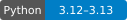
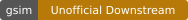
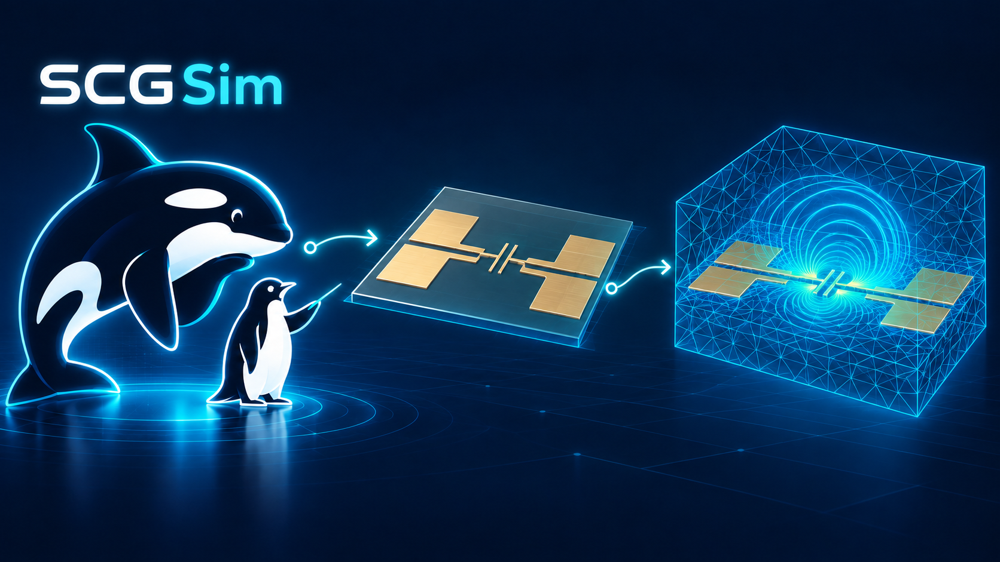

# SCGSim

**Simulate superconducting layouts with Python.**

[](https://github.com/NCUPHY-LTLab/scgsim/blob/develop/LICENSE)
[](docs/start/install.qmd)
[](docs/start/choose-a-simulation.qmd)
[](docs/reference/supported-calculations.qmd)
[](docs/guides/modes-palace.qmd)
[](docs/concepts/geometry.qmd)
[](docs/contribute/goals-and-upstream.qmd)



SCGSim turns a superconducting chip layout, its layer stack and materials, and
the conductors you name into a 3D model, and writes the input of the solver
you choose: the open-source Palace, or Ansys AEDT (HFSS, Q3D, Q2D). When the
run is done, it reads the results back with their units: capacitance matrices,
resonant modes with their frequency, Q and energy participation, S-parameters,
and per-length line parameters.

## Install

Install [uv](https://docs.astral.sh/uv/getting-started/installation/) and Git,
then create a study project with SCGSim `3.0.0` and the OrcaPen SC PDK, the
component library the examples draw their layouts with, each pinned to an exact
revision:

```bash
uv init --python 3.12 scgsim-study
cd scgsim-study
uv add 'scgsim[palace] @ git+https://github.com/NCUPHY-LTLab/scgsim.git@v3.0.0' \
  'orcapen-sc-pdk @ git+https://github.com/NCUPHY-LTLab/orcapen-sc-pdk.git@49e539fd59f3224ecda965d777c7ec3aadcc3b85'
```

The `palace` extra prepares Palace runs. For AEDT, list its extra as well:
`scgsim[palace,aedt]`. [Install SCGSim](docs/start/install.qmd) lists the
extras and what Palace and AEDT need on the computer that runs them.

## Start here

[First simulation](docs/start/first-simulation.qmd) runs one script that
computes the capacitance of a 200 µm square pad in a 20 µm gap with Palace,
on your own computer and without an AEDT licence. It ends by printing:

```text
Capacitance matrix (fF): pad
     pad     112.54
```

## What do you want to compute?

<div id="choose-your-next-simulation"></div>

| What you want to compute | With Palace | With AEDT |
|---|---|---|
| The capacitance matrix of pads and electrodes | [Palace: terminal capacitance](docs/guides/capacitance-palace.qmd) | [AEDT: Q3D extraction](docs/guides/capacitance-q3d.qmd) |
| The frequency, Q and energy participation of resonant modes | [Palace: resonant modes](docs/guides/modes-palace.qmd) | [AEDT: HFSS Eigenmode](docs/guides/modes-hfss.qmd) |
| The S-parameters of a two-port | not in SCGSim | [AEDT: HFSS Driven Terminal](docs/guides/s-parameters-hfss.qmd) |
| The per-length C, G, L and R of a line's cross-section | not in SCGSim | [AEDT: Q2D cross-section extraction](docs/guides/line-parameters-q2d.qmd) |

[Choose a simulation](docs/start/choose-a-simulation.qmd) adds the OrcaPen SC
PDK notebook for each of these. <span id="usage-example-one-script-for-simplepad-capacitance"></span>[AEDT: Q3D extraction](docs/guides/capacitance-q3d.qmd)
opens with the AEDT counterpart of the first simulation: one script that
prepares, runs and reads a Q3D capacitance run.

## Before your own layout

Before you simulate a layout of your own, read the
[supported scope](docs/reference/supported-scope.qmd): what the layout must
guarantee, what SCGSim guarantees in return, and who owns a failure.
