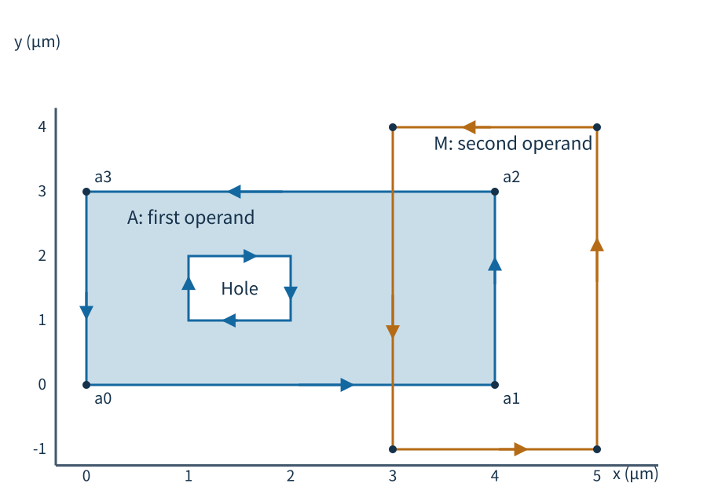
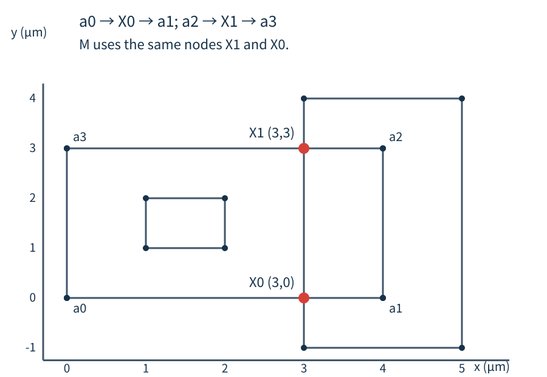
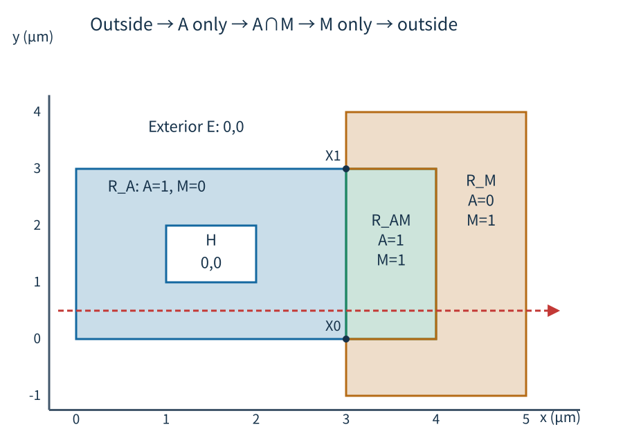
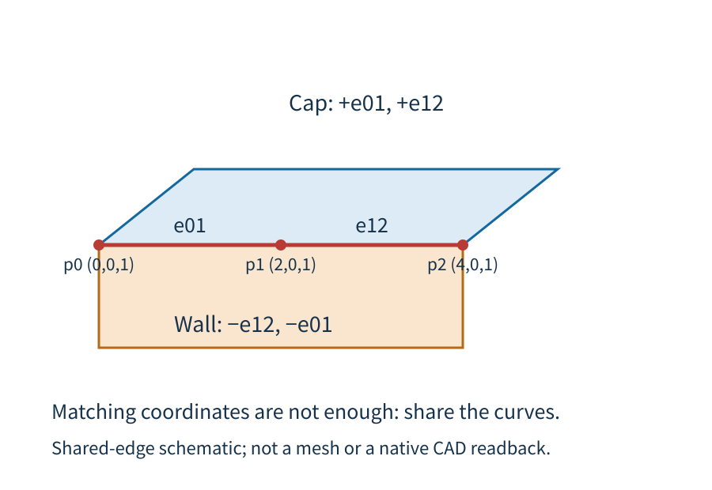

SGB turns a declared layout and process into geometry that a solver backend can build. The key is to preserve **where each shape came from, what occupies it, which Net owns it, and which regions touch** all the way from the source model to CAD.

This page follows one public example with a hole, two Nets, a substrate and vacuum, and an explicitly requested rectangular junction. It explains why each preparation step exists and what it passes to the next step. The worked geometric example stops at CAD construction; it is not a mesh or field-solution result.

::: {.callout-note title="Backend focus: Gmsh and Palace"}
The construction path described here builds CAD with Gmsh/OCC, creates a mesh with Gmsh and supplies it to Palace. AEDT uses the same source meanings where supported, but constructs its project with the native AEDT Modeler; its construction steps therefore differ. See the [physical representation contract](../specs/physical-representation.qmd) and [geometry contract](../geometry-sgb.qmd) for the shared and backend-specific boundaries.
:::

## 1. Start with the facts that define the model {#source-stage}

A layout outline answers “where is the drawn shape?” It does not, by itself, answer “what material is here?”, “which electrical terminal owns it?”, or “what volume touches its upper face?” SGB keeps those answers as explicit source facts so later geometry operations do not have to guess from names or proximity.

### Three sources contribute different facts

A component definition, often authored with GDSFactory, supplies **local geometry and local meaning**. Its polygons and holes describe shape; its component annotations identify source regions and functional selectors such as a port sheet. These declarations stay local to the component. The component itself does not decide the final Net of every placed copy. This public fixture starts from normalized source geometry rather than creating a live GDSFactory component in the documentation; it demonstrates the same source boundary that a component frontend prepares.

A PDK (process design kit) supplies **process meaning**. Its layer stack maps source layers to materials, physical roles, Z intervals and thicknesses, and identifies supporting bodies. This connects a drawn layer to the material that occupies the corresponding place in three dimensions.

The assembly supplies **placement and model-wide decisions**. It identifies each placed component occurrence, applies its translation and rotation, assigns final Nets, declares substrate and vacuum regions, and selects an approximation profile that turns source films into the geometry used by this solve. It may also include an explicit junction request. These facts can span multiple components and therefore belong at assembly level.

| Source | Supplies | Example in this page |
|---|---|---|
| Component | Local polygons, holes, source Entity IDs, and functional selectors | A notched left pad, its hole and a source sheet for the junction |
| PDK | Layer-to-material mapping, physical role, Z interval, thickness and support | A metal film above a Si substrate and surrounded by vacuum |
| Assembly | Occurrence paths and transforms, final Nets, regions, approximation profile and explicit model requests | `chip/left` on Net A, `chip/right` on Net B, `substrate_face`, and a requested rectangular junction |

### Follow one model before looking at its records

The left metal has six exterior corners, one enclosed hole and a notch that opens to the outside. The right metal is a separate piece. The assembly assigns them to Net A and Net B, places them over a Si substrate, and surrounds the modeled bodies with vacuum. @fig-sgb-source shows the left source polygon; @fig-sgb-source-context places both metals in the same assembly frame.

::: {#fig-sgb-source .askr-wide-figure}
```{=html}
<iframe src="../images/sgb-concept/en-source-xy.html" title="Source polygon: six exterior corners and four hole corners" width="100%" height="640" style="border:0;" loading="lazy"></iframe>
```

The left source polygon. P1–P6 mark its exterior and H1–H4 mark the enclosed hole; coordinates are in µm.
:::

The exterior ring closes through P1–P6. The inner ring closes through H1–H4 and encloses an area with no metal. The notch is different: it connects the missing area to the outside.

```text
Outer ring: P1(-2,0) → P2(3,0) → P3(3,1) → P4(2,1)
            → P5(2,2) → P6(-2,2) → back to P1
Hole ring:  H1(-1.5,0.5) → H2(-0.5,0.5) → H3(-0.5,1.5)
            → H4(-1.5,1.5) → back to H1
Units: µm
```

The bounding rectangle is 10 µm². Removing the 1 µm² notch and the 1 µm² hole leaves 8 µm² of source metal. Moving the component changes its assembly position; changing its Net changes an electrical declaration. Neither operation silently edits the local polygon.

::: {#fig-sgb-source-context .askr-wide-figure}
```{=html}
<iframe src="../images/sgb-concept/en-context-xy.html" title="Both metal sources and their assembly position" width="100%" height="640" style="border:0;" loading="lazy"></iframe>
```

Both source metals in the assembly frame, with the substrate and vacuum envelope.
:::

### Why SGB gives source facts names {#entity-occurrence-and-net}

The named object `chip/left` is an **Entity**: a stable source identity that associates a shape with its declared role and material. The substrate and vacuum are Entities too, so “Entity” does not mean “conductor.” A **Net** is the user-declared electrical network assignment for conductors; it does not say that their shapes touch. The assembly maps `chip/left` to Net A and `chip/right` to Net B.

A component placed in the layout is an **occurrence**. Two copies of the same component share local design but have different occurrence paths and transforms. The path lets the prepared model tell which placed pad a selector or contact belongs to after placement. A component-local name alone cannot distinguish two copies.

The preparation step combines these facts into a detached, immutable **snapshot**. The snapshot records the normalized polygons, Entity and occurrence identities, material stack, final Net map, physical-representation request and explicit port or junction declarations. Later edits to the original component do not alter this snapshot; prepare again to capture those edits.

| Term | What it identifies | Why it is kept separate |
|---|---|---|
| Polygon and ring | A local outline, hole and vertex order | Shape does not tell us material or electrical ownership |
| Entity | A named source object and its declared role | It remains the source identity through derived geometry |
| Occurrence | One placed copy, with path and transform | Reused component-local names stay unambiguous |
| Net | The caller's electrical grouping | Geometry contact does not rewrite this declaration |
| Snapshot | One prepared copy of all selected source facts | Downstream steps consume the same fixed input |

::: {.callout-important title="Different Nets do not merge when shapes touch"}
SCGSim preserves the caller's Net assignments. Under the current contact rules, a recognized coplanar face contact or conductor-volume overlap between different Nets stops preparation with a short-circuit error; ordinary edge-only or point-only conductor contacts are rejected too. A same-Net lateral seam in the effective film has a specific accepted case. A shared Net still does not replace geometric contact checks. See the [contact rules in the geometry contract](../geometry-sgb.qmd#component-to-backend-geometry-contract).
:::

::: {.callout-note title="The source DBU and the shared XY grid"}
The GDS database unit (DBU) determines the coordinate step the source can express. For an assembled layout, SGB uses one fixed-precision grid in assembly XY; when `grid_size_um=None`, it takes the actual emitted source DBU. An explicitly different grid is rejected instead of rewriting a shared PDK or global GDSFactory setting. The public example recorded in the [case index](../images/sgb-concept/public-case-binding.json) uses `0.001 µm`, or `1 nm`.

A grid controls how assembled XY boundaries are noded and represented; it does not make every later calculation exact. For example, a segment from $(0,0)$ to $(3,1)$ nm meets $x=1$ nm at $(1,\frac13)$ nm. That intersection is off the 1 nm lattice and must be resolved as part of the shared arrangement. Z, film thickness and finite-element mesh size are separate quantities.
:::

## 2. Interpret source facts as physical geometry {#planning-stage}

The source says what the process contains. Planning answers what geometric representation this solve will build. It applies the selected physical profile, recognizes requested contacts and interfaces, and derives only the additional geometry required by explicit model requests.

### A source film and a solver sheet are different things

In this example, the source metal film occupies $z\in[0,0.25]$ µm. With the `substrate_face` representation, the effective conductor is a zero-thickness sheet attached to the substrate's upper face at $z=0$. The source interval remains a process fact; the sheet is the chosen solver geometry. One does not overwrite the other.

::: {#fig-sgb-physical .askr-wide-figure}
```{=html}
<iframe src="../images/sgb-concept/en-cross-section.html" title="Source film, Si substrate and vacuum; switch to the effective sheet view" width="100%" height="640" style="border:0;" loading="lazy"></iframe>
```

A cross-section through the source and effective model. Use the controls to compare the film with the effective sheet and to reveal the full substrate and vacuum section.
:::

In @fig-sgb-physical, Si occupies $z\in[-2,0]$ µm and the upper vacuum occupies $z\in[0,4.25]$ µm. `lower_air` is the vacuum beside the substrate's lateral faces over $z\in[-2,0]$ µm; there is no vacuum region underneath the substrate in this example. This distinction tells the planner which material borders each side of the conductor sheet.

### A junction changes geometry only when requested

A lumped port provides a surface on which the electromagnetic model can apply a lumped electrical condition. A rectangular junction request names the source sheet and binds its two terminals to exact Entities, occurrences and Nets. It is an explicit request, not a repair inferred from a visible gap.

For this example, planning makes a complete central rectangle between the two terminal supports. The left source has a notch where the requested support must meet it, so planning derives a 1 µm² end region over $[2,3]\times[1,2]$ µm and assigns it to the existing left terminal, Net A. It does not join Net A and Net B. The right end belongs to the right terminal, Net B; the central port remains its own geometry.

::: {#fig-sgb-effective .askr-wide-figure}
```{=html}
<iframe src="../images/sgb-concept/en-effective-xy.html" title="The requested left terminal support fills the notch and keeps its hole" width="100%" height="640" style="border:0;" loading="lazy"></iframe>
```

Effective left terminal support: the original outline is shown for comparison and the orange area is the explicitly derived end support.
:::

The left metal area grows from 8 to 9 µm² because of that explicit request. Its hole remains empty. The seam between original metal and the added support lies inside their union, so it is not a physical exterior edge.

::: {#fig-sgb-effective-port .askr-wide-figure}
```{=html}
<iframe src="../images/sgb-concept/en-port-xy.html" title="Central rectangular port between two separately owned terminal supports" width="100%" height="640" style="border:0;" loading="lazy"></iframe>
```

The complete rectangular port and the metal assigned to each terminal.
:::

For this request, the central rectangle spans $x\in[3,7]$ and $y\in[0,2]$ µm. The planner checks the named source sheet, terminal overlap, source occurrences, Entity owners and Net declarations before building the effective partition. If the request is absent, this terminal completion is absent too.

### One support plane can describe two material interfaces

An interface says which materials meet across a surface. The support plane under the left metal touches Si on one side and vacuum on the other, so planning records separate metal–substrate (MS) and metal–air (MA) interfaces. The substrate–air (SA) boundary is a different interface.

MS and MA may refer to the same planar support geometry, but they keep different field sides and materials. Sharing a shape does not make their later field-energy contributions interchangeable. An outer vacuum wall can have only one adjacent solution volume; it remains a real boundary with its own owner rather than gaining an invented second material.

### Use a shared planar arrangement to determine region membership

Before a planar subdivision operation can create its output faces, it must know where the relevant input polygons overlap and which inputs cover each resulting cell. SGB nodes the boundaries of those operands together and carries each operand's directed edge contribution into the resulting **arrangement** (the network of split edges and enclosed faces). This arrangement is local to that operation's planar inputs. It is not one global overlay of every model surface across different Z heights.

For a small geometric demonstration, let **A** be the rectangle $[0,4]\times[0,3]$ µm with a square hole $[1,2]\times[1,2]$ µm. Let **M** be the rectangle $[3,5]\times[-1,4]$ µm. M is only a second geometry operand: it is not a metal, Net, native Mask setting or new SGB feature. The figures use these same coordinates to show the transition from source rings to split edges, then to faces and their membership.

@fig-sgb-method-source-edges shows the original rings and their direction. The outer ring contributes entry into a polygon; the hole ring contributes the opposite transition. Where A and M boundaries intersect, both rings are split at the same coordinate. That shared split prevents one polygon from retaining a long edge where the other has inserted a T-junction.

{#fig-sgb-method-source-edges}

At $y=0.5$ µm, starting at the unbounded exterior face with membership $(0,0)$, a horizontal path crosses A's left boundary at $x=0$, enters A, then crosses the shared A/M boundaries at $x=3$ and $x=4$, and exits M at $x=5$. Thus the membership evolves as $(0,0)\rightarrow(1,0)\rightarrow(1,1)\rightarrow(0,1)\rightarrow(0,0)$. The first bit records A and the second M. The final transition returns to the unbounded exterior state.

Those crossings are represented by **atomic edges**: segments whose interiors contain no other boundary vertex. The next figure shows the noded edge network. The next step forms faces from this network; it does not yet assign their owners.

{#fig-sgb-method-network}

`polygonize` uses the closed edge network to form candidate faces. Membership comes from a separate propagation step. Each directed ring carries a signed contribution: an outer boundary changes membership from outside to inside, while a hole boundary reverses that change. The planner seeds the unbounded face with $(0,0)$ and propagates these changes across each shared edge into its adjacent face. It repeats the calculation along different paths; if a face gets inconsistent values, or a value is not binary, preparation fails. This makes the result depend on the declared rings and their shared topology rather than a sampled center point.

At $y=1.5$ µm, the path crosses the hole's left edge at $x=1$ and right edge at $x=2$. For A, the bit changes $1\rightarrow0\rightarrow1$: the region inside the outer ring but inside the hole has no A material, and A resumes on the far side. @fig-sgb-method-arrangement summarizes the resulting faces. The hole and unbounded exterior both have membership $(0,0)$, but they are different faces separated by the ring boundaries.

{#fig-sgb-method-arrangement}

| Region | Membership (A, M) | Area |
|---|---:|---:|
| A only | (1, 0) | 8 µm² |
| A and M | (1, 1) | 3 µm² |
| M only | (0, 1) | 7 µm² |
| Hole inside A | (0, 0) | 1 µm² |
| Unbounded exterior | (0, 0) | Unbounded |

The area check follows directly from the coordinates: A's $4\times3$ rectangle has area 12 µm²; its $1\times1$ hole leaves 11 µm². The overlap has width 1 µm and height 3 µm, so its area is 3 µm². Subtracting it from A leaves 8 µm²; subtracting the same overlap from M's $2\times5$ rectangle leaves 7 µm². SGB reconstructs each requested source region from the faces carrying that source's membership.

::: {.callout-note title="This arrangement is geometry bookkeeping, not an FEM mesh"}
The two-dimensional arrangement establishes polygon boundaries, cells and source membership. It does not create tetrahedra and does not decide material, Net or electromagnetic field meaning by itself. Those facts remain attached to the named source and physical plan.
:::

## 3. From shared boundaries to three-dimensional CAD {#construction-stage}

After planar regions, material interfaces and volume boundaries are planned, SGB collects the live surface boundaries that participate in the construction into a three-dimensional topology. Within this boundary set, it creates one Point ID for each shared coordinate and one Curve ID for each shared segment. A T-junction or collinear overlap is split so every incident surface refers to the same atomic curve. This is a canonical boundary model for the planned surfaces, not a planar overlay across unrelated elevations.

Consider three collinear points on a cap: $p_0=(0,0,1)$, $p_1=(2,0,1)$ and $p_2=(4,0,1)$ µm. Call them A, B and C. If the cap initially has the single edge A→C while the neighboring side wall records A→B→C, the cap has a T-junction at B. Canonicalization splits A→C into $e_{01}$ and $e_{12}$. Both surfaces now use those same curve identities; the wall references them in the reverse direction along the shared boundary.

Each surface stores an ordered outer loop and, when present, ordered hole loops. A volume shell then stores oriented references to its bounding surfaces. The order and orientation distinguish the material-facing side of a boundary; adjacent volumes can share the same surface with opposite orientation. These relationships let construction close the intended volumes without guessing from nearby coordinates.

@fig-sgb-method-shared-edge illustrates the split edge. Follow $p_0,p_1,p_2$ along the cap and then compare the signed curve-reference labels on the wall: the curve identities match, while each use records its own direction.

{#fig-sgb-method-shared-edge}

The current topology key rounds each 3D coordinate, in µm, to nine decimal places so planned points can reuse one identity. This is a coordinate identity rule, not the source DBU and not a second XY snap. The XY grid belongs to each relevant planar preparation operation; the canonical key is applied when the planned 3D surface boundaries are collected.

### OCC realizes the plan that SGB already owns

OCC (Open CASCADE) is the CAD kernel exposed through Gmsh. SGB passes it the planned points, lines, loops and surfaces, then uses those surfaces to form closed shells and solution volumes. The plan establishes ownership and adjacency first; CAD construction realizes those records. It does not depend on a global fragment operation to infer which material owns a newly discovered face.

The returned native entity tags can change when CAD is exported and reopened. SCGSim therefore binds native entities to the stable planned surface and volume identities and uses the planned tag records to create named physical groups. A native integer tag is local to that imported model; it is not the enduring identity of a source Entity or surface.

This section explains how the builder consumes a plan: it creates the planned CAD points, curves, loops, surfaces, shells and volumes, then binds exported native entities back to planned identities. The historical XAO view that showed the withdrawn distance-band children is retained on the [historical bands page](../history/sgb-geometric-bands.qmd).

### Meshing uses the built geometry and its own size policy

The Palace mesh-preparation step reads the exported XAO and its physical-group mapping in a fresh Gmsh process. It creates tetrahedra in solution volumes and checks required port-to-volume conformity before producing the mesh input for Palace. The chosen mesh-size policy belongs to this step: it controls element sizing, while the source DBU and assembly XY grid control geometry coordinates. A finer mesh does not repair missing source meaning or change a junction's ownership.

For exact mesh controls, see the [Palace preparation contract](../specs/palace-electrostatic-sgb.qmd#palace-mesh-size-policy).

## 4. Current capability and historical boundary {#distance-bands}

The current SGB path carries source shapes, material/physical interpretation, final Net declarations, explicit port and junction requests, interface ownership, shared planar membership and canonical three-dimensional boundaries into backend construction. Gmsh/Palace and AEDT share those source facts where each backend supports them, while their native construction and execution remain separate.

::: {.callout-warning title="SGB geometric distance bands are withdrawn"}
SCGSim does not currently provide the former geometry-level surface-distance-band producer. Those old partitions and their child CAD surfaces are described for historical context on the [SGB geometric-bands page](../history/sgb-geometric-bands.qmd). Palace's native Mask/Inset setting is a separate solver input: it can select a region during Palace preparation when the chosen executable supports that setting. It does not ask SGB to cut the source geometry into geometric bands. See the [Palace Electrostatic contract](../specs/palace-electrostatic-sgb.qmd#native-mask-inset) for the current native-setting boundary.
:::

Ordinary polygonal outlines remain polygon geometry. Explicitly declared curves use a separate OCC path and have their own route support; see the [curve contract](../geometry-sgb.qmd#source-curves). For the formal source, physical representation and backend contracts, continue to the [SGB geometry contract](../geometry-sgb.qmd).

::: {.callout-note collapse="true" title="Public example source and scope"}
The worked case is the public rectangular-junction and hole fixture in [`tests/test_rectangular_junction_geometry.py`](https://github.com/OrPenStrike/scgsim/blob/2ed85adc/tests/test_rectangular_junction_geometry.py#L230). The [case index](../images/sgb-concept/public-case-binding.json) records its source revision, units, selected profile and figure-stage mapping. The fixture's band and XAO observations belong to the historical design page; this current concept page uses its source, physical and junction views to explain the retained pipeline.
:::
