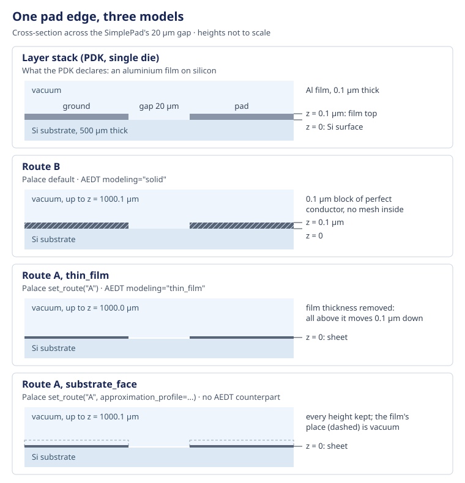

A route is how SCGSim draws your metal in the 3D model. The OrcaPen SC PDK's
single-die stack has a 0.1 µm (100 nm) aluminium film on 500 µm of silicon.
**Route B** keeps that film as a 0.1 µm thick block of perfect conductor.
**Route A** replaces it with a sheet of zero thickness on the silicon surface.
Palace uses Route B unless you call `sim.set_route("A")`. AEDT has no default:
`modeling="solid"` builds the Route B geometry and `modeling="thin_film"` the
Route A one.

## The same pad in both routes {#same-pad}

@fig-routes-cross-section cuts across the 20 µm gap of the
[First simulation](../start/first-simulation.qmd) pad, a 200 µm square pad
inside ground metal on a 1000 µm chip. The levels are the ones SCGSim builds
for that layout with its vacuum region reaching 1000 µm above the chip.

{#fig-routes-cross-section}

| Model | The metal | The vacuum above the chip | Surface-EPR faces of the pad |
|---|---|---|---|
| Route B | A block from z = 0 to 0.1 µm; its surface is a perfect conductor and its inside has no mesh | z = 0 to 1000.1 µm, around and above the metal | MA on the top and the side walls, MS underneath |
| Route A, `thin_film` | A sheet at z = 0 | z = 0 to 1000.0 µm: the film's 0.1 µm is removed and everything above it moves down | One sheet: MA on its upper side (vacuum), MS on its lower side (silicon); no side walls |
| Route A, `substrate_face` | A sheet at z = 0 | z = 0 to 1000.1 µm: every height is kept and the film's place is vacuum | As `thin_film` |

MA, MS and SA, the interfaces where Surface EPR is evaluated, are explained
on [Surface EPR](surface-epr.qmd#interfaces). They are named by the material
next to the metal, so "top" and "upper" in the table hold for this single-die
pad; on the upper die of a flip chip the metal hangs beneath its substrate, and
MS is above it and MA below. Both routes cut the same
Surface-EPR bands: on this pad, 399, 397 and 39,204 µm² for margins of 0.5
and 1 µm.

In both routes the metal is a perfect conductor: neither models the
resistance or the loss of the aluminium.

## Route A profiles {#route-a-profiles}

A sheet has no thickness, so Route A has to decide what happens to the
thickness the film had. That decision is the **approximation profile**.
`set_route("A")` uses `thin_film`; the two other profiles are passed as
`set_route("A", approximation_profile=profile)`.

| Profile | What it does | Single die (Al 0.1 µm on Si) | Flip chip (two dies, 0.1 µm Al on each facing surface, the silicon surfaces 8.2 µm apart) |
|---|---|---|---|
| `thin_film` | Removes the thickness of every film of the stack; what is above a film moves down by its thickness | Sheet at z = 0; the vacuum ends at 1000.0 µm | Sheets at z = 0 and 8.0 µm: the metal surfaces keep their 8.0 µm gap, the dies move 0.2 µm closer |
| `substrate_face` | Puts each named film as a sheet on the substrate face it names and keeps every height | Sheet at z = 0; the vacuum ends at 1000.1 µm | Sheets at z = 0 and 8.2 µm: the dies stay where they are, the sheets are 8.2 µm apart |
| `metal_gap_equivalent` | For exactly two named films on two facing dies: removes their thickness, so the sheets are as far apart as the metal surfaces were | Not available: it needs two facing films | Sheets at z = 0 and 8.0 µm |

The flip-chip numbers are those of the PDK's two-die stack. There
`thin_film` and `metal_gap_equivalent` give the same heights when the layout
uses only those two films; `metal_gap_equivalent` removes only the two films
it names, `thin_film` every film the layout uses.

`substrate_face` and `metal_gap_equivalent` name the films and the surfaces
they sit on. For the single-die stack:

```python
from scgsim.geometry import ApproximationProfile

profile = ApproximationProfile(
    "substrate_face",
    "v1",
    {
        "film_bindings": {
            "orcapen_sc_pdk:D0_TOP_M1": {
                "supporting_entity_id": "D0_SUBSTRATE",
                "supporting_side": "upper",
            }
        }
    },
)
sim.set_route("A", approximation_profile=profile)
```

`"orcapen_sc_pdk:D0_TOP_M1"` is the film's physical-layer ID in the PDK's
stack, and `"upper"` is the top face of the substrate it sits on.
`metal_gap_equivalent` takes two such bindings, one per die. The keys and the
refusals are in the
[physical representation reference](../reference/specs/physical-representation.qmd#palace-caller-profile).

## AEDT: `modeling="solid"` and `"thin_film"` {#aedt-modeling}

HFSS and Q3D import the same SGB model Palace meshes, as a STEP file. Every
AEDT request states its modeling; there is no default.

- `modeling="solid"` keeps each conductor as a solid of the film's thickness
  and makes it a perfect conductor; HFSS does not solve inside it. The guides
  call this model Route C, the name SGB uses for a model that keeps the
  conductor volumes. A perfect-conductor solid and Route B's empty volume with
  a perfect-conductor surface are the same physical model.
- `modeling="thin_film"` is Route A with the `thin_film` profile, the same
  sheets as Palace's `set_route("A")`. HFSS puts a Perfect E boundary on the
  sheets; Q3D makes each sheet a thin conductor of the film's thickness.

| The model you want | Palace | HFSS and Q3D |
|---|---|---|
| Metal with its thickness | Route B: no call, or `set_route("B")` | `modeling="solid"` |
| Metal as sheets, thickness removed | `set_route("A")` | `modeling="thin_film"` |
| Sheets on the substrate faces, heights kept | `set_route("A", approximation_profile=...)` with `substrate_face` | None |
| Facing sheets at the metal-to-metal gap | `set_route("A", approximation_profile=...)` with `metal_gap_equivalent` | None |

## Which to use {#which-route}

- **Start with Route B.** It is Palace's default and keeps the thickness the
  PDK declares.
- **Use Route A when the model you want has zero-thickness sheets**, and pick
  the profile by the distance that must stay as in the stack: `thin_film` keeps
  each sheet where its film meets the substrate and moves what is above,
  `substrate_face` keeps every height, `metal_gap_equivalent` keeps the gap
  between two facing metal surfaces.
- **To compare Palace with HFSS or Q3D, pair the routes:** Palace Route B with
  `modeling="solid"`, Palace `set_route("A")` with `modeling="thin_film"`.
  Each pair builds the same faces and bands from the plan.
- **A route is part of the model, not a mesh setting.** Changing it does not
  repair a mesh that fails, and results on two routes are two models, not one
  model refined. Check a layout on the route you will run:
  `simulation_drc` takes the same `route` and `approximation_profile` as
  `set_route` ([Check a layout](../guides/check-a-layout.qmd)).

For one layout, the two routes have been compared: in a recorded Palace run of
the SimplePad with a 10 nH junction ([run record](https://github.com/NCUPHY-LTLab/scgsim/issues/84#issuecomment-6789403273);
at most two refinement passes, not a converged result), mode 1 came out at
5.135702 GHz on Route B and 5.135740 GHz on Route A (`thin_film`), and the
metal–substrate participation under the pad at 7.741675 × 10⁻⁵ and
7.883729 × 10⁻⁵. That is one pad on coarse meshes, not a rule for other
layouts.
