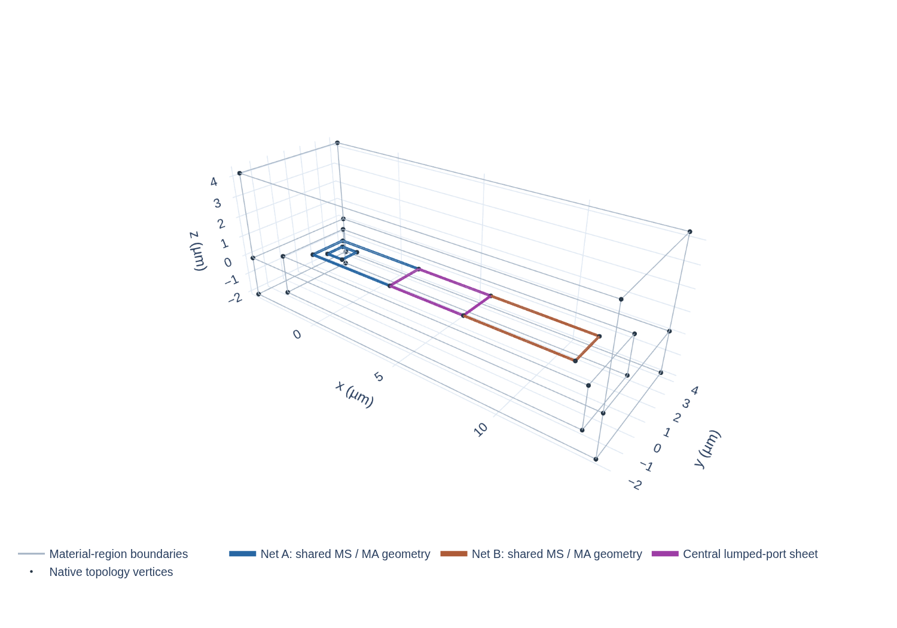

## Purpose

CAD construction and mesh preparation are two different handoffs. CAD records conformal surfaces and volumes with named physical groups. Meshing discretizes the solution volumes into finite elements and checks solver-specific conformity. Keeping the stages separate makes it possible to identify whether a problem is semantic, topological, native-CAD or mesh-related.

## CAD build transaction

The CAD transaction follows the plan rather than deriving a second geometry:

1. **Validate and plan.** `SemanticGeometryBuilder.build()` accepts `GeometryBuildInput`, checks it, selects the construction branch and writes construction records. The planned volume-adjacency conformality check runs before final native volume construction. Polygon construction is mainly data planning at this point; the curved branch has already used OCC during planning to create its shared planar boundary model.
2. **Create or reuse native boundaries.** The polygon branch lowers canonical Point and Curve records, then creates faces from `SurfaceLoopRecord`s. The curved branch instead reads the named curves and faces from its boundary XAO and reuses them while assembling final volumes. Both preserve the planned adjacency and ownership.
3. **Repair and rebind when required.** Surface-first shell creation temporarily uses Gmsh `Geometry.OCCAutoFix=1`, then restores its previous option. The builder prepares one `SurfaceRepairIndex` per model and reuses it to compare each planned wire (boundary loop) and its component edges with repaired faces. Since native tags can change, the complete boundary—not the tag number—maps each repaired face back to one planned surface.
4. **Check the native BRep.** The Gmsh conformality gate checks native geometry against planned volume adjacency. Ambiguous or missing source correspondence fails; area or tag order is not a replacement identity.
5. **Export the mapping.** XAO, physical groups and the plan-to-native tag ledger travel together. The ledger tells the next process which planned face and volume each exported tag represents.

Stage metadata stores timings, object counts and auxiliary mapping-file sizes. Returned native integer tags are backend-local; source Entities, planned Surface IDs and tag names remain the stable semantic identity. When XAO is reopened, backend tags can differ, so the binding ledger travels with the geometry rather than being reconstructed from tag order.

A Gmsh Physical Group is a label consumed by mesh or solver input; it does not join the CAD entities assigned to it. A group can label several geometrically disconnected conductor components when the model criteria allow it, while each planned surface retains its own component and source mapping. See the [geometry contract](../../geometry-sgb.qmd#component-to-backend-geometry-contract) for the precise group semantics.

Construction work grows with planned points, curves, surfaces, shell relationships and native rebinding comparisons. Mesh work grows with solution-volume extent, local element size and conformity constraints. Reporting them separately prevents mesh cost from hiding repeated CAD cost.

::: {#fig-sgb-native-construction}
{width="100%"}



Source-derived three-dimensional construction view. Use the layer controls to inspect boundary, point, wire and surface groups separately.
:::

Use @fig-sgb-native-construction to connect the 2D source outline to its 3D faces: inspect the planar caps, turn on points and wires to see shared topology, then inspect solution volumes. The display groups come from construction records rather than guessed tag order. This is a geometry view, separate from a mesh or field result.

The public notched-pad fixture shown here reads back as 32 points, 46 curves, 22 surfaces and 3 volumes. These are native CAD object counts for this fixture, not a general cost estimate. The [public case binding](../../images/sgb-concept/method-public-case.json) records the case identity and the XAO-to-figure association.

## Mesh preparation

Only after CAD output, mapping and geometry gates succeed does the flow hand off to meshing. Palace mesh preparation opens the exported XAO and physical-group mapping in a fresh Gmsh process, applies the selected initial-size policy, generates tetrahedra in solution volumes, and checks conformity at port surfaces and adjacent volumes. A fresh process keeps mesh generation state separate from CAD construction and makes the exported input the explicit handoff. The output is a mesh input for Palace; it is not the Palace solve, a convergence result or an EPR calculation.

Source DBU and the shared XY coordinate grid set planar geometric precision. Z/thickness describe the physical model, while finite-element mesh size controls element sizing. It does not repair a missing shared curve, assign a material, change the physical profile or merge Nets.

## Output and diagnosis

A successful CAD handoff gives an XAO file, physical-group mapping, source-tag ledger and passing geometry gates. A successful mesh handoff adds a mesh and solver-specific conformity evidence. If CAD construction fails, inspect the last completed planning/native stage; changing mesh size cannot repair an earlier ownership or topology error.

For initial size policies and executable inputs, see the [Palace preparation contract](../../specs/palace-electrostatic-sgb.qmd#palace-mesh-controls-110-candidate).
