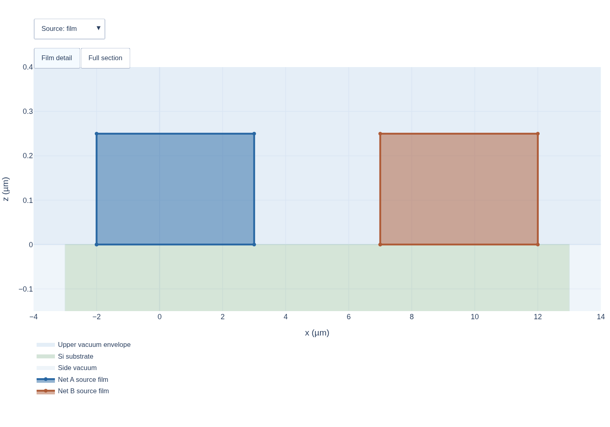

## Purpose {#planning-stage}

The physical-model stage answers a different question from the source stage. A source film records what the process deposited; the selected approximation profile decides which geometry the solver route will use. This decision must be explicit because changing a film into a sheet changes the solve geometry while leaving the source record intact. A rectangular junction request supplies a source rectangle and two terminal bindings. Planning derives the central lumped-port surface (lumped port sheet), where the lumped boundary condition is applied, and completes the metal supports owned by each terminal. The central face is not a metal sheet; this is not a general-purpose gap filler.

## Inputs

The stage receives the normalized source input, selected PDK stack and material declarations, source support/contact facts, and an `ApproximationProfile`. For the running example, the metal film spans $z\in[0,0.25]$ µm, the Si substrate spans $z\in[-2,0]$ µm, and `upper_air` spans $z\in[0,4.25]$ µm. `lower_air` occupies the substrate's side enclosure over the substrate's Z range; it is not a second volume underneath the Si. The chosen `substrate_face` profile binds the effective conductor sheet to the Si top face at $z=0$.

## Approximation profile: a physical choice {#approximation-profile}

An approximation profile is a named physical-model choice that maps source geometry to the geometry used by a solve. It is not a mesh-size setting. In the running example, the process film occupies $z\in[0,0.25]$ µm, while `substrate_face` represents that film by a zero-thickness conductor face on the designated Si top surface at $z=0$.

The profile does not guess the supporting material or face. The source must bind the film to its actual support Entity and identify the relevant side (`lower` or `upper`) when required. If the required support declaration is missing, interpretation fails rather than inferring a binding from a layer name, equal Z coordinates or a drawing.

The profile has a name, revision and parameters. Keep it separate from the solve geometry route: the profile specifies the physical approximation, while the route chooses how the resulting metal is represented and built. Exact fields are in the [physical representation contract](../../specs/physical-representation.qmd).

::: {.callout-note title="Source fact and solver geometry are both retained"}
The source layer still says that a metal film occupies its authored interval. The effective sheet is a separate result of the selected approximation. Keeping both records lets downstream planning use the chosen geometry without rewriting the process source.
:::

## Interpret the physical model

The interpreter validates the selected declarations and profile, then creates an effective stack and a typed physical-representation plan. The plan records source IDs, physical classification, original source Z ranges and post-approximation Z positions/ranges, support points or faces, and enclosure information. `context` is the physical-representation data later planning needs, projected from the plan; it is not a second profile interpreter.

For the film-to-sheet example, the plan maps the finite film interval onto its authored supporting face. The metal's upper side borders air and its support side borders Si. These are distinct metal–air (MA) and metal–substrate (MS) interfaces even though they use one planar support geometry. The substrate–air (SA) interface remains a different surface. The support is not duplicated merely to make two interface records.

A **junction** describes the electrical excitation surface between two explicitly named terminal supports. In the running model, the request specifies the source junction rectangle `[0,10] × [0,2]` µm and the two terminal bindings. Planning derives the central lumped-port surface `[3,7] × [0,2]` µm and completes metal owned by each terminal so each end meets its intended support. The central face applies the lumped boundary condition; it is not a conducting sheet or new metal. On the left, completion fills the `[2,3] × [1,2]` µm notch, increasing metal area from 8 to 9 µm². Without the explicit request, neither the terminal completion nor the central port surface is constructed.

Net assignment and physical contact are different facts. Two touching conductors assigned to different Nets are a short and fail contact validation; SCGSim does not silently merge those Nets. Assigning two non-touching conductors to one Net also does not create a metal bridge: the electrical grouping remains declared, while the requested physical connectivity must still be established by actual geometry or a supported contact record.

## Adjacent volumes and one shared face

Imagine a Si volume below a vacuum volume. Their common planar boundary is one geometric face, referenced once by each volume with opposite orientation. The two volumes remain separate: their material owners and other boundary faces differ. That is why SGB records interfaces and volume references explicitly instead of representing the same plane as two nearby faces.

@fig-sgb-physical shows the source film, substrate, upper air and the selected effective sheet. Use the controls to switch between the source and effective views; the side air occupies the substrate's lateral faces and is not a volume underneath the substrate.

::: {#fig-sgb-physical}
{width="100%"}



Cross-section separating source intervals from the selected effective representation.
:::

## Output and cost

The handoff can be read as five concrete operations:

1. **Keep source facts.** The left and right metal films retain their authored intervals; Si and the air enclosure retain their stack positions. Nothing moves to make a convenient interface.
2. **Select the approximation.** `substrate_face` binds the effective metal sheet to the Si top face at $z=0$. The source film still spans $[0,0.25]$ µm; the effective sheet is a separate representation.
3. **Record both sides.** The selected conductor geometry has a metal–substrate (MS) relationship on the support side and a metal–air (MA) relationship on the field side. They are two physical interface meanings on the same selected planar geometry, not two coincident copies of the sheet.
4. **Complete only requested terminals.** The rectangular junction declaration supplies the source rectangle and two terminal bindings. Planning derives the central lumped-port surface and adds only the metal needed at each terminal end; the center remains a boundary-condition surface, not PEC metal, while Net A and Net B remain distinct.
5. **Pass a typed plan onward.** The result includes effective entities, source/support bindings, interface records and the selected profile context. Planar ownership and boundary construction now use these explicit facts.

The output is the effective source/stack projection plus a physical-representation plan and context for route planning. Its cost depends on validating declarations and building the plan, not on creating CAD. CAD entities do not exist at this handoff. Continue to [planar arrangement](planar-arrangement.qmd), which resolves shared XY ownership before surfaces are built. Exact profile and interface fields are in the [physical representation contract](../../specs/physical-representation.qmd).

### Existing planning-stage link

[Model and numerics](../model-and-numerics.qmd) introduces physical approximations and boundaries; this chapter explains how those choices form effective geometry.
