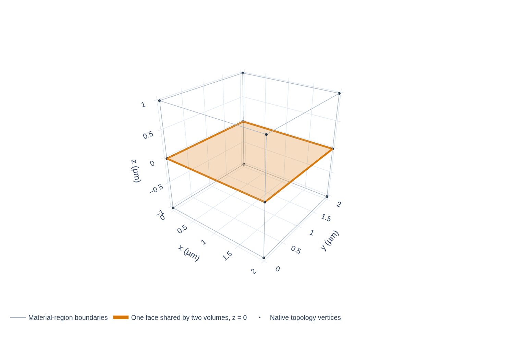

## Purpose {#construction-stage}

Planar faces describe who occupies each region, but a three-dimensional CAD model also needs neighboring surfaces to agree on their exact edges. Shared topology creates one canonical point/curve registry before final volume construction. A vertex that splits one face's edge must split the adjacent face's edge too. In the polygon branch these records guide OCC lowering; in the curved branch the earlier Gmsh arrangement is saved in boundary XAO and reused when final volumes are assembled.

## Inputs

The planner passes live `SurfacePlanRecord`s with an outer loop, optional hole loops, source/Entity ownership, material-interface references, and volume-boundary meaning. Construction-only surfaces are not treated as exported physical faces. Each ring is an ordered sequence of 3D coordinates in µm.

## Split a face interior before registering its edges

Edge T-junction repair only handles points already on a surface boundary. A second case occurs when the same XY support is one tall interface on one side, but is divided into shorter neighboring material regions on the other. The interface must be divided across its face interior first; splitting only its perimeter edges would leave one tall face opposite three separate faces.

Consider a local example with one wall spanning $z=0$ to $3$ µm and three neighboring strips over that exact same XY support. The strips occupy consecutive height intervals:

| Height interval | Tall-wall child | Neighbor strip | Interface result |
|---|---|---|---|
| $z\in[0,1]$ µm | lower child | lower strip | one shared face |
| $z\in[1,2]$ µm | middle child | middle strip | one shared face |
| $z\in[2,3]$ µm | upper child | upper strip | one shared face |

The levels $z=1$ and $z=2$ already exist as boundaries of neighboring regions. Planning uses those levels to split the tall parent face, then matches each child with the corresponding strip so each interface has one shared face. It retains the parent-child links and each face's orientation and material-region ownership. These heights are local teaching values for this example, not the running pad's physical Z dimensions; the example concerns one exact shared XY support and does not imply a global split of all coplanar surfaces.

This face-interior step happens before point and curve canonicalization below. That later pass can then give each child boundary one point/curve identity and split any remaining edge T-junctions; it cannot replace dividing a tall face into the material-aligned interface faces.

## Canonicalize points and edges

The planner first creates a point identity for every boundary coordinate. The coordinate key rounds each 3D coordinate to nine decimal places in µm. This key is a topology identity rule; it is not the source DBU, the assembly XY grid, or a physical tolerance used for material/contact classification. Becoming a shared-topology node does not make different-Net conductors electrically connected; contact has already been checked under its own physical contract.

Next it detects points lying along an existing boundary segment and splits that segment into atomic curves. Use three points $p_0=(0,0,1)$, $p_1=(2,0,1)$ and $p_2=(4,0,1)$ µm. One cap has the long edge $p_0\rightarrow p_2$; the adjacent wall lists $p_0\rightarrow p_1\rightarrow p_2$. The planner recognizes $p_1$ on the cap edge and replaces it with two atomic curves, $e_{01}$ and $e_{12}$. The cap and wall now refer to those same two IDs. This is a T-junction repair: without the split, one surface would end in the middle of its neighbor's unsplit edge.

Each curve has one canonical identity, independent of traversal direction. A `CurveRefRecord` stores the curve ID and a sign. If the cap traverses $p_0\rightarrow p_1$, its label is `+e01`; if the wall traverses the shared segment in reverse, it is `-e01`. The exact sign follows the stored curve direction. Signed labels in the shared-edge figure are references, not arrowheads drawn on the geometry. This keeps geometric sharing and boundary orientation as separate facts.

## Rings, faces and volumes

A `SurfaceLoopRecord` is one ordered edge ring that bounds a surface. Its role is `outer` or `hole`; the lowerer maps this ring to a Gmsh Curve Loop. It is not the Gmsh three-dimensional Surface Loop that bounds a volume. A surface refers to one outer loop and zero or more hole loops. A volume, in turn, refers to surfaces with orientation. The same planar interface can bound two volumes; each volume references that surface in the direction that encloses its own material.

Follow the records into Gmsh: (1) planar ownership cells provide ordered outer and hole boundary rings; (2) ring coordinates map to canonical points; (3) shared and T-junction-split edges map to shared curves, with a signed reference at each use; (4) each ring becomes a Gmsh Curve Loop and each planar region becomes a Gmsh face; (5) the face is mapped to its planned surface; and (6) each volume gathers its bounding faces into a Gmsh Surface Loop, then maps to a volume entity. In the curved branch, curve and face entities already saved in boundary XAO are mapped back by their named groups before the final volumes are assembled. At the Si/vacuum boundary, the face ID is reused on both sides and the two volume references have opposite signs. That is one common interface, not two surfaces separated by a small gap.

::: {#fig-sgb-shared-volumes}
{width="100%"}



Native CAD readback from the small public fixture: two neighboring volumes reuse one interface face with opposite orientation.
:::

In @fig-sgb-shared-volumes, follow the shared face boundary from the same corner on both sides. The geometric face is one object, but its signed reference reverses between the volumes. This is an actual native-CAD readback of a two-volume public fixture: 12 points, 20 curves, 11 surfaces and 2 volumes. It demonstrates the shared-boundary rule; it is not a mesh or field solution. The two material regions share one conformal face without becoming one volume.

## Checks and output

The topology pass checks that each loop closes, each referenced curve exists, shared edges have consistent endpoints, and each surface/volume relation has the required orientation and ownership. It rejects zero-length edges, invalid loops, unrepresented splits and duplicate live surfaces that were not intentionally combined earlier.

The output is planned points, canonical curves, `SurfaceLoopRecord`s and surfaces carrying loop references. These records can be checked before final native volume construction. Work grows with live boundary vertices and segments, plus searching for existing segments that contain each new boundary point. Once built, the registry is reused by adjacent surfaces; construction does not rediscover each edge separately for every face. Exact public record fields are in the [geometry contract](../../geometry-sgb.qmd#source-curves).

Continue to [polygon construction](polygon-construction.qmd) to see how these records become OCC entities.
