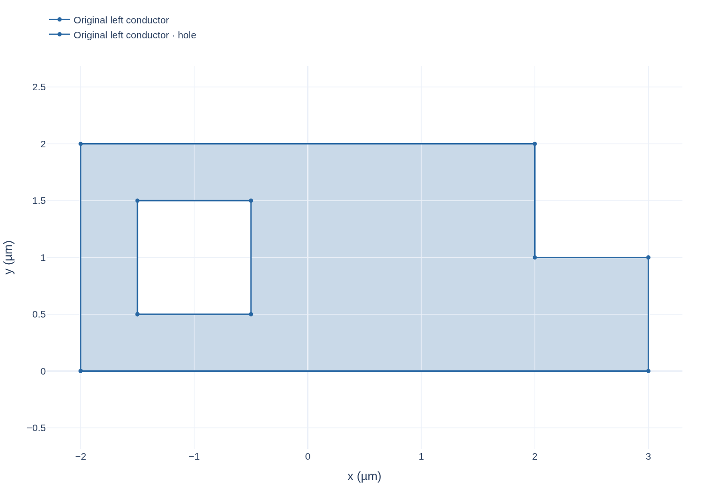
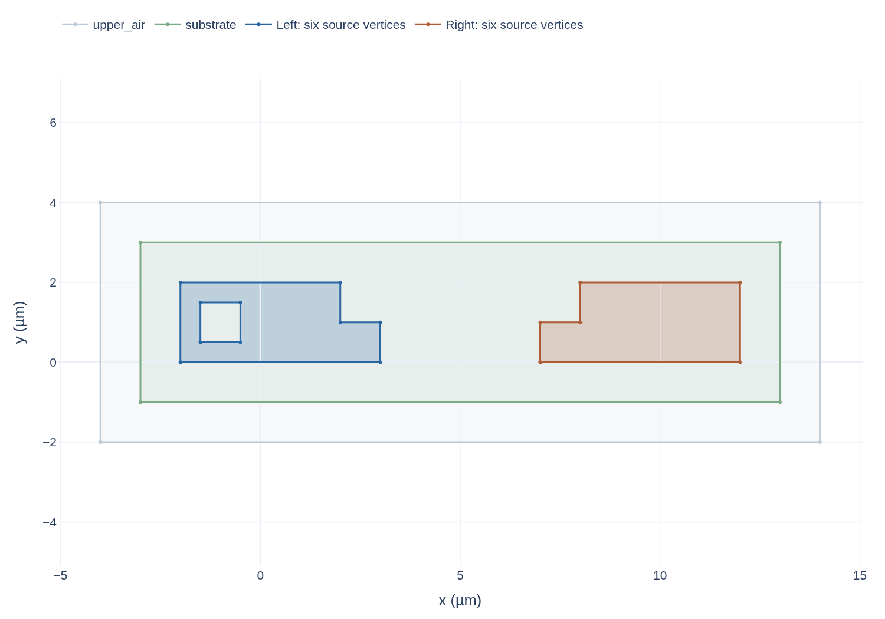

::: {#source-stage .callout-note title="The source stage answers four questions"}
Before SGB divides or builds geometry, identify:

- **Shape origin:** which component defines the local outline.
- **Process data:** which process layer supplies its material identity and Z range.
- **Placement:** which occurrence path and transform place the component.
- **Electrical assignment:** which final Net the assembly author assigns to each placed source object.

These are separate inputs; CAD labels and nearby coordinates do not replace them.
:::

## Three source types and what each provides

Component geometry and annotations
: The component supplies local shape and selection information:

    - **Geometry:** polygon rings define the occupied XY region; an outer ring and hole rings distinguish material from enclosed empty space.
    - **Annotations:** selectors can identify a source region used to locate a port boundary or bind an authored source curve. Their names stay local to the component when it is reused.

PDK process stack and material records
: A PDK (process design kit) describes how drawn layers map to process materials and physical layers:

    - **Layer mapping:** `LayerStack` maps source layers to process layers and links each layer's material identity to a material record.
    - **Height:** the stack provides the Z interval and film thickness.
    - **Physical role and support:** it records the layer's role and any body that supports it.
    - **Material parameters:** the linked material record supplies the material parameters.

    Together, these data say what occupies each region and how it extends through Z. They do not assign the final electrical Net.

Assembly declarations
: The assembly states how source objects are combined for one model:

    - **Placement:** an occurrence path and transform specify where each component copy appears. A path distinguishes repeated placements even when local cell names match.
    - **Electrical and region declarations:** the assembly assigns final Nets to placed source objects and identifies substrate and vacuum regions.
    - **Model choices:** it selects an approximation profile and may request an operation such as a rectangular junction.

    These declarations do not change a component's local polygon or the PDK's material identity.

## Build the running source model

The left source has an exterior notch and one enclosed hole. The notch opens to the exterior; the hole is a separate empty region enclosed by metal. The ordered source coordinates are:

```text
Outer ring (µm):
P1(-2,0) → P2(3,0) → P3(3,1) → P4(2,1) → P5(2,2) → P6(-2,2) → P1

Hole ring (µm):
H1(-1.5,0.5) → H2(-0.5,0.5) → H3(-0.5,1.5) → H4(-1.5,1.5) → H1
```

The outer bounding rectangle has area 10 µm². The 1 µm² notch and 1 µm² enclosed hole leave 8 µm² of source metal.

The right pad is a distinct placed source object. In this fixture both pads belong to the same `chip` component occurrence; `chip/left` and `chip/right` distinguish the two objects inside it. The assembly maps them to Net A and Net B. In a hierarchical design, one reusable component may be placed more than once; then an occurrence-qualified path distinguishes each placement and transform. That general capability is separate from this fixture's two-object example.

@fig-sgb-source shows the source outline and hole. @fig-sgb-source-context shows both placed sources in one assembly frame.

::: {#fig-sgb-source}
{width="100%"}



Source polygon with its exterior and hole rings.
:::

::: {#fig-sgb-source-context}
{width="100%"}



Placed source pads, substrate and vacuum envelope.
:::

## Identity: Entity, occurrence and Net {#entity-occurrence-and-net}

An **Entity** is a named source object that carries role, material association and geometry. A substrate or air region can also be an Entity; Entity does not mean conductor. A **Net** is the assembly author's electrical grouping for conductors. It is a declaration, not a geometric operation. Two polygons that touch do not silently receive the same Net; contact validation checks the shapes separately.

An **occurrence** is one placement of a component in the assembly. If a reusable cell is placed twice, both copies can retain the same local component names, but occurrence-qualified paths distinguish their positions, transforms and selectors. This lets a port or junction request refer to the intended placed object.

The component declares local shapes and selectors; it does not declare a public `Group` of Nets. The assembly assigns final Net membership after each Entity has an occurrence-qualified identity. A conductor component ID identifies a geometrically connected piece of conductor; it is distinct from a GDSFactory Component, a source Entity or a Gmsh Physical Group. A Physical Group is a label for meshing or solver input, not a geometry operation. Several disconnected components may share a mesh label without becoming one connected conductor. The [geometry contract](../../geometry-sgb.qmd#component-to-backend-geometry-contract) defines which components may share that label and how the source mapping is retained.

## Snapshot and grid

`GeometryPlan` gathers these declarations. `prepare()` produces a detached immutable snapshot containing normalized polygons, selected Entities, occurrence records, the material stack, final Net assignments and explicit port or junction declarations. Editing the source component afterwards does not mutate that snapshot; a new preparation captures the edit.

::: {.callout-warning title="Source DBU and the shared XY grid have one explicit relationship"}
DBU means database unit: the smallest coordinate step represented by the emitted GDS. When `grid_size_um=None`, the emitted source DBU supplies the shared assembly-XY grid. An explicitly different XY grid is rejected; SGB does not silently rescale the component or change its source precision. This shared XY coordinate grid sets geometric coordinate precision for planar operations; it is not the finite-element mesh that later divides solution volumes into elements. Z positions, film thickness, mesh size and solver tolerances keep their own units and settings.

Even source vertices on their DBU lattice can produce an off-lattice intersection. For example, the segment from $(0,0)$ to $(3,1)$ nm crosses $x=1$ nm at $(1,1/3)$ nm. A rotation or Boolean intersection can create the same kind of coordinate. The shared-grid step records how those derived XY points are prepared; it does not assert that the original input contains sub-DBU geometry.
:::

The XY example does not set a 1 nm Z increment. Z coordinates remain the physical layer boundaries supplied by the stack.

## Output and cost

The output is the normalized `GeometryBuildInput` carried by a `GeometryPlanSnapshot`, ready for physical interpretation. In the running case, it keeps the original 8 µm² notched-and-holed left pad, the separate right-pad Entity, both Net assignments, the stack and the explicit junction request together. It does not yet contain native CAD faces.

| Step | Intermediate result | Why it exists | Work that grows |
|---|---|---|---|
| 1. Read component semantics | Local polygon rings, holes and selectors | Preserve the authored shape instead of inferring it from later solver tags | Components and ring vertices |
| 2. Expand and place Entities | `chip/left`, `chip/right`, occurrence path `chip`, transformed XY coordinates | Separate local Entity identity from placement identity | Expanded hierarchy and transforms |
| 3. Join PDK facts | Material, physical role, source interval and support Entity | A layer label alone cannot identify the material and volume an interface borders | Stack layers and bindings |
| 4. Assign assembly meaning | Net A/Net B, substrate, air, profile and explicit port/junction requests | Electrical membership and model requests belong to the assembly author | Declared Entities and requests |
| 5. Prepare the snapshot | Detached normalized `GeometryBuildInput` and provenance | Later stages consume one stable input even if the mutable plan changes | Validation and normalized records |

The cost is mainly hierarchy expansion, validation and coordinate normalization. Reusing the snapshot avoids repeating those steps; it does not eliminate later arrangement or native-construction work. Continue to [physical interpretation](physical-model.qmd) to see how the stack and approximation choose the geometry used by the solve.

### Existing source-stage links

The [geometry concept](../geometry.qmd#entities-placements-and-nets) introduces Entities, placements and Nets; this chapter explains how source facts become construction inputs.
