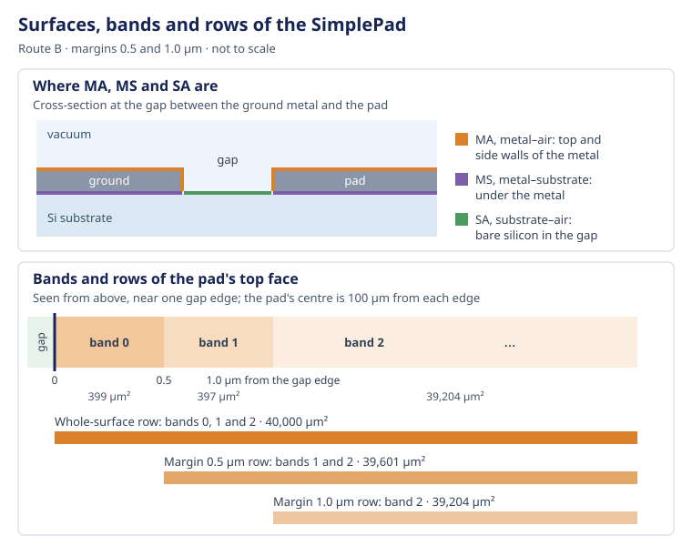

Energy participation (EPR) tells you, for one resonant mode, what fraction of
the mode's electric energy sits in each material, surface and junction.
Multiply a fraction by the loss tangent of what sits there and you get that
channel's contribution to the mode's loss, $1/Q$.

For example, in a recorded Palace run of the
[First simulation](../start/first-simulation.qmd) pad with a 10 nH junction
([run record](https://github.com/NCUPHY-LTLab/scgsim/issues/84#issuecomment-6789403273);
Route B, at most two refinement passes, not a converged result), the metal–substrate
interface under the 200 µm pad held $p = 7.741675\times10^{-5}$ of mode 1's
energy at 5.135702 GHz. With the PDK's literature-central loss tangent for that
interface, $\tan\delta = 4.698936\times10^{-4}$, that is
$1/Q = 3.637764\times10^{-8}$: this one surface alone would limit $Q$ to about
$2.749\times10^{7}$. This page explains each part of that sentence.

The [energy-participation method of Minev et al.](https://arxiv.org/abs/2010.00620)
uses the modes of a linearized Josephson circuit as the input to quantization.
SCGSim computes the electromagnetic participations and loss contributions; it
does not compute a nonlinear Hamiltonian, Kerr coefficients or a qubit
lifetime.

## Three views of a mode {#workflow-and-state-contract}

| View | Energy counted in | What it tells you | SimplePad, mode 1 |
|---|---|---|---|
| Bulk | A dielectric volume of the model | How much of the electric energy is in this material | Si 0.9213201881, vacuum 0.0786798119 |
| Surface | A thin lossy film assumed at an interface | How strongly the field samples that interface | 19 rows between $10^{-9}$ and $10^{-4}$ ([below](#rows)) |
| Junction | A declared linearized circuit element (an inductance on a port) | How the element takes part in the mode | −0.9938724458 (Palace's sign convention) |

The bulk and surface views are not two halves of one energy budget: a surface
value estimates the energy of a film that is not drawn in the model, from the
field at the interface.

## Quantities and normalization {#quantities-and-normalization}

Participation is an energy divided by a reference energy, so it has no unit:

$$
p_i = \frac{U_i}{U_{\mathrm{norm}}}.
$$

Read the numerator and the denominator together. AEDT divides by the electric
energy of the model's physical domains plus the declared junction capacitive
energy; Palace by its own electric-energy and capacitive-energy tables. A
surface-film energy is a numerator only and is never added to these
denominators. The
[surface and junction formulas](../reference/specs/aedt-runtime.qmd#surface-estimates-and-junction-normalization)
define each supported quantity.

The two solvers' junction numbers differ in kind. Palace reports a signed port
participation whose sign follows the mode's phase; AEDT's inductive $p_L$ and
capacitive $p_C$ are nonnegative energy ratios. Do not compare them as
interchangeable numbers. The box around the chip is part of the model too; see
[Mesh and numerics](model-and-numerics.qmd#define-the-physical-model).

## MA, MS and SA {#interfaces}

Surface EPR assumes a thin lossy film at three kinds of interface
(@fig-surface-epr-bands, top):

- **MA, metal–air**: the top of the metal and its side walls, where metal meets
  vacuum. On a Route A sheet, its upper side.
- **MS, metal–substrate**: under the metal, where it meets the substrate. On a
  Route A sheet, its lower side.
- **SA, substrate–air**: the bare substrate, mostly in the gaps between
  conductors.

The film is not drawn in the geometry. You give its thickness, permittivity
and loss tangent per interface type with `plan.set_surface_epr(specs)` before
`plan.prepare()`, and SCGSim estimates the film's energy from the field at the
interface. The PDK ships literature-central presets for the three types; they
are synthetic modeling values from published extractions, not measurements:

| Preset | Thickness | Relative permittivity | Loss tangent |
|---|---|---|---|
| `LiteratureCentral_MA` | 0.002 µm | 10.0 | 0.0033 |
| `LiteratureCentral_MS` | 0.002 µm | 11.4 | 4.698936 × 10⁻⁴ |
| `LiteratureCentral_SA` | 0.002 µm | 6.635 | 0.0017 |

## Surface-EPR rows {#rows}

A **row** is one participation value per mode for one surface: an interface
type on the faces of one Entity, of one kind (top, bottom, side wall, sheet or
interface). Its name says which, for example `MS::chip/PAD__bottom` for the
metal–substrate interface under the pad. These are the SimplePad's
whole-surface rows of the pad and of the substrate's surface, from the run
above:

| Row | Where | Participation | $1/Q$ with the preset |
|---|---|---|---|
| `MA::chip/PAD__top` | Top of the pad | 5.884456 × 10⁻⁷ | 1.941871 × 10⁻⁹ |
| `MA::chip/PAD__sidewall` | Side walls of the pad | 1.645220 × 10⁻⁷ | 5.429225 × 10⁻¹⁰ |
| `MS::chip/PAD__bottom` | Under the pad | 7.741675 × 10⁻⁵ | 3.637764 × 10⁻⁸ |
| `SA::…__interface` | Bare substrate at z = 0, the 20 µm gap around the pad | 8.013336 × 10⁻⁵ | 1.362267 × 10⁻⁷ |

The SA row's full name is `SA::D0_SUBSTRATE|VACUUM_REGION__interface`: the
interface between the Entities `D0_SUBSTRATE` and `VACUUM_REGION`. The ground
metal has its own rows, and Route A has `__sheet` rows instead of
top and bottom. Palace and AEDT evaluate every row of the types you request,
side walls included; a spec's `face_kinds` limits a type to some kinds of face.

## Inset bands and margin rows {#surface-distance-band-correction}

The field of a mode is strongest at the edges of the gaps, and the strip of a
surface right at an edge holds a large share of that surface's participation.
In the run above, the 0.5 µm strip along the pad's edges is 1 % of the area
under the pad but holds 29 % of its MS participation. That strip is also where
the number depends most on the mesh: in a recorded refinement study of the same
pad, the whole-surface MS participation grew at every pass, and the growth was
in the strip within 1 µm of the gap edges
([the numbers](model-and-numerics.qmd#refinement)). An **inset margin** lets
you read the surface without that strip.

A **gap edge** is an edge of a conductor that faces bare substrate. An inset
margin $m$ selects the part of a surface at least $m$ µm from the nearest gap
edge. SGB, SCGSim's geometry builder, cuts the surface into **bands** at the
margins you give, so the solver integrates ordinary faces. With margins of
0.5 and 1 µm, the pad's top face gets three bands (@fig-surface-epr-bands,
bottom):

{#fig-surface-epr-bands}

| Band | Distance from the gap edge | Area on the pad's top face |
|---|---|---|
| 0 | 0 to 0.5 µm | 399 µm² |
| 1 | 0.5 to 1 µm | 397 µm² |
| 2 | more than 1 µm | 39,204 µm² |

Each margin adds a **margin row** next to the whole-surface row. The rows
overlap: each covers the bands from its margin inward.

| Row of `MS::chip/PAD__bottom` | Bands | Area | Participation in the run above |
|---|---|---|---|
| Whole surface | 0, 1, 2 | 40,000 µm² | 7.741675 × 10⁻⁵ |
| Margin 0.5 µm | 1, 2 | 39,601 µm² | 5.497995 × 10⁻⁵ |
| Margin 1 µm | 2 | 39,204 µm² | 4.616724 × 10⁻⁵ |

**Do not add the rows of one surface.** They are three readings of the same
surface, not three pieces of it: their sum would count band 2 three times. The
difference of two rows is the part between their margins, here
7.741675 × 10⁻⁵ − 5.497995 × 10⁻⁵ = 2.24368 × 10⁻⁵ in band 0. Rows of
different surfaces, such as the top and the bottom of the pad, do not overlap.

Distance counts only from gap edges: the die edge, an edge where two conductors
touch and an edge with only vacuum beside it are not gap edges. A face with no
gap edge, such as the underside of the substrate, gets no bands and only its
whole-surface row. Sidewalls are never banded.

The same rule on a smaller example: the left metal of
[How a layout becomes a model](geometry.qmd), with its hole, banded at 0.125
and 0.25 µm. The hole exposes the substrate, so its edges are gap edges too and
bands also form around it.

::: {#fig-surface-epr-planned-bands .askr-wide-figure}
```{=html}
<iframe src="../images/sgb-concept/en-planned-bands.html" title="Bands of the left metal at 0.125 and 0.25 µm from its gap edges, around the outside and the hole" width="100%" height="640" style="border:0;" loading="lazy"></iframe>
```

The bands SGB plans on the left metal: within 0.125 µm of a gap edge, from
0.125 to 0.25 µm, and beyond 0.25 µm. Their areas add up to the metal's 9 µm².
:::

::: {#fig-surface-epr-native-bands .askr-wide-figure}
```{=html}
<iframe src="../images/sgb-concept/en-native-bands-3d.html" title="Band boundary curves of the built 3D model" width="100%" height="640" style="border:0;" loading="lazy"></iframe>
```

The same bands in the built 3D model: the band boundaries are curves of the
model, so the mesh follows them.
:::

To request margins, add `inset_margins_um` to a spec, as the
[Palace modes guide](../guides/modes-palace.qmd#surface-epr-margin-rows) shows.
The keys, the limits and the row names are in the
[margin reference](../reference/specs/palace-eigenmode.qmd#surface-epr-margins);
the rules a layout must follow for bands are in
[Supported scope](../reference/supported-scope.qmd#rules-margins).

## From participation to loss {#surface-identity-masks-and-loss-assumptions}

For a dielectric with a known loss tangent, its contribution to the mode's
loss is

$$
Q_i^{-1} = p_i\tan\delta_i.
$$

For the SimplePad's mode 1 and the PDK's literature-central presets:

| Row | $p$ | $\tan\delta$ | $1/Q = p\tan\delta$ | $Q$ from this surface alone |
|---|---|---|---|---|
| `MA::chip/PAD__top` | 5.884456 × 10⁻⁷ | 0.0033 | 1.941871 × 10⁻⁹ | 5.150 × 10⁸ |
| `MS::chip/PAD__bottom` | 7.741675 × 10⁻⁵ | 4.698936 × 10⁻⁴ | 3.637764 × 10⁻⁸ | 2.749 × 10⁷ |
| `SA::…__interface` | 8.013336 × 10⁻⁵ | 0.0017 | 1.362267 × 10⁻⁷ | 7.341 × 10⁶ |

Both factors matter. Here the substrate–air row has about the participation of
the metal–substrate row under the pad, but a loss tangent 3.6 times larger, so
it contributes 3.7 times more $1/Q$. The film's thickness, permittivity and
loss tangent are your assumptions, not facts the layout determines.

Contributions of different surfaces add up to a known-loss subtotal. That
subtotal covers only the surfaces you evaluated with a known loss tangent; it
is not the device's total $Q$ or $T_1$ and leaves out every mechanism you did
not model. A loss tangent of exactly zero is a known zero contribution. A loss
tangent you did not give is unknown, so that surface's $1/Q$ stays unavailable
even when its participation is known; likewise, energy that was not computed is
not zero energy.

The solver's own $Q$ answers a different question: it reflects the losses the
solver itself modeled, while $p\tan\delta$ attributes loss to the film model
you chose. Palace can report an infinite native $Q$ without that making the
device lossless; see the
[native Q reference](../reference/specs/palace-eigenmode.qmd#native-eigenmode-q).

## Explore a result {#explore-a-result}

Run a resonance and EPR notebook from
[Choose a simulation](../start/choose-a-simulation.qmd#getting-started), then
use [Offline loss analysis](../guides/offline-loss.qmd) to change the loss
assumptions of a recorded result without solving again. The
[report reference](../reference/specs/report-model.qmd#eigenmode-epr-presentation)
describes how a result shows whole-surface, margin and unavailable values.
