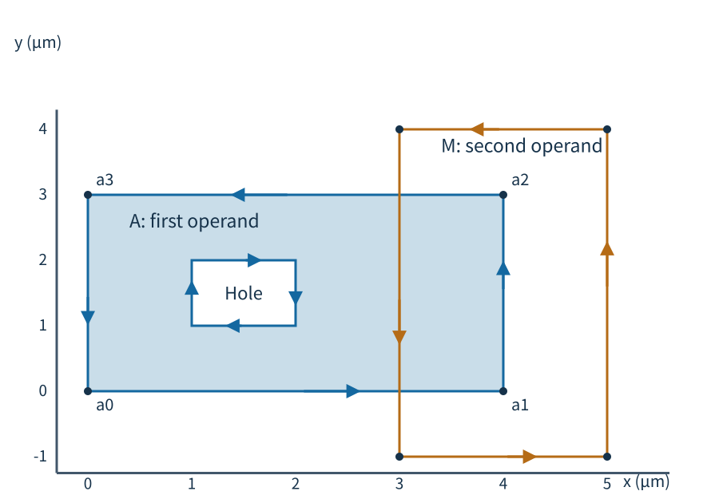
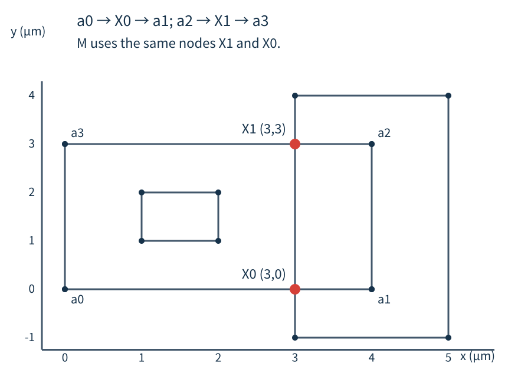
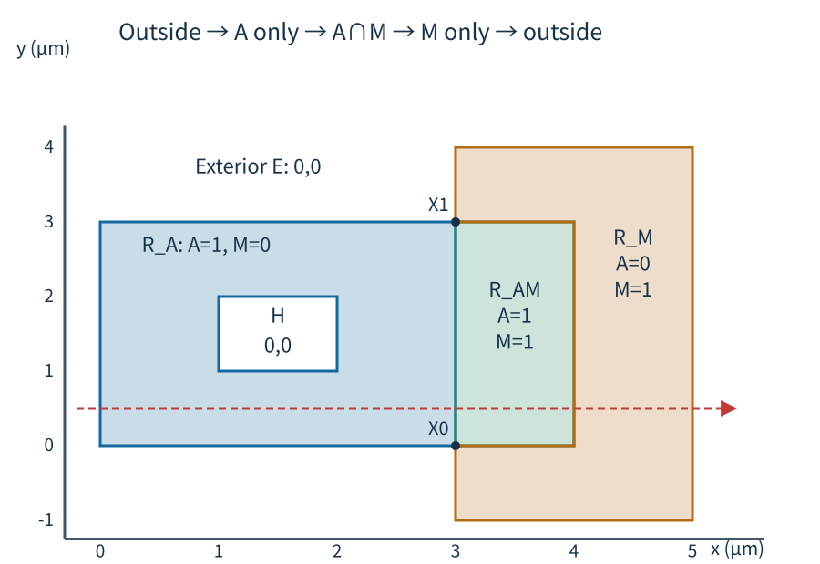
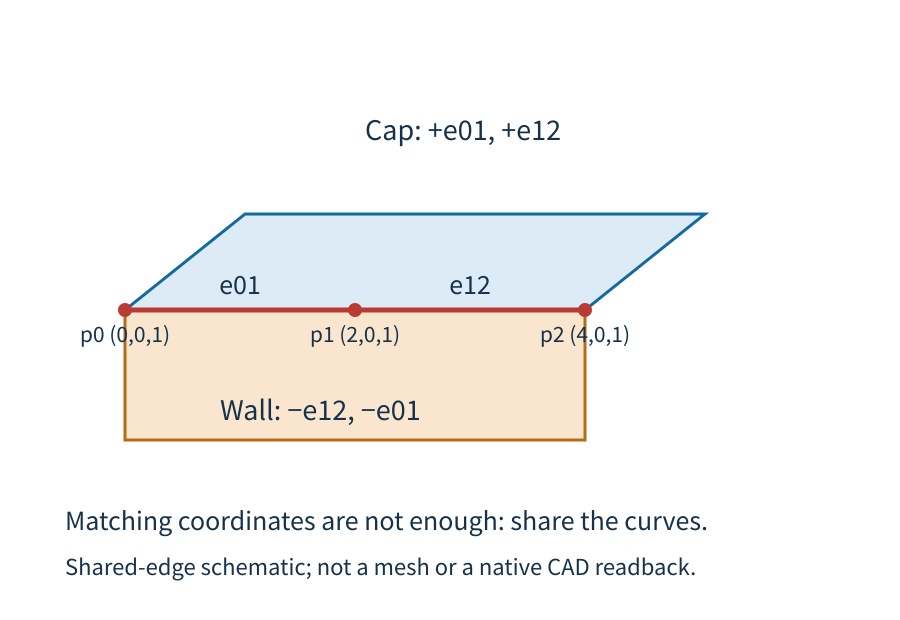

This page is for contributors. It continues
[How a layout becomes a model](../../concepts/geometry.qmd) where that page
stops: how SGB, the semantic geometry builder in `src/scgsim/geometry/sgb`,
turns the prepared input into a conformal 3D model, writes it, and how the
model is meshed. The package docstring of `scgsim.geometry.sgb` lists the
stages in import order, and the [code map](../code-map.qmd) places them in the
whole package.

## The stages {#stages}

SGB builds the model from prisms, a planar footprint extruded over a Z
interval, before any CAD kernel is involved. `build_sgb_geometry` is the entry;
`scgsim.geometry.surface_epr.build_banded_geometry` calls it with the
Surface-EPR bands the specs ask for.

| Stage | Folder | In | Out |
|---|---|---|---|
| S2 | `prisms` | The effective `GeometryBuildInput` and `RepresentationContext` | Prisms, Z levels and slabs |
| S3 | `bands` | Inset requests, measured on a first pass over the physical prisms alone | The cut families of the bands |
| S4, S5 | `arrangement` | Prisms and cut families | Per slab and per level: the planar arrangement, noded on the grid, its cells labelled and dissolved |
| S6 to S8 | `topology` | The labelled arrangements | Vertices, edges, faces, walls, volumes and shells; then, per route, the emitted volumes and the physical groups |
| S9 | `checks` | The routed model | Structural validation (fails closed) and the sliver report |
| S10 | `output` | The validated model | BREP and XAO, the sidecar, and the STEP for AEDT |

## Planar arrangements and membership {#planar-arrangement}

Before a planar operation can make its output faces, it must know where its
input polygons overlap and which inputs cover each resulting cell. The
operands' boundaries are split at every crossing on the model grid into a
network of edges, the **arrangement**, and each cell of that network gets its
**membership**: which operands cover it.

A worked example: let **A** be the rectangle $[0,4]\times[0,3]$ µm with a
square hole $[1,2]\times[1,2]$ µm, and **M** the rectangle
$[3,5]\times[-1,4]$ µm. M is only a second operand, not a metal or a Net.
@fig-sgb-method-source-edges shows the rings and their direction: an outer
ring enters its polygon, a hole ring leaves it. Where the A and M boundaries
cross, both are split at the same point, so neither keeps a long edge where the
other has a vertex (a T-junction).

{#fig-sgb-method-source-edges}

Along $y=0.5$ µm, starting in the unbounded outside with membership $(0,0)$, a
path crosses A's left edge at $x=0$, M's left edge at $x=3$, A's right edge at
$x=4$ and M's right edge at $x=5$: the membership goes
$(0,0)\rightarrow(1,0)\rightarrow(1,1)\rightarrow(0,1)\rightarrow(0,0)$, the
first bit for A, the second for M. The split edges are **atomic**: no other
boundary vertex lies inside them (@fig-sgb-method-network).

{#fig-sgb-method-network}

Along $y=1.5$ µm the path crosses the hole at $x=1$ and $x=2$, and A's bit goes
$1\rightarrow0\rightarrow1$. @fig-sgb-method-arrangement shows the cells. The
hole and the unbounded outside both have membership $(0,0)$ but are different
cells.

{#fig-sgb-method-arrangement}

| Cell | Membership (A, M) | Area |
|---|---:|---:|
| A only | (1, 0) | 8 µm² |
| A and M | (1, 1) | 3 µm² |
| M only | (0, 1) | 7 µm² |
| Hole inside A | (0, 0) | 1 µm² |
| Unbounded outside | (0, 0) | unbounded |

The areas follow from the coordinates: A is $4\times3=12$ µm², 11 µm² without
its hole; the overlap is $1\times3=3$ µm², which leaves 8 µm² of A and
$2\times5-3=7$ µm² of M.

SCGSim builds such arrangements in two places, which decide membership
differently:

- **Source stage and grid Booleans** (`scgsim.geometry.grid`): the operands are
  noded on the model grid with GEOS and the atomic edges polygonized. Each
  directed ring edge carries a signed change of its operand's count, and
  membership is propagated from the unbounded cell across every shared edge
  (`tagged_grid_faces`). A cell reached with two different memberships, or with
  a count other than 0 or 1, is refused.
- **The build** (`scgsim.geometry.sgb.arrangement`): the curves of every slab
  and level are noded by iterated snap rounding on the integer grid
  (`noding`) into a half-edge structure with faces, holes and exact arc edges
  (`dcel`, `arcs`). After noding, each cell lies wholly inside or outside every
  footprint, so its label comes from one exact point strictly inside it
  (`dcel.interior_point`), tested against the footprints. Cells with equal
  labels are dissolved, and `labelling.membership` records each Entity's share
  of a cell's area from the raw cells, in integer arithmetic.

An arrangement is geometry bookkeeping: it makes no tetrahedra and decides no
material, Net or field. Those stay attached to the declared Entities and the
physical plan.

## Shared boundaries in 3D {#shared-boundaries}

`topology.assembly` stacks the level and slab arrangements into one boundary
representation without a CAD kernel: the vertices and edges of the level
arrangements, horizontal faces where the domains below and above differ or a
sheet lies, one wall face per run of stacked slab edges, and volumes as
connected slab cells. A wall column is cut only at the levels where a wall run
starts or ends or a horizontal face has a vertex, so neighbouring faces share
whole edges.

Three collinear points on a cap, $p_0=(0,0,1)$, $p_1=(2,0,1)$ and
$p_2=(4,0,1)$ µm, show why. If the cap had one edge $p_0\rightarrow p_2$ while
the wall beside it had $p_0\rightarrow p_1\rightarrow p_2$, the cap would have
a T-junction at $p_1$. Splitting the cap's edge gives both faces the edges
$e_{01}$ and $e_{12}$; the wall uses them in the opposite direction
(@fig-sgb-method-shared-edge).

{#fig-sgb-method-shared-edge}

Each face stores an ordered outer loop and its hole loops; each volume's shells
list its faces with their orientation, and two adjacent volumes use their
shared face with opposite orientations. Every vertex, edge, face and volume has
a content-addressed ID (`v:…`, `e:…`, `f:…`, `vol:…`). XY coordinates lie on the
integer grid of the model's step, so equal points are one vertex exactly, with
no second snap; Z values are the exact levels of the stack. This topology does
not depend on the route: `topology.routes` decides afterwards which volumes are
emitted and which physical group each face joins.

## Writing the model {#writer}

`output.emission` writes the validated model straight to OpenCASCADE's text
format (BREP) and its XAO wrapper, with no Gmsh or OCC call, no Boolean and no
healing; the bytes are deterministic. It numbers the shapes in
`TopExp::MapShapes` pre-order, the order in which Gmsh tags them when it opens
the file. The **sidecar** (`scgsim.sgb.sidecar.v5`, JSON) binds each of those
native tags to its planned ID, and through it to its Entity, Net, interface,
band and physical group. A native tag is valid only within one loaded model;
the planned ID is the identity.

For AEDT, `output.exchange.step` writes the emitted solids as a STEP assembly,
one named component per solid, without the vacuum (AEDT makes its own Region).
Sheets and port faces that no solid carries cannot travel in STEP at this
scale, so a guard file records their loops and the importer rebuilds them. A
Route B model has no conductor solids and is not exported; AEDT builds the
Route C model of the same input instead.

## Meshing {#meshing}

Palace's `mesh()` meshes the XAO with its sidecar through `scgsim.meshing`.
The recipe sets the initial element sizes (`FeatureRecipe()` by default). Each
round meshes in a fresh Gmsh worker process and audits the linear mesh against
the quality threshold; every element below it gets a finer local size in a ball
around it, and the next round meshes again. The loop stops when the mesh is
clean, or when a budget ends it (rounds, tetrahedra, time, or a bad count that
no longer falls), and `mesh()` then raises `MeshRepairError`. A higher geometry
order is raised after the round that passes. That loop runs for every recipe
but one: `GmshDefaultRecipe()` is report-only (`scgsim.meshing.entry`). It
meshes once with Gmsh's own sizes and no repair, delivers the mesh whatever its
quality, and its report records the elements below the threshold with
`stop="report_only"`; the tetrahedron and time budgets and the order elevation
still apply. Palace's attributes are lowered
from the sidecar's physical groups (`palace.mesh.physical_groups`). The
controls are in the
[Palace mesh reference](../../reference/specs/palace-electrostatic-sgb.qmd#palace-mesh-controls).
