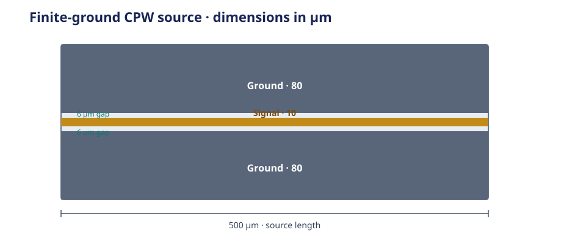

Every 3D AEDT family (HFSS Eigenmode, HFSS Driven Terminal and Q3D) solves the
SGB model of a `GeometryPlan` snapshot, the same model Palace meshes. This page
prepares that snapshot for the public finite-ground CPW, after
[installation](installation.qmd). Q2D solves a 2D cross section and has its own
[cross-section lesson](aedt-q2d.qmd).

The CPW is OrPen's `finite_ground_cpw_coupon`, from the
[pinned CPW group](../examples.qmd#public-inputs): 500 µm long, a 10 µm signal,
6 µm gaps and two 80 µm grounds on the D0 substrate. These are example design
inputs, not measured device geometry or universal solver settings. The PDK
supplies the polygons, their Entities (`SIGNAL`, `GROUND_PLUS`,
`GROUND_MINUS`), the single-die layer stack (a 500 µm Si substrate under the
100 nm Al `D0_TOP_M1` film) and the material records; SCGSim keeps no second
copy of those facts.

{#fig-public-cpw-source}

## Make the CPW plan

```python
import orcapen_sc_pdk
from orcapen_sc_pdk import get_material_records
from orcapen_sc_pdk.cells import finite_ground_cpw_coupon
from orcapen_sc_pdk.tech import get_single_die_layer_stack
from scgsim.geometry import GeometryPlan

orcapen_sc_pdk.activate()
plan = GeometryPlan(
    finite_ground_cpw_coupon(),
    root_id="chip",
    layer_stack=get_single_die_layer_stack(),
    material_records=get_material_records(),
    coupon_padding_um=0.0,
)
plan.set_nets({
    "signal": ("chip/SIGNAL",),
    "ground": ("chip/GROUND_PLUS", "chip/GROUND_MINUS"),
})
plan.set_vacuum_region(padding=(100.0, 100.0, 1000.0))
snapshot = plan.prepare()
```

What each call fixes:

- `root_id="chip"` scopes the coupon's Entity IDs, so the signal is
  `chip/SIGNAL`. The Net map names those qualified IDs; it is the study's
  choice, not the PDK's.
- `get_single_die_layer_stack()` selects the D0 substrate and top metal only:
  there is no upper die. `coupon_padding_um=0.0` keeps the substrate the
  coupon's own 500 µm × 182 µm area.
- `set_vacuum_region(padding=(x, y, z))` sets the Region around the model:
  100 µm on each side in X and Y, 1000 µm above and below. Every AEDT family
  uses this Region as it is; no family adds its own padding.
- `plan.prepare()` returns an immutable `snapshot`: `snapshot.geometry_input`
  holds the qualified Entities and polygons, and `snapshot.stack` the detached
  stack. Preparing it establishes source identity; it does not build the model
  or open AEDT.

Keep `snapshot` in this session. Continue to [HFSS Eigenmode](aedt-eigenmode.qmd)
or [Q3D](aedt-q3d.qmd), which take it directly. [Driven Terminal](aedt-driven-terminal.qmd)
needs a layout that also carries a lumped-port sheet at each port; this coupon
has none. The canonical OrPen notebooks are the source authority for their
consumer workflow; this lesson authors no component notebook.
