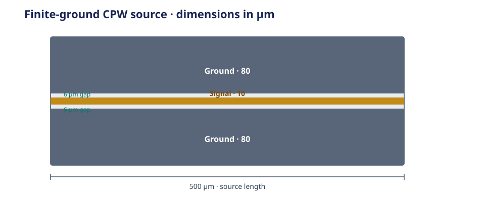

This page builds the plan of a short piece of coplanar waveguide (CPW), a
coupon: a 500 µm long, 10 µm wide signal strip between two 80 µm ground
strips, 6 µm away on each side, in 100 nm aluminium on a 500 µm silicon
substrate. Its result, `snapshot`, is the input of
[Resonant modes with HFSS](modes-hfss.qmd), and the HFSS, Q3D and Palace
simulations all take a plan's `snapshot` the same way.

For S-parameters this coupon is not enough: HFSS Driven Terminal needs a
port sheet at each port, and this coupon has none
([S-parameters with HFSS](s-parameters-hfss.qmd)). For the line's
per-length capacitance and inductance, Q2D takes a cross-section instead
([Line parameters with Q2D](line-parameters-q2d.qmd)).

{#fig-public-cpw-source}

## Make the CPW plan

```python
import orcapen_sc_pdk
from orcapen_sc_pdk import get_material_records
from orcapen_sc_pdk.cells import finite_ground_cpw_coupon
from orcapen_sc_pdk.tech import get_single_die_layer_stack
from scgsim.geometry import GeometryPlan

orcapen_sc_pdk.activate()
plan = GeometryPlan(
    finite_ground_cpw_coupon(),
    root_id="chip",
    layer_stack=get_single_die_layer_stack(),
    material_records=get_material_records(),
    coupon_padding_um=0.0,
)
plan.set_nets({
    "signal": ("chip/SIGNAL",),
    "ground": ("chip/GROUND_PLUS", "chip/GROUND_MINUS"),
})
plan.set_vacuum_region(padding=(100.0, 100.0, 1000.0))
snapshot = plan.prepare()
```

It needs SCGSim with its `aedt-epr` extra and the OrcaPen SC PDK
([Install SCGSim](../start/install.qmd#extras)); it does not need AEDT.

What each line fixes:

- `finite_ground_cpw_coupon()` is the PDK cell, at its default sizes. The PDK
  names its three metal shapes `SIGNAL`, `GROUND_PLUS` and `GROUND_MINUS`;
  each is an Entity, a named shape SCGSim keeps track of.
- `root_id="chip"` puts the layout under the name `chip`, so the shapes are
  `chip/SIGNAL` and so on.
- `get_single_die_layer_stack()` is one chip: the silicon substrate and the
  aluminium film `D0_TOP_M1` on it, with no second chip above.
  `coupon_padding_um=0.0` adds no substrate beyond the coupon's own
  500 µm × 182 µm.
- `set_nets` groups the Entities into Nets, each a named piece of metal that
  acts as one conductor: `signal`, and `ground` made of both ground strips.
  The grouping is your choice, not the PDK's.
- `set_vacuum_region(padding=(x, y, z))` sets the box of empty space around
  the model: 100 µm beyond the coupon on each side in x and in y, and 1000 µm
  above and below it. HFSS and Q3D use this box as their Region, as it is.
- `plan.prepare()` returns the `snapshot`, a fixed copy of the plan that a
  simulation takes. It builds no model and does not open AEDT.

Keep `snapshot` in the same Python session and continue with
[Resonant modes with HFSS](modes-hfss.qmd).
[Capacitance with Q3D](capacitance-q3d.qmd) takes a snapshot the same way, and
[Prepare a layout](prepare-a-layout.qmd) explains the plan for a layout of
your own.
