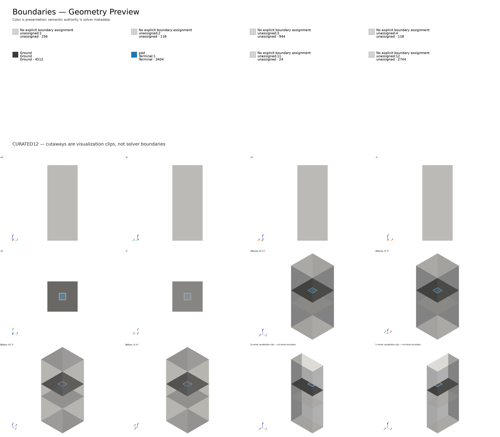

After `mesh()`, you can look at the model the solver will actually get: the
material of each region, which surfaces are terminals and ground, where the
Surface-EPR bands lie, and the mesh with its quality. Look when a result
surprises you, or before a long run, to see that the model is the one you
meant. It is optional: nothing here changes the run. It needs the
`visualization` extra ([Install](../start/install.qmd#extras)).

## Palace {#palace-inspect-the-mesh-that-will-be-transferred}

After `sim.mesh()` and `sim.write_config()`, open the run folder:

```python
from scgsim.visualization import inspect_palace_geometry

preview = inspect_palace_geometry(sim.output_dir)
preview.show_materials()
preview.show_boundaries()
preview.show_surface_epr()
preview.show_mesh()
```

Each call shows a sheet of 12 views of the model with a legend, read from the
mesh and Palace's input file, and saves it in the run folder. This is the
boundaries sheet of the square pad of
[Convergence and reports](convergence-and-reports.qmd): the ground metal is
charcoal, the pad, the terminal, is blue, and the unassigned outer faces are
light gray.



That run asked for no Surface EPR, so `show_surface_epr()` reported the mode as
unavailable instead of drawing an empty picture. `preview.explore("materials")`
shows the same model in an interactive 3D view in the notebook. What each mode
draws, and its colors, are in [Preview the geometry](preview-the-geometry.qmd).

`sim.mesh_summary()` returns the record of the mesh: the sizing recipe, the
mesher's options, the quality threshold and the result, and the element counts
of each region. The benchmark view of a resolved run shows the same record.
For that run's first mesh it read:

| Item | Value |
|---|---|
| Sizing recipe | features (`scgsim.meshing.features/2`) |
| Geometry / FEM order | 1 / 2 |
| Quality threshold | 0.01 (minSICN) |
| Min SICN / elements below threshold | 0.0471318 / 0 |
| Repair loop | clean after 0 of 8 rounds |
| Tetrahedra / budget | 31096 / 2000000 |

minSICN, the minimum signed inverse condition number, measures how well
shaped the worst tetrahedron is: 1 for a regular one, near 0 for a flat one, and
negative for an inverted one. Every tetrahedron here is above the threshold,
so the repair loop had nothing to do. [Tetrahedral mesh
quality](../reference/specs/mesh-quality.qmd#quality-report) defines the report.
In a script, read the record as a dictionary:

```python
summary = sim.mesh_summary()
meshing = summary["meshing"]
recipe, mesher = meshing["recipe"], meshing["mesher"]
quality = meshing["linear_mesh"]
```

## AEDT {#aedt-source-preparation-and-native-preparation-differ}

`prepare_handoff()` writes files without opening AEDT, so there is no AEDT
model to look at yet. To see one, build and save the model in AEDT once,
without solving, on the computer that has AEDT. From the prepared run folder:

```bash
python -m scgsim.aedt.run --handoff metadata/aedt_handoff_metadata.json --execute --prepare-only
```

Use the handoff's own metadata path (`handoff.metadata_path`), relative to the
run folder. This uses up the run folder: it records a preparation only, with no
solve, and cannot be run again as a fresh run. Prepare a new handoff for the
solve.

Then open that folder:

```python
from pathlib import Path
from scgsim.visualization import inspect_aedt_geometry

prepared_only_run_dir = Path(".artifacts/aedt-prepared-only")  # the folder above
preview = inspect_aedt_geometry(prepared_only_run_dir)
preview.show_materials()
preview.show_boundaries()
```

This opens AEDT, of the version the run folder records, to read the model
back. The Surface-EPR and mesh views can be unavailable for AEDT. For a saved
`.aedt` project instead of a run folder, pass its `design` and an
`aedt_version` that matches the installed AEDT.

Next, [run the model](run-elsewhere.qmd), or go back to
[choose a different calculation](../start/choose-a-simulation.qmd).
