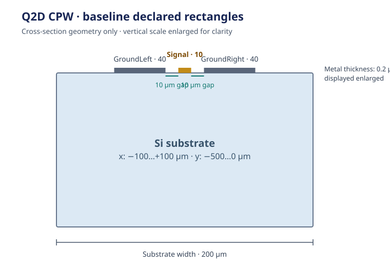

Q2D, the 2D extractor of Ansys AEDT, solves the cross-section of a
transmission line and returns its per-length matrices: capacitance C,
inductance L, conductance G and resistance R. From L and C you get the line's
impedance and phase velocity. Q2D takes the cross-section as rectangles you
give it; it does not cut a section from a layout or a 3D model.

This page has no recorded Q2D result yet; [Read the result](#read-the-result)
shows which entries of the returned matrices give the impedance and the phase
velocity.

{#fig-q2d-cpw-cross-section}

This line is not the CPW of [Prepare a coplanar waveguide for AEDT](aedt-cpw-inputs.qmd)
(6 µm gaps, 80 µm grounds, 100 nm aluminium): it is the PDK's cross-section
example, with niobium metal.

## Prepare the run {#prepare-the-run}

It needs SCGSim with its `aedt` extra and the OrcaPen SC PDK, for the
material records; it writes the run folder without opening AEDT.

```python
from pathlib import Path
import orcapen_sc_pdk
from orcapen_sc_pdk.materials import get_material_records
from scgsim.aedt import (
    MatrixRunControl, PdkMaterial, Q2dConductorSpec,
    Q2dRectangleSpec, Q2dSpec, prepare_handoff,
)

AEDT_VERSION = "2024.2"  # Choose explicitly: 2023.2 or 2024.2.

orcapen_sc_pdk.activate()
records = get_material_records()
materials = {
    name: PdkMaterial(name, records[name]["material_kind"],
                      records[name]["is_superconducting"],
                      records[name]["aedt_library_name"])
    for name in ("vacuum", "Si", "Nb")
}
rectangles = (
    Q2dRectangleSpec("Substrate", (-100.0, -500.0), (200.0, 500.0), "Si"),
    Q2dRectangleSpec("Signal", (-5.0, 0.0), (10.0, 0.2), "Nb"),
    Q2dRectangleSpec("GroundLeft", (-55.0, 0.0), (40.0, 0.2), "Nb"),
    Q2dRectangleSpec("GroundRight", (15.0, 0.0), (40.0, 0.2), "Nb"),
)
conductors = (
    Q2dConductorSpec("Signal", "SignalLine", ("Signal",), 0.2),
    Q2dConductorSpec("Ground", "ReferenceGround", ("GroundLeft", "GroundRight"), 0.2),
)
spec = Q2dSpec(
    aedt_version=AEDT_VERSION,
    project_name="public_cpw_q2d", design_name="CpwFiniteGroundQ2d",
    materials=materials, vacuum_material_id="vacuum",
    rectangles=rectangles, conductors=conductors,
    run_control=MatrixRunControl("Setup1", frequency_ghz=6.0, maximum_passes=3),
    region_padding_um=(100.0, 100.0, 1000.0, 100.0),
)
handoff = prepare_handoff(spec=spec, output_dir=Path(".artifacts/public-cpw-q2d"))
print(spec.to_payload())
print(handoff.spec_path, handoff.archive_path)
```

What the inputs mean:

- Each `Q2dRectangleSpec` is a name, its lower-left corner (x, y) and its size
  (width, height) in µm, and its material. The substrate spans x from −100
  to 100 µm and y from −500 to 0 µm; the metal sits on it, from y = 0 to
  0.2 µm. Print the spec, as the block does, and check the positions against
  the gaps you mean.
- Each `Q2dConductorSpec` groups rectangles into one conductor: one
  `SignalLine` per signal, and a single `ReferenceGround` holding every ground
  rectangle. Every metal rectangle belongs to exactly one conductor; its last
  value is the metal thickness in µm.
- The empty space around the section is Q2D's Region, not a rectangle.
  `region_padding_um` gives its extent beyond the rectangles, in µm, in the
  order (+x, −x, +y, −y): 100 µm on each side, 1000 µm above and 100 µm
  below.
- `MatrixRunControl` sets the frequency, 6 GHz, and up to three adaptive
  passes.

## Read the result {#read-the-result}

Run the folder on a computer with AEDT
([Run a prepared model](run-elsewhere.qmd#aedt-execute-the-prepared-package-locally))
and read it back. `physics_results()` returns one row per matrix entry, with
the quantity (`C`, `G`, `L` or `R`), the row and column conductor, the value
and the unit as Q2D exported them:

| Matrix | Unit |
|---|---|
| Capacitance, C | pF/meter |
| Conductance, G | mho/meter |
| Inductance, L | nH/meter |
| Resistance, R | ohm/meter |

For a lossless line, the impedance and the phase velocity follow from two
diagonal entries: L, the `L` entry whose row and column are both the signal
conductor (here `Signal`), in nH/meter, and C, the `C` entry of the same row
and column, in pF/meter. Convert them to H/m and F/m first:

$$
Z_0 = \sqrt{\frac{L}{C}}, \qquad v = \frac{1}{\sqrt{LC}}.
$$

```python
from scgsim.aedt import resolve_results

result = resolve_results(handoff.run_dir)
entries = {
    (row["quantity"], row["row"], row["column"]): float(row["value"])
    for row in result.physics_results()
}
inductance = entries[("L", "Signal", "Signal")] * 1e-9  # nH/m to H/m
capacitance = entries[("C", "Signal", "Signal")] * 1e-12  # pF/m to F/m
print("Z0 =", (inductance / capacitance) ** 0.5, "ohm")
print("v  =", 1 / (inductance * capacitance) ** 0.5, "m/s")
```

SCGSim does not compute Z₀ or v for you. A per-length capacitance is not the
capacitance of a 3D structure: for that, use [Q3D](capacitance-q3d.qmd) or
[Palace](capacitance-palace.qmd). The report keeps Q2D's convergence status,
its reported change and your controls beside the matrices
([reference](../reference/specs/aedt-runtime.qmd#q2d-q3d-convergence-observations)).
