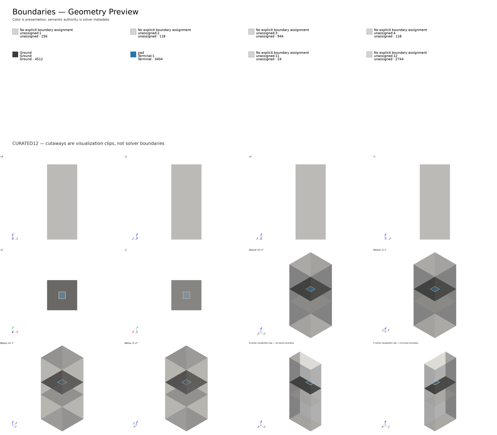

The preview draws the model a solver will use, read from that solver's own
files: the material of each region, the boundary assignments (terminals,
ground, ports), the Surface-EPR faces, and the mesh. It comes in two forms: an
interactive 3D view in a notebook, and a sheet of 12 fixed views saved as an
image. Use it to see that the model is the one you meant. When to call it, after
`mesh()`, is shown in [Inspect the prepared model](inspect-the-prepared-model.qmd).

## The calls {#public-surface}

[]{#purpose-and-ownership}

| Call | What it does |
|---|---|
| `inspect_palace_geometry(run_dir)` | Opens a Palace run folder after `mesh()` and `write_config()`. |
| `inspect_aedt_geometry(source, design=None, aedt_version=None)` | Opens an AEDT run folder prepared in AEDT, or a saved `.aedt` project with its `design` and `aedt_version`. |
| `preview.show_materials()` | Draws the material of each region. |
| `preview.show_boundaries()` | Draws the boundary assignments. |
| `preview.show_surface_epr()` | Draws the Surface-EPR faces. |
| `preview.show_mesh()` | Draws the mesh. |
| `preview.show_all_previews()` | Draws the four modes above, in that order. |
| `preview.explore(mode)` | Shows one mode, `"materials"`, `"boundaries"`, `"surface_epr"` or `"mesh"`, as an interactive 3D view. |

A Palace preview reads the mesh with its tags, Palace's input file, the mesh
manifest and the index map that says which tag is which conductor or surface.
An AEDT preview opens AEDT without its window, reads back each object and its
assignments, and draws them. Neither guesses an assignment from an object's
name, place or color.

A mode with nothing to draw is reported as unavailable, never drawn as an empty
picture. The square pad above requested no Surface EPR, so its
`show_surface_epr()` returned the mode as unavailable, with the reason
`No structured Surface-EPR assignment is present.` For AEDT, the Surface-EPR
and mesh modes can be unavailable while the others work.

## The interactive view {#inline-notebook-viewer}

`preview.explore(mode)` shows a table of what is drawn above one 3D scene that
you can rotate, pan, zoom and reset. The scene is sent into the notebook's
output itself, with no server behind it, so it works in a VS Code Remote SSH
notebook with no port forwarding or extra setup. It needs a running notebook
kernel and the `visualization` extra, and it writes no file.

## The saved views {#curated-views-and-contact-sheet}

Each `show_*` call that has something to draw writes 12 fixed light-theme views
to `previews/geometry/<mode>/` in the run folder:

- the six axis views `+X`, `-X`, `+Y`, `-Y`, `+Z` and `-Z`;
- four diagonal views, two from above and two from below; and
- two cuts through the middle, across X and across Y. The cuts are for viewing
  only; they are not boundaries of the model.

Each view is 1600 × 1200 pixels. The contact sheet, about 4800 × 4200 pixels,
puts a legend above the 4 × 3 grid of views. The legend gives each assignment's
exact ID, its label, its role and the number of mesh elements or objects that
carry it. Two IDs are never merged because their labels or colors match.

Roles have fixed colors:

| Role | Color |
|---|---|
| Ground or PEC | Charcoal |
| Lumped port | Magenta |
| MA (metal–air) | Orange |
| MS (metal–substrate) | Green |
| SA (substrate–air) | Blue |
| MS_MA | Purple |
| Unassigned | Light gray |

Other materials and terminals take colors from a fixed palette of 20, derived
from Matplotlib's `tab20`; the first 20 distinct IDs in a picture get distinct
colors. With more than 20, colors repeat, so the legend's ID, not the color, is
what names an object.

## Without a display {#native-headless-egl-context}

On a computer without a display, SCGSim draws off-screen with a software EGL
device, with no X server, GPU access or special permissions. An existing
`DISPLAY`, `VTK_DEFAULT_OPENGL_WINDOW` or `VTK_DEFAULT_EGL_DEVICE_INDEX`
setting is left as it is. If no EGL device is available, drawing fails with an
error rather than producing a blank picture.

## The preview's own record {#manifest-and-evidence-boundary}

`metadata/geometry_preview_manifest.json` records what was drawn: the status
of each mode, the AEDT design where there is one, the tool versions, the
palette, the views, and the SHA-256 of the files read and written. Preview
files are not part of the run: a preview, or a failure to draw one, never
changes a run's identity, status or result. A Palace preview made before
`prepare_handoff()` is included in the handoff's archive; one made later stays
beside it, outside the archive. Previewing a saved `.aedt` project never edits
a run's receipt.

## Not available {#v1-exclusions}

The preview has no ParaView or Gmsh window, no portable interactive HTML file,
no filters on objects, no cameras or cuts of your own, and no dark theme.
