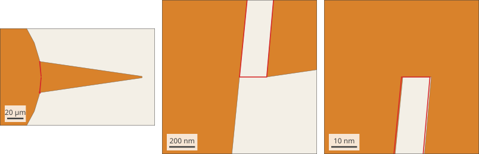
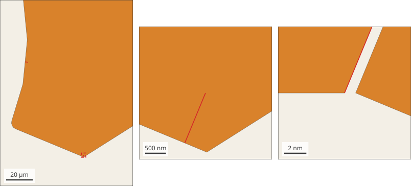
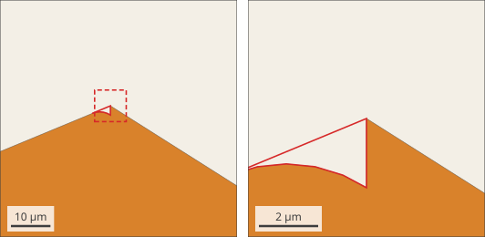
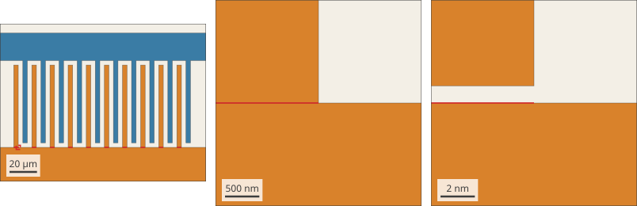
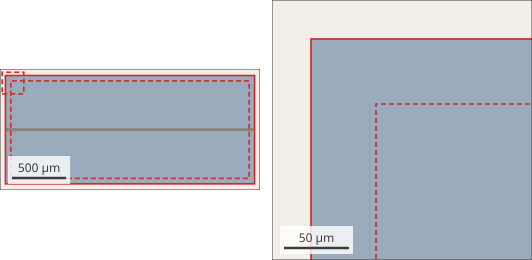
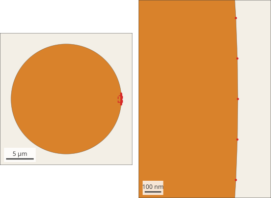
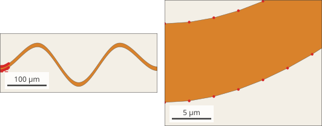
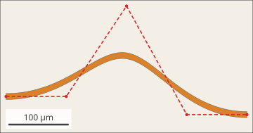
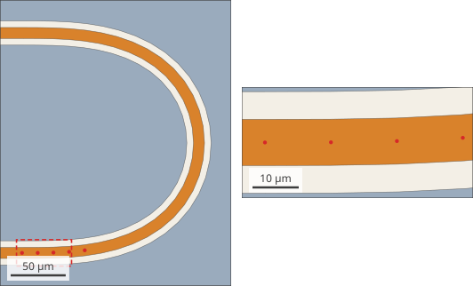
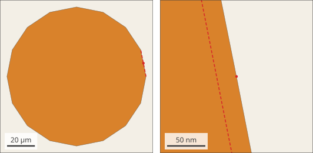

This page lists the geometry known to fail in SCGSim, or to build as something
other than what the layout means. For each case it shows where the problem is,
what goes wrong and why, and why SCGSim does not work around it. In each case
the fix is a change to the layout. What SCGSim does support is on
[Supported Geometry](supported-geometry.qmd), and the rules every layout must
follow, with the owner of each failure, are on [Supported Scope](supported-scope.qmd).

The figures redraw each case from its reported dimensions on SGB's 1 nm grid,
with no PDK code. The problem is marked in red; the panels to the right zoom in
on it, and the dashed red frames show where.

SCGSim builds the outline it is given. It does not close nanometre gaps, remove
short edges or resample curves, because it cannot tell a drawing defect from a
feature that was meant. A layout check with `EigenmodeSim.simulation_drc` or
`ElectrostaticSim.simulation_drc` ([layout modeling check](layout-modeling-check.qmd))
finds the cases that stop the build; the others need a look at the layout.

## Drawing defects in the PDK cells {#drawing-defects}

A survey of the OrcaPen SC PDK cells found places where what is drawn differs
from what the PDK code means to draw. Each is reported to the PDK in
[orcapen-sc-pdk#47](https://github.com/NCUPHY-LTLab/orcapen-sc-pdk/issues/47)
(C1 to C4) or [orcapen-sc-pdk#58](https://github.com/NCUPHY-LTLab/orcapen-sc-pdk/issues/58)
(A1, A6), with the cause in the PDK code. They are drawing defects, so the fix
belongs in the PDK.

The OrcaPen SC PDK corrects all six: C1 to C4 in
[orcapen-sc-pdk#64](https://github.com/NCUPHY-LTLab/orcapen-sc-pdk/pull/64), A1 and A6 in
[orcapen-sc-pdk#61](https://github.com/NCUPHY-LTLab/orcapen-sc-pdk/pull/61). A layout shows them only when it is built from a
PDK revision without those pull requests, so build layouts for simulation from
a PDK revision that includes them.

### C1: a crack between the disk and its lead fan {#c1-crack}

{fig-alt="Disk and fan with a thin wedge-shaped crack on each side, marked in red, and two zoomed views of the crack."}

**What goes wrong.** On each side of the Disk Qubit's radial lead fan, a wedge
18.26 µm long stays open between the fan and the disk: 0.21 µm wide at its mouth,
closing to a 9.9 nm step. SCGSim builds it as drawn. The crack's sides become
gap edges, so the disk gains bands along them: its band 0 grows by about 9 %
(446 against 410 µm² in a sample). The cause is in the drawing: the fan's
three-point arc and the disk's 32-point polygon share only one vertex, so their
union leaves the gap (`_radial_taper` and `_disk_and_junction` in the PDK).

**Why SCGSim does not fix it.** A 0.21 µm gap is a valid drawn feature, so
SCGSim keeps it. Make the fan's arc land on the disk's own vertices, or extend
the fan into the disk before the union, so that the union is one clean outline.

**Corrected in the PDK** by [orcapen-sc-pdk#64](https://github.com/NCUPHY-LTLab/orcapen-sc-pdk/pull/64): the fan's straight
sides continue into the disk.

### C2 and C3: zero-width slits in the claw {#c2-c3-slits}

{fig-alt="The lower part of a claw with two short red lines where the slits enter the metal, and zoomed views of one slit and its base."}

**What goes wrong.** Each claw has slits 1.305 µm (C2) and 2.282 µm (C3) long
whose base is 1 nm wide. The geometry builds and the bands are unchanged, but
each slit leaves 1 nm edges and a 1 nm wide wall face that the mesher must
resolve. With the slits present, one measured run of the Disk Qubit ended
without a usable mesh. The cause is in the drawing: the claw splices rounded
pieces in through r 10 circular windows, the cut points round 1 grid unit apart,
and the slit ends on a window vertex (`_claw_segment` in the PDK).

**Why SCGSim does not fix it.** A 1 nm edge is on SCGSim's grid, so it is valid
geometry. Round the corners on the whole claw outline instead of splicing
rounded pieces in through windows.

**Corrected in the PDK** by [orcapen-sc-pdk#64](https://github.com/NCUPHY-LTLab/orcapen-sc-pdk/pull/64): the claw is drawn as
one outline and rounded once.

### C4: a bite at each claw's outer corner {#c4-corner-bite}

{fig-alt="The outer corner of a claw with a small notch, outlined in red, between a sharp tip and a rounded corner."}

**What goes wrong.** Each claw's outer corner has a sharp 57.7° tip, then edges
of 2.766 and 0.136 µm, and a leftover rounding of r ≈ 5. It builds, but the
corner is not the intended one, and the 0.136 µm edge forces small mesh
elements. The cause is in the drawing: the corner is rounded first
(`_claw_segment`), and the taper then adds the sharp corner back (`_claw_taper`).

**Why SCGSim does not fix it.** The outline is valid geometry. Add the taper
before rounding, or round only the corners that remain.

**Corrected in the PDK** by [orcapen-sc-pdk#64](https://github.com/NCUPHY-LTLab/orcapen-sc-pdk/pull/64): the taper is part of
the claw outline before it is rounded.

### A1: Purcell IDC fingers detached by 1 nm {#a1-detached-fingers}

{fig-alt="Two interleaved finger combs with red marks at the base of each lower finger, and zoomed views of the 1 nm gap under one finger."}

**What goes wrong.** In the Purcell filter cell, ten IDC fingers start 1 nm
above the funnel they should grow from, so they float as ten separate
conductors. The cause is in the drawing: the finger length (59.92476 µm) is off
the grid, and the comb has no spine of its own, so comb and funnel round to
different grid points. On an SGB-native copy the build stops at the first slit
with `Imprint lost band boundaries … is in band 2, expected 1`. The suspected
cause of that error is that the slit is one grid unit wide, so the band seams at
its two sides fall on the same grid points and Imprint cannot keep the bands
apart. Were it to build, the fingers would be floating and the capacitance
wrong.

**Why SCGSim does not fix it.** The fingers are separate conductors in the
drawing, and SCGSim cannot know that they were meant to touch. Give the comb its
own spine and use finger lengths on the grid.

**Corrected in the PDK** by [orcapen-sc-pdk#61](https://github.com/NCUPHY-LTLab/orcapen-sc-pdk/pull/61): each comb has its own
spine, and the Purcell cell's finger length is on the grid.

### A6: an etch frame that the ground mask lacks {#a6-etch-frame}

{fig-alt="A ground plane with a CPW across it, the 50 µm frame round the chip outlined in red, and a zoom of one corner."}

**What goes wrong.** In the airbridge sample chip, the etch layer holds a
50 µm frame round the 2200 × 900 chip that the ground mask lacks; the two layers
differ by 320 000 µm². SCGSim derives the ground from the mask, so its ground
runs over the dicing lane, while the PDK's etch-based metal does not. The lane
is more than 400 µm from the CPW, so the effect on the CPW is small.

**Why SCGSim does not fix it.** SCGSim's documented ground form is the plane
less the ground mask; it does not read the etch layer. Put the frame in the
ground mask too, or take it out of the etch layer, so both give the same metal.

**Corrected in the PDK** by [orcapen-sc-pdk#61](https://github.com/NCUPHY-LTLab/orcapen-sc-pdk/pull/61): the frame is drawn on
the ground mask as well.

## Curves outside the 128-point scope {#curves-outside-scope}

The supported scope for curved outlines is at most 128 points per full circle,
so that every vertex turns by at least 2.8125°
([the curve rule](supported-geometry.qmd#curve-rule)). The cases below are
outside it.

### Polygon circles denser than 128 points per circle {#dense-circles}

{fig-alt="A polygon circle and a zoom onto a few of its vertices, marked as red dots."}

**What goes wrong.** Measured on regular polygon circles at margins 0.5 and
1.0 µm:

| Points per full circle | Turn per vertex | Result |
| --- | --- | --- |
| 144 to 224 | 2.5° to 1.6° | depends on the case: 180 and 224 points are refused at r = 10 µm and build at r = 75 µm |
| 256 | 1.41° | refused at r = 5, 10, 50 and 150 µm |

A refused curve stops the build with
`the inset curve at m = … um is not closed near (x, y) um`: the offsets of two
neighbouring edges at a band margin neither meet nor cross, so the band regions
cannot be told apart. The edge length does not decide it: a 256-point circle of
radius 150 µm has 3.68 µm edges and is still refused. The suspected cause, from
the measurements and not tested separately: past a convex vertex the offsets of
two neighbouring edges overlap by about $m\theta^2/2$ for a turn $\theta$, which
at small turns is comparable to the rounding of each offset's end point to the
grid (up to half a grid unit), so the two offsets can miss each other. The PDK's default
`"fabrication"` profile, 256 points per full circle, is refused this way.

**Why SCGSim does not fix it.** The supported scope is set at 128 points per
full circle; a fix in SGB's band construction was tried and not adopted.
Build components for simulation with `curve_sampling="simulation"`.

### Spline strips drawn with 258 points {#spline-258}

{fig-alt="A wavy strip and a zoom onto its end with the vertices marked as red dots."}

**What goes wrong.** `interpolation_spline_strip` and `bspline_strip` draw each
edge with 129 points, sampled per span rather than by `curve_sampling`. Their
flattest vertices turn by 0.058° and 0.012°, and the build is refused with the
same `inset curve … not closed` message as a dense circle.

**Why SCGSim does not fix it.** The strips are outside the 128-point scope.
Resample each strip so that every vertex turns by at least 2.8125°; the
resampled strips build with exact bands (cell 21 on
[Supported Geometry](supported-geometry.qmd#pads-and-parts)). How to resample is
the PDK's choice
([orcapen-sc-pdk#52](https://github.com/NCUPHY-LTLab/orcapen-sc-pdk/issues/52)).

### Spline curves are not read as curves {#spline-curves}

{fig-alt="A curved strip with its five control points joined by a dashed red polygon."}

**What goes wrong.** When a cell declares its edges as spline boundary curves,
the build stops with `UnsupportedCurveError: … 'bspline' curves are not
supported yet (this version carries lines and circular arcs)`, and the same for
`interpolation_spline`.

**Why SCGSim does not fix it.** SGB offsets lines and circular arcs exactly; the
offset of a spline has no exact form, so reading splines needs a tolerance that
has not been decided. This is tracked in
[scgsim#109](https://github.com/NCUPHY-LTLab/scgsim/issues/109). Until then,
draw the strip as a polygon that follows the curve rule.

## Runs of vertices that turn less than 2.8125° {#small-turn-runs}

{fig-alt="A CPW U-turn with its first centreline vertices marked as red dots in a zoom."}

The curve rule is stated per vertex, but some supported cells have vertices
that turn less, and they build with exact bands as drawn:

- the 90° Euler bend (cell 14) turns by 0.30° and 1.8° at its first two
  vertices, and the 180° U-turn (cell 15) by 0.15°, 0.9°, 1.8° and 2.7° at its
  first four, with chords of 11 to 14 µm;
- the tapers (cell 18) kink by 0.86° and 1.72°.

Outside these cells, a run of several consecutive vertices that turn less than
2.8125° is not verified: it may build, or it may be refused like a dense circle.

{fig-alt="A 16-sided polygon with one extra vertex marked, and a zoom showing the vertex slightly outside the dashed original edge."}

A single vertex that turns less, between longer edges, was also measured: one
vertex added to a 16-point circle of radius 50 µm, with 9.8 µm edges on both
sides.

| Turn of the one vertex | Result |
| --- | --- |
| 2.9°, 2.7°, 1.41°, 0.3° and 0.01°, convex | builds, bands exact |
| 2.7° and 0.01°, reflex | builds, bands exact |
| 0° (a point on a straight edge) | builds, bands exact |

A point on a straight edge leaves an axis-aligned edge's bands unchanged. On an
oblique edge the bands move by a few 10⁻⁴ µm², within the snap bound, because
the offsets of the two halves end on a grid point there. These are observations
at margins 0.5 and 1.0 µm, not guarantees.

**Why SCGSim does not extend the rule.** The supported scope was set from the
measured circles and the PDK cells; widening it needs measurements of the new
patterns and a separate decision.
