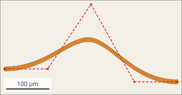
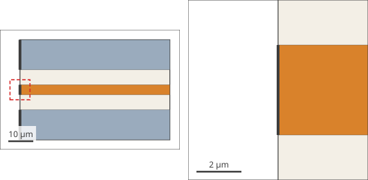
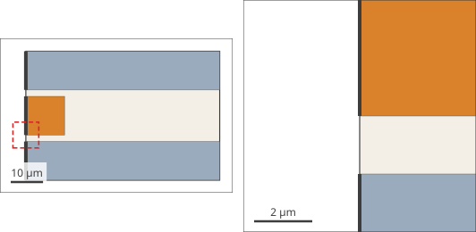
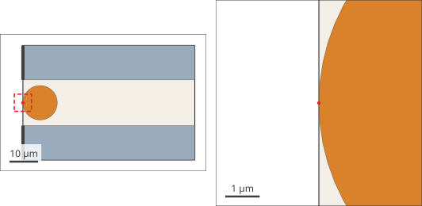
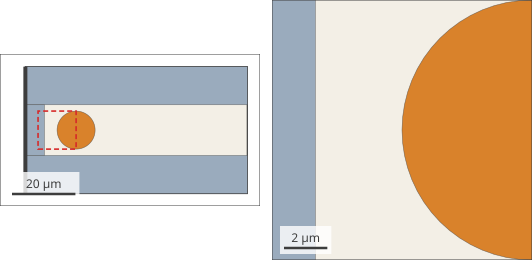

This page lists the geometry known to fail in SCGSim, or to build as something
other than what the layout means. For each case it shows where the problem is,
what goes wrong and why, and why SCGSim does not work around it. In each case
the fix is a change to the layout. What SCGSim does support is on
[Supported Geometry](supported-geometry.qmd), and the rules every layout must
follow, with the owner of each failure, are on [Supported Scope](supported-scope.qmd).

The figures redraw each case from its reported dimensions on SGB's 1 nm grid,
with no PDK code. The problem is marked in red; the panels to the right zoom in
on it, and the dashed red frames show where.

SCGSim builds the outline it is given. It does not close nanometre gaps, remove
short edges or resample curves, because it cannot tell a drawing defect from a
feature that was meant. A layout check with `EigenmodeSim.simulation_drc` or
`ElectrostaticSim.simulation_drc` ([layout modeling check](../guides/check-a-layout.qmd))
finds the cases that stop the build and, in its meshing stage, the fine edges
and faces the mesher cannot use, each with its location and owner; the others
need a look at the layout. A fine edge or face that SGB did not cause is a
layout problem: SCGSim reports it and does not repair it.

## Spline curves are not read as curves {#spline-curves}

{fig-alt="A curved strip with its five control points joined by a dashed red polygon."}

**What goes wrong.** When a cell declares its edges as spline boundary curves,
the build stops with `UnsupportedCurveError: … 'bspline' curves are not
supported yet (this version carries lines and circular arcs)`, and the same for
`interpolation_spline`. A spline on a lumped port's conductor stops the build
with the same error.

**Why SCGSim does not fix it.** SGB offsets lines and circular arcs exactly; the
offset of a spline has no exact form, so SGB does not read splines. Draw the
strip as a polygon.

## A conductor that touches the boundary at one point {#boundary-point-pinch}

A conductor whose outline reaches the edge of the modelled region at a single
point, such as a round pad or a diamond drawn against the edge of the layout
with nothing around it, is refused with `NonManifoldError`. Draw the die outline
or a ground plane so that it, not the pad, sets that edge.

::: {layout-ncol=2}
{fig-alt="A CPW whose three strips end on the left edge of the die, with a heavy line where each strip meets the edge, and a zoom on the centre strip's end."}

{fig-alt="A square pad between two ground strips, its left edge on the left edge of the die, and a zoom on its lower corner."}

{fig-alt="A round pad between two ground strips touching the left edge of the die at one red point, and a zoom where the vacuum above and below the point meets."}

{fig-alt="A diamond between two ground strips touching the left edge of the die with its tip, marked red, and a zoom on the tip."}
:::

**Where the boundary is.** In the plane, the model ends where the layout ends.
The vacuum layouts are tested and simulated in, the plan's vacuum padded by
(x, y, z) = (0, 0, 1000) µm, stops at the layout's planar extent, and so does
any vacuum region with no planar padding. In the figures the die is
60 × 40 µm, its left edge x = 0 is the boundary, the light area is the vacuum at
the height of the metal, and white is outside the model.

**What goes wrong.** Walk along the boundary at the height of the metal. Where
a conductor crosses it or ends on it, like the CPW's strips, or lies along it,
like the square pad's edge, the metal takes up a stretch of the boundary. The
vacuum on one side of that stretch is separated from the vacuum on the other
side, and each meets the metal along a face. Where the round pad or the diamond
touches the boundary, the metal takes up no length at all, only the point
(0, 20) µm. The vacuum below that point and the vacuum above it are neither
separated nor joined by a face: across the height of the metal they touch only
along the vertical line through that point, as the zooms show. Such a place is
called a pinch, and a solid with one is called non-manifold. The mesher needs
each face to have one region on each side, and at a pinch the line through it
has no defined topology, so SCGSim refuses the layout before it meshes. The
refusal names the conductor, its layer and the point, and ends with a link to
this section:

```
non-manifold pinch: conductor chip/centre_0000 on layer metal
of Net chip/centre_0000 reaches the edge of VACUUM_REGION only
at (0.0000, 20.0000) um, z 0.0..0.2 um (slab[0,1/5]), a point
on the model's planar boundary, … Fix the layout: draw the die
outline or a ground plane around it, or set a vacuum region.
See …#boundary-point-pinch
```

Measured with `EigenmodeSim.simulation_drc` and `ElectrostaticSim.simulation_drc`
on the layouts of the figures (ground strips 60 × 12 µm, pads 12 µm across, the
CPW's centre strip 4 µm wide), without bands and with `MA` bands at margins 0.5
and 1.0 µm:

| Layout | No bands | `MA` bands |
|---|---|---|
| CPW cut off at the boundary | passes | passes |
| Square pad, edge along the boundary | passes | passes |
| 64-sided round pad, one vertex on the boundary | refused at (0, 20) µm | refused at (0, 20) µm |
| Diamond, tip on the boundary | refused at (0, 20) µm | refused at (0, 20) µm |

Bands play no part: the refusal comes before any band is cut, and the layouts
that pass also pass with bands.

**Why SCGSim does not work around it.** `simulation_drc` checks a layout in
the vacuum of the plan it is given, the one you simulate in; a planar padding
of SCGSim's own would check a different model from the one you simulate. SCGSim also
builds the outline it is given, so it does not move the vertex off the boundary.

{fig-alt="The round pad between two ground strips joined by a third strip on its left, so the ground runs along the whole left edge of the die, and a zoom showing the vacuum between the pad and that strip."}

**The layout fix.** Draw the die outline or a ground plane so that it, not the
pad, sets the planar boundary, as on a real chip. With the ground drawn round
the left side of the round pad or the diamond, 4 µm from it, both pass, without
bands and with `MA` bands. A vacuum region with planar padding also moves the
boundary away from the pad, in `mesh()` and in `simulation_drc` alike, since
both use the plan's vacuum; it changes the model you simulate, so prefer
drawing the outline.

A region that is not a conductor pinches the vacuum the same way: a finite
dielectric island whose outline touches the boundary at one point is refused,
and the refusal names that region instead of a conductor. Draw the die outline
around it, or change the island's outline so that it meets the boundary along an
edge or keeps clear of it; both of those pass.

### The same rule inside the layout {#pinch-inside-the-layout}

This is the rule on [Supported Scope](supported-scope.qmd#rules-conductors): no
region touches itself along a single vertical edge. Inside the layout it shows
where two conductors of one Net meet only at a corner. The metal there, or the
vacuum between the two pieces, touches itself along the vertical line through
the corner, just as the vacuum does at the round pad above, and the refusal
reads "… touches itself along the vertical edge at (x, y) um …: two cells of one
domain meet only at a vertex." Two regions that are not conductors, such as two
dielectric islands meeting at a corner, pinch the vacuum the same way, and the
refusal then names those regions. Give the two pieces a shared edge, or separate
them. At the boundary the other piece is the outside of the model, which the
layout does not draw, so there the fix moves the boundary instead.
