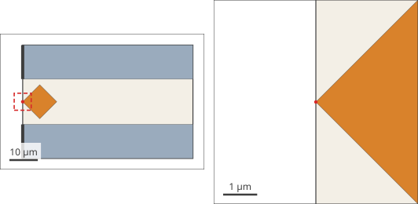

Two kinds of geometry stop a build that otherwise follows the rules: spline
curves, and a conductor that touches the model's edge, or another piece of
its own Net, at a single point. For each, this page shows where the problem is,
why SCGSim refuses it and how to change the layout. The figures redraw each
case on SGB's 1 nm grid; the problem is red, and the panels on the right zoom
in on it. The rules every layout follows are on
[Supported scope](supported-scope.qmd); a [layout check](../guides/check-a-layout.qmd)
finds both problems in seconds.

## Splines must be drawn as polygons {#spline-curves}

{fig-alt="A curved strip with its five control points joined by a dashed red polygon."}

A cell that declares its edges as spline boundary curves stops the build:

```text
UnsupportedCurveError: … 'bspline' curves are not supported yet (this version carries lines and circular arcs)
```

and the same for `interpolation_spline`, also on a lumped port's conductor.
SGB offsets lines and circular arcs exactly; the offset of a spline has no
exact form, so SGB does not read splines. **Draw the strip as a polygon**: a
spline sampled to about 3° of turn per vertex builds with exact bands, as
[cell 21](supported-geometry.qmd#pads-and-parts) shows, and so does the same
strip drawn with the PDK's 258 points.

## A conductor that touches the boundary at one point {#boundary-point-pinch}

A conductor whose outline reaches the edge of the model at a single point,
such as a round pad or a diamond drawn against the edge of the layout with
nothing around it, is refused with `NonManifoldError`. **Draw the die outline
or a ground plane so that it, not the pad, sets that edge.**

::: {layout-ncol=2}
{fig-alt="A CPW whose three strips end on the left edge of the die, with a heavy line where each strip meets the edge, and a zoom on the centre strip's end."}

{fig-alt="A square pad between two ground strips, its left edge on the left edge of the die, and a zoom on its lower corner."}

{fig-alt="A round pad between two ground strips touching the left edge of the die at one red point, and a zoom where the vacuum above and below the point meets."}

{fig-alt="A diamond between two ground strips touching the left edge of the die with its tip, marked red, and a zoom on the tip."}
:::

**Where the boundary is.** In the plane, the model ends where the layout ends:
a vacuum region with no planar padding, such as the plan's vacuum padded by
(x, y, z) = (0, 0, 1000) µm, stops at the layout's planar extent. In the
figures the die is 60 × 40 µm, its left edge x = 0 is the boundary, the light
area is the vacuum at the height of the metal, and white is outside the model.
The ground strips are 60 × 12 µm, the pads 12 µm across, and the CPW's centre
strip 4 µm wide.

**What goes wrong.** Walk along the boundary at the height of the metal. Where
a conductor crosses it or ends on it, like the CPW's strips, or lies along it,
like the square pad's edge, the metal takes up a stretch of the boundary, and
the vacuum on each side meets the metal along a face. Where the round pad or
the diamond touches the boundary, the metal takes up only the point
(0, 20) µm: the vacuum below and above that point touch along the vertical
line through it, as the zooms show. Such a place is a *pinch*, and a solid
with one is *non-manifold*. The mesher needs each face to have one region on
each side, so SCGSim refuses the layout before it meshes. The refusal names
the conductor, its layer and the point, and ends with a link to this section:

```
non-manifold pinch: conductor chip/centre_0000 on layer metal
of Net chip/centre_0000 reaches the edge of VACUUM_REGION only
at (0.0000, 20.0000) um, z 0.0..0.2 um (slab[0,1/5]), a point
on the model's planar boundary, … Fix the layout: draw the die
outline or a ground plane around it, or set a vacuum region.
See …#boundary-point-pinch
```

The two layouts that pass also pass with `MA` bands at margins of 0.5 and
1.0 µm, and the two that are refused are refused the same way with bands: the
refusal comes before any band is cut.

{fig-alt="The round pad between two ground strips joined by a third strip on its left, so the ground runs along the whole left edge of the die, and a zoom showing the vacuum between the pad and that strip."}

**The layout fix.** Draw the die outline or a ground plane so that it sets the
planar boundary, as on a real chip. With the ground drawn round the left side
of the round pad or the diamond, 4 µm from it, both pass. A vacuum region with
planar padding also moves the boundary away from the pad, in `mesh()` and in
`simulation_drc` alike; it changes the model you simulate, so prefer drawing
the outline. SCGSim does not move the vertex itself, because it builds the
outline it is given.

A region that is not a conductor pinches the vacuum the same way: a finite
dielectric island whose outline touches the boundary at one point is refused,
naming that region. Draw the die outline around it, or let the island meet the
boundary along an edge or keep clear of it.

### The same rule inside the layout {#pinch-inside-the-layout}

Inside the layout the same rule refuses two conductors of one Net that meet
only at a corner: the metal there, or the vacuum between the two pieces,
touches itself along the vertical line through the corner. The refusal reads
"… touches itself along the vertical edge at (x, y) um …: two cells of one
domain meet only at a vertex." Two regions that are not conductors, such as
two dielectric islands meeting at a corner, are refused the same way. **Give
the two pieces a shared edge, or separate them.** At the boundary the other
piece is the outside of the model, which the layout does not draw, so there
the fix moves the boundary instead. The rule is
[No region touches itself along a single vertical edge](supported-scope.qmd#rules-conductors).
