If your layout is made of the patterns on this page, within the ranges below,
it builds with Surface-EPR bands whose areas match the exact geometry. Each
pattern has a figure and the dimensions of the OrcaPen SC PDK cells that use
it. A pattern not listed is not verified; the ones SCGSim refuses are under
[Geometry SCGSim does not model](#unsupported), the cases known to fail are on
[Known geometry problems](known-geometry-problems.qmd), and the rules every
layout follows are on [Supported scope](supported-scope.qmd).
[]{#check-a-layout-before-you-simulate-it}[]{#模擬之前先檢查-layout}Before you
simulate, [check the layout](../guides/check-a-layout.qmd).

## What "supported" means {#what-supported-means}

Each unit cell below is a sample layout in SCGSim's test suite, drawn on the
1 nm grid at the dimensions of the PDK cells. Every sample builds under
Route B with MA, MS and SA bands at margins of 0.5 and 1.0 µm, measured from
the [gap edges](specs/palace-eigenmode.qmd#surface-epr-margins). For every
band, the built area matches the exact erosion of the same polygons to within
the grid's snap bound: at most 0.07 µm² per 100 µm of band edge.

The die edge is a dicing line: where it cuts a straight conductor edge, the
conductor is treated as continuing past it, so its bands run straight to the
die edge at any angle, with no rounded end. A die outline that comes back
within the largest margin of that continuation, as beside a notch, is refused,
and so is an exact arc that the die edge cuts; see
[Geometry SCGSim does not model](#unsupported).

The dimensions measured across the PDK cells, and covered by the samples, are:

| Quantity | Range |
| --- | --- |
| Conductor and trace widths | 2 to 150 µm |
| Gaps between conductors | 3.3 to 85 µm |
| Ground ribs between two gaps | 3 µm |
| Polygon-circle radii | 1 to 350 µm |
| Straight edges | any angle, with kinks from 0.86° |
| Lumped-port sheets | 0.27 to 150 µm wide |
| Vertices in one outline | up to 604, in a CPW meander of twelve bends |
| Surface-EPR margins | 0.5 and 1.0 µm |

Only these two margins were measured. A larger margin in a narrow gap or rib
changes which bands exist; that is a valid result, but it is not covered here.

## Supported unit cells {#unit-cells}

The figures are drawn from the test samples. Grey is ground, the other colours
are separate conductors, cream is exposed substrate and yellow is a lumped-port
sheet. Dark grey marks metal that stands above the plane metal: bumps, airbridge
piers and the deck. Dimensions are in µm.

### Disk Qubit cells {#disk-qubit-cells}

These are the patterns the flip-chip Disk Qubit uses.

::: {layout-ncol=2}
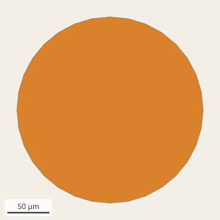{fig-alt="A 32-point polygon disk on exposed substrate."}

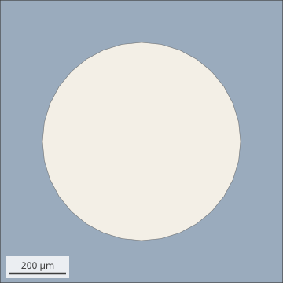{fig-alt="A ground square with a 32-point circular hole."}

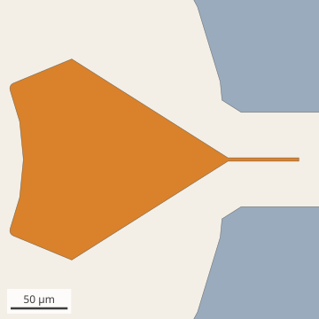{fig-alt="A claw: a ring sector tapering into a narrow CPW, inside a ground opening."}

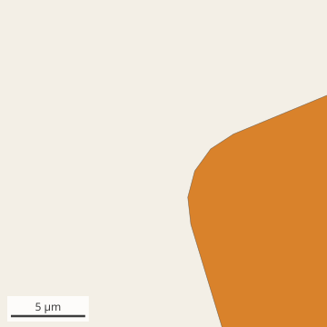{fig-alt="Close view of a claw corner rounded with four chords."}

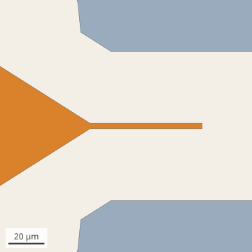{fig-alt="Straight taper edges narrowing from the claw to a 3 µm CPW."}

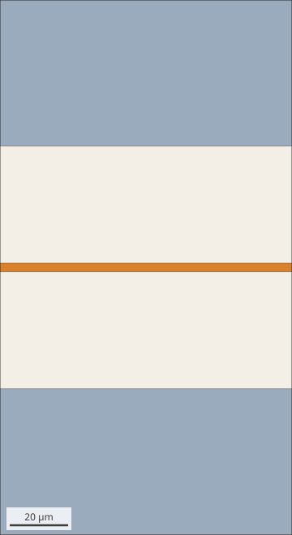{fig-alt="A horizontal CPW: signal strip between two ground strips."}

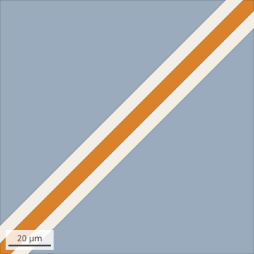{fig-alt="A CPW running diagonally across the die."}

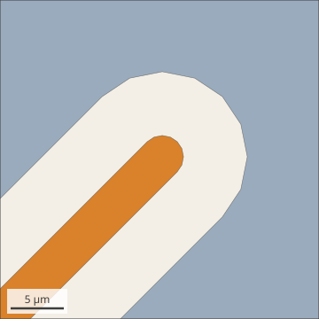{fig-alt="A CPW ending in a half-circle cap inside a half-circle ground opening."}

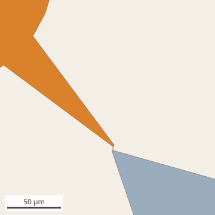{fig-alt="The disk's lead widening as a fan onto the disk, and the ground tongue opposite."}

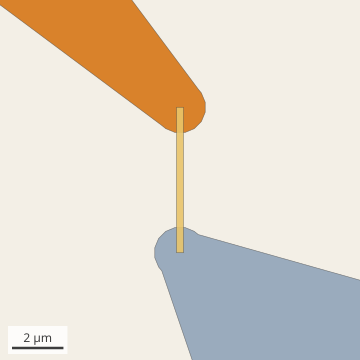{fig-alt="Two lead ends with round caps and the narrow lumped sheet between them."}

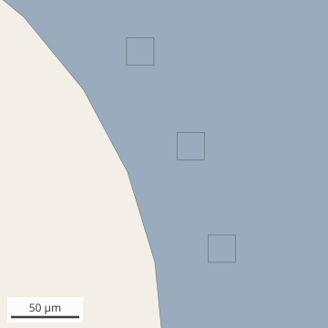{fig-alt="Three square bumps on the ground near the clearance edge."}

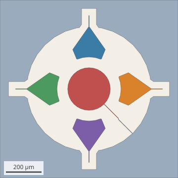{fig-alt="The qubit die: disk, four claws, junction lead and the ground with its openings."}
:::

In cell 10 the simulation sees only the lumped sheet and the two leads. The
5 × 0.09 µm cross that the PDK draws on layer 22/0 is the fabrication junction;
it is not in the simulation layer stack.

In the test build of cell 12, the disk's junction lead is drawn straight,
2 µm wide, on a diagonal. On the grid it comes out 0.7 nm wider than twice the
1.0 µm margin, so it keeps a core 0.7 nm wide and is refused before meshing,
as [rule 12 of Supported scope](supported-scope.qmd#layout-rules) says.

### Lines and bends {#lines-and-bends}

Every CPW here has a 6 µm gap, and every bend a 100 µm radius.

::: {layout-ncol=2}
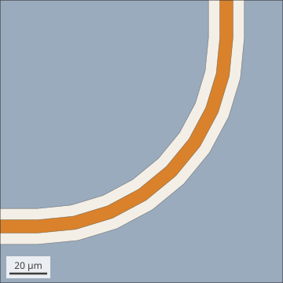{fig-alt="A 90° CPW bend drawn with eight chords."}

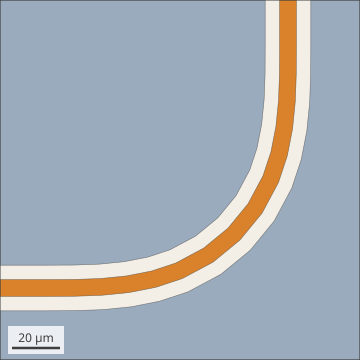{fig-alt="A 90° CPW Euler bend."}

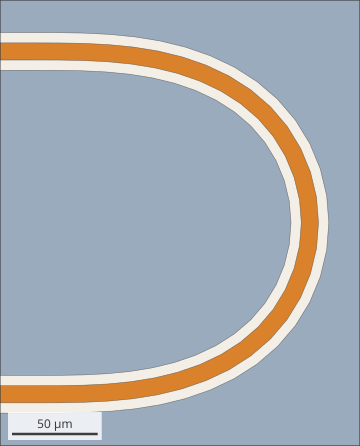{fig-alt="A CPW turning back on itself through a 180° Euler bend."}

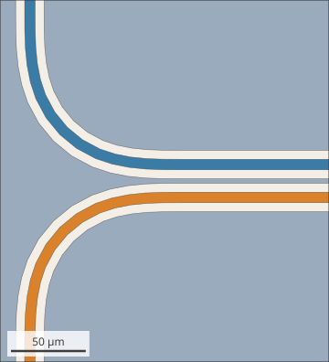{fig-alt="Two parallel CPW traces separated by a narrow ground rib, leaving in Euler bends."}

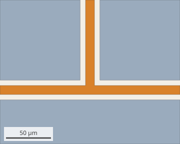{fig-alt="A Manhattan CPW T-junction with three ground pieces."}

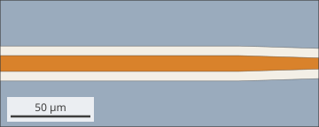{fig-alt="A CPW narrowing from width 10 to 7 over 50 µm."}
:::

### Pads, combs, strips and 3D parts {#pads-and-parts}

::: {layout-ncol=2}
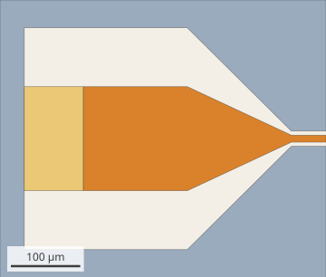{fig-alt="A square launcher pad tapering into a CPW, with the port sheet behind the pad."}

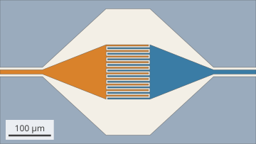{fig-alt="Two interleaved finger combs fed by funnels, inside a ground opening."}

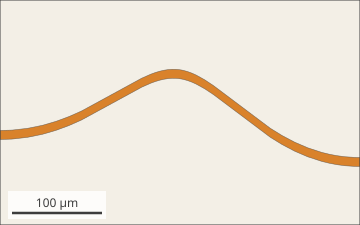{fig-alt="A curved strip with no ground around it."}

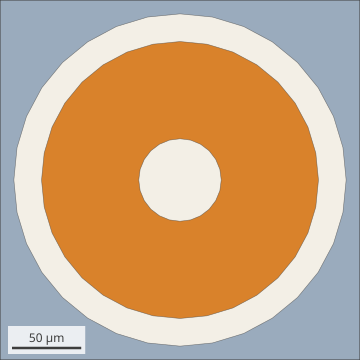{fig-alt="A landing annulus around the TSV bore inside a ground opening."}

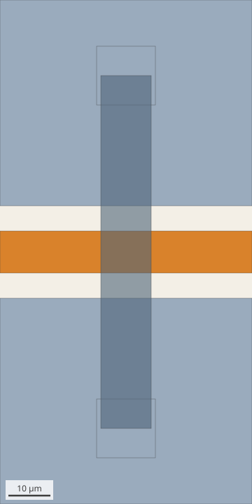{fig-alt="A bridge deck on two piers crossing a CPW."}

{fig-alt="A narrow port sheet spanning the gap between a pad edge and the ground."}
:::

The PDK draws the spline strips of cell 21 with 258 points. The samples
resample them; the strips as drawn also build with exact bands (see
[Curved outlines drawn as polygons](#curve-rule)).

In cell 22 the wall's 0.2 µm thickness is thinner than either margin. Its faces
are vertical, so no band lies on them, and the landing's bands are measured from
the 20 µm gap only.

Cells 14, 15 and 18 contain a few vertices that turn by less than 2.8125°;
they build with exact bands as drawn (see [Curved outlines drawn as
polygons](#curve-rule)).

## Geometry SCGSim does not model {#unsupported}

SCGSim refuses these layouts with a message that names the conductor and the
place, and builds no model from them. Each figure is drawn from a sample in the
test suite, banded at `inset_margins_um=(0.5, 1.0)`. White is outside the die,
so the die edge is where white meets cream; thin dark lines are band boundaries
and red marks the problem. Dimensions are in µm. The rules themselves are on
[Surface-EPR margins](supported-scope.qmd#rules-margins).

### A conductor cut by the die edge along an arc {#unsupported-arc-die-cut}

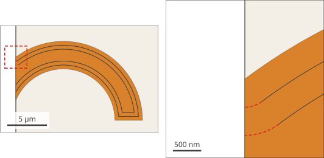{fig-alt="A curved strip running into the die edge, with its band boundaries; near the cut, the boundaries end in short red dashed arcs about the cut point."}

The die edge is a dicing line, so SCGSim treats a conductor cut by it as
continuing past it, and a straight edge continues along its own line. An edge
declared as an exact arc has no straight continuation. Ending its bands in a
half circle about the cut, as at the end of a conductor, would measure the
strip as if it ended there, so SCGSim does not model it.

The build raises `InputError`, naming the conductor and the cut point:

```text
inset request 'ma::strip::top': the die edge cuts 'strip'
at (0.0000, 2.5000) um, where its gap edge is an exact arc. …
Let a straight edge of the conductor meet the die edge
```

A curve drawn as a polygon meets the die edge with a straight chord, which
continues like any straight edge.

### The die outline beside a cut {#unsupported-notch-beside-cut}

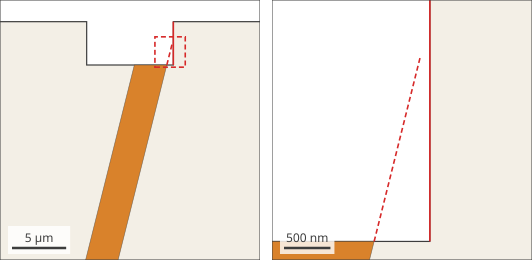{fig-alt="A diagonal strip ending on the floor of a notch in the die edge; a dashed continuation of its side reaches close to the notch wall."}

Bands beside the continuation would be measured from a conductor that is not
drawn. The same rule refuses a conductor that overhangs the die from a vertex
on its edge, two cut conductors whose continuations cross past the die edge,
and a cut beside a curved stretch of the die outline. The build raises
`InputError`, naming the conductor and the cut point, for example
`the die outline comes back within the band margin (1 um) of the continuation of
'strip', cut by the die edge at (21.4000, 26.0000) um`.

### A conductor a little wider than twice its largest margin {#unsupported-lead-core}

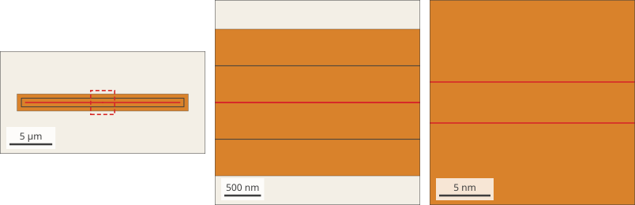{fig-alt="A straight lead with its band boundaries; enlarged, the two innermost boundaries run 4 nm apart down the middle of the lead."}

The core, the face beyond the largest margin, is narrower than the 10 grid
steps the mesher needs. A lead exactly twice the margin wide has no core and is
modeled. The meshing stage of `mesh()` and `simulation_drc()` refuses the core
with `SimulationDrcError`: a class B narrow face owned by `erosion`, with its
location and the fix, change the margins or the width; see
[What the meshing stage reports](../guides/check-a-layout.qmd#what-the-meshing-stage-reports).

## Lumped ports are made rectangles {#lumped-port-rectangle}

Palace accepts a lumped port or lumped RLC only as a rectangle. So each lumped
port an `EigenmodeSim` configures is the central rectangle of its drawn sheet,
and the rest of the sheet becomes metal of the conductors it lands on: the part
before the first cut joins the conductor at the start of the port direction,
the part after the second cut the other one. A conductor without a Net counts
as a Net of its own. Draw the sheet as a rectangle that reaches into both
conductors, along x, along y or at an angle.

Where the sheet lands on an edge declared as an exact arc, the end piece is the
whole drawn sheet up to its cut, so it also meets the arc where the arc bulges
beyond the drawn polygon. Where it lands on edges built as drawn, the end piece
is only the free part, and on a straight edge at right angles to the sheet it
is empty.

### The rectangle on the grid, at any angle {#lumped-port-angle}

The sheet's four corners must be grid points of a rectangle along the port
direction, or each lie within half a grid diagonal of one (0.71 nm on a 1 nm
grid, the grid's snap bound). A sheet turned by an instance, whose corners
leave the grid, is moved to the nearest such rectangle by at most that bound,
and each move is recorded. Vertices the grid adds on a side, within the snap
bound of it, are dropped. Any other sheet is refused, with the port's name, its
layer and its four drawn corners in µm.

### Where the cuts lie {#lumped-port-cuts}

Each end is cut straight across the sheet where it leaves its conductor, at the
first place where both ends of the cut are grid points: every grid step along
x or y, every 1.414 grid steps at 45°. The cut then moves further into the gap,
one such place at a time, until the edge it adds to the conductor along each
side of the sheet is either zero or at least 10 grid steps long, the
fine-structure limit for side walls. A gap with room for fewer than two cuts
is refused, naming where the gap lies, its length and the cut spacing.

For example, on the [flip-chip Xmon](../guides/xmon/inputs.qmd) the junction
sheet runs at 45° across the gap between the ground opening and the Xmon pad,
on a 1 nm grid. Its corners are grid points, so none moves; the cuts fall
1.0027 µm and 4.6556 µm from its first corner, and the port is 3.6529 µm long
and 268.70 nm wide.

[]{#lumped-port-xmon}[]{#lumped-port-record}The full derivation of these cuts,
a second example on a circular pad, and the record SCGSim keeps of each port
are in [GeometryPlan internals](../contribute/internals/geometry-plan.qmd#lumped-port-lattice).

## Curved outlines drawn as polygons {#curve-rule}

A curve drawn as a polygon, with any number of points, builds with the bands of
its exact erosion. SGB sets no minimum turn per vertex and no maximum number of
points per circle. A circular arc can also be declared as an exact arc, which
SGB carries without sampling.

These outlines were built and checked against the exact erosion, at margins
0.5 and 1.0 µm:

| Outline | Turn per vertex | Measured at | Result |
| --- | --- | --- | --- |
| Regular polygon circle, 16, 24, 32, 64 or 128 points | 22.5° to 2.8125° | radius 5, 10, 50 and 150 µm | bands exact |
| 128-point circle, centre off the grid at (0.3337, 0.1234) µm, rotated by 0.73°, or both (centre (12.0004, −7.7771) µm, rotated by 1.7°) | 2.8125° | radius 5, 10, 37.3, 75 and 150 µm | bands exact |
| Regular polygon circle, 256 points | 1.41° | radius 5, 10, 50 and 150 µm | bands exact |
| Spline strips as the PDK draws them, 258 points | down to 0.058° (interpolation) and 0.012° (B-spline) | as drawn | bands exact |
| Euler bends and tapers of cells 14, 15 and 18 | 0.15° to 2.7° at a few vertices | as drawn | bands exact |
| A 16-point circle of radius 50 µm with one vertex added on an edge | 2.9°, 2.7°, 1.41°, 0.3° and 0.01° convex; 2.7° and 0.01° reflex; 0° | 9.8 µm edges | bands exact |

These are examples, not limits; how long such outlines take to mesh with
bands has not been measured. Where two neighbouring offsets neither meet nor
cross, the build stops with this message rather than return wrong bands:

```text
inset family '…': the inset curve at m = … um is not closed near (x, y) um: two
offsets of the support boundary neither meet nor cross there, so the band regions
cannot be told apart. This is an SCGSim defect, not a layout rule: report it to
SCGSim with the layout …
```

