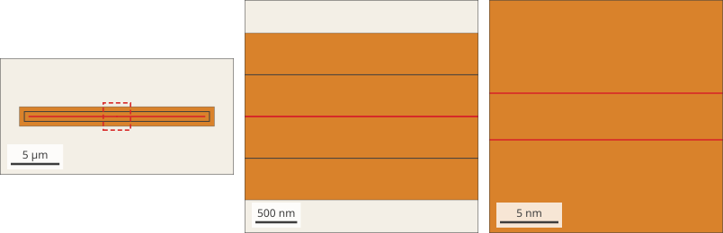

Will your layout build and mesh? It will when it follows the rules on this
page. A layout that breaks a rule is refused with an error that names the rule
and the place; SCGSim never changes the layout to make it fit, because it
cannot tell a drawing defect from a feature you meant. Read this page while
you draw, and when a build or a mesh fails.

The rules are stated for a layout that enters through `GeometryPlan` and the
simulation classes of `scgsim.palace` and `scgsim.aedt`, or an AEDT request
spec passed to `prepare_handoff`.
[]{#supported-entry}Lower-level builders, such as
`scgsim.geometry.sgb.build_sgb_geometry` called with an input you build by
hand, are not supported entries; [GeometryPlan internals](../contribute/internals/geometry-plan.qmd#supported-entry)
says what they assume.

## What a layout must guarantee {#layout-rules}

The *grid* is the layout's database unit, 1 nm for an OrcaPen SC PDK layout;
every coordinate lands on it. A *Net* is a set of Entities you declare to be
one conductor. A *band* is a strip of a surface cut into the model for Surface
EPR, measured from a *gap edge*: an edge of a conductor that faces exposed
substrate. [Terms and units](terms-and-units.qmd) defines the rest.

1. **Declare every Net yourself** with `plan.set_nets`, each Entity in at
   most one Net. SCGSim never joins shapes that touch: two pads that touch but
   sit in different Nets are a short.
2. **Register every child component** that has its own semantics with
   `register_instance`, parents first, one call per GDS reference; expand an
   array reference first.
3. **Point each selector at one polygon.** A selector point of a conductor,
   exclusion, port sheet or ground contribution lies inside exactly one
   polygon of its layer.
4. **Keep every gap, neck, hole and slit wider than one grid step.** On a 1 nm
   grid a 0.4 nm gap between two conductors closes, and the two become one.
5. **Draw no fine structure:** no edge under a side wall shorter than 10 grid
   steps, no face narrower than 10 grid steps, no corner sharper than 1°. On a
   1 nm grid a slit 5 nm wide is refused before meshing; one 20 nm wide is not.
6. **Keep conductors of different Nets apart:** no touch, no overlap, also
   across a gap that closes on the grid.
7. **Give overlapping Entities of one Net different priorities**, so one owns
   the overlap ([which wins](specs/geometry-plan.qmd#overlap-priority)).
8. **Let no region touch itself at a single point,** such as two pieces of one
   Net that meet only at a corner, or a round pad that touches the model's
   edge at one vertex ([why](known-geometry-problems.qmd#boundary-point-pinch)).
9. **Use straight edges and circular arcs;** draw a spline as a polygon.
10. **Draw each lumped port as a rectangle across a clear gap,** landing on
    exactly two conductors, at any angle, with room for at least two cuts
    ([how it is cut](supported-geometry.qmd#lumped-port-rectangle)).
11. **Make every band at least 10 grid steps wide.** Margins of (0.5, 1.0) µm
    give bands 0.5 µm wide; margins of (0.5, 0.505) µm would give a band 5 nm
    wide, which is refused.
12. **Keep a banded conductor clear of twice its largest margin.** Inside the
    largest margin a conductor keeps a *core*; that core must be either none
    or at least 10 grid steps wide. With a margin of 1.0 µm on a 1 nm grid, a
    lead 2.000 µm wide has no core and is modeled, a lead 2.010 µm or wider has
    a core of 10 nm or more and is modeled, and a lead 2.004 µm wide keeps a
    4 nm core and is refused:

    {fig-alt="A straight lead with its band boundaries; enlarged, the two innermost boundaries run 4 nm apart down the middle of the lead."}

13. **Let the die edge cut conductors on straight edges,** with no notch or
    curve of the die outline within the largest margin of the cut
    ([what is refused](supported-geometry.qmd#unsupported)).

The rules in full, with the error each one raises, are
[below](#rules-in-full).

## When something fails {#when-something-fails}

An error is raised at one of three moments:

- **at plan**, while you build the `GeometryPlan` (its constructor,
  `register_instance`, `set_nets` or `prepare()`): a `ValueError`;
- **at build**, when the geometry is built inside `mesh()` or
  `simulation_drc()`: one of the classes of `scgsim.geometry.sgb.errors`
  (`InputError`, `UnsupportedCurveError`, `ContactError` and the others);
- **before meshing**, in the meshing-stage check that `mesh()` and
  `simulation_drc()` run on the built model: `SimulationDrcError`, from
  `scgsim.palace`.

Find the error you see, then follow the owner's next action. Where the owner is
SCGSim, report it with the layout and the message.

| What you see | Owner | Next action |
|---|---|---|
| `ValueError` at plan about `component_semantics`, a registration, a Net, a selector point, a port or a ground contribution | Layout and declarations | Read the message: it names the occurrence or Entity. Fix that declaration in the component or in the notebook. |
| `ValueError` "… topology changed at grid" or "… contact changed at grid" | Layout | A neck, gap, hole or slit is at or below one grid step. Widen it or close it in the drawing. |
| `UnsupportedCurveError` | Layout | Declare the curve as lines and circular arcs, or draw it as a polygon. |
| `ValidationError` "the inset curve … is not closed near (x, y)" | SCGSim | Two neighbouring band offsets near that point neither meet nor cross. |
| `ContactError` or `OverlapError` between different Nets | Layout, or the Net declaration | If the two conductors should be one, put them in one Net. Otherwise separate them in the drawing, by more than one grid step. Give the plan the Nets the simulation uses; `simulation_drc` reads them from it. |
| `OverlapError` "… with equal priority" | Declarations | Give the overlapping Entities of one Net different priorities. |
| `NonManifoldError` | Layout | Follow the link at the end of the message: inside the layout, give the two pieces a shared edge or separate them ([why](known-geometry-problems.qmd#pinch-inside-the-layout)); at the boundary, draw the die outline or a ground plane around what the message names, or give a named region an outline that meets the boundary along an edge or not at all ([why](known-geometry-problems.qmd#boundary-point-pinch)). |
| `InputError` about a port sheet, an Entity id, an arc or a margin | Layout and declarations | Read the message: it names the port, Entity or request. Fix the drawing or the setting it names. |
| `ValueError` "Surface EPR bands narrower than the meshing stage's face-width limit …" | Declarations | Widen the margins it names so that every band is at least 10 grid steps wide. |
| `NoGapEdgeError` | Declarations | The conductor named in `inset_margins_by_entity_um` has no gap edge on that face. Remove it there, or band the face by type. |
| `ValidationError` "… invariant(s) failed" | SCGSim | A structural check of SGB failed on input it accepted. |
| `SimulationDrcError` | The owner each finding names: layout, erosion or sgb | Each refusing finding gives its class, size, µm location and fix. `layout`: fix the drawing there. `erosion`: change the inset margins given to `plan.set_surface_epr` or the conductor's width. `sgb`: SCGSim's. |
| `MeshRepairError` | First check the layout, then SCGSim | Read the quality report: it names the stop reason and lists the remaining bad elements and the features they touch. If they sit on fine structure of the layout, fix the drawing. If the layout has none there, adjust the [mesh settings](specs/palace-electrostatic-sgb.qmd#palace-mesh-controls); when they sit on band edges, the failure is SCGSim's. |
| An error whose message does not match the layout you drew | SCGSim | Report it. |

A failure belongs to the first stage whose guarantee is broken. If a layout
draws a 1 nm slit, the failure is the layout's, even when it first shows up as
a meshing stop minutes later. If the layout follows every rule and the build
or the mesh still fails, the failure is SCGSim's.

## What SCGSim guarantees {#scgsim-guarantees}

On a layout that follows every rule, SCGSim guarantees:

- **The declared geometry, on the grid.** Every Entity is built as declared,
  with its vertices on the grid. Nothing is added, merged or removed, except
  that the free parts of each lumped-port sheet outside its central rectangle
  join the conductors the sheet lands on
  ([Lumped ports are made rectangles](supported-geometry.qmd#lumped-port-rectangle)).
- **Bands that match the exact geometry**, within the grid's snap bound
  ([Supported geometry](supported-geometry.qmd#what-supported-means)).
- **A mesh that meets the quality threshold, or a report.** `mesh()` refuses
  fine structure before meshing. Then, with the default `FeatureRecipe()` or
  any other recipe that enforces the threshold, it returns a mesh whose every
  tetrahedron reaches `quality_threshold` (minSICN 0.01 by default) within its
  budgets, or raises `MeshRepairError` with the report and returns no mesh.
  `GmshDefaultRecipe` records the quality without enforcing the threshold
  ([Tetrahedral mesh quality](specs/mesh-quality.qmd), the
  [mesh settings](specs/palace-electrostatic-sgb.qmd#palace-mesh-controls)).

[Supported geometry](supported-geometry.qmd) lists the patterns SCGSim is
tested on; that a pattern builds with exact bands does not by itself show that
a layout meshes or solves.

## What SCGSim does not do {#not-done}

SCGSim does not repair a layout: it does not close nanometre gaps, remove short
edges, round off spikes or resample curves. These are not supported:

| Not supported | Instead |
|---|---|
| Spline curves read as curves | Draw the spline as a polygon; see [Spline curves](known-geometry-problems.qmd#spline-curves). |
| Nets inferred from geometry that touches | Declare every Net with `set_nets`. |
| Array references | Expand them into single references before registering them. |
| Route C in a Palace simulation | Use Route A or Route B; Route C is AEDT's `modeling="solid"`. |
| `simulation_drc` for HFSS Driven Terminal or Q3D | `prepare_hfss_driven_from_geometry` and `prepare_q3d_from_geometry` refuse a model the import cannot realize before AEDT starts; see [Which check to run](../guides/check-a-layout.qmd#which-check-to-run). |

## Check a layout before simulating it {#check-a-layout}

`EigenmodeSim.simulation_drc(plan)` and `ElectrostaticSim.simulation_drc(plan)`
run the geometry build and the meshing-stage check that `mesh()` runs, on the
route and margins you give, in seconds and without meshing. A check that
succeeds means that model was accepted; it does not promise that it meshes, and only
`EigenmodeSim.simulation_drc` checks the [port rules](#rules-ports).
[Check a layout](../guides/check-a-layout.qmd) shows the call and its report.

## The rules in full {#rules-in-full}

### Declarations {#rules-declarations}

| Rule | Why SCGSim needs it | Reported as | Detail |
|---|---|---|---|
| The root component carries a `component_semantics` record with `schema_version=2`. | SCGSim reads conductors, ports and ground contributions only from this record, never from the drawing. | `ValueError` at plan | [GeometryPlan](specs/geometry-plan.qmd#component-to-backend-geometry-contract) |
| Every child occurrence that has its own `component_semantics` is registered with `register_instance`, parents first. An array reference is expanded into individual references before it is registered. | One registered occurrence names one GDS reference; an unregistered child would vanish when the layout is flattened. | `ValueError` at plan | [GeometryPlan](specs/geometry-plan.qmd#component-to-backend-geometry-contract) |
| You declare the Nets with `set_nets`, and each Entity belongs to at most one Net. | SCGSim never infers connectivity from shapes that touch. Two pads that touch but sit in different Nets are a short, not one conductor. | `ValueError` at plan | [Net](terms-and-units.qmd#term-net) |
| Each selector point (of a conductor, an exclusion, a port sheet or a ground contribution) lies in exactly one polygon of its layer. | A selector point is how a declaration says which polygon it means; a point in zero or two polygons names nothing. | `ValueError` at plan | [GeometryPlan](specs/geometry-plan.qmd#component-to-backend-geometry-contract) |
| A port record gives its `name`, `layer` and `target_layer`. A ground contribution gives exactly `local_id`, `plane_id`, `level`, `layer` and `selector_point_um`. | These fields decide which sheet is the port and which plane the metal joins; none is guessed. | `ValueError` at plan | [GeometryPlan](specs/geometry-plan.qmd#component-to-backend-geometry-contract) |
| No Entity id contains `::` or `__`, and none equals an interface prefix (`MA`, `MS`, `MM`, `SA`, `AA`, `SS`, `EXT`, `PORT`). | Physical-group names join these parts, as in `MA::D1_pad__bottom`; such an id would make a name ambiguous. | `InputError` at build | This page |

### Curves {#rules-curves}

| Rule | Why SCGSim needs it | Reported as | Detail |
|---|---|---|---|
| A curve declared exactly is a line segment or a circular arc. SGB refuses `interpolation_spline` and `bspline` declarations, and boundary reconstructions of any kind other than `circular_arc`. | SGB carries lines and circular arcs, which it offsets exactly; it does not carry spline curves. | `UnsupportedCurveError` at build | [Spline curves](known-geometry-problems.qmd#spline-curves) |
| An exact arc is large enough that its pieces land on different grid points. | An arc whose pieces collapse onto one grid point has no shape left to build. | `InputError` at build ("the arc is too small for the grid") | This page |

### Grid {#rules-grid}

| Rule | Why SCGSim needs it | Reported as | Detail |
|---|---|---|---|
| The grid is the layout's database unit; SCGSim reads it from the GDS. The end points of exact curves lie on the grid. | SCGSim computes on integer grid coordinates; a second grid would move points the layout did not move. | `InputError` at build for an off-grid curve end point | [GeometryPlan](specs/geometry-plan.qmd#component-to-backend-geometry-contract) |
| Snapping to the grid changes no topology: no neck, gap, hole or slit at or below one grid step. | SCGSim places every vertex on the grid. A 0.4 nm gap between two conductors closes on a 1 nm grid, and two separate pieces become one. | `ValueError` at plan: "… topology changed at grid", "… contact changed at grid" | [GeometryPlan](specs/geometry-plan.qmd#component-to-backend-geometry-contract) |
| The outline holds no fine structure: no outline edge under a side wall shorter than 10 grid steps, and no horizontal face narrower than 10 grid steps or with a corner sharper than 1°. SCGSim keeps such structure as drawn and does not remove it. | A 1 nm edge or slit is valid geometry, but the mesher must resolve it with elements of that size. | `SimulationDrcError` before meshing, in `mesh()` and `simulation_drc()`, with the location; a free horizontal edge shorter than 25 grid steps is a warning | [What the meshing stage reports](../guides/check-a-layout.qmd#what-the-meshing-stage-reports) |

### Conductors {#rules-conductors}

| Rule | Why SCGSim needs it | Reported as | Detail |
|---|---|---|---|
| Conductors of different Nets do not touch, including across a gap that closes when the layout snaps to the grid. | A contact between two Nets is a short circuit; SCGSim does not decide which Net is right. | `ContactError` at build, with the location | [Check a layout](../guides/check-a-layout.qmd) |
| Conductors of different Nets do not overlap. | The same: overlapping metal of two Nets has no single owner. | `OverlapError` at build, with the location | [Check a layout](../guides/check-a-layout.qmd) |
| Overlapping conductors of one Net carry different priorities, so one owns the overlap. | Two Entities of one Net may overlap, but the overlap must belong to exactly one of them. | `OverlapError` at build ("… overlap … with equal priority") | [Overlaps](specs/geometry-plan.qmd#overlap-priority) |
| No region touches itself along a single vertical edge. Examples: two pieces of one Net that meet only at a corner; a conductor that reaches the layout's planar extent only at a point. | Two cells of one volume that share only a vertex give a non-manifold solid that cannot be meshed. | `NonManifoldError` at build, with the location | [A conductor that touches the boundary at one point](known-geometry-problems.qmd#boundary-point-pinch) |
| Each Entity is either a sheet, with zero thickness after the physical interpretation, or a body with a positive Z extent. | A sheet with thickness, or a body with none, has no consistent place in the stack. | `InputError` at build ("… is a sheet but its effective Z interval is …", "… has a non-positive Z extent …") | [Physical representation](specs/physical-representation.qmd) |

### Ports {#rules-ports}

| Rule | Why SCGSim needs it | Reported as | Detail |
|---|---|---|---|
| A port sheet overlaps at least one host conductor, and its hosts share one support plane. | The port lies on the surface under its hosts; without a host, or with hosts on two planes, its plane is undefined. | `InputError` at build | [Palace Eigenmode](specs/palace-eigenmode.qmd#lumped-ports) |
| A port sheet is not covered entirely by its hosts. | A sheet wholly on metal has nothing left to excite. | `InputError` at build ("… has no active remainder") | [Palace Eigenmode](specs/palace-eigenmode.qmd#lumped-ports) |
| A port sheet overlaps no other sheet. | Each point of a sheet must belong to one port. | `OverlapError` at build | [Palace Eigenmode](specs/palace-eigenmode.qmd#lumped-ports) |
| A lumped port's sheet lands on exactly two conductors. A conductor without a Net is a Net of its own. | The port is the central rectangle of the sheet; the piece at each end joins that end's conductor. | `ValueError` at build, naming the port | [Lumped ports are made rectangles](supported-geometry.qmd#lumped-port-rectangle) |
| A lumped port's sheet is a rectangle along its port direction, at any angle, whose four corners are grid points or each lie within half a grid diagonal of the corners of such a rectangle. A vertex the grid adds on a side, within half a grid diagonal of it, is dropped. | The port is a rectangle with its corners on the grid; SCGSim moves a corner by no more than the grid's snap bound and records each move. | `ValueError` at build, naming the port, its layer and its four drawn corners in µm | [The rectangle on the grid, at any angle](supported-geometry.qmd#lumped-port-angle) |
| Between its two conductors the sheet crosses a clear gap: across its full width it touches no metal there, and no third conductor touches it. | The rectangle and its two end pieces are cut across that gap. | `ValueError` at build from the rectangle cut, for example "unsupported junction contact ordering or clear corridor" | [Lumped ports are made rectangles](supported-geometry.qmd#lumped-port-rectangle) |
| The clear gap holds at least two cut positions. Along a port direction of v = (p, q) whole grid steps they lie every √(p² + q²) grid steps: every grid step along x or y, every 1.414 grid steps at 45°. | A cut ends on grid points only at a cut position, and the port lies between two cuts. | `ValueError` at build, naming the port's sheet, its layer, where the gap lies, its length and the cut spacing | [Where the cuts lie](supported-geometry.qmd#lumped-port-cuts) |

### Surface-EPR margins {#rules-margins}

| Rule | Why SCGSim needs it | Reported as | Detail |
|---|---|---|---|
| The margins of each request are positive, strictly increasing multiples of the grid, such as `(0.5, 1.0)` µm. | Each margin is a band boundary cut on the grid. | `InputError` at build | [Surface-EPR margins](specs/palace-eigenmode.qmd#surface-epr-margins) |
| Every band is at least 10 grid steps wide: the first band is the first margin, each next band the difference of two margins. | A narrower band is a face the mesher cannot use. | `ValueError` at build, before SGB runs, naming the spec, the band and its width | [What the meshing stage reports](../guides/check-a-layout.qmd#what-the-meshing-stage-reports) |
| No conductor runs wider than twice its largest band margin by less than 10 grid steps, such as a lead 2.004 µm wide banded at 1 µm on a 1 nm grid. Change the margins or the width; SCGSim does not model such a conductor. A width of exactly twice the margin leaves no core and is modeled. The width that counts is the one on the grid: a lead drawn 2 µm wide on a diagonal can come out a fraction of a grid step wider. | Inside that margin the conductor keeps a core narrower than 10 grid steps, a face the mesher cannot use. | `SimulationDrcError` before meshing: a narrow face with owner `erosion`, with its location | [What the meshing stage reports](../guides/check-a-layout.qmd#what-the-meshing-stage-reports) |
| Where the die edge cuts a straight conductor edge, the die outline does not come back, or curve, within the largest band margin of that edge's continuation past the die edge, and no two such continuations cross. A notch beside the cut, a conductor that overhangs the die from a vertex on its edge, or two cut conductors converging past the edge break it. | SCGSim treats a conductor cut by the die edge as continuing straight past it; a die outline beside the continuation would take bands from a conductor that is not drawn. SCGSim does not model it. | `InputError` at build, naming the conductor and the cut point in µm | [Supported Geometry](supported-geometry.qmd#what-supported-means) |
| Where the die edge cuts a conductor, the conductor's gap edge there is straight, not an exact arc. A curve drawn as a polygon meets the die edge with a straight chord and passes. | SCGSim treats a conductor cut by the die edge as continuing straight past it, and an arc has no straight continuation. SCGSim does not model it. | `InputError` at build, naming the conductor and the cut point in µm | [Geometry SCGSim does not model](supported-geometry.qmd#unsupported-arc-die-cut) |
| One face gets one set of margins, even when two Surface-EPR types reach it. | A face holds one family of bands. | `InputError` at build | [Surface-EPR margins](specs/palace-eigenmode.qmd#surface-epr-margins) |
| A band is measured from a gap edge. A conductor named in `inset_margins_by_entity_um` needs a gap edge on each face it bands. A face reached only through its Surface-EPR type that has no gap edge gets no bands. | Without a gap edge there is nothing to measure the distance from. | `NoGapEdgeError` at build | [Surface-EPR margins](specs/palace-eigenmode.qmd#surface-epr-margins) |
| Side walls are never banded; `face_kinds` names only `sheet`, `top`, `bottom` or `interface`. | SGB cuts bands only on these four kinds of face. | `InputError` at build | [Surface-EPR margins](specs/palace-eigenmode.qmd#surface-epr-margins) |

Bands are cut on both Palace routes: on the sheets of Route A and on the faces
of the Route B volumes. The mesher sizes every band boundary from the width of
its bands ([Band boundary curves](specs/palace-electrostatic-sgb.qmd#palace-mesh-band-edges)).

## Who owns a failure {#stages-and-owners}

A layout reaches a Palace mesh in three stages, each with one owner that
guarantees something to the next:

| Stage | Owner | What it guarantees to the next stage |
|---|---|---|
| Layout and its declarations | The PDK and whoever draws the layout and declares its Nets and Surface-EPR margins | Every rule of [What a layout must guarantee](#layout-rules) holds. |
| Geometry building (SGB, SCGSim's geometry builder) | SCGSim | Exactly the declared geometry on the grid, never repaired, and bands that match the exact geometry within the snap bound; a broken rule is refused with an error that names it. |
| Meshing | SCGSim | The meshing-stage check, then, with an enforcing recipe (the default), a mesh whose every tetrahedron meets the threshold, or `MeshRepairError` with a report. |

*Route A* models face metal as zero-thickness sheets and *Route B* each
conductor as a finite metal volume with a perfect-conductor surface;
[Route A and Route B](../concepts/routes.qmd) explains them. *Fine structure*
is geometry far smaller than the features around it: edges a few grid steps
long, or spikes and slits nanometres wide.
