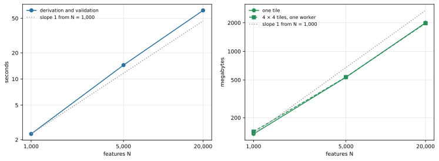

**Question.** When a chip has more features, how much longer does the build take and how much memory does it need?

**Result.** Time grows almost linearly: from 1,000 to 20,000 features the derivation and validation take 2.33 s, 14.5 s and 61.6 s, and the local slope between neighbouring sizes is 1.13 and then 1.05. Model size (faces) grows with slope 1.01 and 0.99, and peak memory with slope 0.85 and 0.95. All numbers are for the polygon-only random layouts described in [Overview](index.qmd#what-was-measured) and [Reproduction](reproduction.qmd#layouts).

## Terms

- **Feature**: one small shape (a rectangle, an L shape, a chamfered or a rotated shape) placed on the chip inside its own cutout of the ground plane. **N** is the number of features. About a quarter of them carry a second, overlapping shape of the same Net.
- **Derivation and validation**: the build step `build_model_from_catalogue`. It derives the conformal topology (the vertices, edges, faces and volumes shared by neighbouring materials) from the prisms and then runs the structural checks; the checks cannot be switched off in production. The checks' own cost is in [Cost of the checks](validation-cost.qmd).
- **Face**: one boundary surface of the derived model. The number of faces is the size of the model.
- **Local slope**: the slope of a straight line between two neighbouring measurements on log-log axes, `ln(y2 / y1) / ln(N2 / N1)`. A slope of 1 means time proportional to N; a slope of 2 means time proportional to N squared.

## Time and memory against N

{#fig-scaling fig-alt="Two log-log charts for N = 1,000, 5,000 and 20,000. Left: derivation and validation time rises from 2.3 to 61.6 seconds, slightly steeper than a dotted reference line of slope 1. Right: peak memory rises from 135 to 2,000 megabytes for one tile and for 4 by 4 tiles, slightly flatter than the reference line."}

In @fig-scaling, the time curve lies slightly above the slope-1 line and the memory curves slightly below it.

::: {.askr-table-compact .askr-table-numeric}

:::

*Peak RSS* is the largest resident memory of the build process when the build finishes. The per-face cost is the time divided by the number of faces; it rises from 164 µs to 216 µs over a 20-fold increase in size.

::: {.askr-table-compact .askr-table-numeric}

:::

## Interpretation

Within the measured range the build is close to linear in the size of the model. Each step from 1,000 to 5,000 and from 5,000 to 20,000 features multiplies the time by slightly more than the size factor, so the per-face cost rises by about a third over the whole range. The measurements do not reach beyond 20,000 features, so the trend is not extended past it.

Memory grows a little slower than the model. Tiling the derivation into 4 × 4 tiles does not change the peak memory of the parent process (see [Parallel derivation](parallelism.qmd#memory)).

What happens after the derivation, and what it costs, is in [Direct writer and Gmsh load](emission-and-load.qmd).
