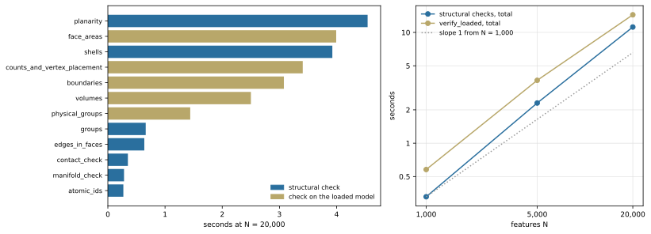

**Question.** The build checks its own output. What do those checks cost, and does the cost grow faster than the model?

**Result.**

- The structural checks take 0.33, 2.31 and 11.2 s at 1,000, 5,000 and 20,000 features: 16% to 19% of the build time in the same run. Their total scales with a slope of 1.20 and then 1.14 against the number of faces.
- The check on the loaded Gmsh model, `verify_loaded`, takes 0.58, 3.70 and 14.4 s.
- Individual checks scale with slopes between 0.89 and 1.35; among the checks that take more than 0.1 s at the largest size the slopes lie between 1.00 and 1.35.
- The OCCT checks were run only on small test models, where they take 6.6 to 262 ms. They were not measured on models of 1,000 features or more, so their scaling is unknown.

## Three groups of checks

- **Structural checks** run inside the build, on the derived model, before anything is written: planarity, the faces of each shell, group membership, identifier uniqueness, area conservation and others (the table below lists all of them). They cannot be switched off in production.
- **Checks on the loaded model** (`verify_loaded`) run after Gmsh has opened the XAO file. They compare the Gmsh model with the plan: counts, vertex positions, boundaries, physical groups, volumes and face areas.
- **OCCT checks** are the OpenCASCADE analyzers (`BRepCheck_Analyzer`, `BOPAlgo_ArgumentAnalyzer`, `ShapeAnalysis`) run on the written BREP and XAO files, together with a comparison of areas and volumes against the plan.

## Structural checks and checks on the loaded model

All three sizes come from one run per size, which builds the model, writes the files, opens the XAO in Gmsh and runs `verify_loaded`.

::: {.askr-table-compact .askr-table-numeric}

:::

{#fig-validation fig-alt="Left: horizontal bars for twelve checks at 20,000 features. Planarity is longest at about 4.5 seconds, followed by face_areas, shells, counts_and_vertex_placement and boundaries at 3 to 4 seconds; the others are below 1.5 seconds. Right: log-log lines for the structural total, rising from 0.33 to 11.2 seconds, and the loaded-model total, rising from 0.58 to 14.4 seconds, both close to a slope-1 reference."}

In @fig-validation, the five most expensive checks (`planarity`, `face_areas`, `shells`, `counts_and_vertex_placement` and `boundaries`) take 3.1 to 4.5 s each at 20,000 features, and three of them run on the loaded model. All nineteen checks follow. The slope column is taken against the number of faces F between the smallest and the largest size:

::: {.askr-table-compact .askr-table-numeric}

:::

Most checks visit every vertex, edge or face once, and their slopes lie close to 1. The checks with the highest slopes are `counts_and_vertex_placement` (1.35), `groups` (1.25) and `shells` (1.24); the lowest is `arcs` (0.89), which checks arc edges and has none to check in these layouts. Another timing of twelve of the structural checks, taken in the scaling run, agrees with this one to within 1.3% at 5,000 and 20,000 features and 8% at 1,000.

## OCCT checks

The OCCT checks ran on the test models of the SGB test suite, which are small: the 23 fixtures of its catalogue (63 combinations, of which 54 build) and the seven example models of the SGB design (a pad in a ground plane under Routes A, B and C, with and without bands, and an airbridge); the example models were checked as BREP and as XAO.

::: {.askr-table-compact .askr-table-numeric}

:::

Each range is the shortest to the longest time over the reports of that set. All 14 reports of the example models were accepted, and the largest relative error of a face area against the plan was 1.3e-12. These models are small (the Route B pad in a ground plane has 35 faces, the smallest layout in this study 14,215), so the table gives the order of magnitude of the cost (milliseconds to a quarter of a second) and says nothing about how it grows.

## Interpretation

The checks do not change the shape of the scaling: the structural total grows with a slope of about 1.15, close to that of the derivation it belongs to ([Scaling with chip size](scaling.qmd)), and it stays about one fifth of the build. The check on the loaded model costs a little more than the structural checks and is part of the tail after the derivation ([Direct writer and Gmsh load](emission-and-load.qmd#what-follows-the-derivation)). The cost of the OCCT checks at chip scale is an open measurement.
