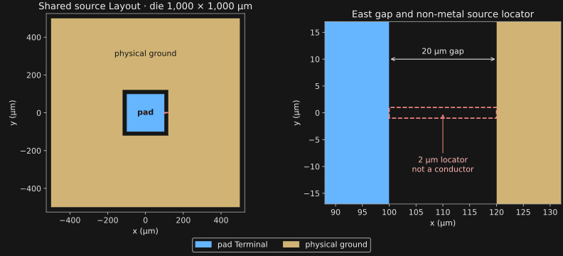

**Recorded snapshot — 4 November 2026:** Route A preparation stops before Gmsh. Route B shares one initial Mesh between C and NC. Conformal completed four solves, then aborted inside MFEM during the next refinement. The NC run was interrupted when the study binary was changed to Spack Official Palace 0.18.1; a later main CG solve had reached the 200-iteration limit without converging. The official-binary batch has not started. These fork observations are retained separately and are not a completed comparison.

| Case | Geometry | AMR | Preparation status | Solver status |
|---|---|---|---|---|
| A-C | Route A: Thin Film, zero-thickness PEC Sheet | Conformal | Blocked before Gmsh: `chip/PAD port overlap intersects 0 local Route A surface_sheet patches` | Not started |
| A-NC | Route A: Thin Film, zero-thickness PEC Sheet | Nonconformal | Blocked before Gmsh: `chip/PAD port overlap intersects 0 local Route A surface_sheet patches` | Not started |
| B-C | Route B: 100 nm Shell Solid; outer PEC | Conformal | Prepared; shares the Route B Mesh with B-NC | Aborted during refinement after four completed solves |
| B-NC | Route B: 100 nm Shell Solid; outer PEC | Nonconformal | Prepared; shares the Route B Mesh with B-C | Interrupted for the binary change; main and Recovery convergence remain separate |

The completed Conformal potential solves converged within 200 iterations; Recovery solves in passes 2–4 did not converge within 10,000 iterations. These observations used the diagnostic fork identified below. The cause of the refinement abort has not been established; neither a Geometry cause nor diagnostics-off equivalence has been demonstrated. A short failed run is not evidence of better efficiency.

The pad Net is selected as the Terminal, and the Ground Net is assigned as physical Ground. The exterior uses the natural boundary; no Surface EPR is requested.

{#fig-simplepad-layout}

## Study question {#study-question}

Within each geometry route, compare Conformal (C) and Nonconformal (NC) AMR from the same initial Mesh. The measures describe refined parents, mesh growth, solver cost, and the 1 × 1 capacitance matrix. Route A and Route B use different surface representations and separately built starting Meshes, so their cross-route comparison combines both changes.

This first trial covers one 1 × 1 capacitance-matrix case. The first batch has no independent reference matrix; neither route serves as truth for the other. A later reference-error analysis requires an explicitly supplied independent matrix. No accuracy threshold is set here.

## Core comparison {#core-settings}

| Dimension | Study design |
|---|---|
| Model | One 1 × 1 capacitance-matrix case; SimplePad geometry and material settings are shared. |
| Geometry | Route A: zero-thickness PEC Sheet. Route B: 100 nm conductor Shell Solid, outer PEC only, interior excluded. |
| AMR pair | Compare Conformal and Nonconformal within each route, starting from the same route Mesh. B is prepared with one shared Mesh; A stopped before Gmsh. |
| Solver | FEM order 2; CG with BoomerAMG; AMR maximum 20 passes, tolerance `0.01`, ZZ update fraction `0.7`, NC level limit 1. |
| Mesh generation | Gmsh 4.15.2; `gmsh_default`; Delaunay; geometry order 1; one thread. |
| Execution | 30 MPI ranks × 2 OpenMP threads; four cases sequentially; output settings shared. |

Model, mesh, and solver settings

| Setting | Value |
|---|---|
| Pad | 200 µm |
| Gap | 20 µm |
| Die | 1,000 µm |
| Silicon substrate | 500 µm; relative permittivity 11.9 |
| Background and vacuum envelope | Vacuum; `(250, 250, 1,000) µm` |
| Terminal and Ground | Pad Net selected as Terminal; Ground Net assigned as physical Ground |
| Exterior boundary / Surface EPR | Natural exterior boundary; no Surface EPR extraction |
| Route A | Explicit `thin_film` V1 Thin Film model; zero-thickness PEC Sheet |
| Route B | `route_b` V1; finite 100 nm conductor represented as Shell Solid; outer PEC; conductor interior excluded |
| Initial Mesh per route | One Mesh generated per route and reused for its C/NC pair. B-C/B-NC share the same prepared Mesh; Route A did not reach Gmsh. |
| Mesh generation | Gmsh 4.15.2; `gmsh_default`; Delaunay; geometry order 1; one thread |
| FEM order | 2 |
| Linear solver | CG with BoomerAMG preconditioning |
| Linear tolerance / maximum iterations | `1e-6` / 200 |
| AMR maximum iterations / tolerance | 20 / `0.01` |
| ZZ update fraction, θ | `0.7` |
| NC level limit | 1 |
| Parallel resources / order | 30 MPI ranks × 2 OpenMP threads; four runs executed sequentially |
| Output settings | Same across all four cases |

Geometry dimensions are in micrometres; relative permittivity is dimensionless.

## Reading the AMR measures {#interpretation}

A **refined parent** is a distinct active Mesh element immediately before an AMR pass that is actually split. The **Closure factor** (`R_closure`) is the number of refined parents divided by the number of ZZ-marked cells. Its numerator includes additional splits required for conformity or the NC level limit. It counts parents, not new child cells; new-cell amplification is a separate measure. The [AMR analysis reference](../amr-analysis.qmd) owns full metric definitions and collection behavior.

ZZ marks cells for refinement; it does not measure capacitance-matrix accuracy.

## Preparation and solver identity {#reproduction}

The public [SimplePad Electrostatic source at the selected 100 nm PDK revision](https://github.com/NCUPHY-LTLab/orcapen-sc-pdk/blob/c75a1d4d2ee07e86a3b5d9b491609e5a1a5b850c/notebooks/src/SCGSimExamples/ComponentSimulation/SimplePad/palace_electrostatic.qmd) owns the component input. The [SCGSim Palace Electrostatic workflow](../course/palace-electrostatic.qmd) and [Palace Electrostatic contract](../specs/palace-electrostatic-sgb.qmd) describe preparation and solver controls.

Prepared-input and executable identities

The Route B C/NC pair uses the same initial Mesh (SHA-256 `e1f600bbde30c981b967c8c62dddc4693874bffd88a8d837932f9b4cfb31ca55`). The two configuration files are identical except for `Nonconformal`. The SCGSim preparation source tree was clean at [revision `baa0766`](https://github.com/NCUPHY-LTLab/scgsim/tree/baa0766f3b3dc27520d3a7bbffe6aa19363647d7).

The diagnostic Palace executable was built from [Palace source revision `8dd5aca`](https://github.com/NCUPHY-LTLab/palace/tree/8dd5aca68cc27981be33e121b23525d9a19868ce); its ELF SHA-256 is `34474fd173e92cb1f712a26116da6277c18baeee69c7881c625513d581a8e60e`. The [later merged Palace source revision `bbe970ed`](https://github.com/NCUPHY-LTLab/palace/tree/bbe970edb6fda1c59336b8351816dc6018635168) identifies integrated source, not the executable that was built. The prepared configuration does not serialize `AbsTol`, `autoLc`, or `partitionseed`; this page does not present them as explicitly recorded settings.

