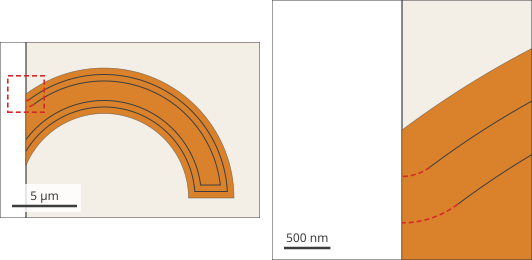
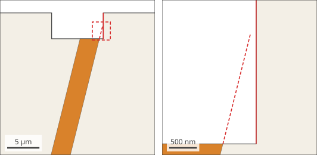
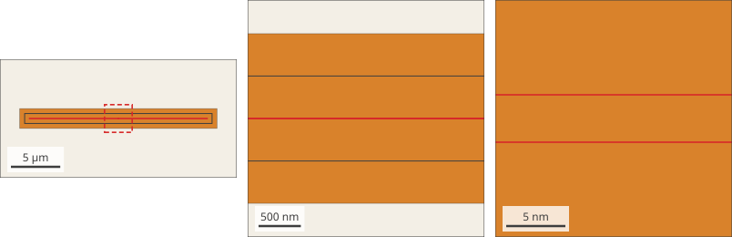

This page lists the layout patterns that SCGSim's geometry builder (SGB) is
tested on, each with a figure and the dimensions of the OrcaPen SC PDK cells
that use it, and the rule for drawing curved outlines. A layout made of these
patterns, within the ranges below, builds with Surface-EPR bands whose areas
match the exact geometry. A pattern that is not listed is not verified; those
SCGSim refuses are shown under [Geometry SCGSim does not model](#unsupported). The
cases known to fail or to need a layout change, with their causes, are on
[Known Geometry Problems](known-geometry-problems.qmd). The rules every layout
must follow, and who owns a failure, are on [Supported Scope](supported-scope.qmd).

## Check a layout before you simulate it

Run the check of each simulation the component is for:
`EigenmodeSim.simulation_drc` for an Eigenmode simulation,
`ElectrostaticSim.simulation_drc` for an electrostatic one, or both. Each runs
the same preparation and geometry build as that class's `mesh()`, with your
Surface-EPR margins, and raises the error `mesh()` would raise. The
[layout modeling check](layout-modeling-check.qmd) shows the call and what it
needs.

## What "supported" means {#what-supported-means}

Each unit cell below is a sample layout in SCGSim's test suite. The samples are
drawn directly as SGB records on the 1 nm grid, with no PDK code, and their
dimensions come from the PDK cells built with `curve_sampling="simulation"`.
Every sample builds under Route B with MA, MS and SA bands at
`inset_margins_um=(0.5, 1.0)`. Bands are measured from the
[gap edges](specs/palace-eigenmode.qmd#surface-epr-margins), the edges of a
conductor that face exposed substrate. The die edge is a dicing line: where it
cuts a straight conductor edge, the conductor is treated as continuing past it,
so the bands along that edge run straight to the die edge at any angle, with no
rounded end. A die outline that comes back within the largest band margin of
that continuation, as beside a notch, is refused, and so is an exact arc that
the die edge cuts; see [Geometry SCGSim does not model](#unsupported).

For every band, the test compares the built area with the exact erosion of the
same polygons. The two agree within the grid's snap bound: half a grid diagonal
(0.71 nm) times the length of the band's edges, so each 100 µm of band edge
allows at most 0.07 µm² of difference.

The dimensions measured across the PDK cells, and covered by the samples, are:

| Quantity | Range |
| --- | --- |
| Conductor and trace widths | 2 to 150 µm |
| Gaps between conductors | 3.3 to 85 µm |
| Ground ribs between two gaps | 3 µm |
| Polygon-circle radii | 1 to 350 µm |
| Straight edges | any angle, with kinks from 0.86° |
| Lumped-port sheets | 0.27 to 150 µm wide |
| Vertices in one outline | up to 604, in a CPW meander of twelve bends |
| Surface-EPR margins | 0.5 and 1.0 µm |

Only these two margins were measured. A larger margin in a narrow gap or rib
changes which bands exist; that is a valid result, but it is not covered here.

## Supported unit cells {#unit-cells}

The figures are drawn from the test samples. Grey is ground, the other colours
are separate conductors, cream is exposed substrate and yellow is a lumped-port
sheet. Dark grey marks metal that stands above the plane metal: bumps, airbridge
piers and the deck. Dimensions are in µm.

### Disk Qubit cells {#disk-qubit-cells}

These are the patterns the flip-chip Disk Qubit uses.

::: {layout-ncol=2}
{fig-alt="A 32-point polygon disk on exposed substrate."}

{fig-alt="A ground square with a 32-point circular hole."}

{fig-alt="A claw: a ring sector tapering into a narrow CPW, inside a ground opening."}

{fig-alt="Close view of a claw corner rounded with four chords."}

{fig-alt="Straight taper edges narrowing from the claw to a 3 µm CPW."}

{fig-alt="A horizontal CPW: signal strip between two ground strips."}

{fig-alt="A CPW running diagonally across the die."}

{fig-alt="A CPW ending in a half-circle cap inside a half-circle ground opening."}

{fig-alt="The disk's lead widening as a fan onto the disk, and the ground tongue opposite."}

{fig-alt="Two lead ends with round caps and the narrow lumped sheet between them."}

{fig-alt="Three square bumps on the ground near the clearance edge."}

{fig-alt="The qubit die: disk, four claws, junction lead and the ground with its openings."}
:::

In cell 10 the simulation sees only the lumped sheet and the two leads. The
5 × 0.09 µm cross that the PDK draws on layer 22/0 is the fabrication junction;
it is not in the simulation layer stack.

The test build draws the disk's junction lead straight, 2 µm wide along its whole
length, on a diagonal. On the grid it is 0.7 nm wider than twice the 1.0 µm
margin, so it keeps a core 0.7 nm wide and is refused before meshing; see
[Surface-EPR margins](supported-scope.qmd#rules-margins).

### Lines and bends {#lines-and-bends}

Every CPW here has a 6 µm gap, and every bend a 100 µm radius.

::: {layout-ncol=2}
{fig-alt="A 90° CPW bend drawn with eight chords."}

{fig-alt="A 90° CPW Euler bend."}

{fig-alt="A CPW turning back on itself through a 180° Euler bend."}

{fig-alt="Two parallel CPW traces separated by a narrow ground rib, leaving in Euler bends."}

{fig-alt="A Manhattan CPW T-junction with three ground pieces."}

{fig-alt="A CPW narrowing from width 10 to 7 over 50 µm."}
:::

### Pads, combs, strips and 3-D parts {#pads-and-parts}

::: {layout-ncol=2}
{fig-alt="A square launcher pad tapering into a CPW, with the port sheet behind the pad."}

{fig-alt="Two interleaved finger combs fed by funnels, inside a ground opening."}

{fig-alt="A curved strip with no ground around it."}

{fig-alt="A landing annulus around the TSV bore inside a ground opening."}

{fig-alt="A bridge deck on two piers crossing a CPW."}

{fig-alt="A narrow port sheet spanning the gap between a pad edge and the ground."}
:::

The PDK draws the spline strips of cell 21 with 258 points. The samples
resample them; the strips as drawn also build with exact bands (see
[Curved outlines drawn as polygons](#curve-rule)).

In cell 22 the wall's 0.2 µm thickness is thinner than either margin. Its faces
are vertical, so no band lies on them, and the landing's bands are measured from
the 20 µm gap only.

Cells 14, 15 and 18 contain a few vertices that turn by less than 2.8125°;
they build with exact bands as drawn (see [Curved outlines drawn as
polygons](#curve-rule)).

## Geometry SCGSim does not model {#unsupported}

SCGSim refuses these layouts with a message that names the conductor and the
place, and builds no model from them. Each figure is drawn from a sample in the
test suite, banded at `inset_margins_um=(0.5, 1.0)`. White is outside the die,
so the die edge is where white meets cream; thin dark lines are band boundaries
and red marks the problem. Dimensions are in µm. The rules themselves are on
[Surface-EPR margins](supported-scope.qmd#rules-margins).

### A conductor cut by the die edge along an arc {#unsupported-arc-die-cut}

{fig-alt="A curved strip running into the die edge, with its band boundaries; near the cut, the boundaries end in short red dashed arcs about the cut point."}

The die edge is a dicing line, so SCGSim treats a conductor cut by it as
continuing past it, and a straight edge continues along its own line. An edge
declared as an exact arc has no straight continuation. Ending its bands in a
half circle about the cut, as at the end of a conductor, would measure the
strip as if it ended there, so SCGSim does not model it.

The build raises `InputError`, naming the conductor and the cut point:

```text
inset request 'ma::strip::top': the die edge cuts 'strip'
at (0.0000, 2.5000) um, where its gap edge is an exact arc. …
Let a straight edge of the conductor meet the die edge
```

A curve drawn as a polygon meets the die edge with a straight chord, which
continues like any straight edge.

### The die outline beside a cut {#unsupported-notch-beside-cut}

{fig-alt="A diagonal strip ending on the floor of a notch in the die edge; a dashed continuation of its side reaches close to the notch wall."}

Bands beside the continuation would be measured from a conductor that is not
drawn. The same rule refuses a conductor that overhangs the die from a vertex
on its edge, two cut conductors whose continuations cross past the die edge,
and a cut beside a curved stretch of the die outline. The build raises
`InputError`, naming the conductor and the cut point, for example
`the die outline comes back within the band margin (1 um) of the continuation of
'strip', cut by the die edge at (21.4000, 26.0000) um`.

### A conductor a little wider than twice its largest margin {#unsupported-lead-core}

{fig-alt="A straight lead with its band boundaries; enlarged, the two innermost boundaries run 4 nm apart down the middle of the lead."}

The core, the face beyond the largest margin, is narrower than the 10 grid
steps the mesher needs. A lead exactly twice the margin wide has no core and is
modeled. The meshing stage of `mesh()` and `simulation_drc()` refuses the core
with `SimulationDrcError`: a class B narrow face owned by `erosion`, with its
location and the fix, change the margins or the width; see
[What the meshing stage reports](layout-modeling-check.qmd#what-the-meshing-stage-reports).

## Lumped ports are made rectangles {#lumped-port-rectangle}

Palace accepts a Lumped Port or Lumped RLC only as a rectangle: it compares the
port's bounding-box length with its length along the port direction. Each
lumped port that an `EigenmodeSim` configures is therefore the central
rectangle of its drawn sheet. The rest of the sheet becomes metal of the
conductors it lands on: the part before the first cut joins the conductor at
the start of the port direction, and the part after the second cut joins the
other conductor. A conductor without a Net is a Net of its own. You draw the
sheet as before, a rectangle that reaches into both conductors, along x, along
y or at an angle.

Each conductor gains the free part of the sheet up to its cut. Where the sheet
lands on a conductor edge that SGB builds as an exactly declared arc, the end
piece is the whole drawn sheet from its start to the cut and overlaps the
conductor, so it meets the arc also where the arc lies beyond the drawn polygon,
as on the inside of a round opening. Where the sheet lands on edges SGB builds
as drawn, the end piece is only the free part, and on a straight edge at right
angles to the sheet it is empty. An arc elsewhere on the conductor, away from
the sheet, changes neither.

### The rectangle on the grid, at any angle {#lumped-port-angle}

A rectangle whose four corners are grid points runs along a direction of whole
grid steps: its side along the port is k steps of v = (p, q), where p and q are
whole numbers with no common factor, and its side across the port is m steps of
(−q, p). This v is the port's direction on the grid: (1, 0) or (0, 1) along x or
y, (1, 1) at 45°, and (3, 4) for a side that runs 3 grid steps in x for every 4
in y. SCGSim reads each sheet as such a rectangle:

1. **Its four corners.** Where a conductor outline crosses a side of the sheet,
   the grid rounds the crossing to a grid point; on a side at an angle that
   point can lie off the side by up to half a grid diagonal (0.71 nm on a 1 nm
   grid), the grid's snap bound. SCGSim drops every vertex that lies within the
   snap bound of the line between the two corners of its side and keeps the four
   corners. When a vertex lies so close to a corner that more than one set of
   four vertices passes this rule, SCGSim reads each set as in step 2 and keeps
   the one whose rectangle lies nearest its drawn corners; when two lie equally
   near, SCGSim refuses the port and names both.
2. **The rectangle.** When the four corners as drawn are grid points of such a
   rectangle, nothing moves. Otherwise, for example when an instance registered
   with a `GeometryPlan` and turned by 45° places a sheet drawn along x, so that
   its corners leave the grid, SCGSim takes the nearest such rectangle whose
   corners each lie within the snap bound of the drawn corners, and records how
   far each corner moved. When there is none, or the nearest one does not run
   along the port direction, SCGSim refuses the port, naming it, its layer and
   its four drawn corners in µm. A layout passed whole, without a plan, reaches
   SCGSim with its corners already on the grid; they are its drawn corners.

Between the two cuts, the sheet's long sides are the sides of that rectangle, so
the port is exactly the rectangle. Beyond the cuts, the end pieces keep the
vertices the grid shares with the conductors.

### Where the cuts lie {#lumped-port-cuts}

A cut across the rectangle has both its ends on grid points only every
|v| = √(p² + q²) grid steps along the port: at every grid step along x or y,
every 1.414 nm at 45° on a 1 nm grid, and every 5 nm along (3, 4). These are the
cut positions. On each end, SCGSim chooses the cut in two steps:

1. It starts at the first cut position, at or past the conductor's farthest
   reach into the sheet, that leaves one connected end piece: the largest
   rectangle the sheet holds.
2. The end piece adds an edge to its conductor along each long side of the
   sheet, from where the conductor's outline meets that side to the cut. The
   cut moves one cut position further into the gap at a time until each such
   edge is zero or at least 10 grid steps long (10 nm on a 1 nm grid), so the
   side wall that stands on it is not narrower than the fine-structure limit for
   side walls. Where the conductor's own edge already runs along the side, the
   end piece continues that edge and adds none.

A gap that holds fewer than two cut positions has no room for the rectangle:
SCGSim refuses the port and names where the gap lies, its length and the cut
spacing.

The outline is the one SGB builds: a conductor declared with an exact arc meets
the side where the arc does, on the grid point SGB rounds the crossing to, not
where its polygon does, and reaches into the sheet as far as the arc does, also
where a chord of its polygon faces the sheet. A sheet that ends on straight conductor edges at right
angles to it keeps the face and the conductors it had: its cuts lie on those
edges and its end pieces are empty.

For the circular pad coupon (pad radius 100 µm in a ground opening of radius
120 µm, a 2 µm sheet, 1 nm grid):

| End | The outline meets the sheet sides at | Largest rectangle | Cut taken | Edge added |
| --- | --- | --- | --- | --- |
| Pad, arc of radius 100 µm | x = 99.995 µm | x = 100.000 µm, edge 5 nm | x = 100.005 µm | 10 nm |
| Ground opening, arc of radius 120 µm | x = 119.996 µm | x = 119.988 µm, edge 8 nm | x = 119.986 µm | 10 nm |

The port is 19.981 µm long, 0.007 µm shorter than the largest rectangle.

### Worked example: the Xmon's junction port at 45° {#lumped-port-xmon}

The [flip-chip Xmon](tutorial-xmon-input.qmd) draws its junction sheet at 45°
across the gap between the ground opening and the Xmon pad, on a 1 nm grid. On
the grid the sheet has eight vertices, four of them added where the two round
outlines cross its long sides:

| Vertex | Position (µm) | Read as |
| --- | --- | --- |
| A | (−55.443, −24.420) | corner |
| | (−54.742, −23.719) | on side AB, where the ground opening crosses it: dropped |
| | (−52.143, −21.120) | on side AB, where the Xmon pad crosses it: dropped |
| B | (−51.443, −20.420) | corner |
| C | (−51.633, −20.230) | corner |
| | (−52.333, −20.930) | on side CD, where the Xmon pad crosses it: dropped |
| | (−54.933, −23.529) | 0.707 nm outside side CD, half a grid diagonal, where the ground opening crosses it: dropped |
| D | (−55.633, −24.230) | corner |

- **Direction.** B − A = (4000, 4000) nm = 4000 · (1, 1), so v = (1, 1) and the
  cut positions are √2 nm = 1.414 nm apart.
- **Width.** D − A = (−190, 190) nm = 190 · (−1, 1): the port is
  190 · √2 nm = 268.70 nm wide, as drawn.
- **Shift.** The four corners are grid points of a rectangle, so none moves. The
  recorded shifts, below 10⁻¹⁴ µm, are the floating-point rounding of placing
  the cell.
- **Cuts.** Counted in cut positions from A:

| End | Largest rectangle | Edge added | Cut taken | Edge added |
| --- | --- | --- | --- | --- |
| Ground opening, at A | 708, 1.0013 µm from A | 9.9 nm | 709, 1.0027 µm from A | 11.3 nm |
| Xmon pad, at B | 3292, 4.6556 µm from A | 11.3 nm | 3292 | 11.3 nm |

The cut at 709 ends at (−54.734, −23.711) and (−54.924, −23.521) µm, the cut at
3292 at (−52.151, −21.128) and (−52.341, −20.938) µm: these are the port's four
corners. The port is 2583 · √2 nm = 3.6529 µm long, and SGB builds its face with
an area of 0.98154 µm².

### What SCGSim records {#lumped-port-record}

The partition record of each port carries what SCGSim did under `lattice`:

| Key | Meaning |
| --- | --- |
| `direction_grid` | v = (p, q), the port's direction in whole grid steps |
| `cut_spacing_um` | the distance between cut positions, \|v\| grid steps |
| `corners_um` | the rectangle's corners A, B, C and D: A starts the port on its right-hand side, B = A + k v ends it |
| `drawn_corners_um` | the corners as drawn, before the grid rounded them |
| `corner_shifts_um` | how far each corner moved from its drawn corner, in x and y |
| `cuts` | each cut's `index` (cut positions from A), `from_corner_a_um` and its two `ends_um` |
| `modelled_sheet_um` | the sheet with its long sides straight between the cuts, present only when they were not |

The AEDT preparation returns the record as
`prepare_planar_geometry_input(...).source["junction_partitions"][junction_id]["lattice"]`.
A Palace simulation prepares its port from the same record and keeps it on the
port sheet of its prepared geometry, under `rectangular_junction_lattice`.

## Curved outlines drawn as polygons {#curve-rule}

A curve drawn as a polygon builds with the bands of its exact erosion. SGB sets
no minimum turn per vertex and no maximum number of points per circle: at a
convex vertex between two straight edges, the offsets of the two edges end at
their crossing, one shared grid point, wherever that crossing lies on both.

These outlines were built and checked against the exact erosion, at margins 0.5
and 1.0 µm:

| Outline | Turn per vertex | Measured at | Result |
| --- | --- | --- | --- |
| Regular polygon circle, 16, 24, 32, 64 or 128 points | 22.5° to 2.8125° | radius 5, 10, 50 and 150 µm | bands exact |
| 128-point circle, centre off the grid at (0.3337, 0.1234) µm, rotated by 0.73°, or both (centre (12.0004, −7.7771) µm, rotated by 1.7°) | 2.8125° | radius 5, 10, 37.3, 75 and 150 µm | bands exact |
| Regular polygon circle, 256 points | 1.41° | radius 5, 10, 50 and 150 µm | bands exact |
| Spline strips as the PDK draws them, 258 points | down to 0.058° (interpolation) and 0.012° (B-spline) | as drawn | bands exact |
| Euler bends and tapers of cells 14, 15 and 18 | 0.15° to 2.7° at a few vertices | as drawn | bands exact |
| A 16-point circle of radius 50 µm with one vertex added on an edge | 2.9°, 2.7°, 1.41°, 0.3° and 0.01° convex; 2.7° and 0.01° reflex; 0° | 9.8 µm edges | bands exact |

These are examples, not limits. The meshing cost of outlines with many more
points per circle, with bands on, has not been measured.

Where two neighbouring offsets still neither meet nor cross, the build stops
with this message rather than return wrong bands:

```text
inset family '…': the inset curve at m = … um is not closed near (x, y) um: two
offsets of the support boundary neither meet nor cross there, so the band regions
cannot be told apart. This is an SCGSim defect, not a layout rule: report it to
SCGSim with the layout …
```

A circular arc can also be declared as an exact arc, which SGB carries without
sampling.
