This page lists the layout patterns that SCGSim's geometry builder (SGB) is
tested on, with the dimensions of the OrcaPen SC PDK cells that use them. A
layout made of these patterns, within the ranges below, builds with Surface-EPR
bands whose areas match the exact geometry. A pattern that is not listed is not
verified: it may build, or SCGSim refuses it with a message. When a layout is
refused, change the layout; the sections below say how for each known case.

## Check a layout before you simulate it

Run the check of each simulation the component is for:
`EigenmodeSim.simulation_drc` for an Eigenmode simulation,
`ElectrostaticSim.simulation_drc` for an electrostatic one, or both. Each runs
the same preparation and geometry build as that class's `mesh()`, with your
Surface-EPR margins, and raises the error `mesh()` would raise. The
[layout modeling check](layout-modeling-check.qmd) shows the call and what it
needs.

## What "supported" means {#what-supported-means}

Each unit cell below is a sample layout in SCGSim's test suite. The samples are
drawn directly as SGB records on the 1 nm grid, with no PDK code, and their
dimensions come from the PDK cells built with `curve_sampling="simulation"`.
Every sample builds under Route B with MA, MS and SA bands at
`inset_margins_um=(0.5, 1.0)`. Bands are measured from the
[gap edges](specs/palace-eigenmode.qmd#surface-epr-margins), the edges of a
conductor that face exposed substrate.

For every band, the test compares the built area with the exact erosion of the
same polygons. The two agree within the grid's snap bound: half a grid diagonal
(0.71 nm) times the length of the band's edges, so each 100 µm of band edge
allows at most 0.07 µm² of difference.

The dimensions measured across the PDK cells, and covered by the samples, are:

| Quantity | Range |
| --- | --- |
| Conductor and trace widths | 2 to 150 µm |
| Gaps between conductors | 3.3 to 85 µm |
| Ground ribs between two gaps | 3 µm |
| Polygon-circle radii | 1 to 350 µm |
| Straight edges | any angle, with kinks from 0.86° |
| Lumped-port sheets | 0.27 to 150 µm wide |
| Surface-EPR margins | 0.5 and 1.0 µm |

Only these two margins were measured. A larger margin in a narrow gap or rib
changes which bands exist; that is a valid result, but it is not covered here.

## Curved outlines: at most 128 points per full circle {#curve-rule}

A curve drawn as a polygon is supported when it uses at most 128 points per full
circle. Each of its vertices then turns by at least 360° / 128 = 2.8125°. This
is a rule about the turn at each vertex, not about edge length: a 256-point
circle of radius 150 µm has 3.68 µm edges and is still refused.

The OrcaPen SC PDK's `curve_sampling="simulation"` profile draws 16, 24 or 32
points per full circle, well inside the rule. Its default `"fabrication"`
profile draws 256 points per full circle and is refused. Build components for
simulation with `curve_sampling="simulation"`.

The rule was measured on regular polygon circles at margins 0.5 and 1.0 µm:

| Points per full circle | Turn per vertex | Radius 5, 10, 50 and 150 µm |
| --- | --- | --- |
| 16, 24, 32, 64, 128 | 22.5° to 2.8125° | builds, bands exact |
| more than 128, fewer than 256 | 2.8° to 1.41° | depends on the case; not supported |
| 256 | 1.41° | refused at every radius |

At 128 points the circle also builds with exact bands at radii of 5, 10, 37.3,
75 and 150 µm when its centre is off the grid at (0.3337, 0.1234) µm, when it is
rotated by 0.73°, and when both apply (centre (12.0004, −7.7771) µm, rotated by
1.7°).

A refused curve stops the build with this message:

```text
inset family '…': the inset curve at m = … um is not closed near (x, y) um: two
offsets of the support boundary neither meet nor cross there, so the band regions
cannot be told apart. An outline whose vertices turn by less than 2.8125 degrees
each, … does this: draw curved outlines with at most 128 points per full circle, …
```

In these measurements no case produced a wrong band without this message; that
is an observation, not a guarantee.

### Vertices that turn less in the unit cells

Some unit cells have vertices that turn by less than 2.8125°, and they are
supported as drawn there. A taper kinks by 0.86° or 1.72° (cell 18). The 90°
Euler bend turns by 0.30° and 1.8° at its first two vertices, and the 180° U-turn
by 0.15°, 0.9°, 1.8° and 2.7° at its first four, with chords of 11 to 14 µm
(cells 14 and 15). Elsewhere, a run of vertices that turn less than 2.8125° is
not verified.

A single vertex that turns less, between longer edges, builds with exact bands.
One added vertex in a 16-point circle of radius 50 µm, with 9.8 µm edges on both
sides, was measured at these turns:

| Turn of the one vertex | Result |
| --- | --- |
| 2.9°, 2.7°, 1.41°, 0.3° and 0.01°, convex | builds, bands exact |
| 2.7° and 0.01°, reflex | builds, bands exact |
| 0° (a point on a straight edge) | builds, bands exact |

A point on a straight edge leaves an axis-aligned edge's bands unchanged. On an
oblique edge the bands move by a few 10⁻⁴ µm², within the snap bound, because
the offsets of the two halves end on a grid point there.

### Draw a curve that fits the rule

- Build PDK components with `curve_sampling="simulation"`.
- Resample a spline so that every vertex turns by at least 2.8125°. Spline
  boundary curves themselves are not read yet
  ([scgsim#109](https://github.com/NCUPHY-LTLab/scgsim/issues/109)).
- A circular arc can also be declared as an exact arc, which SGB carries
  without sampling.

## Supported unit cells {#unit-cells}

The figures are drawn from the test samples. Grey is ground, the other colours
are separate conductors, cream is exposed substrate and yellow is a lumped-port
sheet. Dark grey marks metal that stands above the plane metal: bumps, airbridge
piers and the deck. All dimensions are in µm.

### Disk Qubit cells {#disk-qubit-cells}

These are the patterns the flip-chip Disk Qubit uses.

::: {layout-ncol=3}
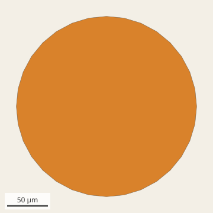{fig-alt="A 32-point polygon disk on exposed substrate."}

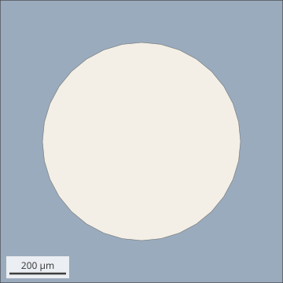{fig-alt="A ground square with a 32-point circular hole."}

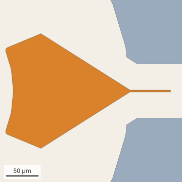{fig-alt="A claw: a ring sector tapering into a narrow CPW, inside a ground opening."}

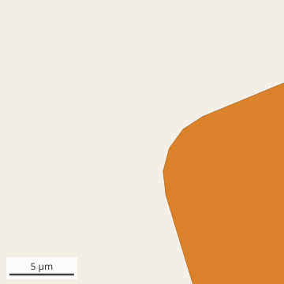{fig-alt="Close view of a claw corner rounded with four chords."}

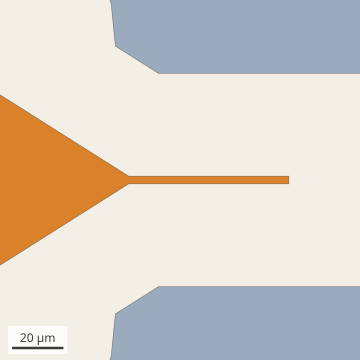{fig-alt="Straight taper edges narrowing from the claw to a 3 µm CPW."}

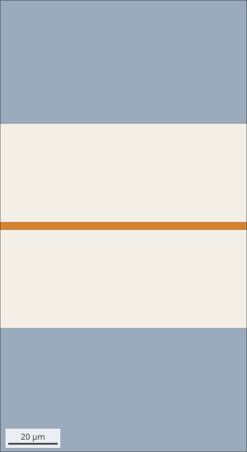{fig-alt="A horizontal CPW: signal strip between two ground strips."}

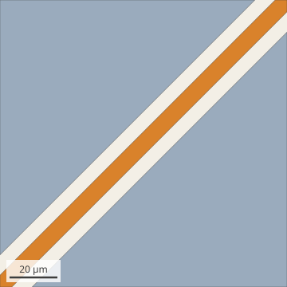{fig-alt="A CPW running diagonally across the die."}

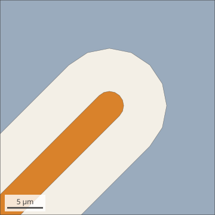{fig-alt="A CPW ending in a half-circle cap inside a half-circle ground opening."}

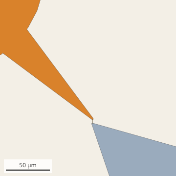{fig-alt="The disk's lead widening as a fan onto the disk, and the ground tongue opposite."}

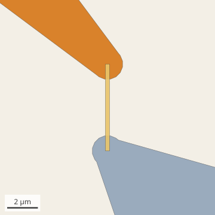{fig-alt="Two lead ends with round caps and the narrow lumped sheet between them."}

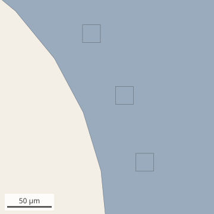{fig-alt="Three square bumps on the ground near the clearance edge."}

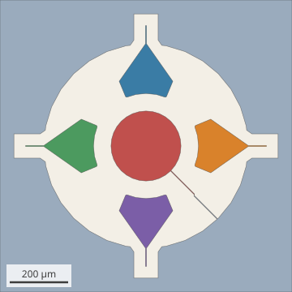{fig-alt="The qubit die: disk, four claws, junction lead and the ground with its openings."}
:::

| Cell | Pattern | Dimensions | Used by |
| --- | --- | --- | --- |
| 1 | Disk island, a 32-point polygon | r 110.5 (119.8 in the test build), 11.25° per vertex | the disk |
| 2 | Ground clearance circle, a 32-point hole | r 350 | both dies |
| 3 | Claw arc: a 45° ring sector with an inner arc of 4 chords | r 170.5 to 230.5, width 60 | four claws |
| 4 | Rounded inner corner | r 5, 4 chords | eight corners |
| 5 | Claw-to-CPW taper: straight edges at any angle | 32.3° (35.1° in the test build), 3 µm neck at r 350 | four claws |
| 6 | Manhattan CPW straight | width 3, gap 40 | claw lines |
| 7 | 45° CPW straight | readout width 7, gap 6; drive width 4, gap 6 | control die |
| 8 | Round CPW tip, 16-point caps | metal r 2 in an opening r 8; readout tip r 3.5 | control die |
| 9 | Radial taper fan | 2 µm neck widening to a 20° arc; flares ±8.30°, 29.24°, 26.17° | junction leads |
| 10 | Junction region: lumped sheet and leads with round caps | sheet 0.27 × 5.66, lead caps r 1 | the junction |
| 11 | Indium bump pads, axis-aligned squares | 20 and 40, 24 sites on r 400 | flip chip |
| 12 | Ground: a square less the mask openings | 1000 × 1000 | both dies |

In cell 10 the simulation sees only the lumped sheet and the two leads. The
5 × 0.09 µm cross that the PDK draws on layer 22/0 is the fabrication junction;
it is not in the simulation layer stack.

### Lines and bends {#lines-and-bends}

Every CPW here has a 6 µm gap, and every bend a 100 µm radius.

::: {layout-ncol=3}
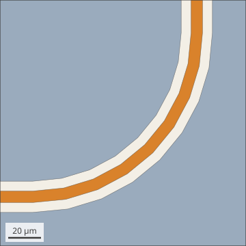{fig-alt="A 90° CPW bend drawn with eight chords."}

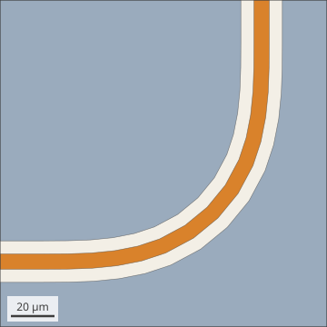{fig-alt="A 90° CPW Euler bend."}

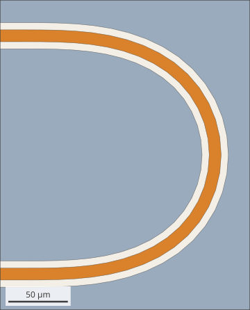{fig-alt="A CPW turning back on itself through a 180° Euler bend."}

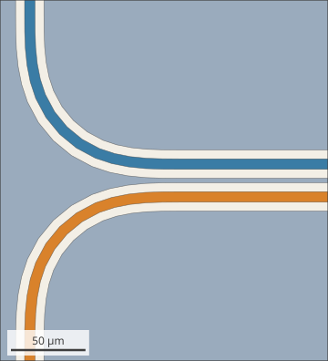{fig-alt="Two parallel CPW traces separated by a narrow ground rib, leaving in Euler bends."}

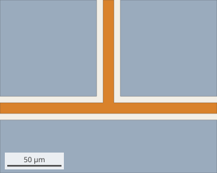{fig-alt="A Manhattan CPW T-junction with three ground pieces."}

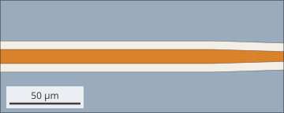{fig-alt="A CPW narrowing from width 10 to 7 over 50 µm."}
:::

| Cell | Pattern | Dimensions | Used by |
| --- | --- | --- | --- |
| 13 | Circular CPW bend | R 100, 8 chords per 90°, edge radii 90.5 to 109.5 | `bend_circular`, Purcell routes, `straight_to_circular_strip` |
| 14 | Euler 90° bend | p 0.5, minimum radius 70.61, 14 chords; the first chord turns 0.30° | `bend_euler`, `mtl_*`, `resonator_hanger` |
| 15 | Euler 180° U-turn | minimum radius 90.86, 30 chords, legs 200 apart; the first chord turns 0.15° | `resonator`, `resonator_meander`, meander coupons |
| 16 | Coupled pair with a ground rib | traces 7, gaps 6, rib 3; traces leave in Euler bends | `n_trace_mtl_section`, `mtl_*`, Purcell, meander coupons |
| 17 | Manhattan T-junction; shorted CPW end | width 10, gap 6 | `cpw_t_junction`, Kosen Xmon, `resonator` |
| 18 | Shallow linear taper | width 10 to 7; edge kinks of 0.86° and 1.72° | `taper`, `cpw_handoff` |

The shorted end in cell 17 is a CPW whose signal joins the ground where it ends,
so each gap is a closed 6 µm slot. It is a sample of its own.

### Pads, combs, strips and 3-D parts {#pads-and-parts}

::: {layout-ncol=3}
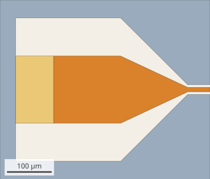{fig-alt="A square launcher pad tapering into a CPW, with the port sheet behind the pad."}

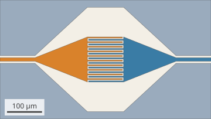{fig-alt="Two interleaved finger combs fed by funnels, inside a ground opening."}

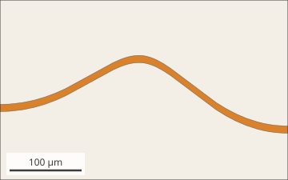{fig-alt="A curved strip with no ground around it."}

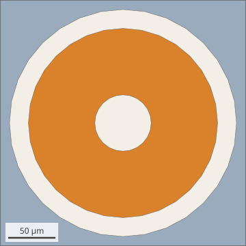{fig-alt="A landing annulus around the TSV bore inside a ground opening."}

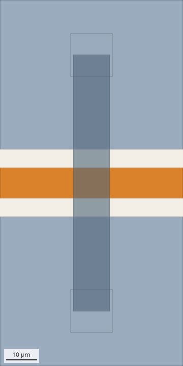{fig-alt="A bridge deck on two piers crossing a CPW."}

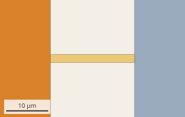{fig-alt="A narrow port sheet spanning the gap between a pad edge and the ground."}
:::

| Cell | Pattern | Dimensions | Used by |
| --- | --- | --- | --- |
| 19 | Launcher | 150 × 150 pad; taper edges at 25.0° (signal) and 44.8° (opening); 85 × 150 port sheet abutting pad and ground | `launcher`, the airbridge sample chip, meander coupons |
| 20 | Interdigitated comb | fingers and gaps 3.3, length 100, 20 fingers; funnel at 21.6° (opening 42.7°) | `interdigital_capacitor`, Purcell |
| 21 | Spline strip | width 10 in y; resampled so every vertex turns at least 2.8125° | `interpolation_spline_strip`, `bspline_strip` |
| 22 | Hollow TSV | 0.2 µm wall between two 24-point circles (r 29.8 and 30), 500 tall; Al landing r 29.8 to 100 in an opening r 120 on both faces | the TSV coupons |
| 23 | Airbridge | 12 × 84 deck on two 14 × 14 piers, over a CPW of width 10, gap 6 | `airbridge`, `cpw_airbridge_coupon`, meander coupons |
| 24 | Lumped sheet across a gap | 2 × 20 sheet over a 20 µm gap, entering pad and ground by 1 nm; square pad 200, or 32-point pad r 100 | the square, circular and flip-chip pad coupons |

The PDK draws the spline strips of cell 21 with 258 points, and their flattest
vertices turn by 0.012° and 0.058°. As drawn they are outside the curve rule and
are refused; the samples resample them first.

In cell 22 the wall's 0.2 µm thickness is thinner than either margin. Its faces
are vertical, so no band lies on them, and the landing's bands are measured from
the 20 µm gap only.

## Drawing defects to fix in the layout {#drawing-defects}

A survey of the OrcaPen SC PDK found drawing defects: places where what is
drawn differs from what the PDK code means to draw. SCGSim does not work around
them. Each is reported to the PDK in
[orcapen-sc-pdk#47](https://github.com/NCUPHY-LTLab/orcapen-sc-pdk/issues/47)
or [orcapen-sc-pdk#58](https://github.com/NCUPHY-LTLab/orcapen-sc-pdk/issues/58),
and the same checks apply to any layout.

| Defect | What happens in SCGSim | What to change |
| --- | --- | --- |
| **C1.** A crack between the Disk Qubit's radial lead fan and the disk: an 18.26 µm wedge, 0.21 µm wide at its mouth, closing to a 9.9 nm step | It builds as drawn. The crack's sides become gap edges, so the disk gains bands along them: its band 0 grows by about 9 % (446 against 410 µm² in a sample) | Make the fan's arc land on the disk's own vertices, or extend the fan into the disk before the union, so the union is one clean outline |
| **C2, C3.** Zero-width slits, 1.305 and 2.282 µm long with a 1 nm base, in the claw metal | The bands are unchanged, but each slit leaves 1 nm edges and a 1 nm wide wall face for the mesher. With the slits present, one measured run ended without a usable mesh | Round the corners on the whole claw outline instead of splicing rounded pieces in through windows |
| **C4.** A bite at each claw's outer corner: a 57.7° tip, then edges of 2.766 and 0.136 µm and a leftover rounding | It builds, but the corner is not the intended one, and the 0.136 µm edge forces small mesh elements | Add the taper before rounding, or round only the corners that remain |
| **A1.** Purcell IDC fingers start 1 nm from their funnel (the finger length is off the grid and the comb has no spine), so they float | The fingers are separate conductors. SGB stops at the first slit with `Imprint lost band boundaries … is in band 2, expected 1`; were it to build, the capacitance would be wrong | Give the comb its own spine and use finger lengths on the grid |
| **A6.** The etch layer holds a chip-edge frame that the ground mask lacks | SCGSim derives the ground from the mask, so its ground runs over the dicing lane, while the PDK's etch-based metal does not | Put the frame in the ground mask too, or take it out of the etch layer |

## Not covered {#not-covered}

- Surface-EPR margins other than 0.5 and 1.0 µm.
- Polygon curves between 129 and 255 points per full circle.
- Spline boundary curves read as curves.
- Patterns that are not among the 24 unit cells or their combinations above.
