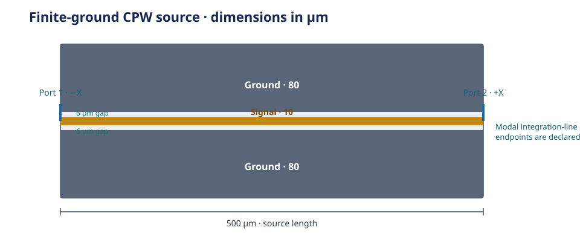

## 1. Choose the response question {#1-what-you-will-get}

> If a signal enters port 1, how much reaches port 2 and how much is reflected?

Follow this page from one declared coplanar waveguide (CPW) layout to its
two-port S-parameter response. The example geometry is:

| Quantity | Baseline value |
|---|---:|
| CPW length | 500 µm |
| Signal width | 10 µm |
| Gap to each ground | 6 µm |
| Width of each ground | 80 µm |
| Silicon substrate thickness | 500 µm |

Choose the port model that matches the question. HFSS Modal uses integration
lines; HFSS Terminal uses Wave ports with explicit ground references.

| Port model | Reference definition |
|---|---|
| HFSS Modal | Integration lines at the two CPW end faces |
| HFSS Terminal | Wave ports at the same end faces, with both ground objects as references |

{#fig-public-cpw-source}

The figure shows the declared rectangles and Modal port coordinates, not a
simulated field or response curve.

::: {.callout-note title="Public source notebooks" collapse="true"}
The PDK maintains the [HFSS Modal source notebook](https://github.com/NCUPHY-LTLab/orcapen-sc-pdk/blob/35b4dc1cdd3f921badcac2fe57a98366315ae8d9/notebooks/ComponentSimulation/CpwFiniteGround/aedt_hfss_driven_modal.ipynb)
and [HFSS Terminal source notebook](https://github.com/NCUPHY-LTLab/orcapen-sc-pdk/blob/35b4dc1cdd3f921badcac2fe57a98366315ae8d9/notebooks/ComponentSimulation/CpwFiniteGround/aedt_hfss_driven_terminal.ipynb).
:::

## 2. Prepare your environment

Use Python 3.12 or 3.13. Install Git and [uv](https://docs.astral.sh/uv/getting-started/installation/),
then create a study environment with the SCGSim and OrcaPen revisions used by
this notebook.

```bash
uv init --python 3.12 cpw-scattering
cd cpw-scattering
uv add 'scgsim[aedt] @ git+https://github.com/NCUPHY-LTLab/scgsim.git@90fb50ef9de80fa6e556d2f2a09fb45707efeea0' \
  'orpen-sc-pdk @ git+https://github.com/NCUPHY-LTLab/orcapen-sc-pdk.git@35b4dc1cdd3f921badcac2fe57a98366315ae8d9' \
  ipykernel
uv run python -c "from importlib.metadata import version; print(version('scgsim')); print(version('orpen-sc-pdk'))"
uv run --with jupyter jupyter lab
```

Check: both package versions print, and Jupyter uses this project's `.venv`.

::: {.callout-note title="Pinned package sources" collapse="true"}
The install command pins SCGSim `2.0.0rc11` and the public PDK source at
revision `35b4dc1`, imported as `orpen_sc_pdk`.
:::

## 3. Set the model and sweep {#3-choose-your-settings}

Edit this cell before building a new request. It groups the layout dimensions,
frequency sweep, and run resources used by both port choices. Lengths are in
micrometres and sweep bounds are in GHz.

| Settings group | Values to choose |
|---|---|
| Solver and output | AEDT release and a fresh run ID for each port model |
| Geometry and material | CPW dimensions and metal thickness |
| Sweep and ports | Frequency bounds, sweep points, integration-line height and length mesh |
| Runtime resources | AEDT cores and RAM limit |

```{python}
#| id: scattering-settings
from pathlib import Path

# Solver and output identity
AEDT_VERSION = "2024.2"  # Select 2023.2 or 2024.2 for the licensed host.
OUTPUT_ROOT = Path(".artifacts/finite-cpw-scattering")
SOURCE_GDS = OUTPUT_ROOT / "source" / "cpw.gds"
MODAL_RUN_ID = "cpw-modal-01"
TERMINAL_RUN_ID = "cpw-terminal-01"
# CPW geometry and material thickness
CPW_LENGTH_UM = 500.0
SIGNAL_WIDTH_UM = 10.0
GAP_UM = 6.0
GROUND_WIDTH_UM = 80.0
SUBSTRATE_WIDTH_UM = SIGNAL_WIDTH_UM + 2 * (GAP_UM + GROUND_WIDTH_UM)
SUBSTRATE_THICKNESS_UM = 500.0
GROUND_CENTER_OFFSET_UM = SIGNAL_WIDTH_UM / 2 + GAP_UM + GROUND_WIDTH_UM / 2
# Frequency sweep, port line, and runtime resources
FREQUENCY_START_GHZ = 3.0
FREQUENCY_STOP_GHZ = 8.0
SWEEP_POINTS = 20_000
METAL_THICKNESS_UM = 0.2
PORT_LINE_HEIGHT_UM = 20.0
LENGTH_MESH_UM = 10.0
AEDT_CORES = 4
AEDT_RAM_LIMIT_PERCENT = 80
```

The two run IDs keep each port model in its own output folder. Modal uses
integration lines at the CPW end faces; Terminal uses the same end faces and
the two explicit ground objects as its references.

Check: confirm the AEDT release, frequency window, sweep size, and fresh run
IDs for the question you plan to study.

## 4. Build the CPW geometry and material map {#build-cpw-source}

This cell creates the public rectangular layout, writes its GDS, and binds the
imported layer and objects to PDK materials. Both port models use this same
geometry and material map.

```{python}
#| id: scattering-cpw-source
import gdsfactory as gf
import orpen_sc_pdk
from orpen_sc_pdk.materials import get_material_records
from orpen_sc_pdk.tech import LAYER
from scgsim.aedt import (
    AedtResources, FrequencySweepSpec, HfssDrivenSpec, HfssRunControl,
    LayerImport, LengthMeshSpec, ModalPort, ObjectBinding, PdkMaterial,
    PhysicalLayerSpec, TerminalPort, prepare_handoff,
)

orpen_sc_pdk.activate()
coupon = gf.Component()
coupon << gf.components.rectangle(
    size=(CPW_LENGTH_UM, SIGNAL_WIDTH_UM), centered=True,
    layer=LAYER.D0_TOP_M1_DRAW,
)
upper = coupon << gf.components.rectangle(
    size=(CPW_LENGTH_UM, GROUND_WIDTH_UM), centered=True,
    layer=LAYER.D0_TOP_M1_DRAW,
)
upper.movey(GROUND_CENTER_OFFSET_UM)
lower = coupon << gf.components.rectangle(
    size=(CPW_LENGTH_UM, GROUND_WIDTH_UM), centered=True,
    layer=LAYER.D0_TOP_M1_DRAW,
)
lower.movey(-GROUND_CENTER_OFFSET_UM)
coupon << gf.components.rectangle(
    size=(CPW_LENGTH_UM, SUBSTRATE_WIDTH_UM), centered=True,
    layer=LAYER.D0_SUBSTRATE_AREA,
)
SOURCE_GDS.parent.mkdir(parents=True, exist_ok=True)
coupon.write_gds(SOURCE_GDS, with_metadata=False)

records = get_material_records()
materials = {
    name: PdkMaterial(
        name,
        records[name]["material_kind"],
        records[name]["is_superconducting"],
        records[name]["aedt_library_name"],
    )
    for name in ("vacuum", "Si", "Nb")
}
object_bindings = (
    ObjectBinding("D0_TOP_M1_1", 1, "signal", "Nb"),
    ObjectBinding("D0_TOP_M1_2", 1, "ground", "Nb"),
    ObjectBinding("D0_TOP_M1_3", 1, "ground", "Nb"),
    ObjectBinding("D0_SUBSTRATE_4", 201, "substrate", "Si"),
)
ground_objects = ("D0_TOP_M1_2", "D0_TOP_M1_3")
```

The imported object names follow source declaration and import order. GDS
contains the metal sheets and substrate outline. The Thin Film model separately
sets the metal interval and lower contact side, so use the request below for
those facts rather than inferring them from the picture.

Check: `SOURCE_GDS` exists and the source uses one signal, two distinct ground
objects, and one substrate object.

## 5. Choose and define the port model {#configure-port-models}

Choose one branch for the study. Both examples use the same imported objects,
explicit `NB_FILM` layer interval, and frequency sweep; they differ in how the
ports define their reference.

:::: {.panel-tabset group="scattering-solver"}

### HFSS Modal

```{python}
#| id: scattering-modal-config
physical_layer_id = "orpen_sc_pdk:CpwFiniteGround:NB_FILM"
physical_layer = PhysicalLayerSpec(
    physical_layer_id=physical_layer_id,
    kind="stack_film",
    z_min_um=0.0,
    z_max_um=METAL_THICKNESS_UM,
    contact_side="lower",
)
layer_imports = (
    LayerImport(
        1, 0, "D0_TOP_M1", 0.0, METAL_THICKNESS_UM,
        physical_layer_id=physical_layer_id,
    ),
        LayerImport(201, 0, "D0_SUBSTRATE", -SUBSTRATE_THICKNESS_UM, 0.0),
)
modal_ports = (
    ModalPort(
        1, "o1", "-X",
        ((-CPW_LENGTH_UM / 2, 0.0, 0.0),
         (-CPW_LENGTH_UM / 2, PORT_LINE_HEIGHT_UM, 0.0)),
    ),
    ModalPort(
        2, "o2", "+X",
        ((CPW_LENGTH_UM / 2, 0.0, 0.0),
         (CPW_LENGTH_UM / 2, PORT_LINE_HEIGHT_UM, 0.0)),
    ),
)
modal_spec = HfssDrivenSpec(
    aedt_version=AEDT_VERSION,
    mode="modal",
    gds_path=SOURCE_GDS,
    modeling="thin_film",
    project_name="public_cpw_modal",
    design_name="CpwFiniteGroundModal",
    materials=materials,
    vacuum_material_id="vacuum",
    layer_imports=layer_imports,
    object_bindings=object_bindings,
    physical_layers=(physical_layer,),
    ports=modal_ports,
    run_control=HfssRunControl(
        "Setup1", "Fast20000",
        FrequencySweepSpec(FREQUENCY_START_GHZ, FREQUENCY_STOP_GHZ, SWEEP_POINTS),
    ),
    region_padding_um=(0.0, 0.0, 100.0, 100.0, 1000.0, 1000.0),
    length_mesh=LengthMeshSpec(("D0_TOP_M1_1",), ground_objects, LENGTH_MESH_UM),
)
```

Modal ports 1 and 2 use explicit integration lines at the `-X` and `+X` end
faces. Their order and line direction are part of this request.

### HFSS Terminal

```{python}
#| id: scattering-terminal-config
physical_layer_id = "orpen_sc_pdk:CpwFiniteGround:NB_FILM"
physical_layer = PhysicalLayerSpec(
    physical_layer_id=physical_layer_id,
    kind="stack_film",
    z_min_um=0.0,
    z_max_um=METAL_THICKNESS_UM,
    contact_side="lower",
)
layer_imports = (
    LayerImport(
        1, 0, "D0_TOP_M1", 0.0, METAL_THICKNESS_UM,
        physical_layer_id=physical_layer_id,
    ),
        LayerImport(201, 0, "D0_SUBSTRATE", -SUBSTRATE_THICKNESS_UM, 0.0),
)
terminal_ports = (
    TerminalPort(1, "o1", "-X", ground_objects),
    TerminalPort(2, "o2", "+X", ground_objects),
)
terminal_spec = HfssDrivenSpec(
    aedt_version=AEDT_VERSION,
    mode="terminal",
    gds_path=SOURCE_GDS,
    modeling="thin_film",
    project_name="public_cpw_terminal",
    design_name="CpwFiniteGroundTerminal",
    materials=materials,
    vacuum_material_id="vacuum",
    layer_imports=layer_imports,
    object_bindings=object_bindings,
    physical_layers=(physical_layer,),
    ports=terminal_ports,
    run_control=HfssRunControl(
        "Setup1", "Fast20000",
        FrequencySweepSpec(FREQUENCY_START_GHZ, FREQUENCY_STOP_GHZ, SWEEP_POINTS),
    ),
    region_padding_um=(0.0, 0.0, 100.0, 100.0, 1000.0, 1000.0),
    length_mesh=LengthMeshSpec(("D0_TOP_M1_1",), ground_objects, LENGTH_MESH_UM),
)
```

Wave Terminal ports each reference the ordered tuple
`("D0_TOP_M1_2", "D0_TOP_M1_3")`. These names must match the explicit source
bindings.

::: {.callout-note title="Keep the port models distinct"}
The Wave Terminal result has explicit ground references. A Lumped Terminal
port is a different model with different support and impedance inputs, so it
cannot replace Wave in this example.
:::

::::

Check: inspect the selected mode, AEDT release, layer interval, port order or
references, and frequency sweep before preparation. The
[Driven contract](../specs/aedt-runtime.qmd#hfss-driven-sweep-count)
defines the sweep-count input.

## 6. Inspect, prepare, and run on AEDT {#prepare-and-execute}

Preparation writes the solver package. Review its copied specification and
archive, then run it explicitly on the licensed AEDT host. For a remote run,
transfer the complete package, run `run_aedt.sh` on that host, and return the
complete output directory.

::: {.callout-important title="AEDT solver host requirements"}
Run on a host with AEDT 2023.2 or 2024.2, PyAEDT 1.3.0, and an available AEDT
license. Python packages prepare the request; they do not install AEDT.
:::

:::: {.panel-tabset group="scattering-solver"}

### HFSS Modal

```{python}
#| id: scattering-modal-prepare
modal_handoff = prepare_handoff(
    spec=modal_spec,
    output_dir=OUTPUT_ROOT / MODAL_RUN_ID,
    resources=AedtResources(cores=AEDT_CORES, ram_limit_percent=AEDT_RAM_LIMIT_PERCENT),
)
print(modal_handoff.spec_path, modal_handoff.archive_path)
```

```{python}
#| id: scattering-modal-execute
import subprocess

subprocess.run(
    ["bash", str(modal_handoff.script_path)],
    cwd=modal_handoff.run_dir,
    check=True,
)
```

### HFSS Terminal

```{python}
#| id: scattering-terminal-prepare
terminal_handoff = prepare_handoff(
    spec=terminal_spec,
    output_dir=OUTPUT_ROOT / TERMINAL_RUN_ID,
    resources=AedtResources(cores=AEDT_CORES, ram_limit_percent=AEDT_RAM_LIMIT_PERCENT),
)
print(terminal_handoff.spec_path, terminal_handoff.archive_path)
```

```{python}
#| id: scattering-terminal-execute
import subprocess

subprocess.run(
    ["bash", str(terminal_handoff.script_path)],
    cwd=terminal_handoff.run_dir,
    check=True,
)
```

::::

AEDT Desktop runs on the same licensed host as its runner. Preparation or
scheduler submission alone does not produce a returned result. See
[execution and handoff](../reference.qmd#execution-handoff) for the transfer
boundary.

Check: the selected runner finishes and the complete returned folder is
available at its run path.

## 7. Read the returned response {#resolve-the-response}

After the run completes, open a fresh analysis kernel. The path below matches
the output directory from step 6; for a remote run, point it to the complete
returned folder, then run the cell.

Both port models return dimensionless S-parameters. For port `k`, its
S-parameter to port `j` is the outgoing wave divided by the incident wave at
`k`, when all other ports have zero incident wave:

$$
S_{jk}=\frac{b_j}{a_k}
$$

Here `a_k` is the incident wave and `b_j` is the outgoing wave. Keep the port
model and reference convention with each reported value.

With port 1 excited, read `S11` as reflection at port 1 and `S21` as
transmission from port 1 to port 2. Locate those named S-parameter results in
the returned rows and report, and retain the selected port ordering.

:::: {.panel-tabset group="scattering-solver"}

### HFSS Modal

```{python}
#| id: scattering-modal-results
from pathlib import Path
from scgsim.aedt import resolve_results

RETURNED_RUN_DIR = Path(".artifacts/finite-cpw-scattering/cpw-modal-01")
resolved = resolve_results(RETURNED_RUN_DIR)
physics_rows = resolved.physics_results()
resolved.show_all_results(show_details=True)
physics_rows
```

Retain the frequency, ordered Modal ports, integration-line convention, and
reported units together. Use the returned report for impedance quantities.

### HFSS Terminal

```{python}
#| id: scattering-terminal-results
from pathlib import Path
from scgsim.aedt import resolve_results

RETURNED_RUN_DIR = Path(".artifacts/finite-cpw-scattering/cpw-terminal-01")
resolved = resolve_results(RETURNED_RUN_DIR)
physics_rows = resolved.physics_results()
resolved.show_all_results(show_details=True)
physics_rows
```

Retain the frequency, ordered ports, exact shared ground references, and
reported units together. Terminal results use their own native reference and
readback; interpret them under that port model.

::::

The report places native status and available adaptive changes beside the
response. Read those with the intended study when deciding whether the result
is useful. See the [results and reports reference](../reference.qmd#results-reports)
for the shared result view.

Check: the resolved report shows the returned run identity, port convention,
frequency data and native status.

## 8. Change the example for another CPW {#8-adapt-this-notebook}

When changing the CPW layout, update its rectangles and material/object
bindings together. Revisit Modal integration-line endpoints or the Wave
Terminal reference-object tuple, and use a new run ID for each preparation.
Update the schematic to match the dimensions and interpret each return under
its selected port model.

Check: inspect the rebuilt layout and copied request before preparing another
run. For backend-specific details, continue to the
[Modal course reference](../course/aedt-driven-modal.qmd),
[Terminal course reference](../course/aedt-driven-terminal.qmd), and
[AEDT runtime contract](../specs/aedt-runtime.qmd).
