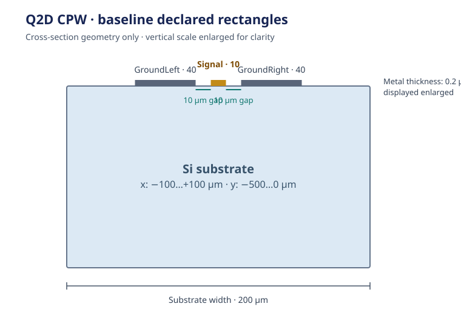

## 1. Define the calculation {#1-what-you-will-get}

> What capacitance, conductance, inductance, and resistance matrices does this
> finite-ground CPW cross-section return per unit length at the chosen frequency?

Follow this coplanar waveguide (CPW) cross-section through Q2D preparation, an
explicit AEDT run, and reading the returned RLGC matrices. The model is an
authored 2D cross-section; it does not infer a slice from a GDS or 3D layout.

{#fig-q2d-cpw-cross-section}

The example cross-section is:

| Feature | Dimensions and material |
|---|---|
| Substrate | 200 µm wide × 500 µm thick Si |
| Signal conductor | 10 µm wide, 0.2 µm thick Nb |
| Each ground conductor | 40 µm wide, 0.2 µm thick Nb |
| Signal-to-ground gap | 10 µm on each side |

## 2. Prepare your environment

Use Python 3.12 or 3.13. Install Git and [uv](https://docs.astral.sh/uv/getting-started/installation/),
then create a study environment with the pinned SCGSim and OrcaPen source.

```bash
uv init --python 3.12 cpw-line-parameters
cd cpw-line-parameters
uv add 'scgsim[aedt] @ git+https://github.com/NCUPHY-LTLab/scgsim.git@90fb50ef9de80fa6e556d2f2a09fb45707efeea0' \
  'orpen-sc-pdk @ git+https://github.com/NCUPHY-LTLab/orcapen-sc-pdk.git@35b4dc1cdd3f921badcac2fe57a98366315ae8d9' \
  ipykernel
uv run python -c "from importlib.metadata import version; print(version('scgsim')); print(version('orpen-sc-pdk'))"
uv run --with jupyter jupyter lab
```

Check: both package versions print, and Jupyter uses this project's `.venv`.

::: {.callout-note title="Pinned package source" collapse="true"}
The install command pins SCGSim `2.0.0rc11` and the PDK source notebook at
revision `35b4dc1`, imported as `orpen_sc_pdk`. The PDK maintains the
[Q2D cross-section notebook](https://github.com/NCUPHY-LTLab/orcapen-sc-pdk/blob/35b4dc1cdd3f921badcac2fe57a98366315ae8d9/notebooks/CrossSectionSimulation/CpwFiniteGround/aedt_q2d.ipynb).
:::

## 3. Set the cross-section and run options {#3-choose-your-settings}

Edit the settings before preparing a new run. They group the cross-section,
Q2D frequency and adaptive limit, and solver resources/output. Rectangle
positions and sizes are in micrometres, and frequency is in GHz. Region padding
is ordered `(+X, -X, +Y, -Y)`.

| Settings group | Values to choose |
|---|---|
| Solver and output | AEDT release, project/design names, and a fresh output directory |
| Q2D run | Setup frequency, adaptive iteration limit, and Region padding |
| Cross-section | Substrate, signal, ground, and gap dimensions |
| Runtime resources | AEDT cores and RAM limit |

```{python}
#| id: line-parameter-settings
from pathlib import Path

# Solver identity and output
AEDT_VERSION = "2024.2"  # Select 2023.2 or 2024.2 for the licensed host.
OUTPUT_DIR = Path(".artifacts/public-cpw-q2d")
PROJECT_NAME = "public_cpw_q2d"
DESIGN_NAME = "CpwFiniteGroundQ2d"
SETUP_NAME = "Setup1"
# Q2D frequency, adaptive limit, and Region
FREQUENCY_GHZ = 6.0
MAXIMUM_PASSES = 3
REGION_PADDING_UM = (100.0, 100.0, 1000.0, 100.0)
# Cross-section dimensions and positions
SUBSTRATE_WIDTH_UM = 200.0
SUBSTRATE_THICKNESS_UM = 500.0
SUBSTRATE_ORIGIN_UM = (-SUBSTRATE_WIDTH_UM / 2, -SUBSTRATE_THICKNESS_UM)
SUBSTRATE_SIZE_UM = (SUBSTRATE_WIDTH_UM, SUBSTRATE_THICKNESS_UM)
SIGNAL_WIDTH_UM = 10.0
GROUND_GAP_UM = 10.0
GROUND_WIDTH_UM = 40.0
METAL_THICKNESS_UM = 0.2
SIGNAL_ORIGIN_UM = (-SIGNAL_WIDTH_UM / 2, 0.0)
GROUND_LEFT_ORIGIN_UM = (
    -SIGNAL_WIDTH_UM / 2 - GROUND_GAP_UM - GROUND_WIDTH_UM, 0.0
)
GROUND_RIGHT_ORIGIN_UM = (SIGNAL_WIDTH_UM / 2 + GROUND_GAP_UM, 0.0)
# AEDT resources
AEDT_CORES = 4
AEDT_RAM_LIMIT_PERCENT = 80
```

The unequal positive and negative Y padding is explicit model input. The tuple
uses its public order; Q2D maps it to the native Region call internally.

Check: confirm the selected AEDT release, frequency, pass limit, padding order,
and a fresh output directory.

## 4. Build the cross-section and conductor map {#build-cross-section}

Use PDK material records, then declare every rectangle and conductor group.
The vacuum is assigned to the Region by Q2D and does not need an authored
vacuum rectangle.

```{python}
#| id: line-parameter-source
import orpen_sc_pdk
from orpen_sc_pdk.materials import get_material_records
from scgsim.aedt import (
    AedtResources, MatrixRunControl, PdkMaterial, Q2dConductorSpec,
    Q2dRectangleSpec, Q2dSpec, prepare_handoff,
)

orpen_sc_pdk.activate()
records = get_material_records()
materials = {
    name: PdkMaterial(
        name,
        records[name]["material_kind"],
        records[name]["is_superconducting"],
        records[name]["aedt_library_name"],
    )
    for name in ("vacuum", "Si", "Nb")
}
rectangles = (
    Q2dRectangleSpec("Substrate", SUBSTRATE_ORIGIN_UM, SUBSTRATE_SIZE_UM, "Si"),
    Q2dRectangleSpec(
        "Signal", SIGNAL_ORIGIN_UM, (SIGNAL_WIDTH_UM, METAL_THICKNESS_UM), "Nb"
    ),
    Q2dRectangleSpec(
        "GroundLeft", GROUND_LEFT_ORIGIN_UM,
        (GROUND_WIDTH_UM, METAL_THICKNESS_UM), "Nb",
    ),
    Q2dRectangleSpec(
        "GroundRight", GROUND_RIGHT_ORIGIN_UM,
        (GROUND_WIDTH_UM, METAL_THICKNESS_UM), "Nb",
    ),
)
conductors = (
    Q2dConductorSpec("Signal", "SignalLine", ("Signal",), METAL_THICKNESS_UM),
    Q2dConductorSpec(
        "Ground", "ReferenceGround", ("GroundLeft", "GroundRight"),
        METAL_THICKNESS_UM,
    ),
)
```

Rectangle positions give their lower-left coordinates. The signal is 10 µm
from each ground; both ground rectangles form the `ReferenceGround` conductor.
The 500 µm substrate extends below the metal plane. Q2D assigns vacuum to the
Region, while the two conductor memberships are explicit in the request.

Check: review each rectangle's material, origin, size, and the two declared
conductor groups against the figure.

## 5. Set up the Q2D request {#configure-the-extraction}

The Q2D request combines the explicit rectangles and conductor groups with a
matrix run control. Its reported matrices describe the cross-section per unit
length at the selected setup frequency.

```{python}
#| id: line-parameter-config
spec = Q2dSpec(
    aedt_version=AEDT_VERSION,
    project_name=PROJECT_NAME,
    design_name=DESIGN_NAME,
    materials=materials,
    vacuum_material_id="vacuum",
    rectangles=rectangles,
    conductors=conductors,
    run_control=MatrixRunControl(
        SETUP_NAME,
        frequency_ghz=FREQUENCY_GHZ,
        maximum_passes=MAXIMUM_PASSES,
    ),
    region_padding_um=REGION_PADDING_UM,
)
print(spec.to_payload())
```

Check: confirm the request shows the AEDT version, setup frequency, conductor
order, rectangle membership, and public padding order.

## 6. Inspect, prepare, and run on AEDT {#prepare-and-execute}

Preparation builds the solver package. Review its specification and archive,
then run it explicitly on the licensed AEDT host. For a remote solver, transfer
the complete package, run `run_aedt.sh` from its extracted folder, and return
the complete output directory.

::: {.callout-important title="AEDT solver host requirements"}
Run on a host with AEDT 2023.2 or 2024.2, PyAEDT 1.3.0, and an available AEDT
license. Python packages prepare the request; they do not install AEDT Desktop.
:::

```{python}
#| id: line-parameter-prepare
resources = AedtResources(
    cores=AEDT_CORES,
    ram_limit_percent=AEDT_RAM_LIMIT_PERCENT,
)
handoff = prepare_handoff(
    spec=spec,
    output_dir=OUTPUT_DIR,
    resources=resources,
)
print(handoff.spec_path, handoff.archive_path)
```

Review the specification and archive before execution. Preparation or job
submission alone does not produce a returned result.

```{python}
#| id: line-parameter-execute
import subprocess

subprocess.run(
    ["bash", str(handoff.script_path)],
    cwd=handoff.run_dir,
    check=True,
)
```

AEDT Desktop runs on the same licensed host as the runner. See
[execution and handoff](../reference.qmd#execution-handoff) for the transfer
boundary.

Check: the native runner completes and the complete return is available at the
chosen output directory.

## 7. Read the returned RLGC matrices {#resolve-the-matrix}

After the run completes, open a fresh analysis kernel. Point the path below to
the output directory from step 6, or to the complete returned folder after a
remote run, then run the cell.

```{python}
#| id: line-parameter-results
from pathlib import Path
from scgsim.aedt import resolve_results

RETURNED_RUN_DIR = Path(".artifacts/public-cpw-q2d")
resolved = resolve_results(RETURNED_RUN_DIR)
physics_rows = resolved.physics_results()
resolved.show_all_results(show_details=True)
physics_rows
```

The native `results/q2d/rlgc_matrix.csv` contains the C, G, L, and R matrix
blocks. Read each block with its conductor order and native per-unit-length
unit:

| Block | Native unit |
| --- | --- |
| Capacitance, C | pF/meter |
| Conductance, G | mho/meter |
| Inductance, L | nH/meter |
| Resistance, R | ohm/meter |

Keep the matrix values and units with the run's frequency and conductor order
when comparing cross-sections.

::: {.callout-note title="Result scope" collapse="true"}
Q2D describes this explicit cross-section per unit length. A finite-length
line's end geometry and port treatment require a separate model.
:::

The resolver also reports frequency, `LastAdaptive` solution, and native
status. Interpret the returned matrices for the intended line model; this
example does not convert RLGC into impedance, propagation constant, or phase
velocity.

In `physics_rows` and the report, identify the C, G, L, or R block and the
conductor entry by its row and column order. Keep the returned run, native
units, frequency, and status with the result. See the
[Q2D export contract](../specs/aedt-runtime.qmd#q2d-native-combined-matrix-export).

## 8. Change the cross-section {#8-adapt-this-notebook}

Edit rectangle dimensions or material records explicitly. The settings cell
derives the substrate and ground origins from the widths and gap; update the
baseline figure when those dimensions change. If a rectangle changes role,
update conductor membership so the signal and reference conductor stay clear.
Use a new output directory for each preparation and retain native matrix units
when comparing runs.

Check: inspect the cross-section and serialized request before preparing the
next run. Continue to the
[Q2D backend course](../course/aedt-q2d.qmd) for family-specific detail, or
the [physical problem concept](../concepts/problems.qmd#finite-extraction-versus-a-cross-section).
