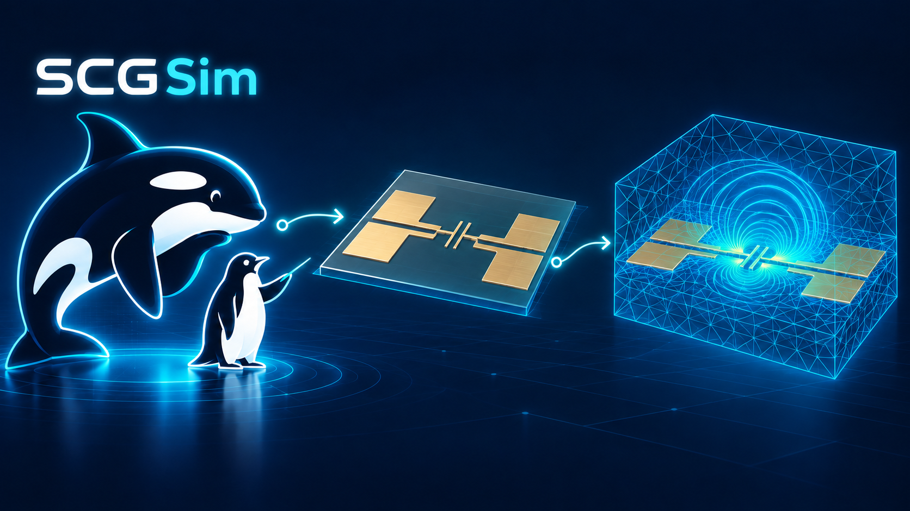

# SCGSim

**使用 Python 模擬超導電路版圖。**

[](https://github.com/NCUPHY-LTLab/scgsim/blob/develop/LICENSE)
[](docs/start/install.qmd)
[](docs/start/choose-a-simulation.qmd)
[](docs/reference/supported-calculations.qmd)
[](docs/guides/modes-palace.qmd)
[](docs/concepts/geometry.qmd)
[](docs/contribute/goals-and-upstream.qmd)



SCGSim 會把超導晶片的版圖、層堆疊與材料，連同你指定的導體，建成一個 3D 模型，再寫出你選擇的求解器的輸入：開源的 Palace，或 Ansys AEDT（HFSS、Q3D、Q2D）。執行結束後，SCGSim 會讀回附有單位的結果：電容矩陣、共振模態的頻率、Q 值與能量參與率、S 參數，以及單位長度的線路參數。

## 安裝

先安裝 [uv](https://docs.astral.sh/uv/getting-started/installation/) 與 Git，再建立研究專案，加入 SCGSim `3.0.0` 與 OrcaPen SC PDK（範例用來繪製版圖的元件庫）；兩者都固定到明確的修訂版本：

```bash
uv init --python 3.12 scgsim-study
cd scgsim-study
uv add 'scgsim[palace] @ git+https://github.com/NCUPHY-LTLab/scgsim.git@v3.0.0' \
  'orcapen-sc-pdk @ git+https://github.com/NCUPHY-LTLab/orcapen-sc-pdk.git@49e539fd59f3224ecda965d777c7ec3aadcc3b85'
```

`palace` extra 用來準備 Palace 的執行。若要使用 AEDT，請一併列出它的 extra：`scgsim[palace,aedt]`。[安裝 SCGSim](docs/start/install.qmd) 列出所有 extra，以及執行 Palace 與 AEDT 的電腦需要什麼。

## 從這裡開始

[第一個模擬](docs/start/first-simulation.qmd)只用一支腳本，以 Palace 計算一個 200 µm 方形焊盤（周圍間隙 20 µm）的電容；在你自己的電腦上就能執行，不需要 AEDT 授權。腳本最後會印出：

```text
Capacitance matrix (fF): pad
     pad     112.54
```

## 你想計算什麼？

<div id="選擇下一個模擬目標"></div>

| 想計算的量 | 使用 Palace | 使用 AEDT |
|---|---|---|
| 焊盤與電極的電容矩陣 | [Palace：端子電容](docs/guides/capacitance-palace.qmd) | [AEDT：Q3D 擷取](docs/guides/capacitance-q3d.qmd) |
| 共振模態的頻率、Q 值與能量參與率 | [Palace：共振模態](docs/guides/modes-palace.qmd) | [AEDT：HFSS Eigenmode](docs/guides/modes-hfss.qmd) |
| 雙埠元件的 S 參數 | SCGSim 未提供 | [AEDT：HFSS Driven Terminal](docs/guides/s-parameters-hfss.qmd) |
| 線路橫截面的單位長度 C、G、L、R | SCGSim 未提供 | [AEDT：Q2D 橫截面擷取](docs/guides/line-parameters-q2d.qmd) |

[選擇模擬](docs/start/choose-a-simulation.qmd)為每一項補上 OrcaPen SC PDK 的筆記本。<span id="使用範例用一支腳本完成-simplepad-電容抽取"></span>[AEDT：Q3D 擷取](docs/guides/capacitance-q3d.qmd)一開始就是第一個模擬的 AEDT 版本：一支腳本完成 Q3D 電容計算的準備、執行與讀取。

## 模擬自己的版圖之前

模擬自己的版圖之前，請先閱讀[支援範圍](docs/reference/supported-scope.qmd)：版圖必須保證什麼、SCGSim 反過來保證什麼，以及失敗由誰負責。
