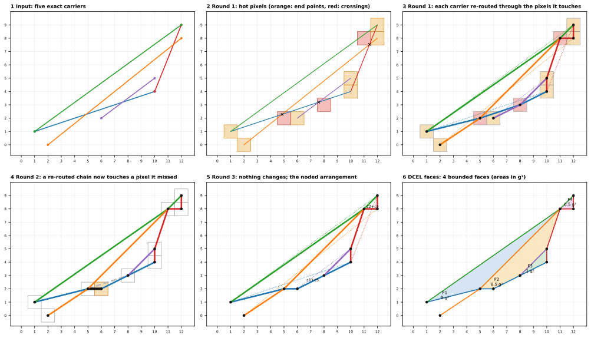
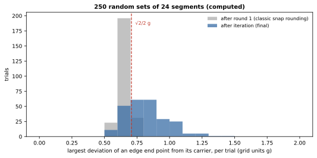
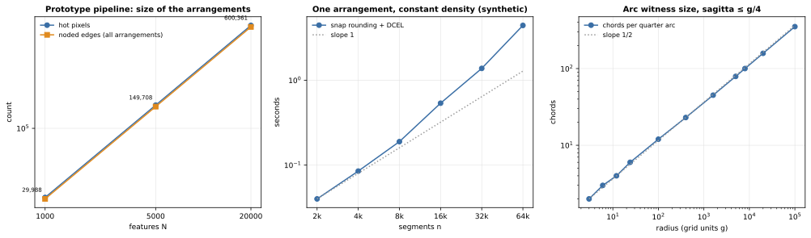
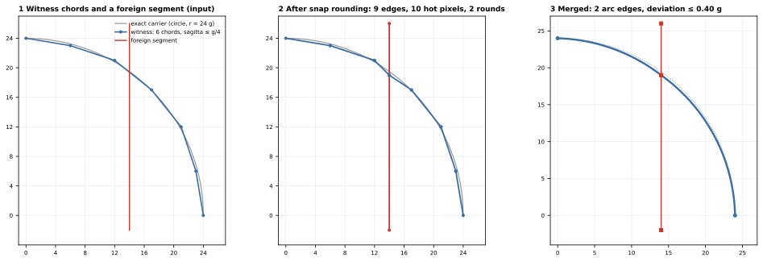

SGB 把一組精確的曲線變成一個 **arrangement**：一個 planar graph，它的 vertex 全都落在同一個格點上、edge 彼此不交叉，而每條 edge 仍記得它所來自的精確曲線。做法是帶 exact carrier 的 snap rounding，production 實作在 `scgsim.geometry.sgb.noding` 與 `arrangement`（整數運算的 iterated snap rounding、tile 平行、half-edge 結構與圓弧的 realisation）。本頁先在一個小範例上走完每一步（以 production 的 noding kernel 逐 round 執行），再說明哪些性質是保證的、哪些是量測的、成本多少，以及圓弧如何納入。

**Arrangement** 是由一組曲線對 XY 平面做的 planar 分割，以 vertex、edge 與 cell 儲存（見[詞彙表](index.qmd#glossary)）。輸入是一個 level 或一個 slab 的曲線（見 [2.5D layered model](layered-model.qmd)），輸出是帶有 cell 的 noded graph。cell 是 arrangement 中的平面區域，之後寫出的 BREP face 則是另一個東西。

## 執行範例的觀點

pad-in-ground 的 footprint 本來就在格點上：每條直線 edge 都終止於格點，圓的四段 quarter arc 也終止於格點。所以當 production 建立 `pad_in_ground_B` 的 level arrangement 時，snapping 沒有移動任何東西；工作是 **noding**（找出曲線在哪裡相遇）與建立 face。

以金屬頂面所在的 $z = 0.2$ µm level 為例，這個 arrangement 由 500 條 segment 建成，其中幾乎全是 pad 的圓孔與圓角的 polyline witness 的弦（見[曲線類別](#curve-classes)）。snap rounding 在一個 round 內找到 496 個 hot pixel，dissolution 之後，這個 arrangement 有 22 條 edge 與 4 個 cell。port sheet 所在的 $z = 0$ level 有 504 條 segment（兩個 slab 的 edge 加上 port 的 4 條），在兩個 round 內得到 500 個 hot pixel，dissolution 之後有 28 條 edge 與 5 個 cell（port 是其中一個 cell；`figures/arrangement-guarantees-numbers.json` 的 `level_stats`）。

Snapping 只有在曲線於非格點的位置**交叉**，或彼此距離小於一個 pixel 時才重要。在執行範例中，這發生在 chamfer 斜邊的 offset，它們是由 Surface EPR 的 inset band 加入的（見 [Inset imprint](inset-imprint.qmd)）。在那裡，sliver 報告量到的 drift：衍生圓弧在 0.63 grid unit 以下，直線 edge 為 0。這個 0 是依構造得到的：layout 的輸入本來就在格點上，而 inset 的直線 carrier 的端點在產生時已四捨五入到格點，所以報告量的是對這些已四捨五入的 carrier 的偏離，不是對精確 offset 的偏離（斜邊的 offset 含 $\sqrt{2}$，無法精確表示）。

為了看清楚每一步，本節後面使用一個很小的輸入，它具備執行範例所沒有的東西：一個在非格點位置的交叉、一個 near-touch，以及第二個 round。

## 一個逐步的範例

格點間距為單位 $g$ 的格點上，有五條精確的 carrier。長度以 grid unit 計。

::: {.askr-table-compact .askr-table-numeric}
| Carrier | 起點 | 終點 | 在範例中的角色 |
|---|---|---|---|
| c1 | (1, 1) | (10, 4) | 三角形的一邊 |
| c2 | (10, 4) | (12, 9) | 第二邊 |
| c3 | (12, 9) | (1, 1) | 第三邊 |
| c4 | (2, 0) | (12, 8) | 一條長 segment，與 c1 和 c2 交叉 |
| c5 | (6, 2) | (10, 5) | 一條短 segment，與 c1 交叉 |
:::

{#fig-steps fig-alt="12 × 9 格點上的六張小圖。1：五條彩色線段，構成一個三角形、一條長的交叉線段與一條短線段。2：同樣的線段，加上端點處的七個橘色方形 pixel、交點處的三個紅色 pixel，以及精確交點處的黑色叉號。3：線段被穿過 pixel 中心的粗折線取代。4：第一條 carrier 的粗折線現在多彎過一個 pixel。5：最後的 noded edge，其中兩條共用的 edge 標為 c1+c5 與 c2+c4。6：四個有界 face 上色並標為 F1 到 F4，附有面積。"}





**步驟 1：輸入。** 五條 carrier，端點是精確的整數。carrier 絕不改變；只有輸出的 vertex 會被 snap。

**步驟 2：round 1，hot pixel。** 格點的 pixel 是以它為中心、邊長為 $g$ 的 half-open 正方形。端點佔了七個 hot pixel。以有理數運算得到的精確交點是：c1 與 c4 在 $(4.857, 2.286)$，c1 與 c5 在 $(7.6, 3.2)$，c2 與 c4 在 $(11.412, 7.529)$。每個交點各落在一個 pixel 中，所以又有三個 pixel 變成 hot：$(5, 2)$、$(8, 3)$ 與 $(11, 8)$。總共 10 個 hot pixel。

**步驟 3：round 1，改道。** 每條 carrier 被換成一串 edge，穿過它所碰到的**所有** hot pixel 的中心，順序沿著 carrier。這也把 c3 拉過 $(11, 8)$，即使 c3 不與任何東西交叉：它只是經過那個 pixel。由多條 carrier 產生的 edge 會合併，並保留它們的 carrier 聯集（c2 與 c4 共用 $(11, 8)$-$(12, 8)$）。

**步驟 4：round 2。** 改道使 c1 離開了它原本的直線。新的 chain $(5, 2)\to(8, 3)$ 現在穿過 $(6, 2)$ 的 pixel；那是 c5 端點所在的 pixel，原本的 c1 從它上方 0.17 g 處經過。那個 pixel 本來就是 hot，但 c1 先前沒有被改道穿過它。edge $(5, 2)$-$(8, 3)$ 被換成 $(5, 2)$-$(6, 2)$ 與 $(6, 2)$-$(8, 3)$，後者由 c1 與 c5 共同攜帶。這就是演算法必須**反覆**的原因：改道可能產生新的接觸。

**步驟 5：round 3，沒有任何變化。** 沒有任何 edge 碰到 hot pixel 卻不穿過它的中心。結果有 10 個 vertex（全在格點上）與 13 條 edge。edge 端點到最近 carrier 的最大距離是 0.632 g，發生在 edge $(5, 2)$-$(6, 2)$，低於 $\sqrt{2}/2 = 0.707$ 的界限。

**步驟 6：cell。** half-edge 結構（doubly-connected edge list，DCEL）把 edge 變成 cell：四個有界 cell，面積為 9、8.5、1 與 0.5 g²。c4 的 $(2, 0)$-$(5, 2)$ 是一條 dangling edge，不圍住任何 cell。

## 一般規則

### 格點、carrier 與 pixel

模型宣告一個 **grid** $g$，預設為來源的資料庫單位 1 nm，並只在 handoff 中記錄一次。Z 值不會被 XY 格點 snap。

**Carrier** 是一條曲線的精確定義：通過兩個格點的直線、一個圓（圓心、半徑），或一條來源 B-spline。carrier 從不移動。vertex 才會移動：arrangement 的每個 vertex 都是格點上的點。

格點 $c$ 的 **pixel** 是 half-open 正方形 $[c_x - g/2,\ c_x + g/2) \times [c_y - g/2,\ c_y + g/2)$。只碰到 pixel 一個角的 segment 不會使它變成 hot，唯一的例外是左下角屬於該 pixel。production 的判斷式對這四個角的處理列在本頁最後的補充。

這個慣例讓 pixel 鋪滿平面而不重疊，所以在 pixel 邊界上的一個點或一條 segment 恰好屬於一個 pixel。這也讓 tile 的切線可以落在 pixel 欄列之間（見 [Parallel derivation](parallelism.qmd)）。判斷式是整數比較：當 $c$ 位於 segment 的 bounding box 內，且 $2\,\lvert (b-a)\times(c-a)\rvert < \lvert b_x-a_x\rvert + \lvert b_y-a_y\rvert$ 時，segment $ab$ 碰到 $c$ 的 pixel；兩邊相等的情況依上面的角規則決定。

### Iterated snap rounding

1. **初始化。** 每個 segment 端點都是 hot pixel。所有 edge 標為 changed。
2. **找交點。** 對每一對至少有一條是 changed 的 edge，以有理數計算精確的交點，並四捨五入到一個 pixel（剛好一半時進位）。新的 pixel 變成 hot。
3. **改道。** 每條 changed 的 edge，以及每條未改變的 edge（只對*新近*變成 hot 的 pixel 檢查），被換成它所碰到的所有 hot pixel 中心的串列，順序沿著該 edge。
4. **合併。** 端點相同的 edge 合併成一條 edge，帶有它們 carrier id 的聯集。
5. 只要有任何改道後的 edge 碰到它先前沒被穿過的 hot pixel，就**反覆**。結果就是 **noded** edge 集合。
6. **Cell。** 建立 half-edge 結構，並抽取帶孔洞的有界 cell。

Hobby（1999）與 Guibas 和 Marimont（1998）把 snap rounding 定義為這個程序的第一個 round。Halperin 和 Packer（2002）則如上所述加以反覆。production 實作的是反覆的形式，且只使用整數運算，以 500 輪為上限，不收斂時丟出 `RuntimeError`。

::: {.callout-important title="設計決策：exact 運算決定 topology"}
交點、pixel 判定與排序使用精確的整數運算；輸出頂點仍經 snapping，與原 carrier 的幾何偏離另外記錄。arrangement 的 topology 因此與 edge 或 tile 的處理順序無關，tile 可以被確定性地合併。「exact」說的是這些判定，不是說輸出頂點恰好在 carrier 上。
:::

整個 pipeline 仍有三個浮點步驟，它們不改變 arrangement 的 topology，但會影響別處的結果：inset band 的 band 歸屬（以 face 的面積與其中取樣點到 gap edge 的浮點距離分類）、圓弧 footprint 的點測試（使用 witness 的弦），以及驗證時取樣的圓弧交叉檢查。只有直線 footprint 的 slab label 是完全以整數判定的。

### Carrier 與 lineage

每條輸出的 edge 保有產生它的 **carrier id 集合**，每個 carrier id 都指向它的來源（entity、polygon、ring、edge 序號，或 family 成員）。arrangement 對每條 edge 記錄 carrier 的參數區間與實測的偏離量。直線 edge 就是它兩個 snap 後 vertex 之間的 segment。圓弧 edge 如何實現，見[曲線類別](#curve-classes)。

直線的 inset 成員保留產生它的 primitive：carrier id 形如 `band_pad_top/ring0/edge8@m100.0`（support、ring、edge 序號，以及 margin）；reflex 圓弧則是 `…/corner<k>`。

edge 的 identity 是 H(plane key、排序後的端點 vertex id、排序後的 carrier id 集合)，其中 plane key 指明它屬於哪個 level 或 slab。因此改變 carrier 的 id 集合，就會改變 edge 的 id（見 [Identity](identity.qmd)）。

## 哪些是保證、哪些是量測

下表用三種依據區分每一項性質：依構造成立、有單元測試、或只是量測。量測的對象是 250 組隨機 segment 集合，每組 24 條、整數端點在 $48 \times 48$ grid unit 的方框內，比較僅做 round 1（經典 snap rounding）與反覆之後的結果。量測結果只說明這組樣本，不是證明。

::: {.askr-table-compact .askr-table-numeric}
| 性質 | 依據（依構造／測試／量測） | 僅 round 1 | 反覆之後 |
|---|---|---|---|
| 所有 vertex 都在格點上 | 依構造；`test_output_is_planar_on_grid_with_no_short_edges` 測試 | | |
| 沒有兩個 vertex 的距離小於 $g$；沒有 edge 短於 $g$ | 依構造（pixel 中心互不相同）；同一個測試 | 最短 edge 1.00 g | 最短 edge 1.00 g |
| 沒有兩條 edge 交叉；沒有 vertex 落在 edge 內部 | 測試（同一個測試）與量測（本表） | 0 組有交叉 | 0 組有交叉或 vertex 在 edge 內 |
| 不相接的 vertex 到 edge 的距離 | 由反覆的停止規則推得至少 $g/2$；只有本表的量測，沒有單元測試 | 最小 0.164 g | 最小 0.521 g |
| edge 端點偏離其 carrier 的最大量 | 只有一個 round 時 $\le \sqrt{2}/2\,g$（測試與量測）；反覆之後沒有此界限（量測） | 最大 0.707 g | 最大 1.417 g |
:::

{#fig-drift fig-alt="250 組隨機試驗中，每組最大偏離量（單位為 grid unit）的重疊直方圖。灰色直方圖（round 1 之後）的尖峰剛好在虛線 0.707 的左邊，沒有超過它。藍色直方圖（反覆之後）則從 0.5 分散到約 1.4。"}



看 @fig-drift 時請注意：反覆讓 vertex 與「沒有被穿過」的 edge 之間至少保持半個 pixel 的距離（round 1 之後是 0.164 g；反覆之後是 0.521 g），代價是讓 vertex 可以**超過**一個 round 的界限而 drift。一個 round 讓每個 vertex 都在其 carrier 的 $\sqrt{2}/2\,g$ 之內。反覆則可能帶得更遠，因為每次改道都把 chain 移離 carrier，下一個 round 改道的是新的 chain，而不是原本的 carrier。

drift 的數字來自不同的輸入，不能互相取代，下表逐一標出輸入類型、樣本範圍與來源：

::: {.askr-table-compact .askr-table-numeric}
| 輸入類型 | 樣本範圍 | 最大 drift（g） | 來源 |
|---|---|---|---|
| 隨機 segment，整數端點 | 250 組 × 24 條，$48 \times 48$ 方框 | 1.417 | `arrangement_guarantees.py` |
| 隨機 segment，整數端點，較密 | 1 500 組 × 40 條，$30 \times 30$ 方框 | 1.925 | `arrangement_guarantees.py` |
| 隨機 layout（Route B，旋轉矩形等） | $N = 200$ 個特徵、6 298 條 edge | 0.605 | `arrangement_guarantees.py` |
| 執行範例的直線 edge | `pad_in_ground_A`、`_B`（有無 band）、`airbridge_B` | 0（依構造：對已四捨五入的 carrier 量） | 各案例的 sliver report（`arrangement_guarantees.py`） |
| 執行範例中由 offset 衍生的圓弧（不是直線 segment 的證據） | `pad_in_ground_A_bands` 59 條、`pad_in_ground_B_bands` 90 條圓弧 edge | 0.632（偏離精確圓） | 各案例的 sliver report（`arrangement_guarantees.py`） |
:::

三點要小心。第一，一個 round 的 $\sqrt{2}/2\,g$ 界限不適用於反覆之後的結果：兩組對抗性樣本都超過它。第二，layout 類的輸入只有 $N = 200$ 的隨機 layout 這一個可重現的數字（0.605 g）；沒有其他可重現來源的範圍數字，本頁不引用。第三，圓弧的 0.632 g 量的是 offset 圓弧偏離精確圓的程度，不是直線 segment 的 drift，不能拿來當直線的證據。

layout 的來源本來就在格點上，所以 drift 只出現在斜向 carrier 的交叉處。arrangement 記錄每條 edge 的實測偏離量，而不是把它藏起來。要不要對 drift 設**上限**（iterated snap rounding 的 bounded-drift 變體，Packer 2008）是決策 D7：Lead 的建議是 v1 只記錄、不設上限，若真實 layout 的 drift 超過 1 g 再重新考慮（見[設計決議](decisions.qmd#d7)）。production 的極端案例 catalogue 現在逐列記錄 drift 與 mesh 品質：54 個建出的列，最大的 snap drift 是 0 g，最大的 arc 偏離是 0.760 g，都低於 1 g，所以 D7 的重新評估條件沒有被觸發（見 [Validation](validation.qmd#catalogue)）。這些 fixture 的輸入都在格點上，drift 為 0 是依構造而得，不是對斜向 carrier 交叉處的量測。

## 成本

production 把 edge 與 hot pixel 放進均勻的空間 hash，大約每個格子一個物件。對 layout 類的輸入（每個格子的曲線數量有上限），每個 round 預期的成本約為 $n + k$（$n$ 條 edge、$k$ 個交點），再加上每條 edge 上 pixel 的排序。我們做的是量測，並不主張最壞情況：文獻對反覆輸出的大小有界限，而設計倚賴的是量測與 validator，不是那個界限。

{#fig-cost fig-alt="三張對數-對數圖。左：N = 1000、5000、20000 個特徵時，hot pixel 與 noded edge 的增長倍數與 N 相同，從約 31 000 增加到約 630 000。中：2 000 到 64 000 條 segment 的 snap rounding 加 DCEL 時間，上升的斜率比 1 稍陡。右：半徑從 3 到 100 000 grid unit 時，每個 quarter arc 的弦數，沿著斜率 1/2 的線。"}



看 @fig-cost 時請注意：

- **大小是線性的。** hot pixel 數量從 $N = 1000$（31 273）到 $N = 5000$（158 575），再到 $N = 20000$（630 556），局部斜率為 1.01 與 1.00。所有 arrangement 規劃的 edge 數從 31 699 增加到 638 533，斜率相同（`figures/why-scaling-measured.json`，production 的量測）。這些 scaling 全是 polygon-only 的 layout，沒有圓弧、witness 的弦與 band，所以圓弧與 band 在大規模下的成本沒有量測，不外推。
- **時間近乎線性。** 對於一個固定密度的短 segment 合成 arrangement，時間（snap rounding 加 DCEL，取三次最佳）從 2 000 到 64 000 條 segment，局部斜率介於 0.97 與 1.52 之間。最後一步用了四個 round（snap rounding 約 3.8 s、DCEL 約 0.7 s），其他步驟用了三個。在完整 pipeline 的 $N = 20000$ 時，noding 的 kernel 與 driver 花 12.8 s（推導與驗證總共 61.6 s），DCEL 花 3.9 s。這些計時是單次執行，同一台機器上重複量測會有明顯起伏（見[為什麼先規劃](why-plan-first.qmd)）。
- **Round 很少。** 隨機集合需要兩到五個 round，200 個特徵的 layout 其每層 arrangement 需要一到兩個，範例則是一到兩個（`level_stats` 與 `layout_like`：`snap_rounds`）。

Noding 不能是每個 tile 各自獨立的工作，因為改道後的弦可能終止在另一個 tile：每個 round 都是對 hot pixel 聯集的 barrier（見 [Parallel derivation](parallelism.qmd)）。

## 曲線類別 {#curve-classes}

- **直線與圓弧**是第一版的類別。兩者對 offset 都是封閉的，所以 inset 曲線仍留在這個類別中。
- **來源 B-spline** 是設計上可以作為材料邊界 carrier 的類別，但第一版 production 在 S2 就 fail closed（`UnsupportedCurveError`），留待之後的階段。B-spline 的 offset 無法精確表示，所以即使之後支援，**inset 也會拒絕它**；要近似它，需要一個只有 Human 能設定的容許值。原型與 production 都只實作直線與圓弧。
- **一個完整的圓是四段 quarter arc。** 完整的圓是一條 loop edge，半圓則與它的弦平行；而 arrangement 要求每條 edge 連接兩個不同的 vertex，且沒有兩條 edge 連接同一對 vertex。

### 透過 polyline witness 處理圓弧

未決的決策 D3 問的是：圓弧要原生地 node，還是透過 polyline。暫定的決策（原型與 production 都已實作）是 **polyline witness**：

1. 為了 noding，圓弧被換成弦，其 sagitta（弦與弧之間的間隙）至多為 $g/4$。每條弦帶有 id `<arc id>#<k>` 與弧的一段參數區間。
2. Snap rounding 把這些弦當作一般的 segment。
3. 之後，同一條圓弧的連續弦，若它們之間**沒有外來的 hot pixel**，就合併回一條圓弧 edge。與其他曲線的交叉會在該處把圓弧切開。
4. 圓弧 edge 由它的 carrier 實現：取 carrier 的半徑，通過兩個 snap 後的端點的圓，圓心在 carrier 的那一側。它偏離精確圓的量會被記錄。

{#fig-arc fig-alt="半徑 24 grid unit 的四分之一圓，被一條垂直紅線段穿過的三張圖。左：圓弧被六條藍色弦近似。中：snap rounding 之後有九條 edge 與十個 hot pixel，圓弧在紅線段處被截斷。右：兩條平滑的藍色圓弧 edge，在紅線段上的一個紅色方塊處相接。"}

在 @fig-arc 中，六條弦在 snap rounding 之後變成九條 edge（外來 segment 變成兩條 edge，並把它所穿過的那條弦切成兩段），再合併成兩條圓弧 edge，與精確圓的偏離為 0.40 g。計數來自 `arrangement_guarantees.py`：10 個 hot pixel、2 個 round。

真實模型上的偏離（production 的 sliver report）：來源圓弧的端點是精確的格點，偏離為 0；inset band 的衍生 offset 圓弧，端點被 snap，在 `pad_in_ground_A_bands` 的 59 條 arc edge 上平均 0.046 g、最大 0.632 g，在 `pad_in_ground_B_bands` 的 90 條 arc edge 上平均 0.030 g、最大 0.632 g（port 在 $z = 0$）。

圓弧若被外來的 vertex 切開（例如 port 的 edge 終止在圓形 pad 的圓弧上），每一段圓弧各自由它 snap 後的端點 realise，落在各自的圓上，偏離量以段為單位記錄。以這樣的圓弧為底的圓柱 wall（Route B 與 Route C）如果不處理就會有 5 條邊界 edge；production 在 assembly 中於該 vertex 處用一條垂直 edge 把 wall 切開，底邊與頂邊的圓弧都在同一個格點被切開，每一片是自己圓上的精確圓柱（見 [Assembly](assembly.qmd#curved-walls)）。原型的 direct writer 曾因此拒絕這個案例。完全由 polygon 組成的圓（GDS 的 16 到 128 個點）不會產生圓柱 wall，它們的 wall 是平面。

witness 的代價是大小。半徑為 $r$ 的 quarter arc 約需要 $\sqrt{r/g}$ 乘上一個常數的弦數：$r = 100$ g 時 12 條，$r = 8\,\mu$m（8 000 g，也就是 pad 的孔）時 100 條，$r = 100\,\mu$m（100 000 g）時 352 條；從 $r = 24$ g 到 $100\,000$ g，斜率介於 0.47 與 0.50 之間（`arrangement_guarantees.py`）。對執行範例 `pad_in_ground_A_bands`（Route A，三個 margin 的 band）的 $z = 0$ level 而言，弦合併之前，noded arrangement 有 4 058 條 edge 與 4 050 個 hot pixel，合併之後是 166 條 edge（`figures/arrangement-guarantees-numbers.json` 的 `level_stats`）。對這個範例而言這很便宜，但對於圓弧很多的 layout，是需要預算的成本。圓弧的原生 snap rounding（Eigenwillig 等人）是升級路徑；structural validation 則是 witness 的安全網（見 [Validation](validation.qmd)）。

## 邊界情況

- **重疊的 carrier。** 兩條共線的 carrier 會產生重合的輸出 edge；它們合併並保留兩個 carrier id，所以共用 edge 的 lineage 會指出兩者（上面的 c1 與 c5；c2 與 c4）。
- **只是經過 pixel 的曲線**會被拉過它的中心，並可能多出一個它在該處沒有交點的 vertex（步驟 3 的 c3）。這就是 snapping 的位移，其界限如上表。
- **幾乎重合的來源曲線。** 兩條相差只有幾個 grid unit 的不同邊界，只要它們留在不同的 pixel，就會保持分開。要保留、回報或合併它們，是 policy 的決定（見 [Sliver](slivers.qmd)）；格點不決定它。極端案例目錄有兩個直接的例子：兩個 layer 的邊緣只差 0.4 g 時會合併、不產生 sliver；差 2 g 時留下一個真正的 2 nm 寬 face，而它通過 `BRepCheck_Analyzer`、`BOPAlgo_ArgumentAnalyzer` 與 conformal mesh 的全部檢查，所以只需要回報，不需要移除。
- **由 snapping 造成的接觸。** 兩個不同 Net 之間的間隙若小於一個 pixel，粗格點會把它關上；這樣的接觸是錯誤，並且指出兩個 entity 與位置。4 nm 的間隙在 g = 1 nm 時可以通過，在 g = 10 nm 時不行（見 [2.5D layered model](layered-model.qmd)）。
- **困難的曲線組合。** 極端案例目錄中，近乎相切的圓弧與直線（secant 深 2 nm）、夾角 1.6 度的兩段圓弧、共線重疊的 edge，以及 0.6 度窄縫的 reflex vertex，在 Route A 與 Route B 都通過全部檢查。
- **來源曲線絕不移動。** 衍生曲線（inset、refinement curve）之後也許會被允許在某個容許值內 snap 到來源曲線上。那是經 Human 把關的 policy，不在本頁範圍內（見 [Sliver](slivers.qmd)）。
- **Z。** arrangement 是 planar 的。Level 是精確的，從不被 snap。
- **Tile seam。** tile 的切線落在 pixel 欄列之間，所以沒有任何 seam 幾何進入 arrangement，也就沒有 seam 需要在之後移除；合併後的結果與單一 tile 的結果相同（見 [Parallel derivation](parallelism.qmd)）。

## 補充：重現資料

本頁的圖與數字是**計算所得**，全部來自 production `scgsim.geometry.sgb`。scaling 與 pipeline 大小的數字取自 `why_scaling.py measure` 的結果 `figures/why-scaling-measured.json`（seed 2 的隨機 layout，一個 tile、一個 worker）。逐步範例由 `docs/design/sgb/_figures/arrangement_steps.py` 產生，數字在 `figures/arrangement-steps-numbers.json`；腳本逐個 round 執行 production 的 noding kernel，並檢查最後的 edge 集合等於 `snap_round` 的結果。保證、drift、成本與圓弧 witness 由 `arrangement_guarantees.py` 產生，數字在 `figures/arrangement-guarantees-numbers.json`；執行範例的數字由該腳本對 production 模型建立 sliver report 與 level 統計得到。

::: {.askr-table-compact .askr-table-numeric}
| N | Hot pixel 數 | Level arrangement 的 edge 數 | Slab arrangement 的 edge 數 | noding kernel（階段 wall time，s） | noding driver（s） | DCEL（s） |
|---|---|---|---|---|---|---|
| 1 000 | 31 273 | 21 130 | 10 569 | 0.372 | 0.101 | 0.112 |
| 5 000 | 158 575 | 107 114 | 53 561 | 2.266 | 0.692 | 0.891 |
| 20 000 | 630 556 | 425 686 | 212 847 | 9.784 | 3.041 | 3.850 |
:::

pixel 判定對 $(0, 0)$ 的 pixel 與四個角的處理（由 `arrangement_guarantees.py` 的 `pixel_corners` 以 production 的 `HotGrid` 計算；`tests/test_sgb_snap_rounding.py` 有一個測試，斷言只碰到 pixel 一個角的 segment 只在左下角使它變成 hot）：

::: {.askr-table-compact}
| 一條 segment …… | 是否碰到該 pixel |
|---|---|
| 通過中心 $(0, 0)$ | 是 |
| 在中心上方切過該 pixel | 是 |
| 只碰到左下角 $(-\tfrac12, -\tfrac12)$ | 是 |
| 只碰到右上角 $(\tfrac12, \tfrac12)$ | 否 |
| 只碰到右下角 $(\tfrac12, -\tfrac12)$ | 否 |
| 只碰到左上角 $(-\tfrac12, \tfrac12)$ | 否 |
:::

隨機 segment 試驗中，需要的 round 數分布：250 組 × 24 條中，2 個 round 的有 47 組、3 個有 196 組、4 個有 7 組；1 500 組 × 40 條中，2 個 11 組、3 個 1 230 組、4 個 250 組、5 個 9 組。

## 參考資料

- J. D. Hobby, Practical segment intersection with finite precision output, *Computational Geometry* 13(4), 199-214, 1999.
- L. Guibas and D. Marimont, Rounding arrangements dynamically, *International Journal of Computational Geometry and Applications* 8(2), 157-178, 1998.
- D. Halperin and E. Packer, Iterated snap rounding, *Computational Geometry* 23(2), 209-225, 2002.
- E. Packer, Iterated snap rounding with bounded drift, *Computational Geometry* 40(3), 231-251, 2008.
- L. Eigenwillig, L. Kettner and N. Wolpert, Snap rounding of Bézier curves, *Symposium on Computational Geometry*, 2007.
