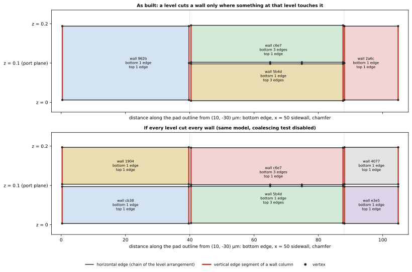
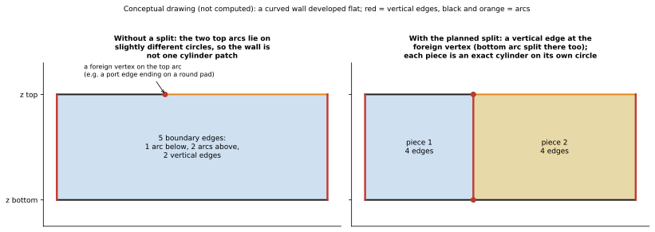
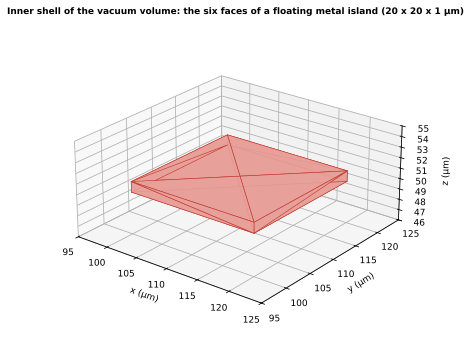

已 label 的平面 cell 要變成可以交給 mesher 的實體模型，SGB 不使用任何 CAD kernel，而是直接由 arrangement 的 vertex 與 edge 組裝出 horizontal face、垂直 wall、vertical edge、shell 與 volume。本頁說明每一種的建構規則、讓 wall 保持最小的 coalescing 規則，以及相鄰 volume 為什麼會落在同一個 face 上。

文中 **cell** 指 arrangement 中的平面區域，**face** 指輸出的 BREP face：一個 level cell 需要 face 時，才會成為一個 horizontal face。Assembly 是 S6 階段（production：`scgsim.geometry.sgb.assembly`），輸入是已 dissolve 的 slab arrangement $S_i$ 與 level arrangement $A_i$（含 label 與 link），輸出是一組 vertex、edge、face 與 volume，每個 entity 都有 [identity](identity.qmd)，[emission](emission.qmd) 可以由下而上寫出。

## 組裝什麼，依什麼順序

::: {.askr-mermaid-view view-label="檢視圖表"}
```{mermaid}
flowchart LR
  A["level arrangement A_i<br/>(vertex、edge、cell、label)"] --> V["vertex 與 horizontal edge"]
  A --> H["horizontal face<br/>(需要 face 的 cell)"]
  S["slab arrangement S_i<br/>(slab label、slab edge)"] --> W["wall run<br/>(已 coalesce)"]
  A --> W
  W --> C["vertical edge<br/>(wall column，必要處切開)"]
  S --> Vol["volume<br/>(連通的 slab cell)"]
  A --> Vol
  H --> Sh["shell<br/>(每個 volume 的封閉曲面)"]
  W --> Sh
  Vol --> Sh
  Sh --> G["primary physical group"]
```
:::

一切都由*原子*組成：level arrangement 的 vertex 與 edge，加上 vertical edge。face 從不擁有自己私有的 edge 副本；它列出的是原子 id，所以相接的兩個 face 共用的是 edge 本身。

## 執行範例的觀點

執行範例是 production 的真實輸入（`gds_pad_in_ground`，見 [label 頁](labels-and-dissolution.qmd)）。Route B 的 Z level 是 $-30, -10, 0, 0.2, 20.2$ µm，其中金屬層只有 $z = 0$ 與 $0.2$ 兩個 level。它規劃出 34 個 face：9 個是 horizontal face（需要 face 的 level arrangement cell，見 label 頁），25 個是 wall。pad 與 ground 都是直邊的矩形，wall 的數量比邊數多：wall 的單位是 slab edge，而 adapter 把 port 的 landing 標在 host 的輪廓上，所以 pad 左側的輪廓在 $(40, 48)$ 與 $(40, 52)$ µm 多了兩個 vertex，ground cutout 左側在 $(30, 48)$ 與 $(30, 52)$ µm 也是；那一邊各是三條 carrier 不同的來源 edge，每條 slab edge 各有一面 wall。所以 pad 有 6 個側壁 face、ground 有 11 個（另有外輪廓左側在 $(0, 30)$ µm 的一個來源 vertex，見 [label 頁](labels-and-dissolution.qmd#attribution-policy)）。port 自己的 edge 沿著這三面 wall 的底邊，所以中間那一片 wall 的底邊就是 port 的 edge。

這個真實輸入裡，真正被 coalescing 合併的 wall 是 vacuum region 的四個外側面：它們從 $z = -30$ 到 $20.2$ µm 跨四個 slab，沒有任何 level 碰到它們，所以每面仍是一個 face。若每個 level 都切每面 wall，模型會變成 46 個 face、97 條 edge 與 58 個 vertex，而實際建出的模型是 34、73 與 46（被切開的模型也能通過驗證，所以沒有錯，只是冗餘）。

要看到 level 切開 wall 的情形，需要一個 level 碰到金屬 wall 的中間，真實輸入沒有：port 在 support plane，金屬層沒有中間 level。下面的 @fig-wall-anatomy 改用 **stage 層的 scene**（`tests/sgb_scenes.py` 的 `pad_in_ground("B")`；它的 port 刻意放在 0.2 µm 金屬的中間平面 $z = 0.1$，所以有 $0$、$0.1$、$0.2$ 三個 level，pad 有九條直邊、一個圓角與一個圓形 hole，規劃出 41 個 face、其中 32 個是 wall）。它不是真實輸入，只用來說明這個機制。

沿 pad 輪廓看連續三邊：從 $(10, -30)$ 到 $(50, -30)$ µm 的底邊、$x = 50$ µm 的右側壁（到 $(50, 18)$），以及到 $(38, 30)$ 的 chamfer。port sheet 在 $x = 50$、$z = 0.1$ 處接觸 pad。@fig-wall-anatomy 把這三面 wall 攤開。

{#fig-wall-anatomy fig-alt="同樣三面 wall 的上下兩張立面圖。上圖中底邊 wall 與 chamfer wall 各是一個從 z = 0 到 z = 0.2 的矩形，x = 50 的 wall 在 z = 0.1 被切成兩片，且兩片在共用的 z = 0.1 線上有三條 edge。下圖中每面 wall 都在 z = 0.1 被切成兩片。"}



@fig-wall-anatomy 的看點：

- **只有 $x = 50$ 的 wall 在 $z = 0.1$ 被切開。** port 的 edge 終止在它上面，所以 $z = 0.1$ 的 level arrangement 在那面 wall 的線上有度數為三的 vertex（位於 $y = \pm 5$ µm）：上片的底邊界有三條 edge，下片的頂邊界也有三條 edge。
- **鄰近的 wall 沒有被切，但它們共用的 column 被切了。** 底邊 wall 與 chamfer wall 各自從 $z = 0$ 到 $0.2$ 仍是一個 face。它們在 $(50, -30)$ 與 $(50, 18)$ 的轉角 column 必須在 $z = 0.1$ 被切開，因為鄰近的 wall 在那裡結束；所以這兩面 wall 在一側各自列出兩段疊起來的 vertical edge（$z = 0.1$ 處的紅色刻痕）。沿同一條 column 相接的兩個 face 因此永遠共用完整的 edge。
- **不做 coalescing，模型會更大。** 每個 level 都切每面 wall，這個 scene 會得到 61 個 face、132 條 edge 與 93 個 vertex，而實際建出的模型是 41、94 與 70。下表是同樣比較對幾個模型的結果（兩個 scene 的變體與 airbridge 都是 stage 層的 scene）：

::: {.askr-table-compact .askr-table-numeric}
| 模型（Route B） | Face：實際／每個 level 都切 | Edge | Vertex |
|---|---|---|---|
| 真實輸入 `gds_pad_in_ground` | 34 / 46 | 73 / 97 | 46 / 58 |
| stage 層 `pad_in_ground("B")` | 41 / 61 | 94 / 132 | 70 / 93 |
| stage 層 pad，32 邊形 hole、無圓角 | 68 / 115 | 175 / 267 | 114 / 159 |
| stage 層 `airbridge()` | 43 / 51 | 78 / 94 | 44 / 52 |
:::

## Horizontal face

**Horizontal face** 是 level arrangement $A_i$ 的一個 cell 變成的 BREP face：該 cell 的 level label 需要 face（`below != above` 或有 sheet 位於其上），並且已經過 dissolution。它是下方 volume（若有）與上方 volume（若有）的邊界。它的外邊界與 hole 是 $A_i$ 的 edge 所成的 loop，取自 half-edge 結構並帶有方向。

兩種特殊情形：

- 兩側是*同一個* volume 的 face，是不圍出任何 volume 的 sheet。它是 **embedded**：列在它的 host volume 上，但有自由邊界，**不屬於任何 shell**。stage 層 scene 中間平面的 lumped port 就是這種例子（真實輸入的 port 位於 support plane，是兩個 volume 之間的 face，不屬此類）；見 [Routes](routes.qmd#the-route-b-port-is-an-embedded-face)。
- 只有一側有 volume 的 face 位於模型的外邊界上，其 physical group 為 `EXT::<domain>`。

## Wall

**Slab edge** 是 $S_i$ 中兩側 slab label 不同的 edge。對每條原子 slab edge，SGB 產生一面垂直的 **wall**：

- 它的**底邊界**是覆蓋該 slab edge 的 $A_i$ edge 所成的 chain（透過每條 slab edge 帶入 $A_i$ 的標記找到；chain 斷裂或有歧義時 build 中止）；
- 它的**頂邊界**是覆蓋它的 $A_{i+1}$ edge chain；
- 它的兩側是位於 slab edge 端點的 **vertical edge**，與相鄰 slab edge 上的 wall 共用。

直線 carrier 上的 wall 是平面。圓弧 carrier 上的 wall 是通過該圓弧的圓柱的一塊 patch。v1 沒有 spline carrier：`interpolation_spline` 與 B-spline 邊界在 S2 就 fail closed。

### Coalescing {#coalescing}

Level 在 Z 上是全域的，但它的作用在 XY 上是局部的。若沒有規則，疊起來的 slab 會在每個 level 切開每面 wall，例如（stage 層 scene 的）pad 側壁在中間平面的 port level 被切開，即使 port 只碰到其中一面。**Coalescing** 規則決定連續的 wall 何時合併。同一條 slab edge（以端點辨識）上的 wall 跨越一個 level 時，在以下條件下合併：

1. 上下兩側的 domain 相同，且
2. 該 level **沒有切**這面 wall。

完整的規則是：level 在以下情況切開一面 wall：

- (a) 該 level 的某條 edge 或某個 vertex 落在 wall 的水平線上（例如 port-sheet 的 edge 碰到金屬側壁，或 level 正下方與正上方的 chain 並不是同一組 edge）；
- (b) 該 level 的一個 sheet face 沿著 wall 的 chain 延伸（即使沒有任何額外的 vertex 碰到那條線）。

::: {.callout-important title="設計決策：wall column 由其鄰居切開"}
wall column（某個 grid 點上方的垂直線）在下列情況於該 level 被切開：某個 wall run 在那裡開始或結束，**或是某個 horizontal face 在該 level 於這條 column 上有 vertex**（例如只碰到 wall 轉角的 sheet）。沒有這第二條規則，沿 column 相接的兩個 face 的 edge 長度會不同，shell 就無法由共用的原子組成封閉曲面。
:::

(a)、(b) 與 column 規則共同構成完整的規則集，production 已實作，並以 mesh conformity 與 OCCT 檢查測試過。

### 曲面 wall {#curved-walls}

圓弧 carrier 上的 wall 是圓柱 patch。若恰好有四條邊界 edge（兩條圓弧與兩條 column，四分之一圓弧的一般情形），production 的 writer 直接寫出圓柱面；stage 層的 scene `pad_in_ground("B")`（圓形 hole 的四段四分之一圓弧與圓角）有五面這樣的 wall，真實輸入沒有圓弧。production 的測試以解析的面積檢查 `pad_in_ground_B` 的 substrate 與 vacuum 體積，相對誤差在 $10^{-12}$ 之內，因為這些 wall 都是精確的圓柱。直線 wall 的平面性以精確整數運算測試。

**弧上有外來 vertex 的 wall。** 當圓弧上落了一個來自別處的 vertex（例如 port 的 edge 終止在圓形 pad 上，或一根 post 站在曲邊上），如果不處理，這面 wall 的頂邊界會被切成兩段圓弧，共有五條邊界 edge。這兩段圓弧各自經過 snap 後的端點重新實現，會落在彼此略有差異的圓上，所以上下邊界不在同一個圓柱上。原型的直接 writer 因此拒絕這種 wall，Gmsh API 的 oracle 才建得出來。production 在 assembly 中解決它：在外來 vertex 處加一條 vertical edge，把 wall 切開，底邊與頂邊的圓弧在**同一個格點**處都被切開，每一片都由一條下圓弧與一條上圓弧圍成、通過相同的端點、用相同的 carrier 半徑，是在自己實現出的圓上的精確圓柱，兩片共用那條 vertical edge。切點會改變 level 的 edge，所以上下兩側的 horizontal face 與疊在上下的 wall 也看到同樣的切點，計畫對整個模型算一次並反覆到沒有新的 vertex 被迫加入為止。結果：writer 對每一片是精確的，而不是「對任意邊數都精確」；驗證檢查 `curved_walls_are_single_cylinders` 斷言每面曲面 wall 都由同一個圓上的一條下圓弧與一條上圓弧圍成。測試涵蓋：port 兩次穿過圓形 pad，每個疊起來的 wall run 一致地切開；兩片共用經過外來 vertex 的 vertical edge；圓盤的體積在切開後仍與封閉形式相符；Route C 切法相同。

{#fig-curved-split fig-alt="把曲面 wall 展開成平面的兩張示意圖。左圖是一個矩形，頂邊在一個點被分成兩段（外來 vertex），共五條邊界 edge。右圖在該點加了一條垂直線，把矩形分成兩個各有四條邊界 edge 的矩形。"}

只由多邊形構成的圓（例如 GDS 中以多邊形近似的圓）從不產生圓柱 wall：它的每一段都是直線，wall 是平面，直線 wall 可以有任意多條邊界 edge 而不需要切開。因此上述切開只適用於來源中宣告為圓弧的邊界。

## Volume

**Volume** 是具有相同 domain identity（材料相同且擁有它的 Entity 相同）的 slab cell 的連通分量。同一個 slab 中的兩個 cell 透過不屬於 wall 的共用 edge（兩側 domain 相同）連通。相鄰 slab 的 cell 則透過 below 與 above domain 相等且沒有 sheet 的 level cell 連通；那裡不會產生 face。assembly 以對 cell link 做 union-find 計算這些分量，這是 assembly 中唯一的全域 reduction（見[平行化推導](parallelism.qmd)）。

在執行範例（真實輸入）中，Route A 有兩個 volume（`substrate`、`VACUUM_REGION`）。Route B 有四個：`substrate`、`VACUUM_REGION`、`ground_0000` 與 `pad`；後兩者是 Route B 從輸出模型中排除的導體 volume。Route C（D1）保留導體 volume 並在內部 mesh，所以四個都輸出。它是 S7 的另一種 policy，assembly 對三種 route 完全相同。

因為 domain 帶著擁有它的 Entity（D5），同材料、同 Net 的兩個 Entity 是分開的 volume。production 的 airbridge 模型（stage 層的 scene）因此有七個 volume：兩塊 ground、兩根 post、deck、substrate 與 vacuum，導體 Entity 之間的 face 是共用 face（`MM::<a>|<b>__interface`；Route B 排除它們，Route C 輸出它們）。

## Shell 與內部 void

Volume 的 **shell** 是它的 face 的集合。SGB 把它們分組為連通的封閉曲面：共用 edge 的 face 屬於同一個候選 shell。每個候選以整數運算的散度定理得到精確的 signed volume（Z level 乘以共同分母）；正值標示 **outer** shell，負值標示 **inner** shell，也就是 volume 內部的 void。

執行範例的 `substrate`、`ground_0000` 與 `pad` 各只有一個 outer shell，但 `VACUUM_REGION` 有兩個：它的外側盒子（6 個 face，signed volume $9.84 \times 10^{5}$ µm³）是 outer shell，而它包住晶片（substrate、ground 與 pad）留下的空腔，由 26 個 face 圍成，是 inner shell，signed volume 為 $-1.0176 \times 10^{5}$ µm³，剛好是被包住的 substrate（$10^{5}$ µm³）、ground（1 680 µm³）與 pad（80 µm³）體積的負值。只要有導體完全位於 dielectric 或 vacuum 內部，就會再多一個 inner shell。在 vacuum 中於 $z = 10$–$11$ µm 加入一個浮空的 $10 \times 10 \times 1$ µm 島（Net `float`），vacuum volume 就有三個 shell：外側盒子、晶片空腔，以及由島的 6 個 face 組成、signed volume 為 $-100$ µm³ 的 inner shell，剛好是島體積的負值。驗證器接受它（模型共 7 個 shell，每條 edge 以相反方向使用兩次，每個 shell 的 Euler characteristic 形式為 $2 - 2g$）。

{#fig-inner-void fig-alt="一個扁平方塊的三維視圖，畫出島的六個 face，位於 z = 10 到 11 µm 之間。"}

### 多 slab volume 的 shell

@fig-shells 顯示較大的 shell：airbridge 模型（`tests/sgb_scenes.py` 的 `airbridge()`，stage 層的 scene，兩塊 ground 由兩根 post 與 deck 連接，五個 slab）的 `vacuum` volume 的 shell。production 依 Entity 歸屬，兩塊 ground、兩根 post 與 deck 各是自己的 volume，所以它們的 wall 各自只跨一個 slab；跨多個 slab 的是 vacuum 的 wall。這個 shell 有 26 個 face，其中 6 個是 horizontal face，20 個是 wall。其中四面 wall **跨 slab 被 coalesce**：晶片四個外側面在 $z = 0.2$ 到 $100$ µm 之間，穿過 $z = 3$ 與 $3.3$ µm 兩個 level，沒有任何東西碰到它們，所以每面是從 $z = 0.2$ 到 $100$ µm 的單一 face。每個 face 都略為朝自己的中心拉開；縫隙就是這些 face 共用的 edge。

{#fig-shells fig-alt="一個高的方盒，內部有兩塊扁平的 ground 板、兩根 post 與一個 deck 留下的空隙，畫成帶有小縫隙的分離 face：淺藍色 horizontal face、深藍色的低 wall、半透明橘色的四面高 wall，以及灰色的晶片邊界 wall。z 軸為顯示用：0 到 3.3 µm 畫成 30 倍高。"}



## 為什麼結果是 conformal by construction

這裡主張的範圍要說清楚。對**每個 volume 的 shell**：shell 由封閉且可定向的 face 組成，每條 edge 在一個 shell 內被以相反方向使用恰好兩次；每個 face 至多被兩個 volume 使用；相鄰的 volume 落在同一個 face entity 上，而不是兩個重合的 face。**Embedded face（例如 stage 層 scene 中間平面的 port）有自由邊界，不屬於任何 shell**，不受這些規則約束，另有自己的檢查。以下是逐步的 sketch，每一步都指出重新檢查它的 check（[驗證](validation.qmd)）。

1. **每個 arrangement 都是平面的。** snap rounding 之後，$S_i$ 或 $A_i$ 的任兩條 edge 不相交，也沒有 vertex 落在 edge 內部，所以它的 cell 只沿完整的 edge 相接。*重新檢查：* `arrangements_planar`。
2. **每條 slab edge 在上下兩個 level 都是 chain。** $A_i$ 與 $A_{i+1}$ 由 $S_i$ 的曲線建立，所以每條 slab edge 在兩者中都成為一條原子 edge 的路徑。wall 的邊界因此是由原子組成的封閉 loop：底 chain、column、頂 chain、column。若 chain 無法追溯，build 中止。
3. **Column 在任何鄰居有 vertex 之處被切開。** 每個碰到 column 的 face 使用的都是它完整的 vertical edge 段（上述 column 規則）。
4. **在任一條 edge 周圍，face 恰好是四個象限中 volume 之間的介面。** 取 level arrangement 的一條 edge，看它周圍四個區域：左、右、下、上。每個區域屬於一個 volume（或不屬於任何 volume）。兩個相鄰區域之間存在 face，若且唯若它們的 volume 不同；label 依 [labelling 規則](labels-and-dissolution.qmd)是單值的，所以 face 沒有其他來源（embedded 的 sheet 另計，它們不分隔兩個不同的 volume）。
5. **於是每個 volume 看到這條 edge 的次數是偶數且互相匹配。** 同一個 volume 在一條 edge 周圍的區域構成連續象限的區段；每個區段由兩個 face 圍住，從該 volume 看去方向相反。所以在一個 shell 內，每條 edge 被以相反方向使用兩次。若某個 volume 只佔據兩個不相鄰的象限（它沿一條 edge 接觸自己），這條 edge 在同一個 shell 中會被使用四次；這種情形會被拒絕，而不是被修補。production 在 assembly 之前就以專用的 contact 階段檢查（`check_manifold`）攔下它，拋出 `NonManifoldError`：例如一小塊同 Net 的有限厚度金屬只在轉角碰到 pad，兩側的 vacuum 就只在那條 vertical edge 相接，訊息為 `non-manifold pinch: VACUUM_REGION (pinched between conductors pad, pinch of Net P) touches itself along the vertical edge at (60.0000, 60.0000) um, z 0.0..0.2 um …`（真實輸入加上這個 prism 的計算結果）。這條規則也適用於 Route B 中 hole 碰到自己外邊界的情形；sheet（Route A）在轉角相接則是合法的。若 pinch 沒有被前一道檢查攔下，shell 的檢查仍會以 `shells_closed_and_oriented`（edge 被使用 4 次）作為第二道防線。
*重新檢查：* `shells_closed_and_oriented`、`shell_euler_characteristic`、`each_face_used_by_at_most_two_volumes`、`every_edge_shared_by_two_faces`。
6. **一個 face 就是一個 entity。** 介面兩側的兩個 volume 列出的是同一個 face id，方向相反；沒有之後還要配對的第二份副本，emitter 也只建立它一次。*重新檢查：* emitter 的「每個 native entity 恰有一個 planned id」測試。

沒有任何一步使用容差：1–3 步是 snap 後 grid 上的整數 topology，4–5 步是組合性的。assembly 本身用到的浮點數值（曲面 shell 的 volume 中的圓弧弓形面積、圓弧偏差）從不決定哪個 entity 存在；assembly 之前還有三處浮點（圓弧 footprint 的 witness 測試、inset band 歸屬、抽樣的圓弧交叉檢查），見 [label 頁](labels-and-dissolution.qmd)。

::: {.callout-important title="保證的範圍：shell 內的 face，不含 embedded face（依據：建構，並由測試與計算的 fixture 驗證）"}
兩個 volume 是 conformal，是因為它們由相同的原子建出，而不是因為 kernel 發現它們重合，這一點適用於 volume 的 shell。embedded 的 sheet（例如 stage 層 scene 中間平面的 port face）不在任何 shell 內；它與 host volume 的關係由 sidecar 記錄，由 mesher 重新套用。production 的測試與 catalogue 對寫出的模型（Route A、B、C 與 airbridge）做粗略 mesh，conformity 檢查沒有發現問題（沒有重複節點）。
:::

## 邊界情形

- **Volume 內部的 sheet。** stage 層 scene 中間平面的 port 是兩側為同一個 volume 的 face，它是 embedded，有自由邊界，且不屬於任何 shell；驗證器明確計入它的自由 edge（這個 scene 為 2 條，且沒有任何 dangling edge）。真實輸入沒有這種 face。
- **Volume 沿一條 edge 接觸自己（non-manifold pinch）。** 見第 5 步：由 `NonManifoldError` 在 assembly 之前拒絕，錯誤訊息指出 Net、Entity 與位置。
- **不同 Net 接觸。** 在 assembly 之前，不同 Net 的導體在任何 route 中只要共用 edge 或 vertex，就會被 contact check 以 `ContactError` 拒絕（見 [label 頁](labels-and-dissolution.qmd)）；它們必須以 gap 隔開，或屬於同一個 Net。
- **已檢查的極端案例。** production 的極端案例 catalogue 中，`stacked_corner_touch`、`stacked_vertex_on_wall_edge`、`port_edge_on_metal_sidewall`、`floating_conductor` 與 `nested_holes` 這些會用到 column 規則、coalescing 與 inner shell 的 fixture，在可建出的 route 上都通過全部 check（結構驗證、寫出 BREP 與 XAO、Gmsh 載入、conformal mesh、OCCT 檢查）；圓弧上有外來 vertex 的兩個 fixture 也通過（見[曲面 wall](#curved-walls)）。
- **Volume 的精確度。** 多邊形模型的 volume 是精確整數。含圓弧 wall 時，chord 多面體是精確的，但每面圓柱 wall 會加上一項以浮點數計算的弓形項，所以曲面 shell 的 volume 與解析值相符，但不是完全相等：production 的測試以 $10^{-12}$ 的相對容差比對 `pad_in_ground_B` 的 volume。

## 小結

- face 列出原子；它們從不擁有副本。
- horizontal face 是分隔兩個 domain 或帶有 sheet 的 level arrangement cell；每條原子 slab edge 在不同 slab label 之間有一面 wall。
- wall 跨 slab 合併，除非有 level 碰到它們；column 由鄰近的 face 切開，使 edge 被完整共用。
- shell 是連通的封閉曲面；負的 signed volume 標示內部 void。
- 下一步：這些 face 在 Route A 與 Route B 下如何成為 physical group，見 [Route A 與 Route B](routes.qmd)。

## 補充：重現資料

圖與數字由 `zh-TW/docs/design/sgb/_figures/assembly.py` 以 production 套件 `scgsim.geometry.sgb` 產生（`SGB_CORE` 指向 `claude/sgb-core` 的 checkout，用它的 Python 環境執行），寫出 `figures/assembly-numbers.json`；除非另有說明，文中數字以它為來源。執行範例是 `tests/sgb_inputs.py` 的真實輸入 `gds_pad_in_ground`（Route B）；浮空島是加進它的 prism catalogue 的一個導體。wall 被切開的機制需要一個碰到 wall 的 level，真實輸入沒有，所以 wall 的圖（@fig-wall-anatomy）與 coalescing 的對照使用 stage 層的 scene `tests/sgb_scenes.py` 的 `pad_in_ground("B")`（port 在中間平面）與 `airbridge()`。「每個 level 都切每面 wall」的數字，是建構時把 `assembly.walls._level_cuts_wall` 換成恆為 `True` 的函式算出的（script 建完即還原），其他都不變。曲面 wall 與 per-Entity volume 的敘述來自 production 的測試（`tests/test_sgb_curved_walls.py`、`tests/test_sgb_emission.py`、`tests/test_sgb_routes.py`）。Brief 對應第 2 節（建構、coalescing）、第 7 節（embedded face）、第 11 與 14 節（invariant、完整 coalescing 規則集、non-manifold pinch）；production 模組為 `assembly`（`builder`、`walls`、`curved_walls`、`shells`）、`labelling/linking`、`derivation/contacts`、`validation`。名詞見[詞彙表](index.qmd#glossary)。
