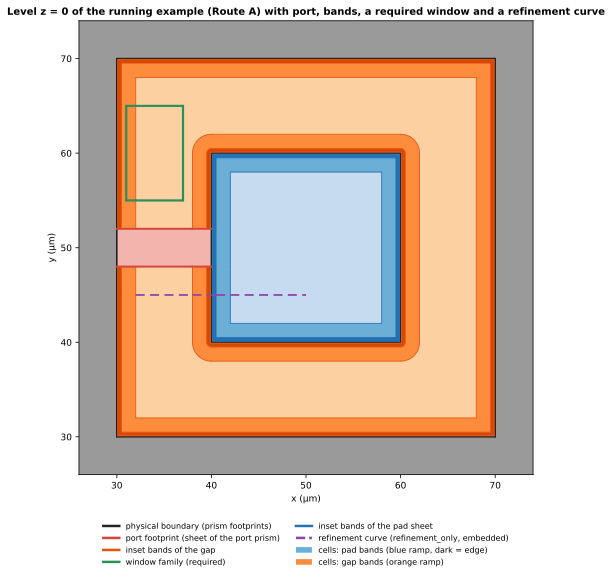

本頁說明：在 SGB 中，分割一個表面的每一種方式都是同一個操作：**把一個 family 的曲線，帶著語意 role 與 edge policy 加入 arrangement**。讀完後，你會知道 family record 裝了什麼、兩種 edge policy 對 cell 與 label 造成什麼影響、為什麼 band 的距離只從 physical boundary 量起、如何在不碰 assembly 或 emission 的情況下新增一種分割，以及曲線何時可以 embed 在 mesh 中，而不必是 edge。

label 與 dissolution 見 [Label、required edge 與 dissolution](labels-and-dissolution.qmd)；第一個完整的使用者是 [inset imprint](inset-imprint.qmd)。名詞在第一次出現時定義，並彙整於[詞彙表](index.qmd#glossary)。

所有範例皆為**計算結果**：由 `docs/design/sgb/_figures/families.py` 在 `experiments/sgb-redesign/prototype` 的 prototype 上產生；數字取自 `figures/families-numbers.json`。

## 執行範例的觀點

執行範例的一個 level 同時帶有四種分割。它是 Route A 的 sheet 平面 $z = 0$，包含：

- **physical boundary**（ground cutout、pad 輪廓、pad hole）；
- **port footprint**（port 是 sheet，所以它的矩形會切開該平面）；
- pad 頂面與 gap 上、margin 為 0.1、0.5 與 2 µm 的 **Surface EPR inset band**（兩個 `inset_band` family）；
- 一個 **window**：為本頁加在 gap 中的矩形，是 role 為 `partition` 的 `required` family；
- 一條 **refinement curve**：橫跨 gap 與 pad 的直線，是 `refinement_only` family。

window 與 refinement curve 是在**完全不修改 pipeline** 的情況下加入的；它們都只是被產生出來的普通 record，附加到模型的 family 清單中。

{#fig-families-level fig-alt="晶片 cutout 的平面圖：pad 被一圈圈巢狀的彩色 band 包圍，gap 左側有一個綠色矩形，pad 右緣有代表 port 的紅色矩形，還有一條橫跨 gap 與 pad 的紫色虛線水平線。"}





@fig-families-level 的看點：

- 綠色的 **window** 位於 gap 中 0.5 與 2 µm 之間的 band，並穿過 2 µm 的 band 曲線進入最內側的 band；每一個交點都是 arrangement 中普通的 vertex。
- **Band** 緊貼 physical boundary，包括圓角與 hole 周圍；window 與 port 不會移動它們（見下方 distance-origin 規則）。
- 紫色的 **refinement curve** 穿過 band 與 pad，但沒有切開任何 cell。它在碰到的 required edge 處被切成 16 段，每一段屬於包含它的 face。

各個 family 單獨加入時的貢獻（計算結果；prototype 對每一種組合從頭建構）：

::: {.askr-table-compact .askr-table-numeric}
| 存在的 family | $z=0$ 的 cell | $z=0$ 的 edge | 模型 face | Face group | Embedded curve 片段 |
|---|---|---|---|---|---|
| 邊界與 port | 5 | 28 | 15 | 6 | 0 |
| + band | 23 | 160 | 33 | 13 | 0 |
| + band + window | 25 | 168 | 35 | 13 | 0 |
| + band + refinement | 23 | 160 | 33 | 13 | 15 |
| 全部 family | 25 | 168 | 35 | 13 | 16 |
:::

window 讓 cell 數增加二、face 數增加二，卻沒有新的 group：它切開的 cell 保有原來的 label，所以 `SA::substrate|vacuum::band=2` 與 `SA::substrate|vacuum::band=3` 這兩個 group 各多一個 face（2 變 3、1 變 2）。refinement curve 沒有改變任何 cell、edge 或 face 的數量；它只增加 embedded curve 片段。band 讓 face group 從 6 增為 13，因為每個 band 都是自己的 group（Route A 中 pad 的 band 是 `SHEET::pad::band=k`，共 7 個 face）。

## Family record

**Cut family** 是一個不可變的 record，說的是：這些曲線，帶著這種意義，作用於這些 level，使用這個 edge policy。brief 的六個欄位與 prototype 的 record 對應如下。

::: {.askr-table-compact}
| Brief 欄位 | Prototype 欄位（`CurveFamilyRecord`） | 意義 |
|---|---|---|
| `family_id` | `family_id` | 名稱；每個成員 carrier id 的前綴（`band_pad_top/ring0/edge8@m100.0`、`window/0`） |
| `role` | `role` | family 的用途：`inset_band`、`partition`、`refinement`；僅作描述，供報告與 lineage 使用 |
| generator | `carriers`、`arcs` | 曲線本身，由來源的函式在 arrangement 之前產生（offset、多邊形、使用者清單）；直線與圓弧 |
| target selector | `target_levels` | 其 arrangement 會接收這些曲線的 level（目前由呼叫者給定 Z 值清單） |
| edge policy | `edge_policy` | `required` 或 `refinement_only`；arrangement 各階段唯一讀取的欄位 |
| distance origin | `support` | 對 offset family 而言，是產生這些曲線所依據的 support region，其 physical boundary 即距離的起點 |
:::

每個成員 carrier 都有 lineage record（family id 與成員名稱）；inset 的直線成員保留它的產生 primitive（`<support>/ring<r>/edge<k>`），和圓弧成員一樣。所以存活下來的 edge 永遠可以追溯到切出它的 family（[Identity](identity.qmd)）。

目標 Z 若沒有任何 prism 定義，family 會加入該 level：它是一般的 level，active set 沒有任何變化。

### 設計中的 family

::: {.askr-table-compact}
| Family | Generator | Target | Edge policy | 在 prototype 中 |
|---|---|---|---|---|
| physical boundary | prism footprint | 各 prism active 的 level 與 slab | label 不同時 required | 有（即 arrangement 本身） |
| lumped-port footprint | port sheet 的多邊形 | 它所在的平面 | required | 有，以 port prism（一個 sheet）；因為其 owner 與鄰居不同而為 required |
| contact cap | prism 的重疊（自動） | 接觸的 level | label 不同時 required | 由 label 自然產生；沒有 family record |
| Surface EPR inset band | 對 physical support region 以 margin $m_1 < \dots < m_k$ 做 offset | 選定的語意表面 | required；band 索引成為 label 的一部分 | 有（`inset_band`） |
| mesh refinement curve | 使用者或自動 | 任何表面 | `refinement_only` | 有（本頁範例） |
:::

**Tile seam 不是 family。** 以 pixel 之間的切線做 tiling 時，沒有任何 seam 幾何進入 arrangement（[平行化推導](parallelism.qmd)），所以不需要為它設一種 edge policy；`dissolve` 這個 edge policy 因此已移除，`CurveFamilyRecord` 拒絕 `required` 與 `refinement_only` 以外的任何 policy（以 `dissolve` 建構會得到 `ValueError: t: unknown edge policy 'dissolve'`，由 script 產生）。

## Edge policy {#edge-policies}

policy 決定 arrangement 在 **labelling 之後**，如何處理帶有該 family 曲線的 edge：

::: {.askr-table-compact}
| Policy | 切開 cell？ | 改變 label？ | edge 最後在哪裡 |
|---|---|---|---|
| `required` | 是：即使兩側 label 相同，edge 也會在 dissolution 後存活 | 本身不會；family 可以在 label 中加入 band 索引 | 成為其 face 的邊界 edge |
| `refinement_only` | 否 | 否 | 成為包含它的 face 的 **embedded curve**；face 的邊界不變 |
:::

對照計算出的表：window（`required`）增加 cell，refinement curve（`refinement_only`）不增加任何 cell。一條 edge 可以屬於多個 family（例如 refinement curve 與 band 曲線交叉時會在交點被切開，每一段只帶有自己的 carrier）；其 carrier 之中最強的 policy 勝出，所以只要有一個 carrier 是 `required`，edge 就會保留。

## Target

family 指名它作用的 level。只有這些 level 的 arrangement 會接收曲線，所以曲線不會切開它原本不打算切的表面（[分層模型](layered-model.qmd)說明了為什麼 level 在這個意義上是局部的）。inset band 在 Route A 中以 sheet 平面為目標；在 Route B 中，同一個 band family 會對金屬的頂面（metal-vacuum 表面）與底面（metal-substrate 表面）各產生一次，是兩個獨立的 family。

prototype 接受明確的 Z 值清單。依語意表面選取（例如「Net `pad` 的每個 metal-vacuum 表面」）是設計意圖，尚未實作；那是在 family 產生之前，把 selector 解析成 Z 值與 support 的一個薄薄的層。

## Distance-origin 規則

inset 曲線由 support region 的 **physical boundary** 產生，在 arrangement 之前、任何分割之前就已算好。其他 family 產生的 seam（port、contact cap、其他 band，以及本頁的 window 與 refinement curve）永遠不是距離的起點。這修正了 solver 端 mask 的缺陷：mask 從已 mesh 表面的每條 edge 量距離，所以 port 或 seam 碰到 band 的地方，band 就被縮短。

這條規則是 generator 的性質，所以由建構保證：generator 收到的是 support region 與 margin，對其他 family 一無所知。計算驗證：無論有沒有 window 與 refinement curve，範例中每個 band 的精確面積都完全相同（最大差異 $0.0$ µm²）；prototype 的 port 不變性檢查（`outputs/inset/port_invariance.json`）對 port 得到同樣的結論（family 完全相同；band 面積最大差異 $6 \times 10^{-8}$ grid unit²）。

## Family 可交換

模型的 identity 不取決於 family 列出的順序：以相反的 family 清單建構範例，得到與原本相等的 build digest（計算結果）。arrangement 一次接收所有曲線，snap rounding 與順序無關，所以 family 是曲線的*集合*，而不是序列中的一步。

## 如何新增 family

本頁的 window 就是整個流程。它的 generator 只有幾行：

```python
def line_family(family_id, role, points_um, closed, policy):
    pts = [(um(x), um(y)) for x, y in points_um]
    pairs = list(zip(pts, pts[1:])) + ([(pts[-1], pts[0])] if closed else [])
    carriers = tuple(LineCarrier(f"{family_id}/{i}", p, q,
                                 Lineage("family_member", family_id=family_id, member=f"{family_id}/{i}"))
                     for i, (p, q) in enumerate(pairs))
    return CurveFamilyRecord(family_id, role, carriers, (Fraction(0),), policy)

window = line_family("window", "partition",
                     [(-79, -20), (-60, -20), (-60, 20), (-79, 20)], True, "required")
```

（`docs/design/sgb/_figures/families.py`；座標單位為 µm，轉換為 1 nm 的 grid。）流程：

1. **撰寫 generator**，回傳 carrier（直線、圓弧），具有唯一的 id 與 lineage。若曲線依賴來源（offset、等值線），要由*來源*與其 support region 計算，而不是由 arrangement 計算。
2. **選擇 target** level。
3. **選擇 edge policy。** 曲線必須分隔 cell（新的表面、新的 group、solver 要積分的 face）就用 `required`；只是引導 mesh 就用 `refinement_only`。
4. **把 record 附加**到模型的 family 清單。

其餘一概不變：labelling、assembly、emission 與驗證都不動。驗證器像對待任何模型一樣重新檢查結果（上表每一種組合都通過）。

::: {.callout-important title="保證：新增 family 不是新增程式路徑"}
assembly 與 emission 讀的是 cell、label 與 edge id。family 只以 edge 的形式、若為 `required` 則以額外 cell 的形式抵達它們。若某個提議的分割無法用曲線、edge policy 與 label 表達，它就是另一種性質的改動，需要設計審查。
:::

## Embed，還是變成 edge？ {#embed-or-edge}

`mesh.embed` 會強迫 mesh edge（或 mesh face）沿著一個不屬於模型邊界的特徵。SGB 恰好在兩個地方使用它：

- **dangling 或交叉的 refinement curve**（`refinement_only`）：emitter 把每一段 embed 到包含它的 face 中；
- **Route B 的 mid-plane port**：embed 在其 host volume 中的 face（[Routes](routes.qmd#the-route-b-port-is-an-embedded-face)）。

其他一切都必須是 arrangement edge，因為 embedded 的特徵沒有 identity：它不在任何 physical group，沒有 cell label，也不能攜帶 band。

::: {.askr-mermaid-view view-label="檢視圖表"}
```{mermaid}
flowchart TD
  Q1{"Does the feature change a label,<br/>bound a measured surface,<br/>or need its own physical group?"} -->|yes| E["arrangement edge<br/>(required family)"]
  Q1 -->|no| Q2{"Is it a sheet that bounds no volume<br/>(inside a host volume)?"}
  Q2 -->|yes| M1["embed the face in its host volume<br/>(sidecar records the pair)"]
  Q2 -->|no| Q3{"Does it only guide the mesh?"}
  Q3 -->|yes| M2["refinement_only family:<br/>embed the curve in its face"]
  Q3 -->|no| E
```
:::

關於 embedding 的兩點：

- refinement curve 的某一段若落在**沒有 face 的 cell**（level 兩側是同一個 domain，那裡不輸出任何東西），或落在沒有任何輸出 volume 的 face 中，就沒有東西可以 embed。這是**錯誤**，不會被默默丟棄：build 以 `SgbError` 中止（以 Route B 在 $z = 0.1$ 的 refinement curve 計算：`refinement curve r/0 at (-70.0000, -8.0000) um on level[1/10] lies in a cell that has no face (inside a volume): it cannot be embedded and is not dropped silently`）。要把 `refinement_only` family 指向其 cell 有 face 的 level。
- XAO 不攜帶 mesh embedding。sidecar 同時記錄 face-in-volume 的配對（`embedded_faces`，Route B 的 port）與 curve-in-face 的配對（`refinement_edges`，refinement curve），使 mesher 能由 sidecar 重新套用（[Emission](emission.qmd)）。

## 小結

- family 是 `(id, role, curves, target levels, edge policy, support)`；arrangement 只讀 policy。
- `required` 切開 cell，`refinement_only` embed 曲線；沒有 `dissolve`，tile seam 不是 family。
- band 只從 physical boundary 量距離；其他 family 永遠不會移動它們。
- 新的分割是一個 generator、一個 target 與一個 policy；沒有新的程式路徑。
- 只有 dangling 的 refinement curve 與 Route B 的 port 可以被 embed；其他都是 edge。
- 下一步：不同 family 的近乎重合曲線如何被回報，見 [Sliver](slivers.qmd)。

## 參考

- Brief 第 4–6 節與第 14 節（policy、family、inset、refinement、target level）。prototype 模組：`records`、`layers`、`dissolve`、`inset`、`emit`。
