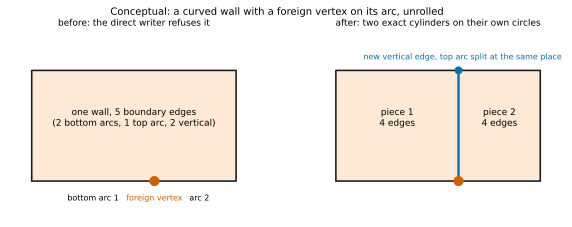

Emission 把已經決定好的 topology 變成 Gmsh 與 AEDT 能載入的檔案。它本身不做任何決定：不做 Boolean operation、不做 healing，也不搜尋幾何。它要保證三件事：每個共用的元素只寫一次，所以結果是 conformal；每個 Gmsh 元素都能用編號對回 planned id；檔案載入後與規劃相符。檔案內部的逐行格式見 [BREP 與 XAO 檔案格式](brep-format.qmd)，交給 AEDT 的部分見 [交給 AEDT](aedt-handoff.qmd)。emission 在 production 已實作（`scgsim.geometry.sgb.emission`、`sidecar`、`verification`、`exchange`，階段 1d 與 1e）；公開入口 `build_sgb_geometry` 寫出 BREP、XAO、sidecar、sliver report 與 validation report 五個檔案，呼叫與回傳見[使用契約](consumer-contract.qmd#call)。本頁的數字、檔案摘錄、id 與計時都是對 production 的計算與量測（`docs/design/sgb/_figures/emission.py`，計時是單次執行，見[補充：重現資料](#reproduction-data)）。

執行範例是 pad-in-ground 模型，metal 具有有限厚度（[Route B](routes.qmd)）：下方是 substrate，上方是 vacuum，ground plane 有一個 cutout，pad 有 chamfer、notch 與圓孔，pad 與 ground 之間有一片 lumped port。port 位於 host 的 support plane（z = 0，也就是 substrate 的表面）：它是 substrate 與 vacuum 之間的一個 face，由兩個 solid 共用，不是 free face（見 [Routes](routes.qmd#port-support-plane)）。這個範例是 production 測試端的 stage-level scene（`tests/sgb_scenes.py` 的 `pad_in_ground`）；那個 scene 為了測試 embedded sheet，把 Route B 的 port 放在金屬的中間平面，compiler 不會這樣放，所以這裡把它換成 z = 0 的同一片 sheet（細節見補充）。

## 發出 CAD 時的執行範例 {#the-running-example-at-the-point-of-emission}

Emission 是最後一個 stage（[pipeline 參考](pipeline-reference.qmd)中的 S10）。Route B 把 pad 與 ground 的內部排除在 mesh 之外，所以四個規劃的 volume 中只有兩個會被輸出：`substrate` 與 `vacuum`。

| | vertex | edge | face | volume |
|---|---:|---:|---:|---:|
| 規劃的 topology | 66 | 88 | 39 | 4 |
| 實際輸出 | 56 | 84 | 35 | 2 |

未輸出的四個 face 是被排除的 ground metal 的外側 wall，它們不接觸任何已輸出的 volume。port 是 substrate 與 vacuum 之間的一般 face，不是 free face，所以 compound 只列出兩個 solid。@tbl-counts 列出檔案內容。

::: {#tbl-counts .askr-table-compact .askr-table-numeric}


running example 寫出的元素。
:::

這裡的 face 是輸出的 BREP face，不是 arrangement 的 cell：horizontal face 由 dissolution 之後 label 相同的 cell 合併而成，wall face 則由 slab 的 edge 長出，沒有對應的 cell。

## 建構順序，以及為什麼它讓模型 conformal {#construction-order-and-why-it-makes-the-model-conformal}

**BREP**（boundary representation）以邊界描述 solid。它的元素構成一個階層：**vertex**（一個點）、**edge**（兩個 vertex 之間的曲線）、**wire**（edge 組成的封閉 loop）、**face**（由一個外側 wire 與任意數量的洞 wire 界定的曲面片，是輸出的 BREP 元素）、**shell**（封閉的 face 集合）與 **solid**（一個或多個 shell）。**compound** 收集 solid 與任何 free face。

```{mermaid}
%%| label: fig-order
%%| fig-cap: "概念圖。箭頭表示「被…使用」。檔案由上往下列出 record，因此每個 reference 都指向已經存在的 record。"
%%{init: {"flowchart": {"rankSpacing": 22, "nodeSpacing": 20, "padding": 6}}}%%
flowchart TB
  V["vertex (0D)：一個點"] --> E["edge (1D)：兩個 vertex 之間的曲線"]
  E --> W["wire：edge 組成的封閉 loop"]
  W --> F["face (2D)：由 wire 界定的曲面片"]
  F --> S["shell：封閉的 face 集合"]
  S --> So["solid (3D)：一個或多個 shell"]
  So --> C["compound：所有 solid 與 free face"]
```

SGB 對這個階層使用兩種順序，兩者對審查都很重要。

1. **相依順序（由葉到根）**是檔案的順序：先是所有 vertex，接著是所有 edge，然後是 wire、face、shell、solid 與 compound。一筆 record 只能指名在它之前寫出的 record。
2. **編號順序（由根到葉）**是深度優先走訪的順序：compound、solid、shell、face、wire、edge、vertex。走訪第一次遇到某個 vertex、edge 或 face 時，該元素取得同類的下一個編號。這些編號就是 Gmsh tag（見 [XAO 與 tag 對應](#xao-groups-and-the-planned-id-to-tag-map)）。

每個共用的元素只寫一次，並以 index 引用。兩個 solid 相接處，它們的 shell 指名同一筆 face record，一次用 `+`、一次用 `-`。符號是該次使用的 orientation（FORWARD 或 REVERSED）：`+` 表示 face 自身的 normal 指向 solid 外側。@fig-shared 顯示範例中 substrate／vacuum 的 interface。

），face `SA::substrate|vacuum::interface` 只存在一次。vacuum 的 shell 以反向使用它（`-21`），因為 face 的 normal（+z）指向 vacuum；substrate 的 shell 則以 `+21` 使用它。](figures/emission-shared-face.svg){#fig-shared fig-alt="上下堆疊的兩個方塊，vacuum 在上、substrate 在下，中間有一個橘色的 face，由兩個 solid 各使用一次。vacuum 的 shell record 以負號列出它，substrate 的 shell record 以正號列出它。"}

::: {.callout-important}
## 保證：以共用達成 conformal

每個規劃的 vertex、edge 或 face 只有一筆 record。相接的兩個 solid 使用同一筆 face record，所以 Gmsh 看到的是一個帶有兩個相鄰 volume 的 face，並且只對它做一次 mesh。沒有任何 tolerance 決定兩個 face 是否重合。在範例中，三個 face（兩個 substrate–vacuum interface face 與 port face）被兩個 shell 使用、32 個被一個 shell 使用，而粗略的 3-D mesh 有 0 個重複 node（見[載入後的檢查](#validation-after-loading)）。topology 本身在建構時就是 conformal（[assembly](assembly.qmd)）；emission 的責任是絕不把共用的元素寫兩次，以維持這個性質。
:::

## 為什麼 SGB 自己寫檔，而不是呼叫 Gmsh {#why-sgb-writes-the-file-instead-of-calling-gmsh}

其中一種輸出方式，是把 plan 透過 Gmsh API 重播：每個 vertex 一次 `addPoint`，每條 edge 一次 `addLine` 或 `addCircleArc`，接著是 curve loop、surface、surface loop 與 volume，最後 `synchronize` 與 `write`。這條路徑得到相同的階層與相同的共用。SGB 保留它作為 test oracle：writer 的輸出會逐 group 與它比較。

::: {.callout-note}
## 設計決策 D8：直接序列化 BREP／XAO

Lead 已決定由 SGB 把規劃好的階層直接寫成 OpenCASCADE 的 `CASCADE Topology V1` 文字檔，需要 physical group 時再包成 XAO；production 已實作，architecture review 尚待進行。Gmsh 只用來對寫出的模型做 mesh，以及作為 test oracle，絕不用來建構幾何。理由有三：量測到的成本、Gmsh API 無法控制的 solid sense，以及一個附帶的好處：planned id 到 native tag 的對應，在 Gmsh 執行之前就已知道。含 foreign vertex 的 curved wall 由 assembly 切成各自在一個圓上的精確 cylinder，所以 writer 只需處理單一圓上的 wall，見[限制與風險](#limits-and-risks)。替代方案與未決事項見 [decisions](decisions.qmd)。
:::

Gmsh API 還有第二個弱點，是任何計時都看不出來的：`addSurfaceLoop` 只收 face 的 tag，不收 orientation，所以無法指定一個封閉 shell 的哪一側是內部，solid 的 sense 無法控制。在同一批隨機 layout 上，這個 oracle 的 solid mass 是錯的：N = 1,000 時 vacuum 是 $2.37 \times 10^9$ µm³、substrate 是 $-2.23 \times 10^9$ µm³（負號表示內外相反），而 direct writer 寫出的兩個 solid 是 $6.91 \times 10^9$ 與 $6.92 \times 10^9$ µm³（`figures/why-scaling-oracle.json`；N = 500 與 2,000 同樣如此，substrate 都是負的）。direct writer 則明確寫出每一個 orientation。

在隨機的 Route B layout（seed 2）上對兩條路徑計時。每個儲存格只跑一次；請讀比值，不要讀最後一位數字。Gmsh-API 路徑只量到 N = 2,000，因為它隨 N 超線性成長：N = 5,000 的試跑在 10 分鐘內沒有完成。direct writer 量到 N = 20,000。@fig-timing 與 @tbl-api 是同一個 N 的並排比較（寫出，加上載入）。

{#fig-timing fig-alt="三個 panel，分別是 500、1000 與 2000 個 feature。每個 panel 有一根堆疊長條代表 Gmsh API，一根代表 direct writer。N 愈大，Gmsh API 長條中的 physical groups 區段愈佔大宗，N = 2000 時約 59 秒；direct writer 的長條在三個 panel 都不到 4 秒，主要是載入。"}



這些計時全部來自只含 polygon 的隨機 layout：沒有 arc、沒有 polyline witness、沒有 cylinder wall，也沒有 band。arc 與 band 在大規模下的成本沒有量測過，不能由這裡外推。這些計時的完整整理與重現方式，見研究頁 [Direct writer 與 Gmsh 載入](../../research/geometry-build/emission-and-load.qmd)；檢查的成本見[檢查的成本](../../research/geometry-build/validation-cost.qmd)。

- **Oracle 的成本集中在 physical group，而且超線性。**N = 500、1,000、2,000 時，oracle 的合計是 2.35 s、8.48 s、64.7 s，direct writer（plan 加算繪）是 0.20 s、0.35 s、0.77 s，差 12 倍、24 倍、84 倍。oracle 的 `addPhysicalGroup` 一階段是 1.19 s、6.07 s、59.3 s（佔 51%、72%、92%），而 group 數只是 1,875、3,691、7,484 個（約 3.7 N）：group 數每加倍，這個 stage 的時間是 5.1 倍與 9.8 倍。其餘三個 stage（OCC build、`synchronize`、寫出 XAO）加起來是 1.16 s、2.41 s、5.46 s，N 每加倍約為 2.1 倍與 2.3 倍。direct writer 不經過 Gmsh 的 group 登記，group 資訊寫在 XAO 的 `<groups>` 與 sidecar 裡。
- **Direct writer 隨 N 大致線性。**N = 1,000、5,000、20,000 時，plan 加算繪（16 個 worker）是 0.44 s、2.19 s、9.14 s，每個寫出的元素（vertex、edge、face）約 6.7 到 7.0 µs。
- **Planning 主導 direct 寫出。**算繪可以平行化（N = 20,000 時，1 個 worker 為 6.93 s，16 個為 1.90 s），但序列的 plan 佔了 16 個 worker 合計 9.14 s 中的 7.24 s（79%）。所以 16 個 worker 對整個寫出只有 1.51 倍（13.8 s 變 9.14 s；N = 1,000 是 1.11 倍，N = 5,000 是 1.28 倍），@tbl-direct。
- **載入是下限。**Gmsh 讀取並 synchronize 同樣的 414,156 個 vertex、620,297 條 edge 與 267,635 個 face（N = 20,000 的 direct XAO）需要 49.7 s，比寫出本身（9.1 到 13.8 s）長；沒有任何 writer 能消除這個成本。載入 API 產生的 XAO 比載入 direct XAO 慢 13% 到 23%（@tbl-load），載入不含 group 的 BREP 比載入 XAO 快 5% 到 10%。
- **報告與 sidecar 比檔案本身貴。**N = 20,000 時，sliver 與 validation report 要 49.7 s、sidecar 要 19.6 s，合計比寫出 BREP 與 XAO 的 13.8 s 長得多（@tbl-sidecar）；本頁沒有把報告再拆成 sliver 與 validation 兩項。
- **不需要 healing。**本頁所有載入都把 `Geometry.OCCAutoFix` 關閉，元素數量與規劃相同，`verify_loaded` 與 OCCT 檢查都通過，所以這些檔案並不依賴 Gmsh 修復。

輸出不受 worker 數影響。文字以 chunk 為單位算繪，再依檔案順序串接；單元測試以三個 hash seed、forked pool 與刻意很小的 chunk 寫出 XAO，每個 route 只得到一個 digest（`test_the_xao_bytes_do_not_depend_on_python_hash_randomisation_or_the_pool`）。這讓序列的 emission stage 能保持 deterministic，而 pipeline 其餘部分可以[平行執行](parallelism.qmd)。

## XAO 與 planned id 到 tag 的對應 {#xao-groups-and-the-planned-id-to-tag-map}

writer 依編號順序走訪 compound，數出每個新的 vertex、edge 與 face，並記錄該計數。Gmsh 對同一維度的元素使用相同的發現順序編號，所以 **Gmsh tag 等於 index 加一**。因此 planned id 到 tag 的對應在寫檔時就已知道，建立它不需要比較任何幾何。同一個 face 有三個編號：在 running example 中，substrate／vacuum 的 interface face（`f:9d1ffbd71300203f`）在 shell 中是 `+21`（substrate 的 shell）與 `-21`（vacuum 的 shell），在 XAO 中是 `reference` 147、index 19，在 Gmsh 中是 tag (2, 20)。

::: {#tbl-tags .askr-table-compact .askr-table-numeric}


running example 中部分 planned id 與它們的 native 編號（physical group 的 tag 依維度各自編號，不是元素的 tag）。
:::

這個對應是完整的：sidecar 的 `ids_by_tag` 依 tag 順序列出 177 個 planned id（56 個 vertex、84 條 edge、35 個 face、2 個 solid），而建構 script 會檢查重新 plan 的結果與它完全相同。從這裡出發，Gmsh 或 Palace 的元素如何一路對回 source curve，見 [mapping chain](identity.qmd)。

## Physical group 與 sidecar {#physical-groups-and-the-sidecar}

Gmsh 的輸出會為 face 所屬的每個 physical group 重複其 element，solver 可能因此誤讀。所以 SGB 讓每個維度的 group 構成一個**分割**：每個輸出的 face 恰好屬於一個 primary group，每個 volume 屬於一個 volume group。running example 的 35 個 face 分成 12 個 group，沒有重疊也沒有遺漏（驗證器斷言這一點）：

::: {#tbl-groups .askr-table-compact .askr-table-numeric}
| Primary group | Face 數 | 意義 |
|---|---|---|
| `MA::pad::top`、`MA::pad::sidewall` | 1、14 | pad 對 vacuum 的頂面與側壁 |
| `MA::ground::top`、`MA::ground::sidewall` | 1、4 | ground 對 vacuum |
| `MS::pad::bottom`、`MS::ground::bottom` | 各 1 | 金屬對 substrate |
| `SA::substrate\|vacuum::interface` | 2 | substrate 對 vacuum（gap 與 pad hole；port 蓋住的部分不在其中） |
| `PORT::p1` | 1 | lumped port（substrate 與 vacuum 之間的 face） |
| `EXT::substrate::bottom`、`EXT::substrate::sidewall` | 1、4 | 外側 box |
| `EXT::vacuum::top`、`EXT::vacuum::sidewall` | 1、4 | 外側 box |
| `substrate`、`vacuum`（volume） | 各 1 | 輸出的兩個 volume |

running example 的 primary group（`MA`：metal–vacuum 側，`MS`：metal–substrate 側，`SA`：substrate–vacuum 表面，`EXT`：外側 box，`PORT`：lumped port）；volume 的 group 沒有前綴，名稱就是 entity id（`substrate`、`vacuum`）。surface 的名稱是 `<kind>::<entity>::<face kind>`。
:::

{#fig-groups fig-alt="左圖是 300 乘 300 微米的 box，灰色 ground plane 上有一個 cutout。右圖是 cutout 的俯視圖：橘色的 substrate 表面、帶有圓孔與 notch 的藍色 pad，以及 pad 與 ground 之間一個小的紅色長方形。"}



XAO 無法攜帶 mesher 與 solver 設定所需的全部資訊，所以 writer 也會在它旁邊寫一個 JSON **sidecar**，即 `<stem>.sidecar.json`（格式 `scgsim.sgb.sidecar.v1`，附 JSON Schema）。它只含 planned id 與 group 名稱：沒有 native handle。每個欄位的定義見[使用契約](consumer-contract.qmd#sidecar)，下表只列出與 emission 有關的主要欄位：

| Sidecar key | 內容 |
|---|---|
| `binding`（`ids_by_tag`） | 每個維度的 planned id，依 native tag 順序排列：`tag = 1 + 位置` |
| `physical_groups` | 每個 primary group：維度、physical `tag`、planned id、`native_tags`，以及 `interface_type`、`face_kind`、`entities`、`net`、`band`、面積與兩側的 volume |
| `unions`、`surface_epr_rows` | `interface_types` 與 `nets` 兩組 primary group 名稱的清單；每個 Surface EPR row 讀取的 group（含 `side` 與 `shared_face_group`） |
| `embedded_faces`、`ports` | mesher 必須重新 embed 的 (face, host volume) 配對；lumped port 的來源識別、host 與 face |
| `refinement_edges`、`mesh_hints` | (edge, host face) 配對，附 `written_as_free_edge`；`mesh_hints` 列出 band 邊界、refinement curve 與曲線 edge，沒有尺寸 |
| `lineage` | edge 對應到 source carrier id、carrier 的描述、face 對應到 source entity id，以及依面積加權的 `membership` |
| `expected` | `verify_loaded` 比對的預期值（vertex 位置、edge、face、solid 的邊界、face 面積與 solid 體積） |
| `counts`、`curved_wall_faces`、`route`、`route_policy`、`grid_um`、`tolerance_um` | 實際寫出的內容 |

一筆 group 條目把三套編號串在一起。running example 中 substrate／vacuum 的 face（節錄）：

```{.json filename="semantic_geometry_route_b.sidecar.json（節錄）"}
  "SA::substrate|vacuum::interface": {
   "dim": 2,
   "face_kind": "interface",
   "ids": ["f:9d1ffbd71300203f", "f:f8d4f101da9d41b5"],
   "interface_type": "SA",
   "native_tags": [20, 28],
   "tag": 12
  },
```

**Physical tag 不是 identity。**它們依排序後的 group 名稱編號，新增 group 時會位移，所以使用者應儲存 group 名稱，並從載入的模型讀取 tag。

**Unions** 是 primary group 名稱的清單。「[Net](../../concepts/geometry.qmd#entity-occurrence-and-net) `pad` 的所有導體表面」是 `unions.nets.pad`，絕不是互相重疊的 Gmsh group：

```{.json filename="semantic_geometry_route_b.sidecar.json（節錄）"}
 "unions": {
  "nets": {
   "Ground": ["MA::ground::sidewall", "MA::ground::top", "MS::ground::bottom"],
   "pad": ["MA::pad::sidewall", "MA::pad::top", "MS::pad::bottom"]
  },
  "interface_types": { "…": ["…"] }
 },
```

**Embedded face 與 curve** 是 free 的元素：不界定任何 volume 的 face（位於某個 volume 中間的 sheet）與 refinement curve。running example 的 port 在 support plane 上，是兩個 solid 共用的一般 face，所以它的 `embedded_faces` 是空的；一片懸在 vacuum 中間的 sheet（catalogue 的 `floating_conductor` fixture 在 Route A 下就是這樣）才會成為 embedded face。refinement curve 一定是 free 的：BREP 可以把它放在 compound 之下（下例是對 running example 加上一條位於 substrate–vacuum interface、從 (−40, 55) 到 (40, 55) µm 的 refinement curve，`RefinementRequest("ref", 0.0, …)`，compound 因此多了一筆 free edge）。但 BREP 無法表達該 edge 位於某個 face 之內，所以 sidecar 記錄 (edge, host face) 的配對，由 mesher 在載入後重新套用：

```{.json filename="semantic_geometry_route_b.sidecar.json（節錄，加上 refinement curve）"}
 "refinement_edges": [
  {
   "edge": "e:af4aaf89517281c3",
   "family": "ref",
   "host_face": "f:9d1ffbd71300203f",
   "written_as_free_edge": true
  }
 ],
```

sidecar 的大小：running example（`pad_in_ground_B`）為 32.6 kB（32,604 bytes）。大型 layout 的 sidecar（含 lineage 與 membership）隨規模大致線性成長：N = 1,000、5,000、20,000 時是 11.2、57.3、232 MB，比同一個 layout 的 XAO（13.1、68.7、282 MB）小；建立它所需的時間見 @tbl-sidecar。它以固定順序寫出，所以對任何 worker 數都是 byte-identical（測試）。

group 名稱的規則（D5，production 已實作 per-Entity）見 [D5](decisions.qmd#d5)。在執行範例中每個 Net 只有一個 Entity，所以 per-Net 與 per-Entity 得到相同的 face，只有名稱不同。Route C 由 production 實作，導體內部成為輸出的 solid，並有以 `<entity>` 命名的 volume group。


## 交給 Gmsh mesher {#handoff-to-the-gmsh-mesher}

Gmsh 只用來對寫出的模型做 mesh，以及作為 test oracle，絕不建構幾何。mesher 是這兩個檔案的使用者：

```{mermaid}
%%| label: fig-handoff
%%| fig-cap: "mesher 的概念性流程。步驟 1 到 5 由 production 的 verify_loaded 與 apply_sidecar_embeds 實作並有測試；步驟 6 是 solver 設定，屬於 Palace adopter（階段 3）。"
%%{init: {"flowchart": {"rankSpacing": 22, "nodeSpacing": 20, "padding": 6}}}%%
flowchart TB
  A["1. 開啟 XAO：幾何與 primary physical group 連同名稱一起載入"] --> B["2. 檢查載入結果：數量、邊界、面積、volume、group"]
  B --> C["3. 讀取 sidecar：由 ids_by_tag 得到 planned id 到 tag 的對應"]
  C --> D["4. 重新套用 embed：(face, host volume) 與 (edge, host face)；由 band 與 refinement curve 建立 size field"]
  D --> E["5. 產生 mesh"]
  E --> F["6. Solver 設定（Palace）：依名稱從 sidecar 取得 group；union 展開成 primary 名稱"]
```

production 的測試與 catalogue 報告執行步驟 1 到 5：開啟 XAO、`verify_loaded`、`apply_sidecar_embeds` 重新套用 embed，接著用 size field 產生粗略的 3-D mesh，並檢查它是否 conformal。

```python
# 概念性程式碼：mesher 在 gmsh.open("….xao") 之後的步驟 3 與 4。
# 實際的版本是 scgsim.geometry.sgb.verification.loaded.apply_sidecar_embeds。
tags = {pid: (dim, i + 1) for dim, ids in sidecar["binding"]["ids_by_tag"].items() for i, pid in enumerate(ids)}
for pair in sidecar["embedded_faces"]:
    gmsh.model.mesh.embed(2, [tags[pair["face"]][1]], 3, tags[pair["host_volume"]][1])
for pair in sidecar["refinement_edges"]:
    gmsh.model.mesh.embed(1, [tags[pair["edge"]][1]], 2, tags[pair["host_face"]][1])
```

## 載入後的檢查 {#validation-after-loading}

SGB 分三層驗證，讓有問題的檔案在成本最低的地方被抓到。三層在 production 都已實作。

| 層 | 何時執行 | 檢查內容 |
|---|---|---|
| 1. 開發測試 | 在 fixture 與隨機 layout 上（需要 `occt` dependency group；CI 尚未安裝，這些測試在 CI 略過） | OpenCASCADE 自己的 `BRepCheck_Analyzer` 與 `BOPAlgo_ArgumentAnalyzer`、`ShapeAnalysis_Shell`、與 plan 的面積／volume 比對，加上下列 Gmsh 載入檢查 |
| 2. 每一次 production build | 寫出之前，以及 mesher 載入之後 | SGB 的[結構不變量](validation.qmd)（fail closed，無法停用）；然後是 `verify_loaded`：載入模型的數量、vertex 位置、邊界、面積、volume 與 group |
| 3. Strict mode（選用） | `build_sgb_geometry(…, strict=True)`，需要 OCP | 對剛寫出的 XAO 執行第 1 層的 OCCT 檢查（self-interference 關閉）；沒有 OCP 時在 build 開始前就以 `OcctUnavailable` 停止 |

第 1 層與第 3 層使用 OCP，也就是 OpenCASCADE 的 Python binding（`cadquery-ocp-novtk==7.8.1.1.post1`，建立在 OCCT 7.8.1 之上，與這裡使用的 Gmsh 是同一個 OCCT 版本）。OCP 在 `occt` dependency group（`uv sync --group occt`），不是必要的相依套件：使用者安裝（例如透過 OrcaPen SC PDK）不會安裝它。`BOPAlgo_ArgumentAnalyzer` 開啟 self-interference、small-edge、face-rebuild、tangency、merge-vertex、merge-edge、continuity 與 curve-on-surface 等模式（`scgsim.geometry.sgb.verification.occt`）；merge 模式能找出重合但未共用的 vertex 與 edge，這是 conformity 的缺陷。該模組也會把 kernel 算出的 volume 與 face 面積與 plan 比較。

### OCCT 檢查的現況

OCCT 檢查有三組結果，範圍由小到大（詳細見 [Validation](validation.qmd#catalogue)）。

**七個執行範例。**`pad_in_ground` 的 Route A、B、C 與各自含 band 的版本，以及 Route B 的 `airbridge`，各有 BREP 與 XAO 兩份報告，共 14 份，全部 `ok`：`BRepCheck_Analyzer` 對每個 vertex、edge、wire、face、shell 與 solid 判定 valid，faulty 元素 0 個；`BOPAlgo_ArgumentAnalyzer`（含 self-interference）沒有 fault，也沒有 result，它不分析 free 的 sheet（running example 的 port 是一般 face，所以沒有 free face 被排除）；`ShapeAnalysis_Shell` 在每個 shell 都找不到 free edge 或 bad edge，沒有 edge 短於十倍 tolerance；kernel 算出的 solid volume 與 plan 的相對誤差最大 $7.9 \times 10^{-14}$，face 面積最大 $1.3 \times 10^{-12}$。14 份報告的 `BRepCheck_Analyzer` 耗時是 2.4 到 22.7 ms，`BOPAlgo_ArgumentAnalyzer` 是 7.8 到 222.8 ms（單次執行；逐案例見 @tbl-occt）。

**極端案例 catalogue。**23 個 fixture 在 Route A、B、C 下共 63 列：54 列建出，並通過 build 與結構檢查、寫出、Gmsh 載入、conformal mesh 與全部 OCCT 檢查；9 列是預期的拒絕（6 個 `NonManifoldError`、3 個 `ContactError`），它們在 build 階段就丟出（1.4 到 22.7 ms），不會拖到寫出之後。這些 fixture 針對容易出問題的幾何：近乎相切的 arc 與直線、淺角度相交的 arc、1 到 3 個 g 長的 edge、頂點相接、重疊的共線 edge、接觸外框的洞、會被 inset 切斷的細頸、會消失的 band、很小的 reflex 角、浮動導體、巢狀的洞、堆疊 slab 的角接觸、port 邊落在 metal sidewall 上、穿過 band 邊界的 refinement curve、相距 0.4 g 與 2 g 的兩層邊，以及圓弧上有外來 vertex 的 wall。54 個通過的組合中，`BRepCheck_Analyzer` 耗時 1.3 到 9.3 ms，`BOPAlgo_ArgumentAnalyzer` 全部模式 3.9 到 51.6 ms（單次執行，@tbl-extreme-timing）。每一列也記錄粗略 mesh 的 `minSICN`、`gamma` 與 drift（D2、D7 的依據）。測試另外在隨機 layout（$N = 100$ 的三種 route 做完整檢查，$N = 1,000$ 的 Route B 做 self-interference 關閉的檢查）上跑 OCCT 檢查，全部通過；尚未量測 $N = 1,000$ 以上的 OCCT 檢查成本。

**Runtime validator 的規模。**validator（第 2 層）在 N = 1,000、5,000、20,000 的隨機 layout（seed 2，polygon-only）上逐項計時：耗時 0.1 s 以上的各項，對 face 數 F 的 slope 在 1.00 到 1.35 之間（band 與 arc 檢查在這些 layout 上沒有工作量，各不到 5 ms），所以成本大致隨 face 數線性成長。N = 20,000（F = 285,871）時，`verify_loaded` 共 14.4 s，各項結構檢查的時間相加是 11.2 s；最大的幾項是 `planarity`（4.5 s）、載入側的 `face_areas`（4.0 s）與 `shells`（3.9 s）（逐項在補充的 @tbl-validator）。

**注入缺陷。**為了知道這些檢查能不能抓到問題，另外對寫出的模型注入五種缺陷：內側 wire 反向、shell 中一個 shared face 反向、vertex 離開 curve 1e-4 µm、少一個 face 造成 open shell、wire 有缺口。`BRepCheck_Analyzer` 五種都抓到（production 的測試斷言這一點）。其餘檢查各自能抓到的種類，測試記錄為下限：vertex 偏離 1e-4 µm 只有 `BOPAlgo_ArgumentAnalyzer` 同時看得到（面積與體積的變化小於 1e-7，規劃比對看不到）；wire 有缺口時 `BOPAlgo_ArgumentAnalyzer` 與 `ShapeAnalysis_Shell` 也看得到。沒有單一檢查能涵蓋全部，所以併用。

這些結果支持的結論是：七個執行範例與 catalogue 中通過的 54 列，其檔案在 OCCT 的標準下有效、與 plan 相符，而預期的拒絕確實發生。它們不支持的是：catalogue 只涵蓋這 23 個構造出來的 fixture（不到 100 個 face 的小模型）；OCCT 的成本只量到 $N = 100$ 與 $N = 1,000$ 的隨機 layout（測試通過，沒有量時間），validator 的成本只量到 $N = 20,000$ 的 polygon-only layout；mesh 品質只是粗略 mesh 的記錄，不是驗收門檻。

### 載入後對 Gmsh 模型的檢查

第 2 層在載入的模型上檢查元素數量、邊界、vertex 位置、group、volume、面積，並產生粗略的 3-D mesh。三個執行範例（`pad_in_ground_A`、`pad_in_ground_B`、`airbridge_B`）全部通過：元素數量與 plan 相同，邊界不一致數為 0，vertex 與規劃位置的偏差為 0，volume 的最大相對誤差分別是 0、$5.4 \times 10^{-13}$ 與 $2.1 \times 10^{-16}$，face 面積的最大相對誤差不超過 $3.1 \times 10^{-12}$，粗略 3-D mesh 都是 conformal 且沒有重複 node，Gmsh-API oracle 的 entity 數與 group 成員與 plan 相同（oracle 的 face 面積與 plan 相差：平面 face 最大 $1.3 \times 10^{-12}$，oracle 自己建立的 curved wall 最大 $1.8 \times 10^{-8}$，測試容許 $10^{-3}$）。完整表格見[補充：重現資料](#reproduction-data)。production 的 catalogue 對每一個建出的列做同樣的載入檢查，全部 `ok`；production 的測試對寫出的檔案做來回檢查（數量、邊界、group、體積、面積與 conformal mesh：`test_round_trip_counts_boundaries_groups_volumes_areas_and_a_conformal_mesh`），並以 Gmsh API 的 oracle 比對 entity、group 與 face 面積（`test_the_gmsh_api_oracle_agrees_on_entities_groups_and_face_areas`）。


每項檢查能抓到什麼：

| 檢查 | 能抓到 |
|---|---|
| 每個維度的元素數量 | 元素被寫兩次或被遺漏 |
| 以 `getBoundary` 檢查邊界 | face 被錯誤的 edge 界定，或 solid 被錯誤的 face 界定 |
| 預測 tag 處的 vertex 位置 | 任何編號錯誤（其他所有檢查都依賴它） |
| group 與 plan 相同 | `<groups>` 中錯誤的 `index` |
| volume（帶正負號的 mass）對 plan 與封閉形式 | orientation 錯誤的 shell（mass 為負）或錯誤的 cylinder |
| 每個 face 與每個 group 的面積 | 錯誤的 surface 或 wire |
| 粗略 3-D mesh 的 conformity | solid 之間不吻合的 face；重複的 node |
| Gmsh-API oracle 的 entity、group 與 face 面積 | 兩個 emitter 之間的差異 |

pad 的 volume 與封閉形式一致（300 × 300 × 100 µm 的 substrate，以及 vacuum box 減去 metal，包含 5 µm 的圓角與 8 µm 的洞；載入的 substrate 與 vacuum 分別是 9,000,000 與 8,984,755.69 µm³，production 的測試容差是 $10^{-12}$ 相對誤差）。emission 之前執行的結構不變量，與上述檢查彼此獨立：前者顯示 plan 是封閉且有 orientation 的，後者顯示檔案所說的與 plan 相同。

solid 的 **sense**（shell 的哪一側是內部）正是 mass 檢查要保護的性質。Gmsh API 無法指定它（見上文）；writer 則明確寫出每一個 orientation，單元測試也確認：把 solid 的 shell 反向，以及只把內部 shell 反向，都會讓 volume 如預期地改變。

## Mesh size hint {#mesh-size-hints}

SGB 提供幾何與 hint；mesh 演算法由 Gmsh 負責。hint 是關於 curve 的陳述，由 mesher 轉成 size field。來源有三種：

- **已經存在的 edge。**inset band 的 edge 與 port footprint 的 edge 都是模型的 edge（見 [inset imprint](inset-imprint.qmd) 與 [cut families](cut-families.qmd)）。sidecar 的 `lineage.edges` 指名每條 edge 的 source carrier，例如 `pad_in_ground_B_bands` 中的 `band_pad_top/ring0/edge1@m2000.0`，所以 mesher 可以用該前綴選出某個 family 的 curve，不需要額外的幾何。
- **Refinement-only curve。**採用 `refinement_only` policy 的 cut family 會把它的 curve 保留為 free edge，且不改變任何 label；落在沒有輸出 face 的 curve 是錯誤。writer 把它們放在 compound 之下，sidecar 在 `refinement_edges` 列出 `(edge, host face)`，mesher 以 `mesh.embed(1, curves, 2, face)` embed 它們，讓 mesh node 落在該 curve 上。
- **Sidecar 的 `mesh_hints`。**production 把這三種來源整理成清單：`band_boundary`（inset family 的 edge，`source` 是請求 id）、`refinement_curve`（refinement 請求的曲線）與 `curved_edge`（每條圓弧 edge），每筆列出 planned edge id 與 native tag；沒有尺寸，mesher 自己決定。
- **大小數值。**這些數字（全域最大與最小、curve 附近的大小、恢復到全域大小的距離）屬於 solver 設定，不屬於幾何。

測試用的 size field 是一個由選定 curve 出發的 `Distance` field，餵給 `Threshold` field：靠近 curve 時給出 `refine_size`，並在 `DistMin` 與 `DistMax` 之間成長到全域最大值。band 測試使用 `refine_size` 1.0 µm，範圍 1–20 µm。band 測試中 `MeshSizeMin` 維持 0，因為 2 µm 的下限無法解析 0.1 µm 的 band；gmsh-API 路徑也以同樣方式失敗。其他範例的 mesh 使用 `MeshSizeMin` = 2 µm，因為 0.2 µm 的 metal 厚度否則會迫使到處都出現很小的 element。

band 從哪裡量起、每個 band 的範圍，見 [Inset band 怎麼量](inset-imprint.qmd#band-measure)。

三個 band case 與一條 refinement curve 在測試中都經過 direct writer。載入後，每個 band group 的 mesh 使得它的 triangle 都恰好是每個相鄰 volume 中一個 tetrahedron 的 face（沒有 element 跨過 band 的邊界），且 centroid 以 exact carrier 的距離判斷落在該 band 內（`pad_in_ground_A_bands` 有 8 個 band group，Route B 與 C 的 band 範例各 12 個，全部如此，@tbl-bands；Route A 把 band group 命名為 `<entity>::band=k`（sheet）與 `SA::substrate|vacuum::interface::band=k`，Route B 與 C 對 pad 的上表面（`MA::<entity>::top`）與下表面（`MS::<entity>::bottom`）各自產生 band，另有 `SA::…::band=k`；逐 group 的 triangle 數見 [inset imprint](inset-imprint.qmd)）。


對 refinement curve，測試檢查：該 edge 在載入的檔案中是 free 的（沒有任何 face 擁有它）、它被切成多於一個 element，以及 sidecar 的該列 `written_as_free_edge` 為 true。

## 交給 AEDT {#handing-the-solids-to-aedt}

AEDT 的交接已有結論：以 XDE assembly 的 STEP 匯入具名 solid，band 在寫檔時就切好，face identity 來自每個 solid 內的 face 順序，port 由 PyAEDT 依 sidecar 以原生方式重建。完整的事實、量測數字與未決事項見 [交給 AEDT](aedt-handoff.qmd)。

## 限制與風險 {#limits-and-risks}

{#fig-five-edge fig-alt="兩個並排的長方形。左邊一個長方形的底邊上有一個橘色的點，把底邊分成兩段，標示為五條邊界 edge。右邊的長方形從該點往上畫一條藍色的垂直線，分成兩片，各有四條 edge。"}

- **OpenCASCADE 與 Gmsh 版本。**shape flag 來自 Gmsh 4.15.2 的檔案，pcurve 的發現是在 OpenCASCADE 7.8.1 搭配 Gmsh 4.15.2 上量測的。其他版本可能以不同方式讀取相同的檔案。每一組支援的版本都需要 writer 的來回測試（`tests/test_sgb_emission.py`），以及第 1 層的 OCCT 檢查。
- **OCCT 檢查的涵蓋範圍。**結果與範圍見[上文](#validation-after-loading)：七個執行範例、23 個 fixture 的 catalogue 與隨機 layout 到 N = 1,000 都已完成；沒有量測更大規模的 OCCT 成本；mesh 品質與 drift 只是 catalogue 的記錄。這些測試目前只在安裝了 `occt` group 的環境執行，CI 尚未安裝。
- **含 foreign vertex 的 curved wall。**當一條 arc 上有外來的 vertex（例如 port 的邊接在圓形 pad 上，或另一層的 post 站在彎曲的邊上），assembly 在該 vertex 處用一條 vertical edge 把 wall 切開，上緣的 arc 也在同一處切開，每一段都是落在自己實現的圓上的精確 cylinder，兩段共用那條 vertical edge（見 [Assembly](assembly.qmd#curved-walls)）。catalogue 的 `arc_with_foreign_vertex` 與 `arc_with_foreign_vertex_from_post` 通過全部檢查。writer 對每一段 cylinder 是精確的，而不是「對任意邊數的 curved wall 都精確」。
- **只有宣告的 arc 會產生 cylinder wall。**只有 polygon 的圓（GDS 的 16 到 128 點）永遠不會產生 cylinder wall，它們的 wall 是平面，所以上述切開只影響宣告成 arc 的幾何。
- **其他不支援的曲面會丟出 `SgbError`。**writer 處理 plane 與單一圓的 cylinder。它也拒絕不是這種 cylinder 的非平面 face、帶洞的 curved wall、繞滿整個 cylinder 的 curved wall、行進方向不同的上緣 arc、不是繞 +z 逆時針的 horizontal face，以及在同一個 wire 中出現兩次的 edge（seam 或 bridge edge）。新增一種 face 要在 `SURFACE_RECORDS` 加一個條目，新增 curve 要在 `CURVE_RECORDS` 加一個，新增 (curve, surface) 組合要在 `PCURVE_RECORDS` 加一個。編號、共用與 section 排列都不變。
- **只在小型 case 上有測試涵蓋。**帶內部 void 的 solid（真空中一個 40 × 30 × 1 µm 的浮動導體：vacuum solid 有外側與內側兩個 shell，volume 是 box 減去 void，把內側 shell 反向則會改成加上 void）、refinement 的 free edge，以及兩個 inset band case。B-spline 的 surface 與 curve 尚未實作。
- **量測。**每個計時儲存格只跑一次，所以結果有執行間的變異：同一個 N = 2,000 的 Gmsh-API oracle 執行了三次，是 84、66 與 65 s（第一次與機器上的其他工作同時執行；表中是最後一次）。Gmsh 的載入時間是佔主導且無法控制的部分。所有 scaling 計時都是 polygon-only 的 layout，Gmsh-API oracle 不做 sewing，也只量到 N = 2,000。

## 參考資料 {#references}

- Gmsh：[reference manual 與 API](https://gmsh.info/doc/texinfo/gmsh.html)，包含 `mesh.embed`、physical group 與 OpenCASCADE 選項。
- OpenCASCADE：[BRep format 說明](https://dev.opencascade.org/doc/overview/html/specification__brep_format.html)，以及 `TopExp::MapShapes` 的文件。
- XAO：[SALOME GEOM 文件中的格式說明](https://docs.salome-platform.org/latest/gui/GEOM/xao_format_page.html)。

## 補充：重現資料 {#reproduction-data}

**資料來源。**本頁的數字、表格與圖都是對 production（`scgsim.geometry.sgb`）的計算與量測，`docs/design/sgb/_figures/emission.py` 把它們轉成表格與圖（`--measure-only` 只重測計時，`--occt-only` 只重建 OCCT 表格），`docs/design/sgb/_figures/emission_snippets_check.py` 檢查頁面引用的檔案摘錄與檔案一致。group 表、tag 表、載入後檢查、band 與 OCCT 報告來自 `tests/sgb_emit_cases.py`、`sgb_scenes.py` 與 `sgb_extreme_cases.py` 的模型，以 `emit_model` 寫出後的檔案與 `check_file` 的報告，單次執行。

| 內容 | 來源 |
|---|---|
| Gmsh-API oracle 逐 stage 與 direct writer 的並排計時、載入時間 | `figures/emission-timing-data.json` 的 `head`（`emission.py --measure-only`；隨機 layout `random_layout(n, seed=2, route="B")`，N = 500、1,000、2,000，每個 N 一個 subprocess） |
| direct writer 的 plan 與算繪（1 與 16 個 worker）、報告、sidecar、檔案大小、Gmsh 載入 | `figures/why-scaling-measured.json`（`_figures/why_scaling.py measure`；同一種 layout，N = 1,000、5,000、20,000，seed 2） |
| 每項檢查的耗時 | `figures/emission-timing-data.json` 的 `validator`（N = 1,000、5,000、20,000；每個 N 一個 subprocess，寫出全部檔案、開啟 XAO、執行 `verify_loaded`） |
| Oracle 的 solid mass | `figures/why-scaling-oracle.json`（`_figures/why_scaling.py oracle`） |
| 各 case 的載入後檢查、band | `verify_loaded` 與 `band_mesh_report`（`tests/sgb_gmsh_oracle.py`） |
| OCCT 檢查報告、注入缺陷與 catalogue | `scgsim.geometry.sgb.verification.occt.check_file`；缺陷來自 `tests/sgb_occt_mutations.py` |
| AEDT 路徑 | [交給 AEDT](aedt-handoff.qmd) |

seed 2：seed 1 的隨機 layout 在 N = 20,000 時有兩個同 Net 的形狀只在一個 vertex 相接，build 以 `NonManifoldError` 拒絕，所以 scaling 使用 seed 2。

### 計時表

::: {#tbl-api .askr-table-compact .askr-table-numeric}


Gmsh-API oracle 逐 stage，與同一個 layout 的 direct writer（plan 加 BREP 與 XAO 的算繪，16 個 worker）。oracle 不做 sewing。「physical group 數」是 oracle 登記的 group 數，每個 group 一次 `addPhysicalGroup`。
:::

::: {#tbl-load .askr-table-compact .askr-table-numeric}


檔案大小與載入時間。載入是在全新的 process 中執行 `open`（XAO）或 `merge`（BREP）加 `synchronize`，不含 Gmsh 啟動時間。N = 5,000 與 20,000 沒有執行 oracle，BREP 的載入也只在前三個 N 量測；這兩列來自 `why-scaling-measured.json`。
:::

::: {#tbl-direct .askr-table-compact .askr-table-numeric}


Direct writer 的 plan 與算繪，1 個 worker 與 16 個 worker（`why-scaling-measured.json`）。planning 是序列的，只有算繪使用 worker；兩次執行各自量測 plan，所以 plan 的兩欄略有差異。
:::

::: {#tbl-sidecar .askr-table-compact .askr-table-numeric}


`emit_model` 在寫完 BREP 與 XAO 之後的步驟：sliver 與 validation report、sidecar（含 lineage 與 membership）的時間與大小（1 個 worker），以及 Gmsh 載入 XAO 的時間（`why-scaling-measured.json`）。@tbl-direct 與 @tbl-load 的寫出時間只包含幾何檔案。
:::

### 極端案例目錄與 validator 規模

目錄的結果見 [Validation](validation.qmd#catalogue)。

::: {#tbl-extreme-timing .askr-table-compact .askr-table-numeric}


極端案例目錄中，各檢查的耗時範圍（只含通過的 54 個組合，單次執行；build 拒絕那一列是 9 個預期拒絕）。
:::

::: {#tbl-validator .askr-table-compact .askr-table-numeric}


runtime validator 逐項的耗時（polygon-only 的隨機 layout，seed 2，單次執行）。「載入側」的項目是 `verify_loaded` 的各階段，其餘是 build 階段的結構檢查。`planarity` 使用 noding kernel，所以它的時間也計在 `ConformalModel.timings` 的 `noding_kernels`。
:::

::: {#tbl-validator-run .askr-table-compact .askr-table-numeric}


同一次執行的檢查時間總和與 `verify_loaded`；peak RSS 是整個 process（build、寫出全部檔案、開啟 XAO 與檢查）的最大值。
:::

### 載入後的檢查（三個執行範例）

::: {#tbl-validation .askr-table-compact}


把寫出的 XAO 載入 Gmsh 後的檢查（`verify_loaded`；BREP 的結果相同，只是它不含 group）。oracle 的 curved wall 是 Gmsh 自己建立的 surface，不是 writer 寫出的精確 cylinder，所以面積與 plan 的差異比平面 face 大。
:::

### OCCT 檢查報告（七個執行範例）

::: {#tbl-occt .askr-table-compact .askr-table-numeric}


每個 case 的 BREP 與 XAO 各一份報告。「BOP 排除的 free face 數」是 `BOPAlgo_ArgumentAnalyzer` 不分析的 free face。
:::

::: {#tbl-occt-controls .askr-table-compact}


對寫出的模型注入缺陷後，各檢查是否抓到；括號內是檢查回報的狀態。
:::

### Inset band case

::: {#tbl-bands .askr-table-compact .askr-table-numeric}


經過 direct writer 的 inset band case（margin 0.1、0.5、2.0 µm，四個 band）。Route A 把 band group 命名為 `<entity>::band=k` 與 `SA::substrate|vacuum::interface::band=k`；Route B 與 C 對 pad 的上表面（`MA`）與下表面（`MS`）各自產生 band，再加上 `SA` 的 band。
:::
