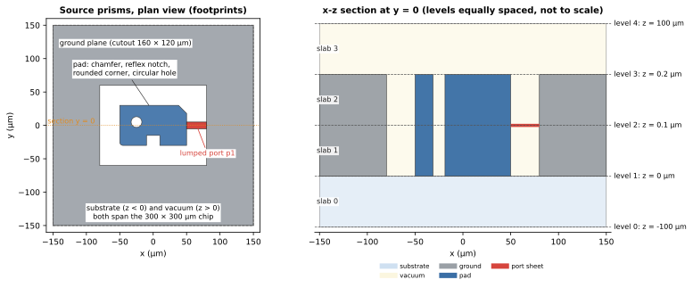
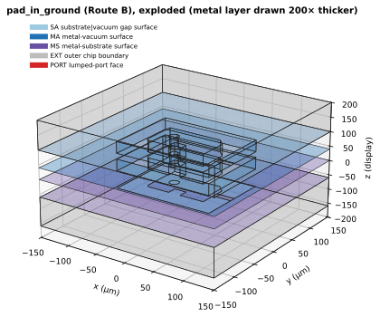

要模擬一顆超導晶片，solver 需要一個封閉的實體模型：相鄰的 volume 共用它們之間的 face（這稱為 conformal），而且每個 face 都知道自己是哪兩種材料之間的介面、屬於哪個 [Net](../../concepts/geometry.qmd#entity-occurrence-and-net)、對應哪一條來源曲線。常見的做法是先為每個零件建一個 solid，再請 CAD kernel 對所有 solid 一次做 fragment（一種全域的 Boolean 運算），最後從結果還原每個 face 的意義。這個做法預期在晶片尺度上很慢，也會遺失每個 face 的來源；論證見[為什麼先規劃](why-plan-first.qmd)，該頁也說明我們沒有對全域 fragment 做 benchmark。

重新設計的 semantic geometry builder（SGB）把順序倒過來。它把晶片描述成有限個 **prism**，**在任何 CAD kernel 介入之前**就推導出完整的 topology 與每個 cell 的意義，再自己把結果寫成 BREP/XAO 檔案。Gmsh 不建立幾何：它載入檔案並對其產生 **mesh**，測試中也把它當作 oracle。模型上不執行任何三維 Boolean 運算。

::: {.callout-note title="實作狀態"}
這個設計已有 production 實作：`scgsim.geometry.sgb`（階段 1，1a 到 1e）。它從真實的 `GeometryBuildInput` 建立 prism，一路做到 snap-rounded arrangement、label、dissolution、assembly、Route A、B、C、per-Entity 的命名、inset band 與 refinement curve、直接寫出 BREP/XAO 與 JSON sidecar，公開入口是 `build_sgb_geometry`。Palace 與 AEDT 尚未切換過來：舊的幾何路徑保留到兩個 adopter 都改接之後（階段 3），移除在階段 4（[D6](decisions.qmd#d6)）。要接 Palace 或 AEDT，請讀 [SGB 輸出的使用契約](consumer-contract.qmd)與[欄位對應](consumer-mapping.qmd)。本設計的圖與數字都出自 `scgsim.geometry.sgb` 的測試與 catalogue 報告（標明 **production**）；少數標明**原型**的是原型時期的一次性觀察。原型程式已經移除，它留下的教訓整理在 `experiments/sgb-redesign/PROTOTYPE_LESSONS.md`。
:::

## 執行範例：輸入與輸出

本設計的每一頁都使用同一顆晶片，稱為 **pad-in-ground**：下方是 substrate，上方是 vacuum，一片帶矩形 cutout 的 ground plane，cutout 內有一個 pad，pad 與 ground 之間有一片 lumped-port sheet。pad 有一個 chamfer、一個 reflex notch、一個圓角和一個圓形孔洞，涵蓋了演算法必須處理的各種轉角。需要多層金屬時，改用第二個較小的範例（由兩根 post 撐起的類 airbridge deck）。

輸入是五個 prism。以下使用 Route B 的形式：金屬厚 0.2 µm，port sheet 位於 host 導體的 support plane，也就是 PDK 宣告的 film attachment face（金屬貼著 substrate 的 $z = 0$）。它躺在 substrate 與 vacuum 的介面上，佔去那裡的 SA 面積，所以這個範例沒有 embedded face，金屬 wall 也不會被 port 切開；規則見 [Routes](routes.qmd#port-support-plane)。

本頁的圖與數字由 production `scgsim.geometry.sgb` 計算。五個 prism 取自測試用的 stage 層 scene `tests/sgb_scenes.py` 的 `pad_in_ground`（可以直接寫出圓弧的 prism 目錄），port 則依編譯器放置 port 的規則放在 $z = 0$（`docs/design/sgb/_figures/intro_common.py` 的 `running_example`）。

{#fig-input fig-alt="左圖：300 × 300 微米晶片的俯視圖。灰色 ground plane 中有一個白色矩形 cutout，裡面是一個藍色 pad，pad 有倒角、下緣有缺口、左下角為圓角並有一個圓孔，另有一個紅色 port 矩形從 pad 連到 ground。右圖：y = 0 的 x-z 剖面，下方是 substrate slab，中間的 slab 有兩塊灰色 ground 與兩塊藍色 pad，substrate 與這個 slab 之間的 level（z = 0）上，pad 與 ground 之間有一片紅色 port sheet，上方是 vacuum，共有四條虛線 level。"}

SGB 從這五個 prism 推導出下面的實體模型（Route B）。為了讓每個 volume 與每個 face 都看得見，圖中把它們拆開：

{#fig-3d fig-alt="三層晶片大小的疊層拆開後的立體圖。最下方偏紫色的一層是 substrate 側，帶有 metal-substrate face。中間一層是 pad 與 ground 的薄金屬 prism，帶有藍色 wall。最上方是 vacuum 側，有淺藍色的 gap 表面與 pad 的頂面 face。黑線標出每個 face 的邊界。"}



看 @fig-3d 時請注意：黑色輪廓是 BREP face 的邊界。metal-vacuum 表面（藍）與 substrate-vacuum gap（淺藍）的邊界只畫一次，並由兩側的 volume 共用。正是這種共用，讓模型不需要任何 fragment 運算就能 conformal。

在這個 Route B 範例中，規劃了 39 個 face，寫出 35 個：ground volume 在晶片邊緣的 4 道 wall 不圍住任何已 emit 的 volume，所以只被規劃而不被寫出，圖中也就沒有畫它們（原因見 [Route A 與 Route B](routes.qmd)）。port 的 face 圍住 substrate 與 vacuum 兩個已 emit 的 volume，位於它們之間；SA 的 gap 面是從 pad 與 ground 之間扣掉 port 的 footprint 之後剩下的部分。完整的數量表在本頁最後的補充。

## SGB 給你什麼

對收到的模型，SGB 產生四樣東西，全部在寫出檔案之前就已決定：

1. **Topology**：由 vertex、edge、face、shell 與 volume 組成，每一個共用邊界只存在一份。相鄰的 volume 共用它們之間的 face 與 edge。
2. **Semantic label**：每個 cell 的材料、擁有者（Net 或 port）、interface 種類，以及 Surface EPR 的 band。cell 與 BREP face 的差別見詞彙表。
3. **Identity**：每個實體有一個 semantic 名稱（例如 `MA::pad::top::band=2`）與一個依內容定址的 atomic id，並附有回到產生它的來源曲線的 lineage。
4. **CAD 檔案與 sidecar**：直接由 topology 寫出的 BREP 與 XAO 檔案，不經任何 Boolean 運算；以及一個 JSON **sidecar**，記錄每個 native 實體對應的規劃 id、physical group、lineage 與依面積加權的 membership。

無論哪一個 solver 使用，這些事實都相同。Palace 透過 Gmsh 讀取 XAO，並由 Gmsh 產生 mesh；AEDT 階段之後會讀取同樣的 solid（見 [Emission](emission.qmd)）。

production 的 group 名稱依決策 D5 以 Entity 歸屬，形式為 `<kind>::<entity>::<face kind>[::band=k]`（例如 pad 的頂面是 `MA::pad::top`，有 inset band 時是 `MA::pad::top::band=2`），完整說明見 [Route](routes.qmd) 與[設計決議](decisions.qmd#d5)。

### 如何檢查結果

設計中有三個層次，production 都已實作：

1. **開發測試**：在 fixture 與隨機 layout 上，以 OCP 綁定執行 OpenCASCADE 自己的檢查（`BRepCheck_Analyzer` 與 `BOPAlgo_ArgumentAnalyzer`），並做 Gmsh 載入檢查 `verify_loaded`（數量、邊界、面積、體積、group）。OCP 在 `occt` dependency group（`cadquery-ocp-novtk==7.8.1.1.post1`），相關測試標為 `occt`；目前 CI 還沒有安裝這個 group，所以 `occt` 測試在 CI 中被略過，只在安裝了該 group 的環境執行。
2. **每一次 production build 都 fail closed**：寫出任何東西之前，先檢查 SGB 自己的 structural invariant（一次 build 記錄 31 項，其中 4 項是不使 build 失敗的警告）。production 中無法關閉驗證。mesher 信任同一次 build 寫出的檔案，不再檢查（見 [Validation](validation.qmd)）。
3. **Strict mode**（選用）：`build_sgb_geometry(..., strict=True)` 在已安裝 OCP 時，對寫出的 XAO 再執行 OCCT 檢查；沒有 OCP 時，在 build 開始前就以 `OcctUnavailable` 停止，並指出 `occt` dependency group。一般使用者安裝（例如透過 OrcaPen SC PDK）不會安裝 OCP。

production 的 extreme-case catalogue（`tests/sgb_catalogue_report.py`，每個 fixture 與 route 一列）結果如下。

- **範圍。** 23 個 fixture 乘上 Route A、B、C，共 63 列。其中 54 列建出模型，並全部通過：build 與結構檢查、direct write、Gmsh 載入（`verify_loaded`）、一次粗略的 3D mesh，以及 `BRepCheck_Analyzer`、`BOPAlgo_ArgumentAnalyzer`（含 self-interference）與 `ShapeAnalysis` 的 OCCT 檢查。另外 9 列是預期的拒絕：6 個 `NonManifoldError`（`exactly_tangent_arc_line`、`kissing_corners_same_net`、`hole_touches_outer`，各在 Route B 與 Route C）與 3 個 `ContactError`（`kissing_corners_different_nets`，三種 route）。原型時期 direct writer 對 5-edge 圓柱 wall 的拒絕已不存在：`arc_with_foreign_vertex` 與 `arc_with_foreign_vertex_from_post` 在 Route B 與 C 都建得出來（見 [Assembly](assembly.qmd#curved-walls)）。
- **每個 fixture 的 mesh 品質與 drift。** catalogue 現在每列記錄它們，D2 與 D7 重新評估的條件因此有資料可看。對 54 個建出的列，以 4 µm 的 mesh size 對 40 × 40 × 20 µm 的 fixture 做粗略的四面體 mesh：Gmsh 的 `minSICN`（1 為正四面體，≤ 0 為翻轉或扁平）最小值落在 0.0007 到 0.312 之間，`gamma` 最小值落在 $7 \times 10^{-6}$ 到 0.306 之間；沒有任何一列出現 ≤ 0 的元素。最大的 snap drift 是 0（輸入本來就在格點上），最大的 arc 偏離是 0.760 grid unit（`arcs_crossing_shallow`），低於 1 g，所以 D7 的重新評估條件沒有被觸發（測試以 ≤ 1 g 斷言）。這些數字是記錄，不是驗收門檻。
- **執行範例。** 七個執行範例（port 放在 support plane 的 `pad_in_ground` 的 Route A、B、C 與各自含 band 的版本，以及 Route B 的 `airbridge`）也全部載入並通過 OCCT 檢查（`docs/design/sgb/_figures/index_example.py` 以 `tests/sgb_catalogue_report.py` 的 `measure` 重新量測，數字在 `figures/index-numbers.json`）。它們以 60 µm 的 mesh size 做粗略 mesh，相對於 0.2 µm 的金屬與 0.077 µm 的 band 非常粗；七個範例的 `minSICN` 最小值落在 0 到 0.119 之間，`gamma` 最小值落在 0 到 0.122 之間。沒有 band 的四個範例與 `pad_in_ground_A_bands` 的 `minSICN` 最小值都在 $10^{-4}$ 以上，`pad_in_ground_B_bands` 是 $5 \times 10^{-6}$，`pad_in_ground_C_bands` 有一個 `minSICN` 約為 0（$-7 \times 10^{-15}$）、`gamma` 為 0 的扁平元素。這是 meshing 的人為結果，不是幾何缺陷：band 的條帶遠比約 60 µm 的元素窄，3D Delaunay 可能把條帶邊界上共線的 node 連成體積為零的四面體；幾何通過 OCCT 檢查（含 self-interference）。改用 HXT 並把最大尺寸設為 bounding box 對角線的 1/20、不設 size field（[測試用的 mesh 配方](emission.qmd#mesh-recipe)）後，三個含 band 的範例 `minSICN` 最小值為 0.0059（Route A）、0.0051（Route B）與 0.0051（Route C）。`tests/sgb_emit_cases.py` 的 `pad_b_bands` 把 Route B 的 port 放在金屬中間平面 $z = 0.1$（stage 層的 case，所以多一個 level），同樣以 60 µm 粗略 mesh 時 `minSICN` 與 `gamma` 的最小值為 0（一個扁平元素）；上述配方在這個 case 會讓 HXT 中止，改用預設的 3D 演算法後 `minSICN` 為 0.0007，沒有扁平元素。這些數字只是這組 mesh 參數下的結果，不是保證：band 的 mesh 尺寸是 Palace adopter 的責任（見[使用契約](consumer-contract.qmd#sidecar)）。D2 不變：不設門檻。（見 [Sliver](slivers.qmd#d2) 與[設計決議](decisions.qmd#d2)。）
- **隨機 layout 與注入缺陷。** 測試在 $N = 100$ 的隨機 layout（三種 route）上跑完整的 OCCT 檢查，在 $N = 1000$（Route B，標為 `slow`）上跑 self-interference 關閉的便宜檢查，皆通過。五種注入的缺陷（內環反向、共用 face 在一個 shell 中翻面、vertex 偏離曲線 $10^{-4}$ µm、缺一個 face、wire 有缺口）每一種都被 `BRepCheck_Analyzer` 抓到，其餘檢查的涵蓋範圍見 [Validation](validation.qmd)。
- **Runtime validator 的成本（production 量測）。** 在 $N = 1000$、5 000、20 000、seed 2 的 polygon-only layout 上（14 215、71 969、285 871 個 face，一個 tile、一個 worker），31 項檢查合計的時間是 0.33 s、2.20 s、10.59 s，對 face 數的局部斜率是 1.16 與 1.14，也就是近乎線性。逐項看，除了 `cylinders` 之外，每一項 validator 的局部斜率介於 0.97 與 1.31；`cylinders` 的 1.6 只出現在 $N = 1000$ 到 5 000，這些 layout 沒有 cylinder wall，那項檢查在這兩個 $N$ 都不到 0.01 s，近乎雜訊（`figures/why-validator-scaling.json`，`python why_scaling.py validators`）。這是單次執行，不含圓弧與 band。

還有三件事要說清楚。第一，AEDT 端：`export_aedt_step` 只做匯出，production 的輸出尚未實際匯入 AEDT 測試過；匯入的證據仍是原型時期的 E4 實驗（[交給 AEDT](aedt-handoff.qmd)）。第二，catalogue 的 fixture 都很小（不到 100 個 face），所以以上的檢查成本與 mesh 數字不代表大型 layout。第三，決定性（逐位元組相同）在同一台機器上測過；跨平台只是論證，尚未實測（見[使用契約](consumer-contract.qmd#determinism)）。各項檢查的細節見 [Validation](validation.qmd)。

## Pipeline 全貌

SGB 共有十一個階段（S0 到 S10）。S0 與 S1 沿用 develop 既有的固定格點來源準備：來源的正規化與 polygon Boolean 在已宣告的格點上完成，其 `GeometryGridContext` 帶著模型格點 $g$，這個 $g$ 就是 S4 使用的格點。**S2 起是新的 pipeline**，production 實作在 `scgsim.geometry.sgb`：S2 直接讀 S1 產生的 effective `GeometryBuildInput` 與 `RepresentationContext`，沒有格點資訊的輸入會被拒絕（不使用預設值）。測試涵蓋由 GDS 與 layer stack、由 thin-film 的 profile、由 `GeometryPlan` 的 snapshot 得到的真實輸入；宣告的圓與圓形的重建紀錄成為精確的 `ArcCarrier`，`interpolation_spline` 與 B-spline 邊界在第一版 fail closed。這與原型不同：原型沒有 S0 與 S1，直接建立 prism，所以原型的成功不代表與 `GeometryPlan` 整合。

S1 到 S9 是作用在 immutable record 上的純函式，也是可平行化的部分（各階段的平行單位見 [pipeline 參考](pipeline-reference.qmd)）。S10 是循序的：它把完成的 topology 序列化，不呼叫任何 CAD kernel 來建立它。Route 是 S7 的一種 labelling policy，不是另一條 pipeline；v1 有三種，都已實作：Route A（sheet 金屬；有限厚度的本體如 bump 仍是 volume）、Route B（排除金屬 volume）與 Route C（保留導體 volume 並在其內部做 mesh，用於有限導電率，以及未來的超導材料模型）。

::: {.askr-mermaid-view view-label="檢視圖表"}
```{mermaid}
flowchart TB
  subgraph P["準備（Prepare），S0 到 S3"]
    direction LR
    S0["S0 來源 snapshot<br/>（Source snapshot）"] --> S1["S1 物理詮釋<br/>（Physical interpretation）"] --> S2["S2 Prism 目錄<br/>（level、slab）"] --> S3["S3 Cut family"]
  end
  subgraph A["排列與標記（Arrange and label），S4 到 S6"]
    direction LR
    S4["S4 Arrangement<br/>（A_i 與 S_i）"] --> S5["S5 Label、<br/>dissolution"] --> S6["S6 Topology 組裝<br/>（Assembly）"]
  end
  subgraph N["命名與檢查（Name and check），S7 到 S9"]
    direction LR
    S7["S7 Route 表示<br/>（Route representation）"] --> S8["S8 Identity、<br/>group"] --> S9["S9 驗證<br/>（Validation，fail closed）"]
  end
  P --> A --> N --> S10["S10 Emission（循序）<br/>direct BREP/XAO writer 與 sidecar"]
  S10 --> M["Gmsh 產生 mesh，Palace 求解<br/>AEDT 之後"]
  classDef reused fill:#d9d9d9,stroke:#555,color:#111
  classDef newpar fill:#cfe0f1,stroke:#2a6f9e,color:#111
  classDef seq fill:#f6d9a8,stroke:#e08a1e,color:#111
  class S0,S1 reused
  class S2,S3,S4,S5,S6,S7,S8,S9 newpar
  class S10 seq
```
:::

圖中灰色的 S0、S1 沿用 develop 的程式；藍色的 S2 到 S9 是新的、可平行化的階段，production 已實作；橘色的 S10 是新的、循序的階段，production 同樣已實作。

這張圖是**概念性**的示意。整個設計由三個想法支撐：

- **Local arrangement。** 每個 Z level 與每個 slab 各有一個 planar arrangement，只由在那裡相遇的曲線建立（見 [2.5D layered model](layered-model.qmd)）。
- **每一種分割共用同一個機制。** 材料邊界、port、inset band 與 refinement curve 都是在 arrangement 中加入曲線，再由 label 決定意義（見 [Cut family](cut-families.qmd)）。平行化用的 tile seam 不是 family：任何 seam 幾何都不會進入 arrangement。
- **格點上的 exact carrier。** 每條曲線保有它的精確定義，而每個 vertex 都落在同一個格點上（見[建立 arrangement](arrangement.qmd)）。

## 目標與各自的機制

目標依優先順序列出。每一列指出服務該目標的機制，以及說明它的頁面。

::: {.askr-table-compact}
| # | 目標 | 機制 | 頁面 |
|---|---|---|---|
| 1 | **Semantics 先於幾何。** 材料、擁有者、Net、interface 種類、route 與表面 identity 都在規劃好的 record 上決定；kernel 從不決定這些。 | 任何 face 出現之前，每個 cell 就已有 label；route 是一種 labelling policy；名稱來自 label。 | [Label](labels-and-dissolution.qmd)、[Route](routes.qmd) |
| 2 | **沒有全域 fragment；能擴展到大型幾何。** 模型上沒有 3D Boolean；成本隨特徵數近乎線性成長；推導可平行化。 | 每個 level 與 slab 各自的局部 2D arrangement；由共用的 atomic 實體組裝；純粹的逐 tile 函式。 | [為什麼先規劃](why-plan-first.qmd)、[Parallel derivation](parallelism.qmd) |
| 3 | **穩定的來源 identity，向前傳遞；route 是早期輸入。** 要建什麼，在建構之前就完全決定。 | 每條曲線都有 lineage；id 由內容雜湊而成；route 改變的是 prism 與 label，不是 pipeline。 | [Identity](identity.qmd)、[Route](routes.qmd) |
| 4 | **可重現的 handoff identity 與程式化對應**：從每個 solver 實體回到 semantic 表面與來源曲線。 | 主要 physical group、sidecar，以及固定的對應鏈；使用端儲存 group 名稱（native tag 不是 identity）；不做座標或面積比對。 | [Identity](identity.qmd)、[Emission](emission.qmd) |
| 5 | **與後端無關。** 一個封閉、conformal 的實體模型，供 Palace 以及之後的 AEDT 使用。 | topology 就是產物；BREP/XAO 與 AEDT 的 solid 都是它的序列化，而 Gmsh 只負責 mesh。 | [Assembly](assembly.qmd)、[Emission](emission.qmd) |
| 6 | **依構造即 conformal；人為產生的 sliver 予以消除，來源本身的事實則予以回報。** | 共用的 atomic vertex 與 edge；snap rounding；local arrangement；dissolution；sliver 報告；fail-closed 驗證，且在任何 route 中不同 Net 的接觸都是錯誤。 | [Assembly](assembly.qmd)、[Sliver](slivers.qmd)、[Validation](validation.qmd) |
| 7 | **可擴充的分割。** inset imprint 是第一個使用者，不是特例。 | 新的分割種類只需要一個 generator、一個 target 與一個 edge policy；assembly 與 emission 不需要新的路徑。 | [Cut family](cut-families.qmd)、[Inset imprint](inset-imprint.qmd) |
:::

第一版的非目標：mesh 演算法（由 Gmsh 負責；SGB 只提供幾何與尺寸提示）、solver 設定、推論電氣連通性，以及非 prism 的本體，例如斜側壁。非 prism 本體是擴充點，絕不會被悄悄地近似。

## 接下來讀哪裡

初次閱讀請依此順序；每一列說明讀完該頁後你能解釋什麼。第 16 到 19 頁是給需要核對檔案內容、採用 sidecar 或查詢欄位的人，不需要依序讀完；要把 Palace 或 AEDT 接到新的 SGB，從第 17 頁開始。

::: {.askr-table-compact}
| # | 頁面 | 讀完後你能解釋 |
|---|---|---|
| 1 | 本頁 | SGB 解決什麼問題、給你什麼、各項目標。 |
| 2 | [為什麼先規劃](why-plan-first.qmd) | 為什麼先建 solid 再 fragment 會損失速度與 identity、規劃帶來什麼（附實測 scaling），以及為什麼 SGB 自己寫 CAD 檔案。 |
| 3 | [2.5D layered model](layered-model.qmd) | Prism、level、slab、slab arrangement 與 level arrangement，以及為什麼 arrangement 是局部的。 |
| 4 | [建立 arrangement](arrangement.qmd) | 帶 exact carrier 的 snap rounding、它的保證、成本與曲線類別。 |
| 5 | [Label、required edge 與 dissolution](labels-and-dissolution.qmd) | cell 如何取得 label，以及哪些 edge 會被保留。 |
| 6 | [從 arrangement 到 solid](assembly.qmd) | Face、wall、shell 與 volume，以及為什麼結果依構造即 conformal。 |
| 7 | [Route A 與 Route B](routes.qmd) | sheet 金屬與被排除的有限厚度金屬，如何只改變 label 與 emission。 |
| 8 | [Cut family](cut-families.qmd) | 所有分割共用的機制，以及哪些分割需要明確的 record。 |
| 9 | [Surface EPR inset imprint](inset-imprint.qmd) | Erosion、轉角規則、band，以及 Palace 與 AEDT 如何使用它們。 |
| 10 | [Identity、lineage 與對應鏈](identity.qmd) | 兩層 identity，以及一次從頭到尾追蹤的查詢。 |
| 11 | [Parallel derivation](parallelism.qmd) | 平行化的結構、tiling 規則，以及哪些部分維持循序。 |
| 12 | [Sliver](slivers.qmd) | 四種 sliver 來源、哪些依構造即被消除，以及 feature size 如何量測。 |
| 13 | [Validation](validation.qmd) | 各項檢查、三層驗證，以及 fail-closed 的行為。 |
| 14 | [Emission](emission.qmd) | direct BREP/XAO writer、sidecar，以及 Gmsh 如何處理它們。 |
| 15 | [交給 AEDT](aedt-handoff.qmd) | SGB 的 solid 如何以帶名稱的 solid 進入 AEDT，以及 face identity 如何把關。 |
| 16 | [BREP 檔案格式](brep-format.qmd) | direct writer 寫出的 BREP 與 XAO 檔案的結構（給需要讀寫檔案的人）。 |
| 17 | [SGB 輸出的使用契約](consumer-contract.qmd) | `build_sgb_geometry` 的呼叫與回傳、決定性的保證（測過與論證）、sidecar 的每個欄位，以及 Palace 與 AEDT 讀取端的步驟。 |
| 18 | [Palace 與 AEDT 的欄位對應](consumer-mapping.qmd) | 今天的 Palace group dict 與 record 欄位、AEDT ledger、Electrostatic 的 Net 各對到新 sidecar 的哪裡；哪些要同時切換；開放項目。 |
| 19 | [階段與 record 參考](pipeline-reference.qmd) | 每個階段的輸入、輸出與 record，供查閱。 |
| 20 | [設計決議](decisions.qmd) | 每一項決策的狀態、選項、建議與後果。 |
:::

想快速找到某個問題的答案：

- *為什麼不直接建 solid 然後呼叫 fragment？* [為什麼先規劃](why-plan-first.qmd)。
- *為什麼不會有來自無關層的 sliver face？* [2.5D layered model](layered-model.qmd)。
- *所有東西都在格點上時，「exact」是什麼意思？* [建立 arrangement](arrangement.qmd)。
- *一個 Palace attribute 如何追溯到來源曲線？* [Identity](identity.qmd)。
- *哪些已決定、哪些還開放？* [設計決議](decisions.qmd)。

本設計的圖有兩種：**計算所得**的圖與數字來自 production 的測試與 catalogue 報告（稱為「production」）；文中少數標明「原型計算」的數字是原型時期的觀察，原型程式已移除，無法再由本 repository 重現；**概念性**的圖是手繪的規則示意，圖說會註明是哪一種。互動式圖可以在檢視器中開啟並縮放，每張都附有一張顯示關鍵視角的靜態圖。除非圖中註明「grid units $g$」，長度單位為微米，格點單位為奈米。

## 詞彙表 {#glossary}

詞彙在此定義一次；各頁在第一次使用時會再簡述一次。

::: {.askr-table-compact}
| 詞彙 | 意義 | 所在頁面 |
|---|---|---|
| **Prism** | 把一個平面 footprint（一個外環加上孔洞）沿 Z 區間擠出而成的體，帶有材料、entity id 與 role。 | [Layered model](layered-model.qmd) |
| **Sheet** | 厚度為零的 prism（$z_0 = z_1$），例如 Route A 的金屬或 lumped-port 的 face。 | [Layered model](layered-model.qmd) |
| **Level** | 所有 prism 頂面與底面、sheet 平面與 port 平面中，不同的 Z 值。 | [Layered model](layered-model.qmd) |
| **Slab** | 兩個相鄰 level 之間的開區間。 | [Layered model](layered-model.qmd) |
| **Active set** | 填滿某個 slab 的 prism（$z_0 \le z_i$ 且 $z_1 \ge z_{i+1}$）。 | [Layered model](layered-model.qmd) |
| **Arrangement** | 由一組曲線對 XY 平面做的 planar 分割，以 vertex、edge 與 cell 儲存。分為 slab arrangement $S_i$ 與 level arrangement $A_i$。 | [Layered model](layered-model.qmd)、[Arrangement](arrangement.qmd) |
| **Carrier** | 一條曲線的精確定義（通過兩點的直線、由圓心與半徑決定的圓）。vertex 會被 snap；carrier 從不被 snap。 | [Arrangement](arrangement.qmd) |
| **Hot pixel** | 含有端點或交點的格點 pixel；曲線會被改道穿過它的中心。 | [Arrangement](arrangement.qmd) |
| **Cell** | arrangement 的一個區域（帶孔洞的連通區域）。它與之後寫出的 BREP face 不同：BREP face 是 emission 的曲面，由 cell 與 wall 組成。 | [Layered model](layered-model.qmd) |
| **Label** | cell 的意義：slab cell 是它佔據的 domain；level cell 則是（下方、上方、sheet 擁有者、band）。 | [Label](labels-and-dissolution.qmd) |
| **Required edge** | 會被保留的 edge：它兩側的 label 不同（label 含擁有它的 Entity，所以不同 Entity 之間的 seam 也被保留），或它所屬的 curve family 標為 `required`。 | [Label](labels-and-dissolution.qmd) |
| **Dissolution** | 移除非 required 的 edge，並合併兩側的 cell。 | [Label](labels-and-dissolution.qmd) |
| **Cut family** | 一筆 immutable record（id、role、generator、target、edge policy、distance origin），以 semantic role 把曲線加入 arrangement。 | [Cut family](cut-families.qmd) |
| **Band** | support 表面上兩條 inset 曲線之間的區域，依 margin 編號；band 的 face 在 label 中帶有該編號。 | [Inset imprint](inset-imprint.qmd) |
| **Wall** | 沿著 slab edge、位於兩個 slab label 不同的 cell 之間的垂直 face。 | [Assembly](assembly.qmd) |
| **Shell** | 圍出一個 volume 的封閉水平 face 與 wall 集合；帶有內部空洞的 volume 擁有不只一個 shell。 | [Assembly](assembly.qmd) |
| **Volume** | 同一個 domain（材料相同且擁有它的 Entity 相同）的連通區域，由 shell 圍出。 | [Assembly](assembly.qmd) |
| **Semantic identity** | 由 label 推得的名稱，不受無關修改影響，例如 `MA::pad::top::band=2`。 | [Identity](identity.qmd) |
| **Atomic identity** | vertex、edge、face 或 volume 依內容定址的 id；相同輸入無論 worker 數或 tile 配置為何，都得到相同的 id。 | [Identity](identity.qmd) |
| **Lineage** | 記錄 edge 或 face 回到其 carrier 與來源 entity 的路徑，合併後的 face 另附依面積加權的 membership。 | [Identity](identity.qmd) |
| **Membership** | 對單一 face 而言，每個貢獻的來源 entity 其 footprint 所覆蓋的面積比例（wall 則是底邊長度的比例）。各比例不互斥，總和可以大於 1。Entity 是 lineage，不是「每個 entity 都有各自量測值」的承諾。 | [Identity](identity.qmd) |
| **Physical group** | 交給 mesher 與 solver 的、已命名的一組已 emit 的 face 或 volume。每個已 emit 的實體恰好屬於一個 primary group；像「Net X 的所有導體表面」這種聯集，是 group 名稱的清單，絕不是互相重疊的 group。native tag 依排序後的名稱編號，不是 identity。 | [Identity](identity.qmd)、[Emission](emission.qmd) |
| **Sidecar** | 與 BREP/XAO 檔案並列寫出的 JSON 檔（production 格式 `scgsim.sgb.sidecar.v2`，附 JSON Schema）：native tag 對應的規劃 id、physical group 與其聯集、embedded face、refinement curve、Surface EPR row、曲面 wall、mesh feature（幾何事實）、計數與 lineage。欄位見[使用契約](consumer-contract.qmd#sidecar)。 | [Emission](emission.qmd) |
| **Feature size** | face 的寬度，定義為兩條互不相接的邊界 edge 之間的最小距離，在精確的 carrier 上量測（含圓弧）；sliver 報告用它衡量 face 有多薄。 | [Sliver](slivers.qmd) |
| **MA / MS / SA** | interface 種類的縮寫：MA 是 metal–vacuum（金屬與真空之間），MS 是 metal–substrate（金屬與基板之間），SA 是 substrate–vacuum（基板與真空之間，也就是 gap 表面）。它們是 Surface EPR 的 row 所用的分類，也出現在 physical group 名稱中（例如 `MA::pad::top`）。見 [概念：geometry](../../concepts/geometry.qmd) 與 [Inset imprint](inset-imprint.qmd)。 | [Identity](identity.qmd) |
| **Net / Entity** | Entity 是元件中一個有名字的來源形狀（例如 pad）；Net 是形成同一條電氣導體的一組 Entity。定義見 [概念：geometry](../../concepts/geometry.qmd#entity-occurrence-and-net)。 | [Route](routes.qmd) |
| **Route A / B / C** | 三種 labelling policy：Route A 把金屬當成零厚度的 sheet；Route B 把有限厚度金屬的 volume 排除，只留下邊界；Route C 保留導體 volume 並在內部做 mesh。見 [Route](routes.qmd)。 | [Route](routes.qmd) |
| **Strict mode** | 選用的 production 設定：在已安裝 OCP 綁定時，對寫出的檔案執行 OpenCASCADE 的有效性檢查，這是每次 build 都會執行的 structural 檢查之外的額外一層。 | [Validation](validation.qmd) |
:::

## 補充：重現資料

下表是 production（`scgsim.geometry.sgb`）對執行範例（port 在 support plane $z = 0$）與延伸範例的數字，每一列同時列出「規劃」與「實際輸出」：規劃是 S6 組裝好的 topology（`ConformalModel.counts`），實際輸出是 direct writer 寫出的實體數量（sidecar 的 `counts`）。

::: {.askr-table-compact .askr-table-numeric}
| 量（規劃／實際輸出） | `pad_in_ground_B` | `pad_in_ground_A`（sheet 金屬） | `pad_in_ground_C` | `pad_in_ground_B_bands`（3 個 margin） | `airbridge_B`（延伸範例） |
|---|---|---|---|---|---|
| Prism 數 | 5 | 5 | 5 | 5 | 7 |
| Level / slab 數 | 4 / 3 | 3 / 2 | 4 / 3 | 4 / 3 | 6 / 5 |
| Vertex | 66 / 56 | 39 / 34 | 66 / 56 | 321 / 236 | 44 / 44 |
| Edge | 88 / 84 | 44 / 44 | 88 / 88 | 274 / 270 | 78 / 74 |
| Face | 39 / 35 | 15 / 15 | 39 / 39 | 60 / 56 | 43 / 33 |
| Volume | 4 / 2 | 2 / 2 | 4 / 4 | 4 / 2 | 7 / 2 |
| Physical group 數 | 14 | 10 | 17 | 23 | 18 |
| 通過的 structural validation 檢查 | 31 / 31 | 31 / 31 | 31 / 31 | 31 / 31 | 31 / 31 |
:::

規劃與實際輸出的差，可以逐項對上（對這五個案例重建 topology 並檢查）：

- **Vertex：** 圓弧 edge 在規劃中各帶一個只用來記錄圓心的 vertex，不寫出。規劃的 vertex 數減去圓弧 edge 數（sidecar 的 `counts.arcs`：依欄位順序為 10、5、10、85、0），恰好等於寫出的數量。
- **Face 與 edge：** 不圍住任何已 emit volume 的 face 不寫出，只屬於它們的 edge 也不寫出。Route A 與 Route C 沒有這類 face。`pad_in_ground_B` 與 `pad_in_ground_B_bands` 各有 4 個（全是 `EXT::ground::sidewall`，ground volume 在晶片邊緣的 wall），只屬於它們的有 4 條垂直 edge。`airbridge_B` 有 10 個：6 個是兩塊 ground 在晶片邊緣的 `EXT::*::sidewall`，4 個是被排除的導體 Entity 之間的 `MM::*::interface`（ground 與 post、deck 與 post），只屬於它們的有 4 條垂直 edge。
- **Volume：** `airbridge_B` 規劃 7 個 volume，因為 D5 之後每個導體 Entity 各自一個 volume（兩塊 ground、兩根 post、deck、substrate、vacuum）；輸出的是 substrate 與 vacuum。

最後一列是 `ValidationReport` 記錄的檢查數。每個範例寫出後都通過 `verify_loaded` 與 OCCT 檢查（見上文 catalogue 報告）。

這些數字由 `docs/design/sgb/_figures/index_example.py` 重建：以 `running_example`（`tests/sgb_scenes.py` 的 `pad_in_ground`，port 放在 $z = 0$）與 `airbridge()` 建立模型，`model.counts` 是規劃的數量，寫出後讀 sidecar 的 `counts` 是實際輸出，數字在 `figures/index-numbers.json`。要注意：`tests/sgb_emit_cases.py` 的 `pad_b`、`pad_c`、`pad_b_bands` 等 case 使用 scene 自己的 Route B port，位於金屬中間平面 $z = 0.1$，所以多一個 level 與一個 slab，並把兩道金屬 wall 切開；那組 case 的 `pad_b` 是規劃 41、寫出 37 個 face，`pad_b_bands` 是 62／58，與上表不同。Route A 的 port 本來就在 $z = 0$，所以 `pad_in_ground_A` 在兩組之間相同。`airbridge_B` 的 7 個 volume 是 substrate、vacuum 與每個導體 Entity 各一個，加上 4 個同一個 Net 的不同 Entity 之間的 `MM` 接觸 face（Route B 不輸出）與依 Entity 切開的外側 sidewall，皆為 D5 的 per-Entity 歸屬。`pad_in_ground_B_bands` 的 `SolutionInterface` 取整個 substrate–vacuum 介面，所以 pad 圓形 hole 的 SA face 也被切 band，port 的 footprint 則從 SA 與它的 band 中扣掉（band 的距離只從 gap edge 量起）。圖與數字的腳本與執行方式列在 `docs/design/sgb/_figures/README.md`。
