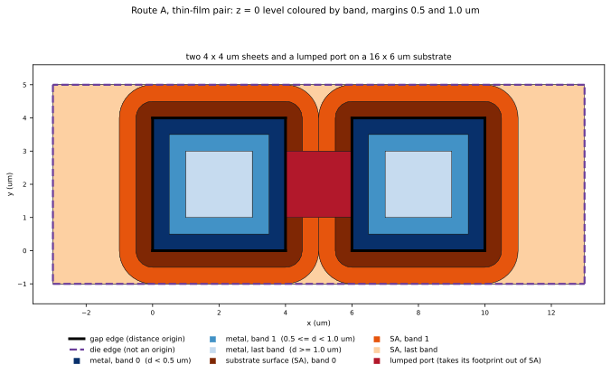
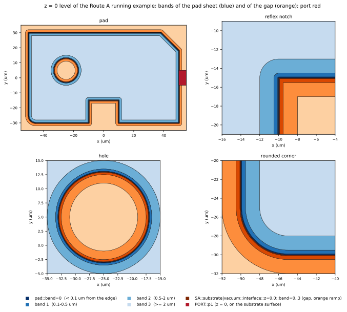
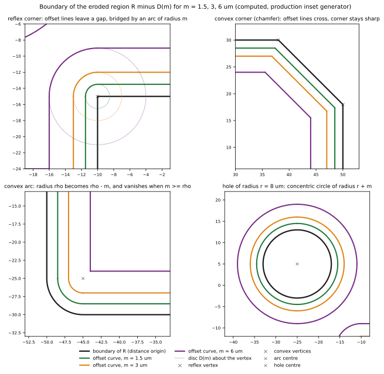
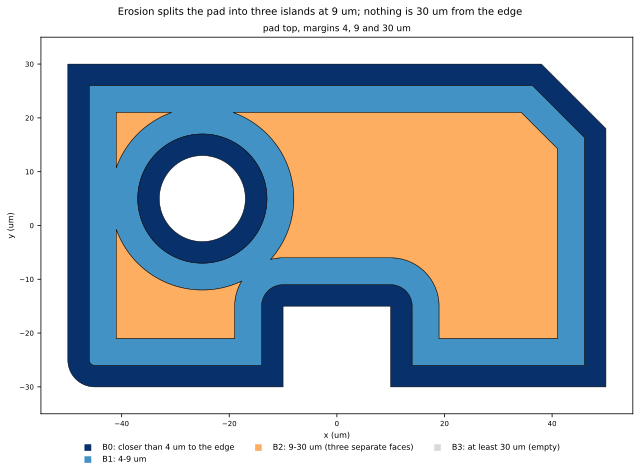
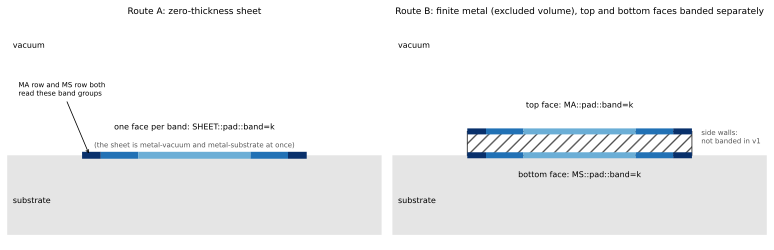
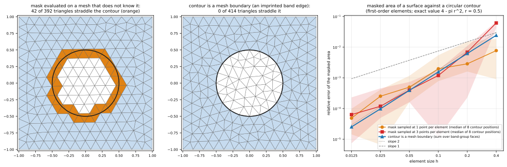
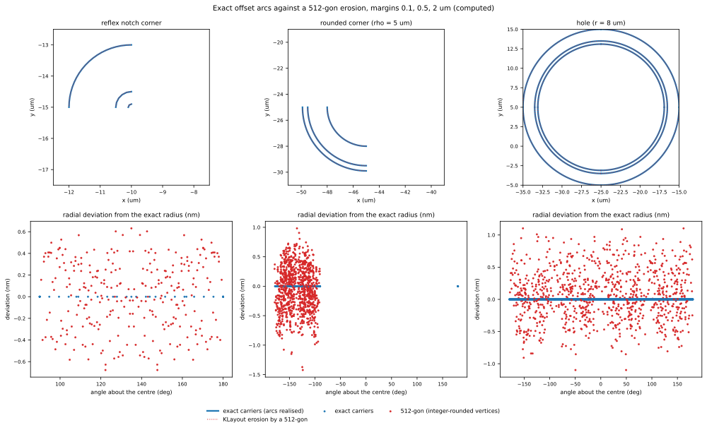

**Inset** 選出一個 surface 上距 **gap edge**（面向裸露 substrate 的金屬邊，定義見 [Inset band 怎麼量](#band-measure)）至少 $m$ 的部分；相鄰兩個 margin 之間的差形成 **band**。Surface EPR 在這些區域之上，還需要一個 field solution 與選定的 loss model：把 field 在各個區域上積分，才能估計 surface loss 有多少集中在邊緣附近。這一頁說明 SGB 如何把這些區域做成模型中精確的幾何：inset 曲線的規則、band 如何組成累積的「距邊緣至少 $m_k$」selection、solver 端有什麼改變，以及它與現行的 mask 做法有何不同。SGB 在 CAD／XAO 中直接解決 inset：一般的（upstream）Palace 只需要對普通的 surface group 積分，不需要、也不支援 fork 版 Palace 的原生 Mask／Inset。

在 SGB 中，inset band 是 **cut family** 的第一個使用者：cut family 是把一組曲線連同語意 role 加進 arrangement 的 record（機制見 [Cut families](cut-families.qmd)，arrangement 見 [Building an arrangement](arrangement.qmd)，兩種 route 見 [Routes](routes.qmd)）。arrangement 中的平面區域稱為 **cell**，輸出後成為 BREP **face**。這些規則在 production（`scgsim.geometry.sgb.cutfamilies`）已實作，請求以 `InsetRequest` 與三種 support 表示：指定 face 的 `ConductorSurface`、`SolutionInterface`，以及按 Surface EPR 種類選出所有 face 的 `InterfaceSurfaces`（見[要 band 的兩種寫法](#request-forms)與[使用契約](consumer-contract.qmd#requests)）。本頁的圖與數字是**對 production 的計算結果**：running example 的 pad-in-ground 是 production 測試端的 stage-level scene（`tests/sgb_scenes.py`），以 `build_model_from_catalogue` 建出，lumped port 放在 host 的 support plane（z = 0）；概念示意會標明 conceptual；產生方式見最後的補充。

## Inset band 怎麼量 {#band-measure}

這一節是 inset 距離規則的唯一說明；[Cut families](cut-families.qmd#distance-origin)、[Routes](routes.qmd#port-support-plane)、[使用契約](consumer-contract.qmd#requests)與其他頁只連到這裡。

### 距離從哪裡量起

band 把一個 **support face**（要被分段的面）依「離 **distance origin** 多遠」切開。distance origin 只有一種：**gap edge**。

**gap edge** 是導體 footprint 的一段邊，並且在導體的 support plane 上，這段邊的另一側是**裸露的 substrate 表面**：兩個 solution region 的介面，其中至少一個是 dielectric，也就是 `SA` 或 `SS` 介面。導體的 support plane 是它附著的那個平面：Route A 的 sheet 所在的平面，或 Route B、C 有限厚度金屬的底面所在的平面（top face 的 footprint 與 bottom face 相同）。判斷時 lumped port 一律當作不存在：port 蓋在 gap 上，並不會讓兩側的金屬邊不再面向 gap。

下列的邊**不是** origin：

- **die／model 邊界上的邊。** 金屬一直延伸到 die 邊緣，邊的外側已經沒有 substrate 表面。
- **兩個導體相接的邊**（conductor–conductor contact）。
- **另一側只有 vacuum 的邊。** 例如懸空的導體，其 footprint 的邊旁邊沒有 substrate。

同一條規則適用於每一種 support：導體的 MA 與 MS face、Route A 的 sheet，以及 SA 與 SS 介面。導體的 face 從它自己 footprint 的 gap edge 量起；SA 或 SS 介面從它自己邊界上與導體相接的部分量起。

### 為什麼只有 gap edge 是 origin

Surface EPR 的 **2D correction factor** 是由 gap 的剖面算出來的：兩片金屬夾著一道裸露的 substrate（metal–gap–metal）。一個 band 的修正因此只有在距離從面向 gap 的邊量起時才有意義。die edge 旁邊的金屬沒有這樣的剖面，那裡的區域無法修正，所以 die edge 不是 origin；它旁邊的區域屬於最後一個 band，而不是自成一個以 die edge 為起點的 band。

### Band 的編號

margin 是嚴格遞增的長度 $m_1 < m_2 < \dots < m_K$。設 $d$ 是一點到最近 gap edge 的距離：

::: {.askr-table-compact}
| band | 範圍 | 以 margin $(0.5, 1.0)$ µm 為例 |
|---|---|---|
| `band=0` | $0 \le d < m_1$ | $d < 0.5$ µm |
| `band=1` | $m_1 \le d < m_2$ | $0.5 \le d < 1.0$ µm |
| `band=2`（最後一個） | $d \ge m_K$ | $d \ge 1.0$ µm |
:::

$K$ 個 margin 得到 $K + 1$ 個 band。**最後一個 band 是比最後一個 margin 更遠的所有地方**，包括 die edge 附近的區域：die edge 不是 origin，所以那裡不會有自己的 band，只會落在最後一個 band 裡。

### 兩個真實輸入

下面兩個輸入是 production 測試所用的（`tests/sgb_inputs.py` 的 `gds_pad_in_ground` 與 `thin_film_pair`），以 `build_sgb_geometry` 建出，每個 surface 都要求 band，margin 為 $(0.5, 1.0)$ µm。圖中黑色粗線是 gap edge，紫色虛線是 die edge（不是 origin）。

**MA／MS：ground plane 的外緣就是 die edge。** `gds_pad_in_ground` 是 100 µm 的 die，ground plane 開了一個 40 µm 的 cutout，cutout 裡有一塊 20 µm 的 pad，兩者以一個 lumped port 連接（Route B）。ground 的 top 與 bottom face 各是 8 400 µm² 的 support，它有兩圈邊界：cutout 的 160 µm 邊面向 gap，是 gap edge；外緣 400 µm 的邊在 die edge 上，不是 origin。所以 ground 的 band 只沿 cutout 出現，其餘整片 ground 都在 `band=2`。

{#fig-origin-ma fig-alt="四個面板：整個 die、cutout 的轉角、port、die 的角落。band 只出現在 cutout 與 pad 的邊旁邊，die edge 旁邊是最後一個 band 的顏色。"}



**SA 與 sheet：band 只從金屬向外展開。** `thin_film_pair` 是兩片 4 × 4 µm 的 sheet，放在 16 × 6 µm 的 substrate 上，中間以 lumped port 連接（Route A）。SA 的 support 是整個 substrate 表面減去兩片 sheet（64 µm²）：兩片 sheet 的 32 µm 邊面向裸露的 substrate，是 gap edge；substrate 的外緣 44 µm 在 die edge 上，不是 origin。band 因此像水波一樣從兩片 sheet 向外展開，沒有任何一圈以 die edge 為中心。兩片 sheet 之間的 gap 是 2 µm，正好是最後一個 margin 的兩倍：兩邊的 band 在中線相遇，gap 中沒有 `band=2` 的面。

{#fig-origin-sa fig-alt="兩片方形 sheet 與中間的 port 在一塊較大的 substrate 上，橘色的 band 從兩片 sheet 的邊向外展開，substrate 外緣是最後一個 band 的顏色。"}



下表是這兩個輸入的 support、origin 與每個 band 的面積（取自 build 寫出的 sidecar）：

::: {.askr-table-compact .askr-table-numeric}
| 輸入 | Support | Support 面積 (µm²) | Gap edge 長度 (µm) | 非 origin 的邊界 (µm) | `band=0` | `band=1` | `band=2`（最後） |
|---|---|---|---|---|---|---|---|
| pad-in-ground，Route B | ground 的 top／bottom face | 8 400 | 160 | 400（die edge） | 80.79 | 82.36 | 8 236.86 |
| | pad 的 top／bottom face | 400 | 80 | 0 | 39.00 | 37.00 | 324.00 |
| | SA（substrate–vacuum） | 1 200 | 240 | 0 | 115.79 | 115.36 | 928.86 |
| thin-film pair，Route A | 每片 sheet | 16 | 16 | 0 | 7.00 | 5.00 | 4.00 |
| | SA | 64 | 32 | 44（die edge） | 15.57 | 18.71 | 25.72 |
:::

SA 的三個 band 面積加上 port 的面積等於 support 面積：pad-in-ground 是 $115.79 + 115.36 + 928.86 + 40 = 1\,200$，thin-film pair 是 $15.57 + 18.71 + 25.72 + 4 = 64$。

### Support plane 與 port

lumped port 與金屬都在同一個 support plane 上：PDK 宣告金屬是附著在 substrate 表面的 film（附著面是下表面），所以 port 的 sheet 在 $z = 0$，也就是 substrate 的表面，gap edge 與 SA 介面所在的平面也是它。

{#fig-origin-section fig-alt="兩張 x–z 剖面：金屬在 substrate 表面上，gap 的兩側有 gap edge；一張的 z = 0 上有紅色的 port，另一張的 z = 0 上有橘色的 SA band。"}

port 只拿走它蓋住的面積：port 的 footprint 不再屬於 SA，所以 SA band 的 face 不含 port 蓋住的部分。band 的 seam 在 port 的邊界停下，不會穿進 port 的 sheet，所以 port 是**一個 face**（矩形的 port 就是一個矩形 face），group `PORT::<id>` 就是這個 face；明確的 `RefinementRequest` 曲線則仍嵌在這個 face 內，不會把它切開。port 不會移動任何 band，因為 gap edge 的判斷把 port 當作不存在：pad-in-ground 的 port 蓋住 40 µm² 的 SA，SA 的三個 band 面積加上這 40 µm² 等於沒有 port 時的面積，每個 band 都只少不多（測試 `test_a_port_removes_its_footprint_from_the_sa_bands_without_moving_a_band`）。

### 以面積決定 band，以及什麼會失敗

band 的邊界是 arrangement 的 edge，所以一個 face 不會跨過兩個 band 的邊界。一個 face 屬於哪個 band，是**由它的面積決定**：face 被分成面積可精確求和的梯形，每一塊取一個離所有 margin 都夠遠的取樣點，判斷它的距離落在哪個 band，面積所在的 band 就是 face 的 band。所以剛好落在 margin 上的點不會讓 face 被分錯：例如上面兩片 sheet 的 gap 恰好是 margin 的兩倍，中線上的點距離等於 1.0 µm，但這條線兩側的面積都在 `band=1`。如果一個 face 的面積分在兩個 band，代表缺了一道切割，build 以 `ValidationError`（`holds area in several bands`）**失敗**，不會任選一個。

`InputError` 在建立 band 的 request 時就拋出，包括：

::: {.askr-table-compact}
| 情形 | 例 |
|---|---|
| **指定的 support 沒有任何 gap edge** | 一整片 ground plane 蓋住整個 die、沒有任何開口：`inset request 'ground_top': the top of 'ground' has no gap edge to measure the bands from (a conductor edge counts only where exposed dielectric lies next to it)`。懸空、旁邊只有 vacuum 的導體也是同樣的情形。按種類要求時這種 face 不是錯誤，會被略過（見[要 band 的兩種寫法](#request-forms)） |
| margin 不合法 | 沒有 margin、margin 不是 model grid 的正整數倍、margin 沒有嚴格遞增 |
| support 選不到面 | 實體不是導體、`side` 與導體的種類不符（有限厚度的導體要 `top` 或 `bottom`，sheet 要 `sheet`）、`SolutionInterface` 的兩個 region 沒有共同介面、介面在多個高度出現而沒有給 `z_um`、`interface` 宣告的種類找不到 |
| request id 重複 | 每個 request id 是 family 的名稱，必須唯一 |
:::

## 要 band 的兩種寫法 {#request-forms}

要求 band 的一方（例如 Palace）通常只知道「Surface EPR 的 MA 種類，margin 0.5 與 1 µm」，不知道模型裡哪些導體有這種 face：那取決於 route（Route A 是 sheet，Route B 與 C 是有限導體的 top 或 bottom）和 face 兩側的鄰居。`InsetRequest` 的 support 因此有兩種寫法。兩者並存，各有用途，彼此的行為不變：

::: {.askr-table-compact}
| 寫法 | 用在 | SGB 做什麼 |
|---|---|---|
| `InterfaceSurfaces(interface_type, face_kinds=None, exclude_entity_ids=())` | 某個 Surface EPR 種類（`"MA"`、`"MS"`、`"SA"`）的**每一個** face | 自己找出這些 face，替每個量得出 band 的 face 各做一個 band family；量不出的 face 略過並記錄 |
| `ConductorSurface(entity_id, side)`、`SolutionInterface(first, second, z_um=None)` | 只替**選定**的 face 要 band，例如某一塊 pad 的 top，或某個導體要用不同的 margin | 就是那一個 face；選不到或沒有 gap edge 時 build 失敗 |
:::

### 按種類要求

```python
from scgsim.geometry.sgb.cutfamilies.requests import InsetRequest, InterfaceSurfaces

insets = tuple(
    InsetRequest(kind.lower(), InterfaceSurfaces(kind), (0.5, 1.0))
    for kind in ("MA", "MS", "SA")
)
build_sgb_geometry(build_input, representation, route="B", insets=insets, output_dir=out)
```

SGB 在 [physical pre-pass](cut-families.qmd) 的 label 上找 face，用的是替 sidecar 的 `surface_epr_rows` 決定 row 的同一套 interface 種類規則，所以「要求的 face」與「結果裡有 row 的 face」不會不一致：

::: {.askr-table-compact}
| 種類 | 展開成的 face |
|---|---|
| `MA`、`MS` | Route A：有該種類 row 的 sheet。一側是 vacuum、另一側是 dielectric 的 sheet 兩種 row 都有，一個 family 同時服務 MA 與 MS 的請求；兩側都是 vacuum 的懸空 sheet 只有 MA。Route B 與 C：有限導體中，有該種類 cell 的 top 或 bottom face（top 通常面向 vacuum 是 MA，bottom 貼著 dielectric 是 MS）。側壁不切 band |
| `SA` | 每一對 dielectric 與 vacuum 的 solution region，在它們相遇的每一個高度上的介面 |
:::

`AA` 旁邊沒有導體，不會有 gap edge；`MM` 與 `SS` 不是 Surface EPR 的貢獻。所以 `interface_type` 只接受 `MA`、`MS`、`SA`，其他值是 `InputError`。

兩個選填欄位縮小範圍：

- `face_kinds`：只留下這些種類的 face，值取自 `"sheet"`、`"top"`、`"bottom"`、`"interface"`（`"interface"` 是 SA 的介面）；`None` 是所有可以切 band 的種類。側壁不能切 band，寫 `"sidewall"` 是 `InputError`。
- `exclude_entity_ids`：略過屬於這些 Entity 的 face。導體 face 依它的 Entity；介面只要兩側有一側是這個 Entity 就略過。名單裡有模型沒有的 Entity 是 `InputError`。

**指定與按種類並用。**需要替某幾個導體用不同的 margin 時，替它們寫指定 face 的請求，再用 `exclude_entity_ids` 讓按種類的請求避開它們：

```python
insets = (
    InsetRequest("pad_top", ConductorSurface("pad", "top"), (0.1, 0.5)),
    InsetRequest("ma", InterfaceSurfaces("MA", exclude_entity_ids=("pad",)), (0.5, 1.0)),
)
```

**一個 face 只有一個 family。**多個請求選到同一個 face 時，它們共用一個 family，margin 取所有請求的聯集（相同的長度只算一次），band 數隨之增加；上面的寫法讓兩者不落在同一個 face，就不會悄悄混用 margin。一個指定 face 的請求保有自己的 `request_id`，只由按種類的請求選到的 face 則是 `<request_id>::<entity>::<side>`（介面是 <code>&lt;request_id&gt;::&lt;first&gt;&#124;&lt;second&gt;::z=&lt;z&gt;</code>）；多個請求共用時取 id 排序最前的請求。這些 id 是 lineage（`<id>/ring<r>/edge<k>`）、`mesh_features` 的 `band_boundary` 來源與 `insets` 的鍵，它們只由請求和 face 決定，不隨 `workers`、`tiles` 或執行次數改變。兩個指定 face 的請求選到同一個 face 時，兩者不會合併：兩個 family 的 band 會落進同名的 group，band 編號只在各自的 family 內有意義，所以 build 以 `InputError` 停止（訊息指出 group 與兩個 family 的 id，規則見 [identity](identity.qmd#band-group-names)）；每個 face 只寫一次請求。

**沒有 gap edge 的 face 會被略過。**「某種類的每個 face」也包含量不出 band 的 face：基板下方的 SA 介面（旁邊沒有附著導體）、整片蓋住 die 的 ground plane、懸空的導體，都沒有 gap edge（定義見[上一節](#band-measure)）。按種類要求時 SGB 略過這些 face，把每一個記在 sidecar 該請求的 `expansion.skipped`（原因 `no_gap_edge`），build 不失敗。所以要確認某個導體真的有 band，看 `expansion.banded` 與 `expansion.skipped`，不要只看 build 有沒有成功。`expansion.banded` 列的是 physical pre-pass 建出的 family；family 有沒有可積分的 band，要讀那個 family 自己的 `bands`，以及最後的 `surface_epr_rows`，因為 port 是之後才放上去的，可以把一個 family 的 face 整個蓋住（例如矩形 port 蓋住整個 SA gap，只在兩塊 sheet 上各留 0.5 µm 的 landing）：該 family 仍列在 `expansion.banded`，`bands` 是 `{}`，`expansion.skipped` 是空的，`surface_epr_rows` 也沒有該 SA 的 row。指定 face 的寫法維持失敗，因為你點名的 face 沒有 gap edge 是輸入錯誤。

下表是兩個真實輸入各以 MA、MS、SA 三個請求（margin 0.5 與 1 µm）展開的結果，最後一列是整片被 ground 蓋住的 die（`InterfaceSurfaces("MA")` 略過它的 top，同一個 face 以 `ConductorSurface` 要求則失敗）。pad-in-ground 的基板下方有一層 vacuum，所以 z = −10 µm 的 SA 介面被略過；thin-film pair 的 sheet 一側是 vacuum、另一側是 substrate，MA 與 MS 的請求共用同一個 family：

::: {.askr-table-compact}

:::

以這些請求建出的模型，與手寫對應的指定 face 請求（使用上表的 id）建出的模型有相同的 `model.identity_digest`（`_figures/inset_types.py` 計算並檢查；測試 `test_a_type_request_gives_the_model_of_the_equivalent_concrete_requests`）。

## 以 running example 看

running example 的 pad 有 45° 的 chamfer、一個 reflex notch、一個 rounded corner 與一個圓形 hole。對兩個 support surface，也就是 pad 的上表面與 pad 和 ground cutout 之間的 gap ring，要求三個 margin，$m = 0.1, 0.5, 2$ µm。每個 surface 被切成四個 band $B_0 \dots B_3$。曲線是精確的 arc 與 line，像任何材料邊界一樣屬於 arrangement 的一部分。

{#fig-bands fig-alt="level arrangement 的四個放大視圖：整個 pad、reflex notch、hole 與 rounded corner，依 band 著色。"}



每個 band 由一個或多個 cell 組成，輸出後成為 BREP face 與一個 physical group，名稱來自 label（production 中 Route A 的 sheet 為 `pad::band=2`，Route B 的 top 與 bottom face 為 `MA::pad::top::band=2` 與 `MS::pad::bottom::band=2`，gap 為 <code>SA::substrate&#124;vacuum::interface::z=0.0::band=0</code>，介面的名稱帶高度，規則見 [identity](identity.qmd#band-group-names)）。下表是 Route A 範例（production 的 `pad_in_ground_A_bands`）；面積由精確 arc 計算，是後面 KLayout 比較所用的數字：

::: {.askr-table-compact .askr-table-numeric}
| Support surface | Band | Faces | 面積 (µm²) | Band ≥ k 的聯集，「$R_{m_k}$」(µm²) |
|---|---|---|---|---|
| pad top | B0 (< 0.1 µm) | 2 | 39.1069 | 5421.5730 |
| pad top | B1 (0.1–0.5 µm) | 2 | 156.2232 | 5382.4661 |
| pad top | B2 (0.5–2 µm) | 2 | 583.2396 | 5226.2429 |
| pad top | B3 (≥ 2 µm) | 1 | 4643.0033 | 4643.0033 |
| gap（substrate–vacuum） | B0 | 3 | 93.0717 | 13478.4270 |
| gap | B1 | 3 | 371.3770 | 13385.3553 |
| gap | B2 | 3 | 1380.0089 | 13013.9783 |
| gap | B3 | 2 | 11633.9694 | 11633.9694 |
:::

同一個 surface 的 band 互不重疊，且加起來等於該 surface（pad top 的 B0 到 B3 總和為 5421.5730 µm²，等於 sidecar `insets` 記錄的 support 面積）。gap 的 support 是整個 substrate–vacuum 介面，包含 pad 的圓形 hole（support 面積 13 778.4270 µm²）；Route A 的 port footprint（300 µm²）是 `PORT::p1` 的 face，所以 gap band 加起來是 13 478.4270 µm²，少了 port 的面積。一個 band 可以不只一個 face：pad top 的 band 是沿外框的一圈加上繞 hole 的一圈，而 port footprint 從 gap band 中挖出一個缺口，band 的 face 繞著它。同一個 band 的所有 face 共用一個 group 名稱。

group 依 D5 以 Entity 歸屬（band 曲線不受影響，見 [D5](decisions.qmd#d5)）：volume 與 Route A 的 sheet 以 entity id 命名，介面前綴（`MA`、`MS`、`SA`、`PORT`、`EXT`）保留。

## 規則：以 disk 做 erosion

對 support region $R$（*物理上*的 surface，由精確的 line 與 arc 圍成）與它的 distance origin $O \subseteq \partial R$（gap edge，見 [Inset band 怎麼量](#band-measure)），距 $O$ 至少 $m$ 的區域是 $R$ 減去 $O$ 的半徑 $m$ 鄰域。running example 的兩個 support（pad top 與 gap）的整條邊界都是 gap edge，$O = \partial R$，這時它就是以半徑 $m$ 的 disk $D(m)$ 做的 Minkowski erosion：

$$
R_m \;=\; \{\, x \in R \;:\; \operatorname{dist}(x, O) \ge m \,\} \;=\; R \ominus D(m) \quad (O = \partial R).
$$

對 margin $0 = m_0 < m_1 < \dots < m_K$，**band** 是它們的差：

$$
B_0 = R \setminus R_{m_1}, \qquad
B_k = R_{m_k} \setminus R_{m_{k+1}}\ (0<k<K), \qquad
B_K = R_{m_K}.
$$

$R_m$ 的邊界由 origin 依每種特徵各一條規則得出（下表以 $O = \partial R$ 的 running example 為例）：

::: {.askr-table-compact}
| origin 的特徵 | $R_m$ 的邊界 | 範例中 |
|---|---|---|
| 直線 edge | 向內側平移 $m$ 的平行直線 | 每條 edge |
| convex vertex（內角 < 180°） | 兩條 offset 直線相交；角**維持尖角** | chamfer |
| reflex vertex（內角 > 180°） | offset 直線之間留下縫隙，以**圓心在該 vertex、半徑 $m$ 的 arc** 補上 | notch |
| 半徑 $\rho$ 的 convex arc | 同心、半徑 $\rho - m$ 的 arc；當 $m \ge \rho$ 時**消失**成尖角 | rounded corner，$\rho = 5$ µm |
| 半徑 $r$ 的 hole（concave arc） | 同心、半徑 $r + m$ 的圓 | hole，$r = 8$ µm |
:::

實作（`scgsim.geometry.sgb.cutfamilies.inset`）並不畫出 disk。它寫出規則所給的 raw offset 曲線，以與其他曲線相同的 snap rounding 做 noding，並且只保留中點距 origin 至少 $m$ 的 edge（$\operatorname{dist} \ge m$ 的判斷）；懸空的 stub 會被移除。規則在 convex corner 產生的重疊會被這個判斷切掉，而 topology 變化（見下）不需要任何特殊程式。

{#fig-construction fig-alt="四個面板：reflex corner 繞 vertex 的 arc、chamfer 的 convex corner offset 維持尖角、rounded corner 的 offset arc 縮小直到消失、hole 的同心圓。"}



**精確的 carrier，snapped 的端點。** arc 的 offset carrier 是精確的圓，只有端點 snap 到 1 nm 的 grid，與其他 vertex 一樣。直線的 offset 則不同：斜向 edge（chamfer）的 offset 位置是無理數，無法在 grid 上表示，所以 SGB 以已 round 的端點建立直線 carrier；因此直線 member 的「drift 為 0」是相對於這條已 round 的 carrier，並且因為 layout 的輸入本來就在 grid 上而成立（by construction），它不是對精確 offset 的偏差量測。derived arc 與其精確圓的偏差，在含 band 的 Route A 模型的 59 條 arc edge 上，平均為 0.046、最大為 0.632 grid unit，在 snap bound $\sqrt2/2 \approx 0.707$ 之內。circle 以四段 quarter arc 表示，reflex arc 在 90° 處切開，因為單一 edge 的圓是 loop，半圓與它的 chord 平行，而 arrangement 要求每條 arc edge 連接兩個不同的 vertex。

### 累積的 selection

Band 是**互不相交**的，所以可以相加：對任何 surface 量 $Q$，四個 band 的值加起來就是整個 surface。「距邊緣至少 $m_k$」的量是 band $k, k+1, \dots, K$ 的聯集：

$$
Q(\ge m_k) \;=\; \sum_{j \ge k} Q(B_j), \qquad
Q(\text{whole surface}) \;=\; Q(\ge m_0) \;=\; \sum_{j=0}^{K} Q(B_j).
$$

::: {.callout-warning}
## Selection 是巢狀的，不要相加
$Q(\ge m_1)$、$Q(\ge m_2)$、$Q(\ge m_3)$ 是累積且巢狀的：每一個都包含下一個。把它們相加會重複計算內部。要加的是 *band*（互不相交），或只讀*一個* selection，絕不是 selection 的總和。這與既有的多 margin Surface EPR 規則一致：margin 是彼此替代的觀察，絕不加總成物理 loss。
:::

以範例而言，Route A 的 pad top sheet 的 selection 就是一串 physical group 的 attribute（取自 production 的 sidecar）：

::: {.askr-table-compact}
| Selection | Margin | Group（attribute） |
|---|---|---|
| 整個 surface | 0 | `pad::band=0..3`（11、12、13、14） |
| $\ge m_1$ | 0.1 µm | `band=1..3`（12、13、14） |
| $\ge m_2$ | 0.5 µm | `band=2..3`（13、14） |
| $\ge m_3$ | 2 µm | `band=3`（14） |
:::

Sidecar 的 `surface_epr_rows` 把 sheet 的 Surface EPR row `MA::pad::sheet::band=k` 與 `MS::pad::sheet::band=k` 都對到 `pad::band=k`（pad 上方是 vacuum、下方是 substrate，所以兩個 row 都存在；兩列的 `shared_face_group` 相同，`face_sides` 逐 face 列出積分的一側，`side` 分別是 `above` 與 `below`。sheet 兩側都是 vacuum 時只有 MA row），其他有 band 的 group 則對到它自己。`unions.nets.pad` 列出四個 band group，所以 pad sheet 未加 mask 的 loss 就是對它們全部加總；這就是 band 加起來等於 baseline 的一致性檢查。Attribute 的數字依排序後的 group 名稱發放，加入 group 就會位移；請儲存 group 名稱（見 [Identity](identity.qmd)）。

## Port 不移動 band

port 在 host 的 support plane 上，佔去 SA 的一塊面積，但不移動任何 band（規則見 [Inset band 怎麼量](#band-measure)）。這個結果由 production 驗證（測試 `test_adding_the_port_changes_no_band_but_keeps_the_seams_out_of_it`；`inset.py` 對 running example 做同樣的比較）：把 lumped port 從範例中移除，每個 family 的 support 完全相同，pad 的 band 面積完全相同，沒有任何 gap band 的面積增加，gap band 合計只少掉 port 蓋住的 300 µm²。在有 port 的 Route A 模型中，port 仍是一個 face、一個 group `PORT::p1`（band 的 seam 在它的邊界停下，見上面「Support plane 與 port」），因為 port 不屬於 Surface EPR 的 surface。

band 曲線在 surface 被分成 group 之前，就由 support region 的 gap edge 產生，所以 port、contact cap 或 tile seam 不可能成為 distance origin。這也是在 CAD 中解決 inset 的好處之一：距離的定義在幾何中寫死，不依賴 solver 如何解讀 patch 的周長。

## Topology 變化是一般的結果

Erosion 可能把一段窄頸切成兩半，或讓整個 band 消失。兩者都逐 band 記錄，不需要修補。測試在 pad top 上使用 margin $m = 4, 9, 30$ µm。

{#fig-topology fig-alt="pad top 在 4、9、30 µm margin 下依 band 著色，顯示三座分離的內部島。"}



::: {.askr-table-compact .askr-table-numeric}
| $m$ (µm) | 0 | 4 | 9 | 21 | 23 | 30 |
|---|---|---|---|---|---|---|
| $R_m$ 的 component 數（KLayout） | 1 | 1 | 3 | 1 | 1 | 無 |
:::

B2 的三個 face 面積為 250.5974、36.7232 與 1710.8321 µm²。Band B3（至少 30 µm）沒有 face：pad top 上沒有任何一點距 gap edge 30 µm（$R_{23}$ 仍存在，$R_{30}$ 不存在）。build 仍然通過驗證，空的 band 是零貢獻，並如實記錄。Validator 對每個 inset family 檢查兩件事（`band_area_monotone`）：band 構成 support region 的 partition，且 $R_m$ 的面積不隨 $m$ 增加。

## Band 在哪裡：Route A 與 Route B

Band **逐 support face** 產生：

{#fig-routes fig-alt="剖面圖：Route A 是基板上的一層有 band 的薄 sheet；Route B 是上下表面都有 band 的金屬塊。"}

- **Route A。** sheet 的 face 依兩側的鄰居可同時是 metal–vacuum 與 metal–substrate。它承載 band，並以 face 命名為 `<entity>::band=k`；Surface EPR 的 MA row（某個 face 的某一側是 vacuum 時才有）與 MS row（某個 face 的某一側是 dielectric 時才有）都參照這一個 group（`surface_epr_rows`）。
- **Route B，top face。** 位於 $z = 0.2$ µm 的 family `band_pad_top` 產生 `MA::pad::top::band=k`。
- **Route B，bottom face。** 位於 $z = 0$ 的 family `band_pad_bottom` 產生 `MS::pad::bottom::band=k`。Route B 的範例兩個 face 都切 band：規劃 60 個 face、274 條 edge、321 個 vertex，23 個 group，validation 通過（31 項），`unions.nets.pad` 列出八個 band group 與 `MA::pad::sidewall`（side wall，不切 band）；port 在 z = 0 的 support plane，是 substrate 與 vacuum 之間的一個 face，不在金屬的 top 或 bottom face 上，也不移動任何 band。
- **Side wall** 不在 v1 範圍：side wall 的 band 會是 wall face 上的第三個 family，目前不產生。

## Solver 收到什麼

每個 band 都是自己的 primary physical group。Masked integral 變成對 band group 的聯集做一般積分，以 attribute 選取（見上表）。solver 內部沒有任何東西會切開 element。

`inset.py` 對含 band 的 Route A 模型做這個檢查：以 production 的 direct writer 寫出 XAO、載入並通過 `verify_loaded`，再以 Gmsh 做 3-D mesh（最大 40 µm，band 曲線附近有 1 µm 的 size field，向外在 1 到 20 µm 之間長回 40 µm）：13 377 個 node、71 994 個 tetrahedron，無重複 node，mesh conformal。對每個 band group，它計算 surface triangle 數，找出各 volume 中擁有這些 triangle 的 tetrahedron，並檢查每個 triangle 的 centroid 是否落在它的 band 內：

八個 band group 的每一個，其 surface triangle 全部是 substrate 與 vacuum 各一個 tetrahedron 的 face，且每個 triangle 的 centroid 都在自己的 band 內（逐 group 的 triangle 數見補充）。同樣的檢查對 Route B 與 Route C 的 band 範例（各 12 個 band group，mesh 最大 60 µm）也全部通過（production 的測試 `test_band_faces_through_the_direct_writer` 是同一個檢查）。
這是 mesh 檢查：沒有任何 element 跨越 band 邊界，不是 Palace 的執行。

### 這對 adaptive refinement 為何重要

在 solver 內求值的 mask 會切過 element。跨在 contour 上的 element，由 quadrature point 落在哪裡來決定 masked quantity 的一部分，而這一部分取決於 mesh 與 quadrature 規則，不只是 field。若 band edge 是 mesh boundary，它就會一直是 mesh boundary：refinement 在父 element 內部細分，所以經過任意次數的 pass 之後，每個 band face 仍然是 element face 的聯集，masked quantity 是對 surface element 的加總，沒有 indicator 切割的誤差。有兩件事這並不保證：refinement 是否集中在 band edge 附近，取決於 size hint 與 solver 的 error estimator；而彎曲的 band edge 的準確度只能到 mesh 的 geometric order 所允許的程度，因為細分後的一階 element 不會移到真正的 arc 上。要量測對 masked coefficient 的影響，需要實際執行 Palace。

{#fig-mask fig-alt="兩張正方形加圓的 triangle mesh：一張被圓切過並標出跨越的 triangle，一張與圓對齊；以及 masked 面積誤差對 element size 的 log-log 圖。"}



這個示意由 `inset.py` 以 gmsh 在一個帶半徑 0.5 圓形 contour 的 2-D 正方形上**計算**，**不是** Palace 的計算。它量測的是 surface 被 mask 保留部分的面積，不是 field 的積分。在 $h = 0.025$ 時，mesh 不知道有 mask 的情況有 276 個跨越的 triangle，contour 本身是 mesh boundary 時為零；面積的相對誤差在 sampled mask 為 $2.5 \times 10^{-4}$（八個 contour 位置的中位數，每個 element 取一個取樣點），aligned 為 $9.8 \times 10^{-5}$，而 sampled mask 最壞的位置是 $4.1 \times 10^{-4}$（所有數值見 `figures/inset-tables.md`）。使用一階 element 時，aligned 的誤差就是任何圓的 conformal mesh 的 polygon 誤差，並隨 $h^2$ 下降。

## 為什麼不用 solver 端的 mask

先前的做法是讓 solver 在求解後用 mask 選出 inset 區域：fork 版 Palace 的原生 Mask／Inset，或 AEDT 的 non-model integration sheet。SGB 不採用 solver 端 mask，理由有三：

- **Mask 會切過 element。** 跨在 mask 邊界上的 element 由 quadrature point 落在哪裡決定結果，AMR 細化時這部分誤差會一直變動（見上一節的示意）。SGB 讓 band 邊界本身就是 mesh 邊界。
- **需要特製的 solver。** 原生 Mask／Inset 只存在於 fork 版 Palace，而且有效能問題。SGB 的 band 是普通的 physical group，任何一般的 Palace 都能直接積分。
- **距離定義不在幾何裡。** Solver 端 mask 的距離原點取決於 solver 如何看待 patch 的周長；SGB 的距離原點是寫在幾何裡的 gap edge。

AEDT 端同樣不再需要 non-model sheet：band 由 SGB 預先切好寫在 STEP 的 solid 中（D4，見[設計決議](decisions.qmd#d4)），預先切好的 band face 就是積分範圍，不需要 AEDT Imprint。現行 AEDT 的做法（128 邊形 circle erosion 加 non-model sheet）見 [AEDT runtime 規格](../../specs/aedt-runtime.qmd#epr-inset-contour-coherence)。

## 與 KLayout 交叉檢查

精確的 band 面積與 AEDT 風格的 erosion 比較：區域以 1 nm 的 database unit 表示，把補集用 512 邊形膨脹後減去。下表給出 $R_m$（band $\ge k$ 的聯集）的面積：由精確 arc、由 KLayout，以及 oracle 自己的 rounding 雜訊（每個邊界點 ±0.5 nm）：

八個比較（pad top 與 gap 各四個 margin）的最大相對誤差是 $1.6 \times 10^{-6}$（完整表格見補充）。在 extreme-case catalogue 中另有 4 個 band fixture（neck 被切開、band 消失、0.6° 的 slit、refinement 穿過 band edge；Route A、B、C 下共 20 個 family、60 個比較）也對 KLayout 做了比較，每個差值都在 oracle 的 rounding 雜訊之內，最大相對誤差是 $1.95 \times 10^{-5}$；$1.6 \times 10^{-6}$ 只適用於 pad 與 gap。
每個差值都遠小於 oracle 自己的 rounding 雜訊，相對誤差至多 $1.6 \times 10^{-6}$。margin 0 的列沒有 erosion，所以它只反映多邊形化 arc 的 chord 誤差（約 $10^{-4}$ µm²）。Route B 的 top 與 bottom face 給出與 pad top 相同的數字。曲線本身在約一奈米內一致，那是多邊形整數 rounding 的量級：

{#fig-arcs fig-alt="三個放大視圖，精確 arc 疊在 KLayout 多邊形邊界上，以及三張以奈米為單位的徑向偏差散點圖。"}





## 限制與未決事項

- **只有直線與圓弧曲線。** line 與圓弧的 offset 仍是 line 與 arc。B-spline carrier 的 offset 無法精確表示，在 v1 **拒絕做 inset**；若要容許需要 Human 決定一個容差。
- **topology 是整數，但有三個步驟使用浮點。** 某個 cell 屬於哪個 band 是由它的面積與其中取樣點到 gap edge 的浮點距離決定（比 snap bound 還薄的 cell 可能被分類成與精確 carrier 不同）；arc footprint 的包含測試使用 polyline witness 的 chord；arc 不交叉的檢查是取樣的。哪些 edge 存在則完全是整數。
- **Arc noding 在 merge 之前很昂貴。** 使用 polyline witness（D3）時，含 band 的 Route A 範例的 z = 0 level 有 4 058 條 noded edge（4 050 個 hot pixel），dissolve 後剩 166 條。witness 約以 $\sqrt{r/g}$ 成長；arc 很多的 layout 必須預留這筆成本。當 band 的 arc 帶著外來的 vertex，wall 會在該 vertex 處被切開成兩個精確的圓柱（見 [D8](decisions.qmd#d8) 與[曲面 wall](assembly.qmd#curved-walls)），production 已實作。
- **薄的 band 要付出 element。** 0.1 µm 的 band 比檢查所用的 1 µm size field 薄得多，這個檢查只證明 conformity，不評估 mesh 品質。production 的 catalogue 以粗略的 mesh 記錄 mesh 品質（含 band 的執行範例在 60 µm 的 mesh size 下，`pad_in_ground_C_bands` 有一個扁平元素，見 [Validation](validation.qmd#catalogue)），那不是對 band 做 refinement 的 mesh。band 的 mesh 尺寸屬 mesher 的責任：sidecar 的 `band_boundary` 只給出 margin 與最窄 band 的寬度（`narrowest_band_um`），不給尺寸；測試用的配方見 [測試用的 mesh 配方](emission.qmd#mesh-recipe)，欄位見[使用契約](consumer-contract.qmd#sidecar)。
- **Side wall 的 band** 不在 v1 範圍。
- **還沒有 Palace 的執行。** 本頁的檢查是 mesh 檢查（Palace 的 adopter 屬階段 3）。用一般的 Palace 對 band group 求解、量測 Surface EPR 與 AMR 收斂行為，要等 Palace 端改接新的 XAO 與 sidecar 之後才能做。

## 參考文獻

- Palace documentation，[boundary 與 surface post-processing](https://awslabs.github.io/palace/stable/config/boundaries/)。
- KLayout，[`Region`](https://www.klayout.de/doc/code/class_Region.html)（`sized`、`merged`、`minkowski_sum`）。
- Hobby, J. D. (1999). Practical segment intersection with finite precision output. *Computational Geometry* 13(4).
- Halperin, D. and Packer, E. (2002). Iterated snap rounding. *Computational Geometry* 23(2).

## 補充：重現資料

本頁的圖與數字由 `docs/design/sgb/_figures/inset.py` 與 `inset_origin.py` 對 production 計算（「Inset band 怎麼量」一節的圖與數字由 `inset_origin.py` 產生，輸入是 `tests/sgb_inputs.py` 的 `gds_pad_in_ground` 與 `thin_film_pair`，以 `build_sgb_geometry` 建出，數字在 `figures/inset-origin-numbers.json`；以下說明 `inset.py` 的部分）：以 `SGB_CORE` 指向含 `scgsim.geometry.sgb` 與其 `tests/` 的 checkout，並用該 checkout 的 Python 執行。running example 是測試端的 stage-level scene `tests/sgb_scenes.py::pad_in_ground`（ground 的 cutout，pad 有 chamfer、20 × 15 µm 的 notch、5 µm 的 rounded corner 與半徑 8 µm 的圓 hole），以 `build_model_from_catalogue` 配上 `InsetRequest` 建出，band 請求與 `tests/sgb_emit_cases.py` 的 `pad_requests` 相同（三個 margin 0.1、0.5、2 µm，pad 與 substrate–vacuum 的 gap）。這個 scene 把 Route B 的 port 放在金屬的中間平面（為了測試 embedded sheet），compiler 不會這樣放：port 位於 host 的 support plane，所以 `inset.py` 把它換成同一片 sheet 放在 z = 0，Route A 的 port 本來就在那裡。所有 band 面積、arc 偏差、edge 數與 Route B 的數量都從 production 的 `ConformalModel` 與 sidecar 讀出；KLayout 交叉檢查用測試端的 oracle `tests/sgb_klayout.py`，mesh 檢查用 production 的 direct writer 寫出 XAO 再以 Gmsh 做 mesh（`tests/sgb_gmsh_oracle.py` 的 `refine_near`、`mesh_coarsely`、`band_mesh_report`）。產生的表格另存於 `figures/inset-tables.md`，其餘數字在 `figures/inset-numbers.json` 與 `figures/inset-klayout-comparison.json`；production 的 KLayout 交叉檢查也在 `tests/test_sgb_inset.py`（需要 KLayout，沒有安裝時略過）。2-D 的 mask 對 imprint 示意只用 Gmsh，與 SGB 無關。

mesh 檢查（含 band 的 Route A 模型；最大 40 µm，band 曲線附近 1 µm 的 size field，13 377 個 node、71 994 個 tetrahedron，無重複 node，conformal）：

::: {.askr-table-compact .askr-table-numeric}
| Band group | Faces | Triangles | 兩側各自的 tet | 全部被 tet 共用 | Centroid 在 band 內 |
|---|---|---|---|---|---|
| <code>SA::substrate&#124;vacuum::interface::z=0.0::band=0</code> | 3 | 1857 | 1857 + 1857 | 是 | 是 |
| <code>SA::substrate&#124;vacuum::interface::z=0.0::band=1</code> | 3 | 1904 | 1904 + 1904 | 是 | 是 |
| <code>SA::substrate&#124;vacuum::interface::z=0.0::band=2</code> | 3 | 3692 | 3692 + 3692 | 是 | 是 |
| <code>SA::substrate&#124;vacuum::interface::z=0.0::band=3</code> | 2 | 3672 | 3672 + 3672 | 是 | 是 |
| `pad::band=0` | 2 | 790 | 790 + 790 | 是 | 是 |
| `pad::band=1` | 2 | 807 | 807 + 807 | 是 | 是 |
| `pad::band=2` | 2 | 1591 | 1591 + 1591 | 是 | 是 |
| `pad::band=3` | 1 | 1663 | 1663 + 1663 | 是 | 是 |
:::

KLayout 交叉檢查（區域以 1 nm database unit 表示，補集以 512 邊形膨脹後減去；gap 的 support 是整個 substrate–vacuum 介面，包含 pad 的圓形 hole，扣掉 port 蓋住的 300 µm²，所以 margin 0 的 gap 面積是 13 478.4270 µm²）：

::: {.askr-table-compact .askr-table-numeric}
| 區域 | Margin (µm) | 精確 (µm²) | KLayout (µm²) | 差 (µm²) | 相對 | Oracle rounding bound (µm²) |
|---|---|---|---|---|---|---|
| pad top | 0 | 5421.5730 | 5421.5732 | −0.00017 | −3.1e−08 | 0.196 |
| pad top | 0.1 | 5382.4661 | 5382.4575 | +0.00867 | +1.6e−06 | 0.196 |
| pad top | 0.5 | 5226.2429 | 5226.2351 | +0.00779 | +1.5e−06 | 0.195 |
| pad top | 2 | 4643.0033 | 4643.0019 | +0.00142 | +3.1e−07 | 0.194 |
| gap | 0 | 13478.4270 | 13478.4268 | +0.00017 | +1.2e−08 | 0.496 |
| gap | 0.1 | 13385.3553 | 13385.3599 | −0.00466 | −3.5e−07 | 0.495 |
| gap | 0.5 | 13013.9783 | 13013.9840 | −0.00572 | −4.4e−07 | 0.493 |
| gap | 2 | 11633.9694 | 11633.9680 | +0.00136 | +1.2e−07 | 0.483 |
:::

「要 band 的兩種寫法」一節的表格與 sidecar 節錄由 `_figures/inset_types.py` 產生，執行方式與 `inset_origin.py` 相同。它以 `build_sgb_geometry` 建 `gds_pad_in_ground`（Route B）與 `thin_film_pair`（Route A），各以 `InterfaceSurfaces("MA")`、`"MS"`、`"SA"`（margin 0.5 與 1 µm）要求 band，再以手寫的指定 face 請求（使用展開後的 id）重建一次並比較 `model.identity_digest`；最後一列是 `tests/sgb_scenes.py::slab_model` 的一個蓋住整個 die 的導體。輸出是 `figures/inset-types-table.md`、`figures/inset-types-record.md` 與 `figures/inset-types-numbers.json`。
