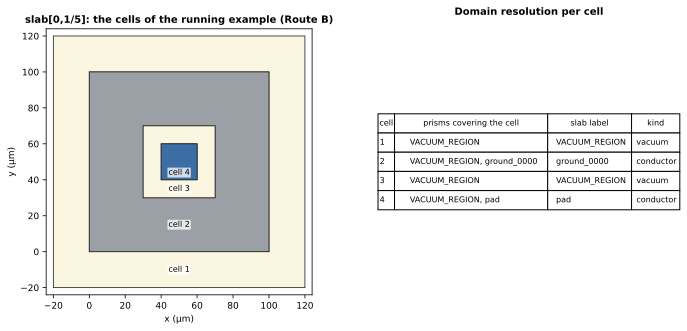
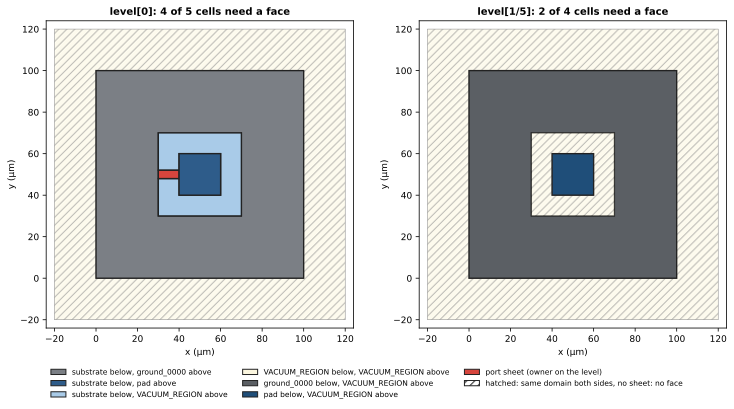
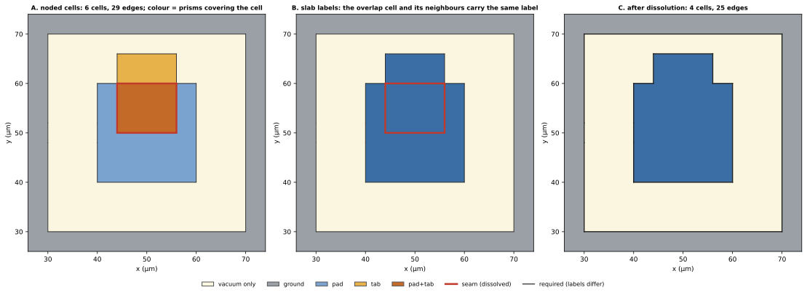

Arrangement 只告訴我們平面被曲線切成哪些 **cell**（平面區域）；SGB 還要知道每個 cell 是什麼，以及哪些 edge 可以留下。本頁說明 slab cell 與 level cell 的 label 怎麼來、一條 edge 保留或移除的規則，以及 dissolution 具體移除哪些 seam。這些規則在 production（`scgsim.geometry.sgb.labelling`）已實作；被標明為原型計算的圖與數字，出自依 Net 合併的原型。

這裡的 cell 是 arrangement 中的平面區域；輸出的 **face** 指 BREP face。一個 level cell 是否會成為 horizontal face，由它的 label 決定（見下）。arrangement 如何建立見[建立 arrangement](arrangement.qmd)，Z 方向的結構（level、slab、active set）見[2.5D 分層模型](layered-model.qmd)。

## 執行範例的觀點

執行範例是 *pad-in-ground* 晶片（見[總覽](index.qmd)）。在 Route B（有限厚度的金屬，見 [Routes](routes.qmd)）中，金屬厚 0.2 µm，port sheet 位於其中間平面（這是執行範例的設定，真實輸入的 port 在 support plane，見 [Routes](routes.qmd#port-support-plane)），所以 Z level 為 $-100, 0, 0.1, 0.2, 100$ µm，模型有四個 slab。取第一個金屬 slab $(0, 0.1)$ µm 來看：有三個 prism 在其中 active，分別是 vacuum 方塊、ground plane（含 cutout）與 pad（含 hole）。slab arrangement $S_i$ 只沿這三個 footprint 的邊界曲線切割平面，沒有其他曲線。它有四個 **cell**，也就是 edge 之間的連通區域。

{#fig-slab-cells fig-alt="晶片 cutout 區域的平面圖，標示四個 cell（ground、vacuum gap、pad、pad hole 內的 vacuum），旁邊的表列出各 cell 被哪些 prism 覆蓋，以及最後得到的 slab label。"}

請看表格：cell 1 與 cell 3 各被兩個 prism 覆蓋（vacuum 方塊*和*一個導體），卻只得到一個 label。把這種重疊解析成單一答案，就是 **slab label** 的工作。

## Slab label

**Domain** 是佔據某個區域的東西：某個 Entity 的導體、dielectric 或 vacuum（production 中為 `Domain(kind, material, net, owner)`，`owner` 是擁有它的 Entity，導體另帶 Net）。cell 的 **slab label** 就是在整個 slab 範圍內佔據該 cell 的 domain。它由 cell 內一個精確的內部點，與該 slab 中 active 的 prism 做 point-in-footprint 測試來決定。對由直線構成的 footprint，這個測試是精確的整數運算；對含圓弧的 footprint，以圓弧的 polyline witness（chord）判斷。整個 pipeline 中使用浮點數的只有三處：圓弧 footprint 的 witness 測試、inset band 的歸屬（以 cell 代表點到 support 邊界的距離判定）與圓弧交叉的抽樣檢查；它們都不決定 topology 中有哪些 edge。

解析規則有四種情況：

::: {.askr-table-compact}
| 覆蓋該 cell 的 prism | 結果 |
|---|---|
| 無 | cell 位於模型之外（label 為 `None`） |
| 一個或多個導體，且屬於同一個 Net | priority 最高的那個導體 Entity 的 domain（導體優先於 dielectric 與 vacuum）；priority 相同則為**錯誤** |
| **不同** Net 的導體 | **錯誤**：build 中止（`OverlapError`） |
| 沒有導體 | dielectric 優先於 vacuum，同一種類內取 `priority` 最高者；優先序相同但材料不同則為**錯誤** |
:::

下列兩種來源上的事實是*錯誤*而不是選擇，因為默默解決它們會掩蓋建模上的錯誤。對 pad 加上一個 Net 為 `other` 且與 pad 重疊的導體，build 會以下列訊息中止：

```text
different-Net conductors overlap near (-42524.750, -29999.500) grid units: other_net, pad
```

若再加入一個與 substrate 優先序相同的 dielectric，則得到（原型計算的訊息；production 的訊息在結尾多一個子句，指出該由哪個來源補上 priority）：

```text
ambiguous equal-priority materials near (-50000.000, -30000.000) grid units: alumina, substrate
```

（兩則訊息皆由原型的 script 產生；座標單位為 grid unit，此處即 nm。）把新的 dielectric 設為 `priority=1` 便能解決重疊，模型也通過驗證（volume 為 `Ground`、`alumina`、`pad`、`substrate`、`vacuum`）。兩個同 Net 的 Entity 重疊則由 priority 決定：priority 較高者擁有重疊區（D5），priority 相同或沒有宣告時，build 以 `OverlapError` 中止，並指名兩個 Entity 與位置：

```text
same-Net entities p and q overlap near (…) um with equal priority 0: declare distinct entity
priorities (SemanticEntitySpec.priority) so that exactly one of them owns the overlap; …
```

結尾的子句依兩個 Entity 的來源指出該補哪個 priority：不同 layer 的 Entity 看 layer stack 的 `mesh_order`（較低者勝，gdsfactory 慣例）；同一個元件、同一個 layer 的 Entity 看元件標註的 `priority`（PDK 填入）；來自不同 occurrence 的 Entity 要靠 `GeometryPlan.set_entity_priorities`；來源未知的手工 record 得到一般性的建議。完整的慣例見[設計決議 D5](decisions.qmd#d5)。

重疊不是唯一的衝突。**在每一種 route 中，不同 Net 的接觸都是錯誤。** 兩個不同 Net 的導體只是*接觸*（在同一平面上共用 edge 或 vertex：兩個 Route A sheet、有限厚度的金屬、站在另一個 Net 金屬上的 post），會在 arrangement 建立後、由 arrangement 的 vertex 與 face 偵測到，並使 build 中止。只存在於 grid 上的接觸也是錯誤：粗的 grid 或 snap 把來源中的間隙封閉了。若第二個 Net 的矩形與 pad 共用左邊緣，會得到：

```text
different-Net contact between other (entities touching_net) and pad (entities pad) at
(-50.0000, -20.0000) um on slab[0,1/10] (grid g = 0.001 um; a gap smaller than the grid
closes when the sources snap)
```

訊息指出兩個 Net、各自到達該點的 Entity、位置與 plane。同 Net 的接觸則屬正常。

::: {.callout-important title="保證：slab label 與 kernel 無關（依據：建構）"}
slab label 只是來源 prism 與明確 priority 規則的函式。CAD kernel 從不決定 material、Net 或 owner，不同 Net 的重疊或接觸也不可能傳到 kernel。
:::

## Level label 由 linking 取得

**Level arrangement** $A_i$ 是 Z level $z_i$ 上的平面剖分。它的 cell 需要一個 **level label** `(below, above, sheet owner, bands)`：level 正下方的 domain、正上方的 domain、位於該 level 上零厚度 sheet 的 owner（導體 Net 或 port），以及以該 level 為目標的 family 的 inset band 索引。

`below` 與 `above` *不是*用第二次 point test 求得。slab arrangement $S_{i-1}$ 與 $S_i$ 的每條 edge 也都是 $A_i$ 的 edge chain（slab edge 以帶標記的曲線進入 $A_i$），所以每個 level cell 都被**連結（link）**到下方恰好一個 slab cell、上方恰好一個 slab cell：level cell 會跨越所有不屬於這種 chain 的 edge 而被合併，合併出的每一組都與某條 chain 相鄰，該 chain 的左右兩側就指出 slab cell。slab label 便透過這個 link 讀取。因此 level label 不可能與它所夾的 slab label 不一致；若同一組的兩個 level cell 指向不同的 slab cell，build 就會中止。只有 sheet owner 需要做 footprint 測試，因為 sheet 不屬於任何 slab。

{#fig-level-links fig-alt="三張平面圖，各對應一個 level。z = 0 時四個 cell 都是 substrate 與金屬或 vacuum 之間的 face。z = 0.1 時只有紅色的 port sheet 是 face。z = 0.2 時 ground 與 pad 的 cell 是金屬與 vacuum 之間的 face。"}



@fig-level-links 的看點：

- 在 $z = 0$，每個 cell 下方都是 substrate，所以四個 cell 都分隔兩種不同的 domain，四個都需要 **horizontal face**（substrate 的頂面，依上方的東西再切分）。
- 在 $z = 0.1$，除了 port 以外，跨越該 level 沒有任何改變：金屬兩側都是金屬，gap 兩側都是 vacuum。只有帶 sheet owner（`port:p1`）的那個 cell 需要 face：五個 cell 中的一個。
- 在 $z = 0.2$，ground 與 pad 的 cell 分隔金屬與 vacuum；gap 與 pad hole 兩側都是 vacuum。

規則只有一行：level cell 需要 face，若且唯若 `below != above` 或有 sheet 位於其上（`LevelLabel.needs_face`）。依 prototype 計數，$z = 0$、$0.1$、$0.2$ 三個 level 需要 face 的 cell 分別為 4 之 4、5 之 1、4 之 2。

## Required edge 與非 required edge

noding 之後，每條 edge 左右各有一個 cell。若兩側 label 不同，或它屬於 edge policy 為 `required` 的 curve family（port footprint、inset band 邊界；見 [Cut family](cut-families.qmd)），則該 edge 為 **required**。其餘皆為 **seam**：它分隔兩個就模型而言是同一個東西的 cell。label 帶著擁有它的 Entity（`Domain.owner`、`SheetOwner`），所以依 D5，兩側屬於不同 Entity 的 edge 預設也是 required（見「Attribution policy」）；原型只比較 Net，沒有這一點。

第二種 policy `refinement_only` 不在這個二分之內：這類 edge 不是 required，所以從不切分 cell，也不改變 label，但會被另外保存為包含它的 cell 的 *embedded curve*（見 [Cut family](cut-families.qmd#edge-policies)）。

## Dissolution

**Dissolution** 會丟棄每一條非 required 的 edge，把它分隔的兩個 cell 合併，接著移除那些**度數為 2 的 vertex**，只要它的兩條 edge 位於完全相同的 carrier 集合上（**carrier** 是 edge 被切出來的那條精確曲線：直線、圓或來源 spline；見[建立 arrangement](arrangement.qmd)）。它不會移動任何 vertex。

要看到 seam，範例在執行範例中多加一個 prism（這裡呈現的是**原型計算**的行為，即依 Net 合併；production 在這個例子保留 pad 與 tab 之間的 seam，見「Attribution policy」）：與 pad 頂部重疊的同 Net tab（`pad_tab`，40 × 25 µm）。noding 把 slab 切成六個 cell、504 條 edge。其中四條 edge 是 seam，也就是位於金屬內部的重疊 cell 的邊界；其餘 500 條分隔 label 不同的 cell。

{#fig-dissolution fig-alt="帶有 tab 的 pad 之三張平面圖。A 圖以三種顏色表示 pad、tab 與它們的重疊，重疊區周圍有紅色 seam edge。B 圖三者都是同一種金屬顏色，seam 仍為紅色。C 圖只剩一個金屬 cell，輪廓為聯集，沒有 seam。"}





由左至右閱讀 @fig-dissolution：A 與 B 是同一個 arrangement 的兩種著色。A 中以*哪些 prism 覆蓋*區分 cell，所以重疊區自成一個 cell。B 中以 *label* 區分，重疊區、pad 與 tab 都讀作「pad」。四條紅色 edge 兩側 label 相同，所以不是 required。C 是剩下的部分：一個金屬 cell，輪廓為聯集。

::: {.askr-table-compact .askr-table-numeric}
| 步驟（slab $(0, 0.1)$ µm，pad 加 tab） | Cell | Edge |
|---|---|---|
| noded arrangement | 6 | 504 |
| 其中 seam（label 相同，被 dissolve） | | 4 |
| 其中 label 不同（暫時保留） | | 500 |
| 依 carrier 集合相同移除度數為 2 的 vertex 之後 | 4 | 26 |
:::

最後一步消失的 474 條 edge 不是 seam，而是圓弧被 *noding* 成的 chord 片段（pad 的 hole 與圓角是圓弧；v1 以 polyline witness 對圓弧做 noding，見 open decision D3）。同一條圓弧 carrier 的連續片段之間若沒有其他東西落在該 carrier 上，就是位於相同 carrier 集合上的度數為 2 的 vertex，所以會合併回一條 arc edge。同一個步驟把未修改的執行範例在此 slab 的 496 條 noded edge 變成 22 條，並把 $z = 0.1$ 的 level arrangement 從 502 條變成 28 條。若度數為 2 的 vertex 的兩條 edge 有*不同*的 carrier 集合，則會保留：它是輪廓上真正的轉角（pad 的 chamfer 角、notch 角）。

::: {.callout-important title="規則：dissolution 移除什麼（依據：建構與測試）"}
dissolution 具體做兩件事：(1) 移除兩側 label 相同、且不屬於 `required` family 的 edge，並合併它兩側的 cell；(2) 移除度數為 2、且兩條 edge 的 carrier 集合完全相同的 vertex，把兩條 edge 併成一條。除此之外它不改變任何 vertex。這不表示結果是全域最小的 topology：不同 Entity 之間的 seam 預設保留（label 的擁有者不同，所以兩側 label 不同）；不同 carrier 的轉角、`required` family 的 edge 與度數不為 2 的 vertex，也都會留下。擁有者相同的 seam 仍被移除，例如同一個 Entity 的兩個重疊 polygon（production 的測試以此檢查：兩個 polygon 合成一個 cell，輪廓為聯集）。
:::

dissolution 改變的是數量，不是面積。驗證器（[驗證](validation.qmd)）會檢查 arrangement 在 dissolution 前後所圍面積相同，也檢查每個 prism 的 footprint 面積在其各 cell 上於 snap 界限內守恆。

### 邊界情形

- **你想要的 seam。** `required` family 的 edge 即使兩側 label 相同也會留下。inset band 邊界或明確的 port footprint 就是這樣把 label 相同的 cell 切成數個 face。
- **Tile seam。** 平行排程器會把 level 切成 tile（[平行化推導](parallelism.qmd)），但沒有任何 seam 幾何進入 arrangement；tile 邊界從不是 edge，也不是 cut family，所以沒有東西需要 dissolve。
- **合併後的 cell 保有 lineage。** 合併後的 pad cell 仍可透過其 edge 的 carrier 追溯到兩個來源 prism（[Identity 與 lineage](identity.qmd)）。

## Attribution policy

**Attribution policy** 決定輸出中一個表面被區分得多細，也就是 solver 看得到哪些 label 差異。D5 已決定，production 已實作：

- 表面**預設依 Entity 歸屬**。不同 Entity 之間的 seam 保留為 required edge，讓每個 Entity 對 Surface EPR 的貢獻可以分開；primary group 的命名規則是 `<kind>::<qualified entity id>::<face kind>[::band=k]`（例如 `MA::chip/q0/pad::top::band=2`；Route A 的 sheet 與 volume 一樣以裸的 entity id 命名，sheet 為 `<entity>[::band=k]`）；
- 報告依 **interface type**（MA／MS／SA）彙總並可顯示總和，這些總和是 sidecar 中的 union；
- Net 只在後端需要電性身分時使用（例如 Electrostatic 的 terminal 與 ground），Net 層級的 union 也只用於這種情形；
- 同一個 Net 的重疊區域，屬於宣告 priority 較高的 Entity；priority 相同或缺少時 fail closed（Lead 的預設，可改）。

同一個 Net 的兩個 Entity 因此是兩個不同的 domain：各自成為獨立的 volume，之間的共用 face 保留（兩個導體之間是 `MM::<a>|<b>::<face kind>`），輸掉重疊的 Entity 仍在 membership 中列出自己的份額。以上面的 pad 加 `pad_tab` 為例，production 不會把它們 dissolve 成一個 cell：pad 與 tab 各有自己的 face，重疊區屬於 priority 較高者。

在 production 中，這個 policy 是由 route 擁有的單一函式（`routes.naming.surface_group`）。對 Route B 的執行範例，它產生下列 primary physical group（`tests/sgb_emit_cases.py` 的 `pad_b`）：

::: {.askr-table-compact .askr-table-numeric}
| Primary group | 意義 | Face 數 |
|---|---|---|
| `MA::pad::top`、`MA::pad::sidewall` | pad 金屬對 vacuum：頂面、側壁 | 1、15 |
| `MA::ground::top`、`MA::ground::sidewall` | ground 金屬對 vacuum | 1、5 |
| `MS::pad::bottom`、`MS::ground::bottom` | 金屬對 substrate | 各 1 |
| `SA::substrate\|vacuum::interface` | substrate 對 vacuum（gap、pad hole） | 2 |
| `PORT::p1` | lumped-port face | 1 |
| `EXT::substrate::bottom`、`EXT::substrate::sidewall` | 模型外部邊界 | 1、4 |
| `EXT::vacuum::top`、`EXT::vacuum::sidewall` | 模型外部邊界 | 1、4 |
:::

被重疊的 Entity 以 lineage 保存，並以 **area-weighted membership** 記錄：對每個貢獻的來源 Entity，記錄該 Entity 的 footprint 所覆蓋的、輸出 face 面積的比例。比例是非互斥的（重疊處對每個覆蓋它的 Entity 都計入），總和可以大於 1。production 對每個 face 記錄它（sidecar 的 `lineage.membership`）。執行範例中 pad 的頂面（`MA::pad`）為 `{"pad": 1.0, "vacuum": 1.0}`：vacuum prism 也覆蓋它，所以比例總和為 2。wall 沒有 footprint，Entity 的比例是 wall 底部邊界長度中由該 Entity 的 edge 所承擔的比例（pad 在 port plane 的兩面 wall 為 `pad: 1.0`，上面那一面另有 `p1: 0.208`）。

對上述 pad 加 tab 的例子，原型計算對合併後 pad 頂面（`MA::pad`）的 membership 記錄為 pad 0.900、`pad_tab` 0.166、vacuum 1.0（400 µm² 的重疊對兩個 Entity 都計入，所以比例總和大於 1）。production 在 per-Entity 的版本中，輸掉重疊的 face 仍列出重疊份額的 Entity（測試的小型 fixture 中，tab 的 face 記錄 `pad` 0.5、`pad_tab` 1.0、vacuum 1.0，總和大於 1）；membership 在 dissolution 之後仍然保留：slab 的 cell 帶有被併掉的 footprint 的聯集。

## 小結

- slab cell 的 label 是覆蓋它的 prism 所解析出的 domain；來源衝突（重疊或接觸）使 build 中止。
- level cell 的 label 是透過 link 從上下的 slab cell 讀取；上下 domain 不同或有 sheet 時，它會成為 horizontal face。
- label 不同或 `required` family 要求時，edge 為 required；其餘 label 相同的 edge 被移除，度數為 2 且 carrier 集合相同的 vertex 被合併。
- 表面依 Entity 歸屬是 D5 的決定，production 已實作；同一個 Net 的 Entity 重疊時由 priority 決定。
- 下一步：已 label 的 cell 如何成為 face、wall 與 volume，見[從 arrangement 到實體](assembly.qmd)。

## 補充：重現資料

本頁的圖與 dissolution 範例由 `zh-TW/docs/design/sgb/_figures/labels_and_dissolution.py` 使用 `experiments/sgb-redesign/prototype` 的 prototype 產生（原型計算）；文中的數字除非另有說明，皆記錄在 `figures/labels-numbers.json`。group 名稱與 face 數取自 production：`tests/sgb_emit_cases.py` 的 `pad_b`（`ConformalModel.routed.groups`）。Brief 對應第 2、4 與 14 節；production 模組為 `labelling`（`prism_set`、`linking`、`dissolve`、`membership`）、`derivation/contacts` 與 `routes`；測試 `tests/test_sgb_dissolve.py`、`tests/test_sgb_labelled.py`、`tests/test_sgb_priority.py`。名詞見[詞彙表](index.qmd#glossary)。
