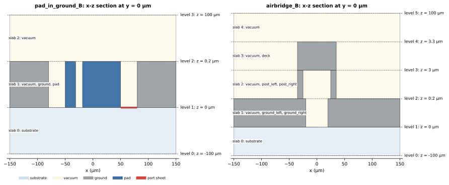
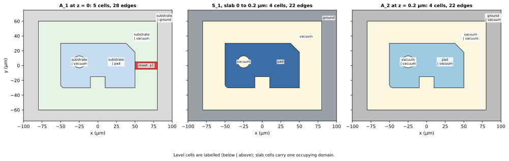
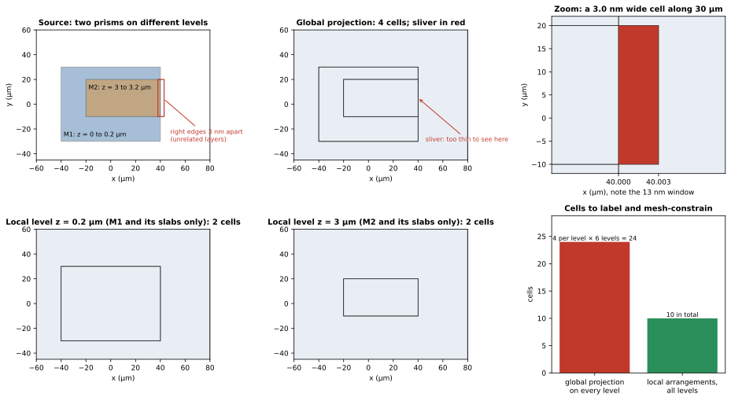
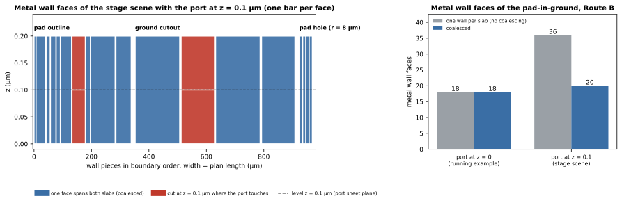
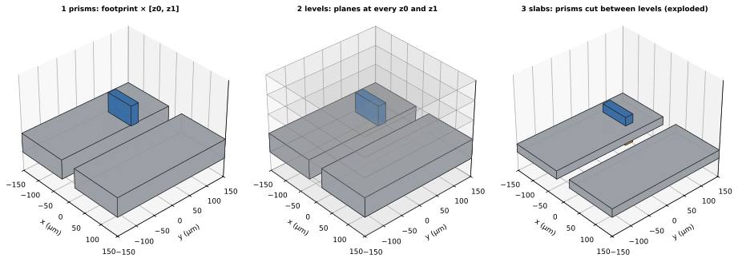

SGB 處理的模型是有限個 **prism** 的集合：晶片在 **level** 處被切成 **slab**，每個 level 與每個 slab 各有一個 planar arrangement。這些 arrangement 是**局部**的：每一個只收納在三維空間中真正相遇的曲線，而不是把所有層投影到同一個平面。本頁先用執行範例說明 level、slab 與 active set，再說明為什麼局部的做法能避免 phantom sliver。詞彙彙整在[詞彙表](index.qmd#glossary)。

## 模型格點

所有 XY 座標都落在同一個**模型格點** $g$ 上，預設是來源的資料庫單位 1 nm，宣告一次並記錄在 handoff 中。這個格點來自 develop 既有的固定格點來源準備（S0 與 S1）：來源的正規化與 polygon Boolean 在已宣告的格點上完成，`GeometryGridContext` 帶著 $g$ 往後傳，S4 的 snap rounding 使用的就是同一個 $g$。S2 起是新的 pipeline（production 實作在 `scgsim.geometry.sgb`）：S2 讀 S1 的 effective 輸入，格點取自其 `GeometryGridContext`，座標以精確的整數轉換，沒有格點資訊的輸入與不在格點上的頂點都會被拒絕（見[總覽](index.qmd)）。原型不含 S0 與 S1，直接以格點上的整數座標建立 prism。Z 不受這個格點約束（見下文）。

## 執行範例的觀點

pad-in-ground 晶片的輸入（[總覽](index.qmd#fig-input)）是五個 prism。**Prism** 是把一個平面 footprint（外環加孔洞）沿 Z 區間擠出而成的體，帶有材料、entity id 與 role。**Sheet** 是厚度為零的 prism；lumped port 就是一個 sheet。

它們的頂面與底面的 Z 值是 $-100$、$0$、$0.2$ 與 $100$ µm，這些就是 **level**（port sheet 所在的 $z = 0$ 已經是 substrate 的頂面，不新增 level）。兩個相鄰 level 之間是一個 **slab**。在每個 slab 中，有些 prism 完整涵蓋整個 slab；這些 prism 構成它的 **active set**。

{#fig-stack fig-alt="兩張 x-z 剖面圖，水平的 level 線等間距。左：pad-in-ground 範例，level 0 到 3、三個 slab：slab 0 是 substrate；slab 1 有 vacuum、兩塊灰色 ground 與藍色 pad；slab 2 是 vacuum；level 1（z = 0）上，pad 與 ground 之間有一片紅色 port sheet。右：airbridge 範例，level 0 到 5、五個 slab：slab 1 有灰色的 ground 兩半，slab 2 有兩根橘色 post，slab 3 在 post 上方有一塊灰色 deck。"}

::: {.askr-table-compact}
| Slab | $z$ 範圍（µm） | Active set | 原因 |
|---|---|---|---|
| 0 | $-100$ 到 $0$ | substrate | substrate 這個 prism 恰好涵蓋這個 slab |
| 1 | $0$ 到 $0.2$ | vacuum、ground、pad | vacuum 涵蓋 $0$ 到 $100$；金屬涵蓋 $0$ 到 $0.2$；port 是 sheet，所以它不在任何 slab 的 active set 中 |
| 2 | $0.2$ 到 $100$ | vacuum | 金屬已經結束 |
:::

port sheet $p_1$ 位於 level $0$（$z = 0$ µm，也就是 substrate 的表面），這是 host 導體的 support plane，編譯器的 port 都放在那裡（見 [Routes](routes.qmd#port-support-plane)）。它不填滿任何 slab；它附屬於它所在的 level。level 帶有它的 sheet，slab 帶有它的 active prism。若把 port 改放在金屬的中間平面 $z = 0.1$（stage 層測試 scene 的做法，編譯器自己不這樣放），就會多出一個 level，並出現 embedded face 與被切開的 wall；那個情形留到[下面的 wall coalescing](#wall-coalescing) 說明。

### 每個 level 與每個 slab 各一個 arrangement

每個 slab 有一個 **slab arrangement** $S_i$：以它的 active prism 的邊界曲線，對 XY 平面做的 planar 分割。它的每個 **cell**（分割中的一個 face）都有一個 label，也就是佔據該處的 domain。

每個 level 有一個 **level arrangement** $A_i$，由緊鄰它上方與下方兩個 slab 的曲線，加上位於該 level 的 sheet 建成。它的每個 cell 的 label 有四個部分：下方的 domain、上方的 domain、若有 sheet 則為 sheet 擁有者，以及任何 inset band。

{#fig-arrangements fig-alt="晶片 cutout 的三張俯視圖。左：z = 0 的 level，有五個 cell，以下方與上方標示：外圍為 substrate 與 ground，gap 與圓孔中為 substrate 與 vacuum，pad 中為 substrate 與 pad，gap 的右側有一個標為 sheet p1 的紅色 cell（port）。中：0 到 0.2 微米的 slab，四個 cell 標為 ground、vacuum、pad 與 vacuum。右：z = 0.2 的 level，四個 cell：ground 與 vacuum、gap 與孔洞中的 vacuum 與 vacuum、pad 與 vacuum。"}

看 @fig-arrangements 時請注意：

- **Slab 的 cell** 各有一個名稱。$S_1$ 有四個 cell（ground、pad，以及 gap 與孔洞兩塊 vacuum），輪廓與 $A_2$ 相同；$A_1$ 則多了 port 的一個 cell。
- **$z = 0$ 的 $A_1$**：每個 cell 下方都是 substrate、上方是別的東西，或帶著 sheet，所以每個 cell 都會產生最終模型中的一個 BREP face（ground 與 pad 底下的 metal-substrate 表面、substrate-vacuum 的 gap 與孔洞表面，以及 port 的 face）。port 的 cell 是從 gap 的 cell 裡切出來的：port 佔去那裡原本屬於 SA 的面積。
- **$z = 0.2$ µm 的 $A_2$**：ground 與 pad 的 cell 上方是 vacuum、下方是金屬，產生 metal-vacuum 的頂面；gap 與孔洞的 cell 下方與上方是同一個 domain（都是 vacuum），所以這兩個 cell 不產生介面 face。level cell 需要 face，若且唯若它下方與上方的 domain 不同，或其上有 sheet。

$A_1$ 是 5 個 cell、28 條 edge；$S_1$ 與 $A_2$ 各是 4 個 cell、22 條 edge（`figures/layered-numbers.json`）。

## 一般規則

### Level、slab 與 active set

Prism 是 $P = (F, [z_0, z_1], \text{material}, \text{entity id}, \text{role})$；當 $z_0 = z_1$ 時它是 sheet。對一個模型：

$$
Z = \operatorname{sort}\bigl(\{z_0, z_1\ \text{of every prism}\} \cup \{\text{sheet and port planes}\}\bigr),
\qquad s_i = (z_i,\ z_{i+1}).
$$

Slab $i$ 的 **active set** 是滿足 $z_0 \le z_i$ 且 $z_1 \ge z_{i+1}$ 的非 sheet prism 的集合。level $i$ 上的 active sheet 是滿足 $z_0 = z_1 = z_i$ 的 sheet。Z 值是精確的有理數，XY 格點從不對它們做 snap。

### Slab arrangement 與它們的 label

$S_i$ 由 slab $i$ 的 active set 的 footprint 曲線建成。它的 label 是 cell 的**佔據 domain**，依據包含該 cell 的 prism，按明確的規則決定：

- 導體勝過 dielectric 或 vacuum；
- 兩個不同 Net 的導體在同一個 slab 中重疊，是錯誤；
- 同一個 Net 的兩個 Entity 重疊，由宣告的 priority 較高者擁有重疊區，priority 相同或缺少是錯誤；
- dielectric 勝過 vacuum，同一種類內由明確的 priority 決定；優先順序相同但材料不同，是錯誤。

同一個 Entity 的重疊（例如它的兩個 polygon）不是錯誤：它們之間的 seam 兩側 label 相同，會被 dissolve；不同 Entity 之間的 seam 因 label 的擁有者不同而保留為 required edge（見 [Label、required edge 與 dissolution](labels-and-dissolution.qmd)）。

圖中的 label（`ground`、`pad`）是擁有該 cell 的 Entity id：production 依決策 D5 以 Entity 歸屬，完整說明見 [Route](routes.qmd) 與[設計決議](decisions.qmd#d5)。

### Level arrangement

$$
\operatorname{curves}(A_i) = \operatorname{curves}(S_{i-1}) \cup \operatorname{curves}(S_i) \cup \partial(\text{sheets at } z_i) \cup \text{cut-family curves targeting level } i,
$$

其中 $\operatorname{curves}(S)$ 指的是 dissolution 之後 slab arrangement 的 *required* edge。由此得到兩個後果，設計的其餘部分都倚賴這兩點：

1. $A_i \supseteq \operatorname{curves}(S_i)$ 且 $A_{i+1} \supseteq \operatorname{curves}(S_i)$，所以 slab 的每條 edge 在上下兩個 level 中都是一串 atomic edge。因此 slab 兩側的 face 沿著共用的 edge 相接（見[從 arrangement 到 solid](assembly.qmd)）。
2. level 只包含來自它旁邊兩個 slab 的曲線、位於其上的 sheet，以及以它為 target 的 family。其他層的曲線不在其中。

### Level label 來自 slab link

level cell 的*下方*與*上方* domain 不是靠第二次 point test 找出來的。每個 level cell 都被**連結**到它下方的 slab cell 與上方的 slab cell，label 就從這兩個 slab cell 讀取。slab 的 labelling 是唯一的真實來源。

::: {.askr-mermaid-view view-label="檢視圖表"}
```{mermaid}
flowchart TB
  S0["S_(i-1) 的 slab cell<br/>（下方 domain）"] --> A["A_i 的 level cell<br/>label：下方、上方、<br/>sheet 擁有者、band"]
  S1["S_i 的 slab cell<br/>（上方 domain）"] --> A
  SH["位於 level i 的<br/>sheet prism"] --> A
  CF["以 level i 為 target 的<br/>cut-family band"] --> A
```
:::

這張圖是**概念性**的。sheet 擁有者與 band 來自 sheet 與 cut family，不來自 slab。

## 為什麼 arrangement 是局部的

另一種做法是把**每一層**的曲線投影到同一個平面，建一個 arrangement，然後在每個 level 重複使用。這樣每個 level 都會被它在空間中從未相遇的那些層的曲線所分割。後果是更多 face、mesher 更多的限制，以及 **phantom sliver**：位於兩個無關層、幾乎重合的 edge 之間非常薄的 cell。

下面這個兩層金屬的例子展示了這一點。它是**計算所得**：`_figures/layered_phantom.py` 以 production pipeline（`build_model_from_catalogue`）建立局部 arrangement，並以對所有 footprint 曲線做一次 snap rounding 的 arrangement 建立全域版本。金屬 M1 位於 $z = 0$ 到 $0.2$ µm，金屬 M2 位於 $z = 3$ 到 $3.2$ µm，兩者之間是 vacuum。M2 是落在 M1 輪廓內的矩形，只是它的右緣比 M1 的右緣再多出 3 nm。

{#fig-phantom fig-alt="上排：M1 與 M2 的輪廓，一個紅框標出相距 3 奈米的右緣；有 4 個 cell 的全域投影，其中的 sliver 薄到看不見；放大圖顯示一個寬 3 奈米、高 30 微米的紅色 cell。下排：z = 0.2 的局部 level arrangement 有兩個 cell（只有 M1），z = 3 有兩個 cell（只有 M2），以及一張長條圖，比較每個 level 都使用全域投影的 24 個 cell 與局部 arrangement 的 10 個。"}



看 @fig-phantom 時請注意：

- **上排中與右。** 全域投影有 4 個 cell。其中一個是兩條右緣之間的 cell：寬 3 nm、長 30 µm、面積 0.09 µm²。在晶片的尺度上看不到它；放大圖才顯示出來。
- **下排。** 在 $z = 0.2$ µm 的局部 arrangement 中，只出現 M1 的曲線；在 $z = 3$ µm 則只有 M2 的。沒有任何 level 同時包含兩條右緣，所以任何地方都沒有 sliver。任何局部 level 中最窄的 cell 寬 20 µm。
- **下排右。** 如果六個 level 都使用全域投影，模型會有 $4 \times 6 = 24$ 個 cell 與六份 sliver。使用局部 arrangement 則是 10 個 cell。所有數字在 `layered-phantom-numbers.json`。

::: {.callout-important title="設計決策：arrangement 是局部的"}
level arrangement 只接收在 3D 中真正相遇的曲線：與它相鄰的 slab、位於其上的 sheet，以及以它為 target 的 family。這是第一條 sliver 規則（見 [Sliver](slivers.qmd)）。同一個 slab 或 level 之中的這兩條 edge，則是來源本身的事實，會被保留並回報，而不是被移除。
:::

成本面也隨之而來。一個 level 的 arrangement 含有的曲線，就只是在那裡相遇的曲線；在 XY 上互不相關的多層模型，各 arrangement 的大小是相加，而一次投影則會把它們乘上 level 的個數。

## Wall 與 wall coalescing {#wall-coalescing}

**Wall** 是沿著 slab arrangement 的 edge 的垂直 BREP face，該 edge 兩側的 slab label 不同。SGB 對每條 atomic slab edge 產生一個 wall，下方的 $A_i$ edge 串是它的底邊界，$A_{i+1}$ 的 edge 串是它的頂邊界。

若對每個 slab 都這樣做，就會在每個 level 切開每一道 wall，連金屬 wall 明明是繼續延伸的地方也不例外。**Wall coalescing** 去除這種情況，完整的規則是：level 在以下情形才切開一道 wall：(a) 該 level 的一條 edge 或一個 vertex 落在 wall 的水平線上，例如 port sheet 的 edge 終止在金屬側壁上；或 (b) 該 level 的一個 sheet face 沿著 wall 的 chain 延伸。另外，只要相鄰的 wall run 在該處開始或結束，或有水平 face 在該 wall column（垂直 edge）上有 vertex，就會把 wall column 切開。否則，連續 slab 疊起來的 wall 會合併成一個 face。Level 在 Z 上是全域的，但它們的作用在 XY 上是局部的。

在執行範例中，port 在 $z = 0$，沒有任何 level 落在金屬 wall 的中間：18 道金屬 wall（pad 輪廓、孔洞、圓角與 ground cutout）每一道都只橫跨金屬所在的那一個 slab（$0$ 到 $0.2$ µm），沒有可以合併的東西。port 的 edge 終止在 pad 與 ground 的 wall 的**底邊**上，只是讓那條底邊多出幾個 vertex，不切開 wall。所以 coalescing 在這個範例裡不起作用（18 對 18）。

要看 coalescing 做什麼，需要一個有 level 落在金屬中間的模型。下面使用 stage 層的 scene：同一個 pad-in-ground，但 port 放在金屬的中間平面 $z = 0.1$（`tests/sgb_scenes.py` 的 `pad_in_ground("B")` 自己的 Route B port；編譯器不會這樣放 port，它在測試中用來練習 embedded 的 sheet）。這時多一個 level $0.1$，port 的 edge 終止在 pad 的右側 wall（$x = 50$ µm）與 ground 的 cutout wall（$x = 80$ µm）的中間，兩道 wall 被切成下半與上半兩片；其他每一道金屬 wall 仍以單一個 face 橫跨兩個 slab。

{#fig-walls fig-alt="左：長條分為 pad 外輪廓、ground cutout 與 pad 孔洞三組。幾乎每個長條都是藍色，從 z = 0 延伸到 0.2；有兩欄是紅色，在虛線 z = 0.1 處被切成下方與上方兩個長條。右：長條圖。port 在 z = 0 的執行範例，沒有 coalescing 與有 coalescing 都是 18 個金屬 wall face；port 在 z = 0.1 的 stage scene，沒有 coalescing 時有 36 個，有 coalescing 時有 20 個。"}

數字是由兩個模型的 topology 計算而得（port 在 $z = 0$ 的是執行範例，在 $z = 0.1$ 的是 stage scene）：

::: {.askr-table-compact .askr-table-numeric}
| | 執行範例：每個 slab 一道 wall | 執行範例：Coalesced | stage scene：每個 slab 一道 wall | stage scene：Coalesced |
|---|---|---|---|---|
| 金屬 wall face（pad 輪廓、孔洞、圓角、ground cutout） | 18 | 18 | 36 | 20 |
| 所有 wall face（含 substrate、vacuum 與 ground 的晶片邊界 wall） | 30 | 30 | 52 | 32 |
| 模型的所有 face（水平 face 不變：9 個） | 39 | 39 | 61 | 41 |
:::

「每個 slab 一道 wall」是逐 slab 的片段數：對最終每一道 wall，把它所橫跨的 slab 數加總（`layered_model.py`）。

## 延伸範例：不只一層金屬

airbridge 有七個 prism：substrate、vacuum、兩半 ground、兩根 post 與一塊 deck。它有六個 level $(-100, 0, 0.2, 3, 3.3, 100)$ µm 與五個 slab，各金屬 prism 佔據各自的 slab。這正是 *active set* 派上用場的情況。

{#fig-exploded fig-alt="三張立體圖。1：兩塊灰色 ground 之間有間隙，兩根橘色小 post，上方有一塊藍色 deck。2：同樣的 prism 加上六片半透明灰色 level 平面。3：同樣的 prism 在垂直方向被拉開，每層一個 slab，讓 ground、post 與 deck 位於不同的高度。"}



看 @fig-exploded 時請注意：這裡每個金屬 prism 恰好只在一個 slab 中，所以它的 slab cell 是單純的矩形。vacuum 這個 prism 橫跨四個 slab，所以被 level 切成四片。deck 只在 slab 3，位於 slab 2 的 post 之上；deck 下方的 vacuum 屬於 slab 2，繞過 post 與兩側的 vacuum 相連。slab arrangement 共有 10 個 cell，level arrangement 共有 16 個（`layered-numbers.json`）。production 依決策 D5 以 Entity 歸屬：規劃 44 個 vertex、78 條 edge、43 個 face 與 7 個 volume（兩塊 ground、兩根 post、deck 各自一個，加上 substrate 與 vacuum），其中包含導體 Entity 之間的共用 face；已 emit 的是 substrate 與 vacuum 兩個 volume，其餘五個金屬 volume 在 Route B 被排除。

## 邊界情況

- **Sheet。** 在 Route A 中所有導體都是 sheet，所以模型只有晶片本體（以及任何 port sheet）的 level；沒有任何 slab 帶有金屬 prism。Route A 與 Route B 的差別只在 labelling policy（見 [Route](routes.qmd)）。
- **Family 以某個 level 為 target。** cut family（band、refinement curve）把它的曲線加到它所指定的 level。若 family 指定的 Z 沒有任何 prism 定義，它會新增該 level：那是一個普通的 level，不改變任何 active set（production 已實作並有測試）。本設計範例中的所有 family 都指向既有的 level（見 [Cut family](cut-families.qmd)）。
- **薄的 slab。** Level 是宣告的精確 Z 值，不設任何 Z 的 threshold。兩個 prism 的高度只差幾奈米，就會產生一個比 $g$ 還薄的 slab；它會被保留並回報，不會使 build 失敗（決策 D2，見 [Sliver](slivers.qmd)）。原型曾在驗證時因這種 slab 中止；production 已移除這個中止，薄 slab 以兩個警告回報（見 [Validation](validation.qmd)），並有測試保證它從來源保留到 arrangement。
- **同一 Net 的金屬重疊。** 同一個 Entity 的重疊不是錯誤，seam 會被 dissolve，合併後 face 的 lineage 保有兩個 prism。兩個 Entity 的重疊由 priority 決定（較高者擁有重疊區，seam 保留，輸掉的 Entity 在 membership 中仍列出份額）；priority 相同或缺少則為錯誤。
- **不同 Net 的金屬重疊或接觸。** 同一個 slab 中的重疊是錯誤，會使 build 中止。接觸也是錯誤，而且在每一種 route 中都是：包含兩片 Route A sheet 共用一條 edge 或一個 vertex，以及由 snapping 造成的接觸（在 g = 1 nm 時 4 nm 的間隙可以通過，在 g = 10 nm 時則不行）。接觸以 `ContactError` 在 build 的早期丟出。
- **Non-manifold 的 pinch。** 同一 Net 的有限厚度金屬若只沿著一條垂直 edge 或在一個 vertex 相遇，會在組裝之前被拒絕，錯誤為 `NonManifoldError`，訊息指出 Net、entity、位置與 vertex 或垂直 edge。Route B 中，一個 hole 碰到自己的外邊界也屬於這一類；Route A 的 sheet 則可以在轉角相遇，也接受有 pinch 的 hole。
- **非 prism 的本體。** 截面隨 $z$ 改變的本體（斜側壁）不是 prism。它是模型的擴充點，不會被悄悄近似。

## 補充：重現資料

本頁的圖與數字是**計算所得**，來自 production `scgsim.geometry.sgb`（執行範例是 `tests/sgb_scenes.py` 的 `pad_in_ground` 加上放在 $z = 0$ 的 port，延伸範例是同檔的 `airbridge()`）：

- `docs/design/sgb/_figures/layered_model.py` 產生 level 與 slab 的剖面、arrangement 比較、wall 計數（含 port 在 $z = 0.1$ 的 stage scene）與 airbridge 的 3D 圖，數字在 `figures/layered-numbers.json`。
- `docs/design/sgb/_figures/layered_phantom.py` 產生兩層金屬的 phantom sliver 範例，數字在 `figures/layered-phantom-numbers.json`。
- 全域投影是以一個 snap rounding 後的 arrangement 包含所有 footprint 曲線；局部 arrangement 是 production `build_model_from_catalogue` 的結果。

下一頁[建立 arrangement](arrangement.qmd) 說明一個 arrangement 的曲線如何被 node 到格點上；[Label、required edge 與 dissolution](labels-and-dissolution.qmd) 說明哪些 edge 會被保留；[從 arrangement 到 solid](assembly.qmd) 由共用的 edge 建立 face、wall 與 volume。
