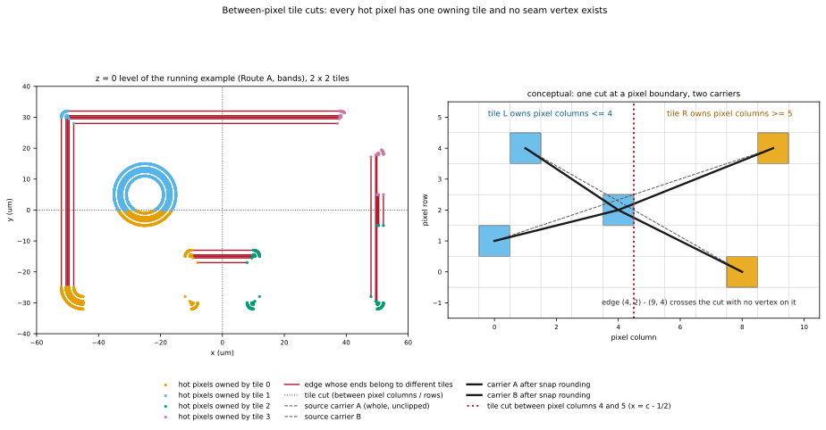
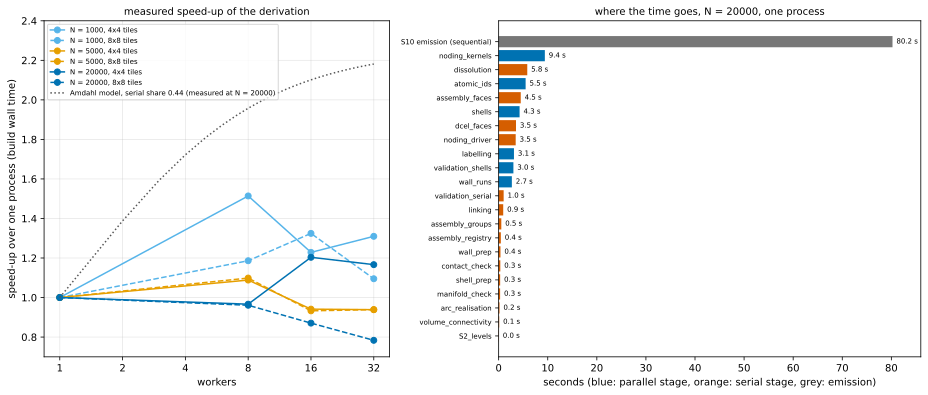

本頁說明 SGB 哪些部分平行執行，以及平行結果如何與序列結果逐位元相同。讀完後你會知道 dependency graph、tile 規則、noding 為何每一輪都是一次 fork/join、Python prototype 實測的加速與 Amdahl 分解，以及 production 設計準備如何處理。

名詞在首次出現處定義，並彙整於[術語表](index.qmd#glossary)。資料結構見 [Building an arrangement](arrangement.qmd) 與 [Identity](identity.qmd)，每個 stage 見 [stage 參考](pipeline-reference.qmd)。圖與數字皆為**計算結果**：tile 圖與表格由 `docs/design/sgb/_figures/parallel.py` 產生（它讀取 prototype 實測的 `outputs/scaling.json`，並用 prototype 自己的 runtime 重算 tile ownership），時間數字由 prototype 的 `examples/scaling.py` 量得。

## 哪些平行、哪些不平行

SGB 以 immutable record 上的 pure function *derive* 整個 conformal 模型，所以 derivation stage S1–S9 是平行化的對象。有三件事刻意排除在外：

- **Meshing**：Gmsh 的 meshing 本身已原生平行，不屬於 SGB。
- **Emission（S10）**：由下而上的 OCC 建構是序列的，且與 entity 數量成線性。在 prototype 中，N = 20 000 個 feature 時需要 74.2 s，比整個 derivation（45.2 s）還長；`synchronize`、平面 face 建構與 XAO 寫出佔大宗。Lead 已決定（待 architecture review）改採 BREP/XAO 直接序列化（D8），見[決策頁](decisions.qmd#d8)。
- **Volume connectivity**、dissolution 與 half-edge 結構（DCEL）：在 prototype 中是全域且序列的（見下表）。

Worker 是 **process**：stage 函式是對可 pickle 的 record 的 pure function，Gmsh/OCC 狀態絕不跨 worker 共用。

## Dependency graph

```{mermaid}
%%| label: fig-dag
%%| fig-alt: "S1 到 S10 的 stage 相依圖；S4 是對 tile 反覆的 fork 與 join，S10 是序列的。"
flowchart LR
  S1["S1 interpretation<br/>per entity"]:::par --> S2["S2 prism catalogue<br/>levels and slabs"]:::ser
  S2 --> S3["S3 cut families<br/>per region × margin"]:::par
  S2 --> S4
  S3 --> S4["S4 arrangement<br/>per level or slab × tile<br/>fork/join per round"]:::par
  S4 --> S5["S5 labels, dissolution<br/>per cell (dissolution serial)"]:::mix
  S5 --> S6["S6 assembly<br/>per slab, per volume"]:::mix
  S6 --> S7["S7 route<br/>per face"]:::par
  S6 --> S8["S8 identity and groups<br/>per face"]:::par
  S7 --> S9["S9 validation<br/>independent checks"]:::par
  S8 --> S9
  S9 --> S10["S10 emission<br/>sequential"]:::ser
  classDef par fill:#cfe8f7,stroke:#0072B2,color:#111
  classDef ser fill:#fbd9c4,stroke:#D55E00,color:#111
  classDef mix fill:#fff2cc,stroke:#b8860b,color:#111
```

藍色 stage 可切成彼此獨立的 job，橘色 stage 是序列的，黃色 stage 兩者混合。這張圖是設計；prototype 的 stage 名稱與哪些部分仍是序列，見下方表格。

## 以 running example 看：tile

**tile** 是 pixel grid 上的一塊矩形。prototype 把模型範圍切成 $T \times T$ 個 tile，切線落在 **pixel 欄與列之間**，位置是 $c - \tfrac12$ grid unit。**hot pixel**（含有 vertex 或交點的 grid point，見 [Building an arrangement](arrangement.qmd)）因此恰好屬於一個 tile，tile 邊界本身不是任何幾何物件。

{#fig-tiles fig-alt="左圖為 pad 的平面圖，hot pixel 分成四種顏色，紅色 edge 跨越兩條切線；右圖為 pixel grid，一條垂直切線、五個彩色 hot pixel 與兩條經 snap rounding 的 carrier。"}



左圖請看：切線是 $x = y = -0.0005$ µm（$-\tfrac12$ nm）的虛線，穿過 notch、hole 與 port。hole 與 rounded corner 周圍的 pixel 落在左側的 tile，因為 arc 在那裡（2 918 個 hot pixel 中有 1 251 與 1 257 個）。有 56 條 noded edge 的兩端落在不同 tile：就是又長又直的 pad edge。它們不會在切線處被分段，所以沒有 seam vertex、seam edge 或 seam face 進入 arrangement。

::: {.askr-table-compact .askr-table-numeric}
| Tiles | 每個 tile 的 hot pixel 數（tile index = 欄 × T + 列） | 兩端分屬不同 tile 的 edge |
|---|---|---|
| 2 × 2 | 1 251, 1 257, 295, 115 | 56 |
| 3 × 3 | 5, 167, 5, 0, 2 576, 0, 5, 155, 5 | 38 |
| 4 × 4 | 1, 4, 4, 1, 0, 1 246, 1 252, 0, 0, 286, 106, 0, 1, 8, 8, 1 | 58 |
:::

（Route A 範例含 band 的 z = 0 level 共 2 918 個 hot pixel、2 932 條 noded edge；`figures/parallel-tables.md`。）每種切法下，這 2 918 個 pixel 都恰好計入一個 tile。

## 規則

1. **Tile 擁有 pixel。** 切線只取決於模型範圍與 $T$。
2. **每個 tile 收到完整、未裁切的 carrier**（曲線）——只要它碰到該 tile 的 pixel 範圍——對它們做 snap rounding，只保留落在自己 pixel 內的 edge 片段。tile 能看見其 pixel 內每個交點的兩側，以及 carrier 可能經過的每個 hot pixel。
3. **合併時依序串接**沿每條 edge 的 chain 片段，並對交點 pixel 取聯集。切線上沒有任何東西留下，所以沒有東西需要 dissolve。

由於每一輪結束後 hot pixel 集合都取聯集，而一輪的輸出只取決於這些集合，合併後的結果對任何 $T$ 與任何 worker 數都與單一 tile 的結果相同。這在隨機 segment 與 running example 上都以性質測試驗證（vertex、edge、face、volume 的 ID 完全相同；`tests/test_tiling.py`），[Identity 頁](identity.qmd)也列出 12 種 tile、worker 與 hash seed 設定下相同的 digest。

**為何不用 halo。** halo（裁切 carrier、在 tile 周圍多加一圈 cell、在 seam 切開再 dissolve）會在 seam 產生額外的 hot pixel 並破壞 identity。改成在 pixel 之間切，是消除問題而不是修補問題。

## Noding 每一輪是一次 fork/join

Snap rounding 是迭代的：把 chain 重新繞過它碰到的 hot pixel，可能讓它碰到新的 hot pixel。tile 無法獨自完成，因為 chain 的端點可能在別的 tile，所以每一輪都需要所有 hot pixel 的聯集。

```{mermaid}
%%| label: fig-rounds
%%| fig-alt: "一輪 snap rounding：各 tile 找交點 pixel，join 取 hot pixel 聯集，各 tile 找 edge 碰到的 hot pixel，join 重新繞 chain，若有任何改變則再來一輪。"
flowchart TB
  A["edges and hot pixels<br/>of round r"] --> F1["fork: crossing pixels<br/>one job per tile"]
  F1 --> J1["join: union of new hot pixels<br/>(barrier)"]
  J1 --> F2["fork: hot pixels met by each edge<br/>one job per tile"]
  F2 --> J2["join: re-route chains,<br/>mark changed edges (barrier)"]
  J2 --> Q{"changed edge or<br/>new hot pixel?"}
  Q -->|yes| A
  Q -->|no| Z["noded edges, identical for every T"]
```

每一輪有兩次 fork/join。在 prototype 的五個範例 case 中，39 個 arrangement 有 33 個在一輪後收斂，6 個在兩輪後收斂（`outputs/*/stage_summary.json` 的 `snap_rounds`）。這個 barrier 是精確的，也保住 identity 性質，但它正是 noding 是一串小型 fork/join、而不是每個 tile 一個 job 的原因。

## Granularity：job 單位是整段 per-tile derivation

只對 noding 做 tiling **完全沒有加速**：noding 約佔 derivation 的 15%，其餘是序列的。因此平行單位是 noding 輪次之後所有「逐 item」的工作。item（face、edge、vertex、wall、volume）由**其錨點所在的 tile 擁有**；每個 stage 對每個非空 tile 執行一次，結果依 item index 放回。序列與平行共用同一組 stage 函式，所以結果不可能依賴 $T$ 或 worker 數。

::: {.askr-table-compact .askr-table-numeric}
| Stage（prototype 名稱） | 種類 | N = 20 000，單一 process（s） |
|---|---|---|
| `noding_kernels`（crossing pixel、hot-pixel hits） | parallel | 7.40 |
| `dissolution` | serial | 5.24 |
| `atomic_ids`（vertex、edge、face 的 hash） | parallel | 4.87 |
| `shells` | parallel | 4.30 |
| `assembly_faces` | serial | 4.23 |
| `dcel_faces`（half-edge 結構、face） | serial | 3.11 |
| `validation_shells` | parallel | 2.99 |
| `noding_driver`（輪次、chain 組裝） | serial | 2.38 |
| `labelling` | parallel | 2.38 |
| `wall_runs` | parallel | 2.34 |
| `validation_serial` | serial | 0.98 |
| `linking`、`assembly_groups`、`assembly_registry`、`wall_prep`、`shell_prep`、`contact_check`、`arc_realisation`、`volume_connectivity`、`S2_levels` | serial | 合計 2.98 |
| **build 的 wall time** | | **45.2**（serial stage 18.9，parallel stage 24.3） |
| S10 emission（Gmsh API，不含 meshing） | sequential | 74.2 |
:::

Face 會跨越 tile（ground plane 是一個 face，所有 cutout 都是它的 hole），所以 face 抽取不做 tiling。只有 shell 與 volume 的連通性是全域 reduction，亦即對 cell 連結做 union-find。

## Prototype 量到什麼

設定（`examples/scaling.py`、`outputs/scaling.json`）：隨機 Route B layout，N = 1 000、5 000、20 000 個 feature，$4 \times 4$ 與 $8 \times 8$ 個 tile，1、8、16、32 個 worker；每個 case 在 64 核心機器上各用一個 subprocess，每個 case 都通過驗證，同一個 N 在所有設定下 identity digest 相同。

{#fig-speedup fig-alt="左圖：加速對 worker 數，所有實測曲線都低於 1.2，虛線 Amdahl 曲線升向 2.2；右圖：stage 時間的橫條圖，S10 emission 約 74 秒，noding kernels 約 7 秒，其餘更小。"}



::: {.askr-table-compact .askr-table-numeric}
| N | Tiles | Workers | Build (s) | 加速 | Serial stage (s) | Parallel stage，wall (s) | Worker compute (s) | Parallel fraction | Limit | Peak RSS (MB) |
|---|---|---|---|---|---|---|---|---|---|---|
| 1 000 | 1×1 | 1 | 1.4 | 1.00 | 0.5 | 0.8 | 0.8 | 0.61 | 2.54 | 324 |
| 1 000 | 4×4 | 8 | 1.3 | 1.08 | 0.6 | 0.6 | 1.3 | 0.66 | 2.95 | 152 |
| 1 000 | 4×4 | 16 | 1.3 | 1.06 | 0.7 | 0.6 | 1.4 | 0.68 | 3.17 | 151 |
| 1 000 | 8×8 | 32 | 1.6 | 0.91 | 0.6 | 0.8 | 2.0 | 0.76 | 4.14 | 150 |
| 5 000 | 1×1 | 1 | 9.3 | 1.00 | 3.7 | 5.2 | 5.1 | 0.58 | 2.37 | 1 358 |
| 5 000 | 4×4 | 1 | 10.2 | 0.92 | 3.9 | 5.9 | 5.4 | 0.55 | 2.22 | 520 |
| 5 000 | 4×4 | 8 | 7.7 | 1.21 | 4.4 | 2.8 | 6.7 | 0.61 | 2.54 | 575 |
| 5 000 | 4×4 | 32 | 7.7 | 1.22 | 4.3 | 2.7 | 7.5 | 0.63 | 2.72 | 575 |
| 5 000 | 8×8 | 32 | 8.2 | 1.14 | 4.4 | 3.2 | 10.0 | 0.70 | 3.29 | 578 |
| 20 000 | 1×1 | 1 | 45.2 | 1.00 | 18.9 | 24.3 | 24.2 | 0.56 | 2.27 | 5 272 |
| 20 000 | 4×4 | 1 | 48.5 | 0.93 | 19.0 | 27.5 | 24.0 | 0.52 | 2.06 | 1 929 |
| 20 000 | 4×4 | 8 | 38.2 | 1.18 | 21.8 | 13.8 | 30.1 | 0.58 | 2.38 | 2 128 |
| 20 000 | 4×4 | 16 | 38.6 | 1.17 | 21.9 | 14.1 | 34.0 | 0.61 | 2.56 | 2 143 |
| 20 000 | 8×8 | 32 | 42.5 | 1.06 | 23.0 | 16.6 | 41.4 | 0.64 | 2.80 | 2 129 |
:::

（節錄；全部 27 個 case 在 `figures/parallel-tables.md`，由 `outputs/scaling.json` 產生。加速＝1×1、單一 worker 的 build 時間除以該 case 的 build 時間。*Parallel fraction* 是 worker compute 除以 serial 加 parallel compute；*limit* 是在實際付出的 marshalling 成本下，若 parallel stage 完美擴展可得的加速。）

量測結果，不做任何四捨五入掩飾：

- **加速最高 1.22×**（N = 5 000、4×4 tile、32 個 worker；8 個 worker 為 1.21×），N = 20 000 時為 1.18×，且不隨 N 成長。只用一個 worker 時，tile 讓時間多出 7–16%（0.86–0.93×），這是同一條程式路徑的代價。
- **Amdahl parallel fraction 在單一 process 為 0.56–0.61，在 N ≥ 5 000 且有 worker 時為 0.56–0.70**，所以這種分解的上限約 2.3–3.3×（有 worker，N ≥ 5 000），單一 process 為 2.3–2.5×。序列 stage（`dissolution`、`assembly_faces`、`dcel_faces`、`noding_driver`、`validation_serial`）在 N = 20 000 時佔 build wall time 的 42%。
- **實測加速遠低於上限，有兩個原因。** 有 worker 時 serial stage 反而*變長*（18.9 s 變成 21.8 s），且 worker compute 總和隨 worker 增加（24 s 增至 30–41 s），而 parallel stage 的 wall time 從 8 個 worker 起就持平（4×4 tile 下 8、16、32 個 worker 分別為 13.8、14.1、13.9 s）。prototype 的筆記把這個成長歸因於 fork 出來的 CPython worker 在每次 reference count 更新時的 copy-on-write page fault。超過 8 個 worker 沒有好處。
- **因為 worker compute 會增加，有 worker 時量到的 fraction 被墊高**；單一 process 的數字才是演算法分解較乾淨的估計。
- **Tile 降低 parent 的記憶體。** N = 20 000 時 parent 的 peak RSS 從 5 272 MB 降到約 1 900–2 100 MB，因為 per-tile 結果不保留在 parent；fork 出的 worker 會加到機器總量。
- **Python 的 garbage collector 比 tile 更重要。** build 期間暫停 cyclic collector 本身就有 30% 的改善（N = 5 000 時 11.6 s 變 8.4 s，這是 prototype README 另外報告的量測），比任何 tile 加速都大。這是效能模型的一部分，所以 production 設計不可以對每條 edge 配置一個 Python 物件。

### 端到端

Emission 是序列的。N = 20 000 時 derivation 與 emission 分別是 45.2 s 與 74.2 s，所以 emission 佔 119.4 s 的 62%。即使 derivation 達到它的加速上限 2.27×（19.9 s），總時間也是 94.1 s，端到端只快 1.27×；以實測最佳加速（1.18×）計則是 112.4 s、1.06×。因此在 prototype 中，影響總時間的最大槓桿是 emission，不是 tile 平行的 derivation（數字由 `parallel.py` 從 `outputs/scaling.json` 算出）。

## Production 設計怎麼處理

prototype 的筆記把加速偏低歸因於 prototype 的語言（CPython process、序列的 half-edge 結構、每條 edge 一個 Python 物件），而不是演算法。因此設計承諾：

- **更粗的 job。** 先依 level、slab、layer 或 net group（輸入互不影響之處）平行，之後才把單一 level 切成 tile。
- **Compiled kernel**：noding、half-edge 結構與 dissolution 由編譯過的 kernel 負責，Python 負責 orchestration（決策 D9）。rectilinear 的工作可用 KLayout 的整數 region engine 與它的 tiling processor；arc 需要我們自己針對 line 與 arc carrier 的 snap rounding（D3）。
- **以 flat array 取代 Python 物件**來表示 vertex 與 edge，也就不受 garbage collector 影響。
- **BREP/XAO 直接序列化**（D8，Lead 決定、待 architecture review）：可以分塊平行寫出，mesher 只需載入一次，emission 不再是最大的序列項。

以上都沒有在這裡量測。prototype 量到的是演算法分解（tile 規則、barrier、序列比例）；它沒有量測 compiled kernel。D9 預期的收益應表述為第一個 compiled 實作的目標，不是本設計的結果。

## 限制

- **Tiling 只對大型 level 有益。** N = 1 000 時，32 個 worker 搭配 8×8 tile 比單一 process 慢（0.91×）。
- **Tile 的平衡取決於幾何。** 範例中 2 918 個 hot pixel 有 2 508 個落在左半邊的兩個 tile，因為 arc 在那裡；production 的 scheduler 需要依工作量切 tile，而不是等面積。
- **跨 tile 的 face 不會逐 tile 縫合**；half-edge 結構是全域且序列的，如上所述。
- **Gmsh 與 OCC 是單一 process 的物件。** 本設計不會讓它們跨 worker 共用。

## 參考文獻

- Hobby, J. D. (1999). Practical segment intersection with finite precision output. *Computational Geometry* 13(4).
- Guibas, L. and Marimont, D. (1998). Rounding arrangements dynamically. *International Journal of Computational Geometry and Applications* 8(2).
- Halperin, D. and Packer, E. (2002). Iterated snap rounding. *Computational Geometry* 23(2).
- KLayout, [`TilingProcessor`](https://www.klayout.de/doc/code/class_TilingProcessor.html).
