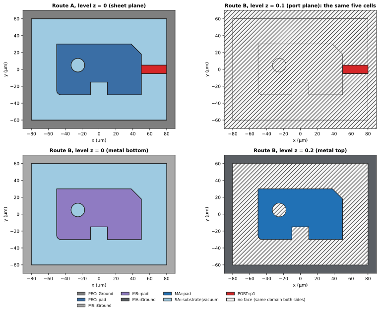
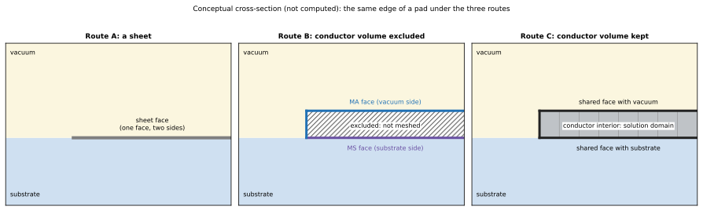

同一顆晶片的導體，可以用不同的方式交給 solver：把薄膜當成零厚度的 sheet（Route A）、把有限厚度的金屬 volume 從求解區域中挖掉、只留下它的邊界（Route B），或把導體 volume 保留下來並在內部 mesh（Route C）。SGB 把這個選擇放在 labelling 層：arrangement、cell 與 face 的推導對每種 route 都是同一份程式，route 只決定導體的 cell 在輸出中代表什麼，以及哪些 volume 會被輸出。

三種 route 在 production（`scgsim.geometry.sgb`，階段 1）都已實作並有測試。本頁先用執行範例看 Route A 與 Route B 的差別，再說明 route 決定什麼、Route A 的導體從何而來、physical group 如何劃分、lumped port 放在哪個平面（以及它對 SA 的影響），最後說明 Route C。[Cell 與其 label](labels-and-dissolution.qmd) 以及 [face、wall 與 volume](assembly.qmd) 是這一頁的基礎。

## 執行範例的觀點

執行範例是 production 的真實輸入（`tests/sgb_inputs.py` 的 `gds_pad_in_ground`）：100 µm 的晶片，ground plane 開一個 40 µm 的 cutout，cutout 內有 20 µm 的 pad，lumped port 橫跨 gap。Ground 與 pad 在 Route A 中是 $z = 0$ 的 sheet，lumped port 也是 $z = 0$ 的 sheet；Route A 要求導體在 S1 之後是零厚度，所以 Route A 用同一份 GDS 與 stack、以 `thin_film` profile 詮釋（兩個 film 收成 sheet，vacuum 的頂端因此從 20.2 降到 20 µm）。在 Route B 中，金屬厚 0.2 µm（$z = 0$ 到 $0.2$），貼在 substrate 上；Ground 與 pad 的導體 volume 不屬於輸出模型，只有它們的邊界屬於。三種 route 的 port 都在 host 的 support plane $z = 0$（規則見[Port 位於 support plane](#port-support-plane)）。Entity 名稱是來源 adapter 給的 id：`ground_0000` 是 ground 多邊形，`VACUUM_REGION` 是自動加上的 vacuum region（它向四周多出 20 µm，把 substrate 包在裡面）。

判斷一個平面 **cell** 要不要成為輸出的 **face**（BREP face，以下簡稱 face），只需要問一個問題：**這個 cell 正上方與正下方的 domain 相同嗎？** 以 Route B 的金屬頂面 $z = 0.2$ 為例：

- 金屬區域（ground 與 pad）：下方是金屬，上方是 vacuum，不同，所以是 face（`MA::*::top`）；
- gap 與晶片外圍的環：上方是 vacuum，下方也是 vacuum。

上下 domain 相同，代表這個 cell 兩側沒有介面，所以不輸出 face。在 $z = 0$ 平面則不同：ground、pad 與 gap 的 cell 下方是 substrate，上方是金屬或 vacuum，兩側 domain 不同，所以都是 face；port 的矩形上下與 gap 相同（substrate 與 vacuum），但它是位於該平面的 sheet，不屬於任何一側的 domain，因此被另外保留成自己的 cell 與 face。只有晶片外圍的 vacuum 環在 $z = 0$ 上下都是 vacuum，沒有 face。

Route A 與 Route B 在 $z = 0$ 的 level arrangement 有**完全相同的 edge 幾何**（23 條 edge、5 個 cell；script 逐一比對）。不同的是 cell 的*意義*。

{#fig-cells fig-alt="三張平面圖。左（Route A，z = 0）：ground 與 pad 是各有顏色的 sheet face，gap 是 SA face，紅色的 port 矩形是 PORT face，外圍的環畫上斜線。中（Route B，z = 0）：相同的輪廓，ground 與 pad 是金屬與 substrate 之間的 MS face，其餘相同。右（Route B，z = 0.2）：ground 與 pad 是金屬與 vacuum 之間的 MA face，gap 與外圍的環畫上斜線，表示沒有 face。"}



@fig-cells 的看點：

- **左對中。** 同樣的五個 cell、同樣的 edge。在 Route A 中，每個金屬 cell 是一個以 entity id 命名的 sheet face（group `ground_0000`、`pad`），兼任金屬對 vacuum 與金屬對 substrate 兩種表面；gap 是 `SA::substrate|VACUUM_REGION::interface`；port 是 `PORT::PORT_SHEET__P1__0000`。在 Route B 中，金屬在這個平面的 cell 是金屬對 substrate 的 `MS::*::bottom`，其餘相同。外圍的環在兩種 route 都沒有 face。
- **右。** 在 Route B 中，金屬對 vacuum 的表面位於 $z = 0.2$，是 `MA::*::top`。Route A 則是一個 sheet 兼任兩者。
- **Gap cell** 在兩種 route 中於 $z = 0$ 都是 `SA::substrate|VACUUM_REGION::interface`，已經扣掉 port 蓋住的面積。

{#fig-3d fig-alt="並排的兩張三維 exploded 視圖。Route A 中，substrate 與 vacuum 兩個 volume 拉開，各自都有同一個灰色 sheet face，gap 處是淡藍色的 SA face 與紅色 port。Route B 中，substrate 側有紫色的 MS face，vacuum 側有藍色的 MA top 與金屬的 wall。"}



## Route 決定什麼

{#fig-abc fig-alt="三張並排的橫截面示意圖。A：substrate 與 vacuum 之間一條灰色粗線代表 sheet。B：一塊畫有斜線、標示為不 mesh 的矩形，上緣為 MA face，下緣為 MS face。C：同樣位置的灰色矩形，內部有 mesh 線，標示為導體內部是 solution domain，上下緣是與 vacuum 和 substrate 共用的 face。"}


Route 是*早期輸入*，只作用於兩個地方：S1 決定存在哪些 prism，S7 決定輸出哪些 volume 與如何命名導體的 face。arrangement、labelling、dissolution、assembly 與驗證都不看 route；在 production 中，route 是一個小的 policy record 與一個命名函式：`RoutePolicy(name, exclude_conductor_volumes, allows_sheets, rejects_finite_films)` 與 `surface_group`。

::: {.askr-table-compact}
| | Route A | Route B | Route C |
|---|---|---|---|
| 導體在 S1 之後 | 零厚度 sheet；有限厚度的本體（bump、post 等 `finite_volume`，或沒有物理宣告者）照樣接受；仍是有限厚度的 film（`stack_film`、`local_film`）被拒絕 | 有限厚度 prism；導體 sheet 被拒絕 | 有限厚度 prism；導體 sheet 被拒絕 |
| 導體 volume（S7） | sheet 沒有 volume；有限厚度的本體有 volume，但與 Route B 一樣從輸出模型**排除** | 存在，但從輸出模型**排除** | 存在，**保留**並在內部 mesh，導體內部是 solution domain（以 `<entity>` 命名） |
| level 上的導體 cell | 一個 face（以 `<entity>` 命名），位於上下兩個 volume 之間 | 相鄰 dielectric volume 的 face：`MA::<entity>::top`（vacuum 側）、`MS::<entity>::bottom`（substrate 側）、側壁為 `::sidewall` | 與 Route B 同名的 face，但兩側的 volume 都被輸出：導體 volume 與相鄰 dielectric 或 vacuum volume 共用它 |
| Lumped port | 位於 host 的 support plane（sheet 平面）：兩個 volume 之間的 face，佔去該處的 SA 面積 | 位於 host 的 support plane（例如 substrate 上表面）：substrate 與 vacuum 之間的 face，佔去該處的 SA 面積；不是 free face | 與 Route B 相同，邊與導體 wall 共用 |
| production 狀態 | 已實作，已測試 | 已實作，已測試 | 已實作，已測試 |
:::

::: {.callout-important title="設計決策：route 是輸入，不是後處理"}
route 改變存在哪些 prism（S1）以及輸出哪些 volume（S7）。它從不事後改寫 arrangement 或 topology。要建什麼幾何，在建構之前就已決定。
:::

### Route A 的導體從何而來

Route A 的 sheet 不是使用者直接畫出來的薄片。來源仍保有真實的金屬宣告：例如 100 nm 厚的金屬，以 `PhysicalLayerDeclaration` 記錄厚度與來源身分。S1（`interpret_physical_geometry`）依一個明確的近似設定（例如 `thin_film` profile）把它映射成零厚度的有效 sheet，這個設定的契約見 [Physical representation](../../specs/physical-representation.qmd)。

production 的 Route A 規則因此只看**經過 S1 之後仍是有限厚度的 film**：宣告為 `stack_film` 或 `local_film`、卻沒有被 profile 收成 sheet 的導體，會被 `RouteError` 拒絕，訊息建議選一個會收成 sheet 的 profile（例如 `thin_film`）或改用 Route B 或 C。有限厚度的**本體**（宣告為 `finite_volume` 的 bump、post、TSV 類 volume，或像今天的 `cutout_boundary_shell` 表示法那樣沒有宣告者）照樣被接受，它們的 volume 與 Route B 一樣被排除，邊界面成為相鄰 volume 的 face；例如一顆站在 thin-film sheet 上的 bump，在 Route A 就是 sheet 加上被排除的有限厚度本體。Route B 與 Route C 則反過來，拒絕**導體 sheet**。原型時期在入口以 `RouteError` 拒絕所有有限厚度導體的做法，是原型的捷徑，已被這個規則取代。

### 並排比較

::: {.askr-table-compact .askr-table-numeric}
| 量（production，真實輸入） | Route A | Route B | Route C |
|---|---|---|---|
| Slab / level | 3 / 4 | 4 / 5 | 4 / 5 |
| Face（規劃／輸出） | 15 / 15 | 34 / 34 | 34 / 34 |
| Volume（規劃／輸出） | 2 / 2 | 4 / 2 | 4 / 4 |
| Primary physical group：face / volume | 8 / 2 | 12 / 2 | 12 / 4 |
| 驗證 check | 31 之 31 通過 | 31 之 31 通過 | 31 之 31 通過 |
:::

Route A 的 slab 與 level 比較少，因為金屬層沒有厚度：沒有 $z = 0$ 到 $0.2$ 的 slab，也沒有 $z = 0.2$ 的 level。Route B 多出來的 face 是 wall 與第二組金屬表面：25 面 wall 對 8 面（Route A 只有 vacuum region 的四個外側面與 substrate 的四個側面）；水平的 face 則是 9 個對 7 個（Route A 的兩個 sheet 在 Route B 變成兩個 `MS::*::bottom` 加兩個 `MA::*::top`）。這個真實輸入中，沒有輸出的兩個 volume（`ground_0000` 與 `pad`）的 face 全都同時是 vacuum 或 substrate 的 face，所以規劃的 face 全部輸出，34 個都在。Route C 保留了導體 volume，所以輸出的 volume 多出 `ground_0000` 與 `pad` 兩個，face 數不變。完整的數量見文末的補充資料。

## Physical group 劃分每個維度

每個輸出的表面與 volume 都屬於**恰好一個 primary physical group**。名稱依 D5 以 Entity 歸屬：`<kind>::<entity>::<face kind>[::band=k]`，face kind 是 `top`、`bottom`、`sidewall`、`sheet`、`interface`（有 band 的 `interface` 另帶高度，見 [identity](identity.qmd#band-group-names)）。Route A 的 group 是 `ground_0000`、`pad`（兩個 sheet）、`PORT::PORT_SHEET__P1__0000`、`SA::substrate|VACUUM_REGION::interface`、`SA::substrate|VACUUM_REGION::sidewall`、`EXT::VACUUM_REGION::bottom`、`EXT::VACUUM_REGION::sidewall`、`EXT::VACUUM_REGION::top`、`substrate`、`VACUUM_REGION`（兩個 volume；共 10 個）。裸的 entity id 指物件本身，Gmsh 的 Type 欄位標示它是 surface 或 volume。Route B 以 `MA::ground_0000::top`、`MA::ground_0000::sidewall`、`MS::ground_0000::bottom` 與 pad 的三個對應 group 取代兩個 sheet group（共 14 個）。Route C 再加上 volume group `ground_0000` 與 `pad`（共 16 個）；這個真實輸入的 ground 不碰模型外邊界（vacuum region 把它包在裡面），所以沒有 `EXT::ground_0000::sidewall`。

solver 常想要的是 *union*，例如「Net `pad` 的所有導體表面」或「所有 MA 表面」。它在 sidecar 中是 primary group 的清單，絕不是第二個重疊的 Gmsh group，因為 MSH 輸出會為每個包含某元素的 group 各複製一次該元素，solver 可能把這些複本讀成兩個表面。執行範例（真實輸入，Net 的 id 是 `G` 與 `P`）的 sidecar 為 Route B 記錄（節錄）：

```json
"unions": {
  "interface_types": { "MA": ["MA::ground_0000::sidewall", "MA::ground_0000::top",
                              "MA::pad::sidewall", "MA::pad::top"],
                       "MS": ["MS::ground_0000::bottom", "MS::pad::bottom"], "…": ["…"] },
  "nets": { "G": ["MA::ground_0000::sidewall", "MA::ground_0000::top", "MS::ground_0000::bottom"],
            "P": ["MA::pad::sidewall",         "MA::pad::top",         "MS::pad::bottom"] }
}
```

Route A 的 sheet group（以 `<entity>` 命名）承載它所具有的 MA 與 MS Surface EPR row（有 face 的某一側是 vacuum 才有 MA，是 dielectric 才有 MS），所以它也列在 `interface_types` 中對應的 `MA` 與 `MS` 之下，Net 的聯集則是 `"P": ["pad"]`。同一份 solver 設定兩者都能讀：union 永遠是 primary group 名稱的清單，驗證器檢查每個成員都存在（`unions_reference_primary_groups`），也檢查沒有任何 entity 位於兩個 group（`groups_partition_each_dimension`）。physical tag 不是 identity：tag 依 group 名稱排序，新增 group 時會位移，所以使用者應儲存 group 名稱。

::: {.callout-important title="保證：一個 face，一個 group（依據：測試）"}
沒有任何輸出的 face 或 volume 位於兩個 physical group，也沒有任何一個不在任何 group 中。union 只是 sidecar 與 solver 設定中的簿記。
:::

::: {.callout-important title="D5：表面依 Entity 歸屬"}
表面**預設依 Entity 歸屬**：不同 Entity 之間的 seam 保留為 required edge，讓每個 Entity 對 Surface EPR 的貢獻可以分開；報告依 interface type（MA、MS、SA）彙總，這些總和是 sidecar 中的 union；Net 層級的 union 只用於 Electrostatic 等需要電性身分的後端。同一個 Net 的重疊區域屬於宣告 priority 較高的 Entity；priority 相同或缺少時 build 以 `OverlapError` 失敗，並指出該由 layer stack 的 `mesh_order`、元件標註的 `priority` 或 `GeometryPlan` 的 assembly-level priority 中的哪一個補上（priority 的慣例與三個來源見[設計決議 D5](decisions.qmd#d5)）。在執行範例中每個 Net 只有一個 Entity，所以依 Net 與依 Entity 得到的 face 完全相同，改變的只有 group 的名稱。
:::

## Port 位於 support plane {#port-support-plane}

lumped port 的 sheet 放在 host 導體的**物理 support plane**：導體貼附的那個面。0.2 µm 的金屬在 substrate 上，support plane 是 substrate 的上表面 $z = 0$，port 就躺在那個介面上。

這個平面是 source 宣告的，SGB 不從 body 的區間推算。PDK 在每個 film 的 `PhysicalLayerDeclaration` 宣告 `source_contact_facts["layer_attachment_face"]`（`lower` 或 `upper`），它對應 source 區間的下端或上端（`attachment_z_um`）；零厚度的 source sheet 以自己的平面為準。SGB 再經由共同的 `PhysicalRepresentationPlan`（`project_support_point`；Route A 的 sheet 取 sheet anchor）把它投影成 effective 模型的 $z$。AEDT 端準備 junction 時用的是同一條規則（見 [AEDT runtime](../../specs/aedt-runtime.qmd) 規格中 junction 的來源支撐平面：「physical source support plane」）。

- **所有 host 必須一致。** 每個 host 的宣告平面是同一個 source $z$，投影後也是同一個 effective 平面；有限厚度的 body 區間只用來確認 host 確實碰到這個平面，不會自己產生平面。不一致時 build 以 `InputError` 停止。
- **沒有宣告就失敗，沒有後備。** host 沒有物理宣告、宣告不是 film（例如 `finite_volume`）或沒有 attachment face，build 以 `InputError` 指名 host，並說明 PDK 必須宣告 `layer_attachment_face`。
- **Route A 不變。** sheet host 的 anchor 就是 support plane，port 在 sheet 平面上；rectangular junction 的中央矩形 port 用同一條規則。

效果有三個。

1. **port 是兩個 volume 之間的 face。** 在 gap 內，這個平面上方是 vacuum、下方是 substrate，所以 Route B 與 C 的 port 與 Route A 一樣，是兩個 volume 之間的一般 face：`embedded_faces` 沒有它，`ports[*].host_volumes` 為空，`adjacent_volumes` 有兩個。它的邊與相鄰金屬的 wall 和底面共用。
2. **port 佔去它在 SA 平面上的面積。** 同一個平面的 substrate–vacuum 介面減去 port footprint，所以 SA band 的 face 不含 port 蓋住的部分；band 的 seam 在 port 的邊界停下，所以 port 是一個 face，group `PORT::<id>` 就是這個 face（規則見 [Inset band 怎麼量](inset-imprint.qmd#band-measure)）。
3. **band 不動。** band 的 distance origin 是 gap edge，判斷時 port 當作不存在（見 [Inset band 怎麼量](inset-imprint.qmd#band-measure)）；port 只拿走它蓋住的面積，不移動任何 band 的邊界。

在 pad-in-ground 範例（production 的真實輸入，Route B 與 C；SA 的 `SolutionInterface("substrate", "VACUUM_REGION", z_um=0.0)`，margin 0.5 與 1 µm）中，gap 環的 support 面積是 1 200 µm²，port footprint 是 40 µm²（12 × 4 µm 減去兩端各 1 × 4 µm 的 landing）：

::: {.askr-table-compact .askr-table-numeric}
| SA band | 沒有 port（µm²） | 有 port（µm²） | 差（µm²） |
|---|---|---|---|
| `…::band=0` | 119.785 | 115.785 | 4 |
| `…::band=1` | 119.356 | 115.356 | 4 |
| `…::band=2` | 960.858 | 928.858 | 32 |
| 合計 | 1 200 | 1 160 | 40 = `PORT::PORT_SHEET__P1__0000` |
:::

三個 band 的總和加上 port 面積，等於沒有 port 時的總和（測試 `test_a_port_removes_its_footprint_from_the_sa_bands_without_moving_a_band` 對 Route B 與 C 檢查）。重現資料在文末。

## volume 內部的 sheet 仍是 embedded face {#the-route-b-port-is-an-embedded-face}

production 的 port 因為上面的規則，不會出現在 volume 內部：真實輸入的 sidecar 中 `embedded_faces` 為空，`ports[*].host_volumes` 為空，`adjacent_volumes` 有兩個。但 arrangement 與 assembly 對一般的 sheet 不做這個假設，所以兩側是同一個 volume 的 sheet 仍然是合法的。真實輸入沒有這種 face；下面用 **stage 層的 scene**（`tests/sgb_scenes.py` 的 `pad_in_ground("B")`，它的 `lumped_port` 刻意把 port 放在金屬的中間平面 $z = 0.1$，用來走 embedded sheet 的路徑）說明這個機制。這個 scene 不是真實輸入，也不是本頁其他圖與數字的來源。

在那個 scene 中，pad 的 wall 與 ground cutout 的 wall 之間是 vacuum，port 矩形位於 vacuum volume *內部*：它上下方的 volume 是同一個。兩側為同一個 volume 的 face 不圍出任何 volume；它是 **embedded** 於 host，且它有自由邊界，**不屬於任何 volume 的 shell**：

- 這個 face 列在 volume 上作為 embedded face（scene 中有一個，`PORT::p1`，host 是 `vacuum`），不在該 volume 的 shell 之內；
- 它在 pad 與 ground wall 上的兩條 edge 與 wall 片段共用（這就是這兩面 wall 在 $z = 0.1$ 被切開的原因，見[從 arrangement 到實體](assembly.qmd#coalescing)）；其他兩條 edge 是自由 edge，驗證器把它們計為自由 edge（scene 中為 2 條，沒有任何 dangling edge）；
- XAO 檔案無法攜帶「face embedded 於 volume」這種資訊，所以 sidecar 記錄這組配對，由 mesher 重新套用。sidecar 中是 `"embedded_faces": [{"face": "<face id>", "host_volume": "<volume id>", "group": "PORT::p1"}]`，mesher 對每一組呼叫 Gmsh 的 embedding（`gmsh.model.mesh.embed(2, [face], 3, volume)`；`verify_loaded` 之後由 `apply_sidecar_embeds` 重新套用）。

**真實輸入今天用到 embedding 的是 dangling refinement curve。** 在真實輸入的 gap 內（$z = 0$）加一條從 $(32, 55)$ 到 $(38, 55)$ µm 的 refinement curve（`RefinementRequest`），模型多出 2 個 vertex 與 1 條 `refinement` edge，face 數不變（34 個）。它是 `refinement_only`：不切開 gap 的 cell；sidecar 的 `embedded_faces` 仍為空，`refinement_edges` 多一筆 `{"edge": "<edge id>", "family": "ref", "host_face": "<face id>", "written_as_free_edge": true}`，`apply_sidecar_embeds` 對每個 host face 呼叫 `gmsh.model.mesh.embed(1, edges, 2, face)`。`mesh.embed` 適用的其他地方見 [Cut family](cut-families.qmd#embed-or-edge)。

## Route C：保留導體 volume

D1 已決定 **Route C 屬於 v1**，production 已實作。導體 volume 保留在模型中並在內部 mesh，導體內部是 solution domain；導體與 dielectric、導體與 vacuum 的介面是共用 face。目的是現在能處理有限導電率，未來能接上超導材料模型。它是 S7 的第三種 labelling policy，不是另一條 pipeline：arrangement、label 與 assembly 本來就為導體建立 volume 與它的 shell，Route C 只是不把它排除。

在 Route C 中，每個導體 Entity 的 volume 都被輸出，volume group 為 `<entity>`；導體的表面仍用 `MA::`、`MS::` 的 face 名稱，只是 face 兩側的 volume 都存在；兩個導體 Entity 之間的 face 是 `MM::<a>|<b>::interface`（Net 的聯集只列暴露的導體表面，不含 `MM`）。碰到模型邊界的導體有自己的 `EXT::<entity>::sidewall`（真實輸入的 vacuum region 把 ground 包在裡面，所以沒有；stage 層 scene `pad_in_ground("C")` 的 ground 貼著晶片外緣，有 `EXT::ground::sidewall`）。導體 sheet 被拒絕；lumped port 與 Route B 相同，位於 host 的 support plane。「Net X 的 PEC」在 Route C 不再是一組 PEC face，Palace 端如何把導體 volume 當成 material domain、如何 lower Surface EPR，是階段 3 的工作（見[欄位對應](consumer-mapping.qmd)）。

## 邊界情形

- **Route A with Surface EPR band。** sheet face 同時是 metal-vacuum 與 metal-substrate 表面。有 inset band 時，它以 face 命名：`<entity>::band=k`（例如 `pad::band=2`）；sidecar 的 `surface_epr_rows` 在 group 中有 face 的某一側是 vacuum 時才有 MA 列、有某一側是 dielectric 時才有 MS 列；存在的列都對應到同一個 group，`shared_face_group` 指向這個 sheet group，`face_sides` 逐 face 列出積分的是哪一側，`side` 是它們共同的值（例如 MA 為 `above`、MS 為 `below`），不一致時為 `mixed`（[Inset imprint](inset-imprint.qmd)）。
- **Route B 的 band。** 同一個 band family 對金屬的頂面（`MA::pad::top::band=k`）與底面（`MS::pad::bottom::band=k`）各產生一次；側壁不切 band。band 版本的執行範例（真實輸入，Route B；pad 的頂面與底面、substrate 與 vacuum 之間的 gap 各取 margin 0.1、0.5、2 µm）規劃 46 個 face、163 條 edge、142 個 vertex，24 個 group（`figures/routes-numbers.json` 的 `route_B_bands`）。
- **不同 Net 的導體接觸**在每種 route 中都是錯誤，包括共用 edge 或 vertex 的兩個 Route A sheet，以及因 snap 而產生的接觸；`ContactError` 指出兩個 Entity 與位置（見 [label 頁](labels-and-dissolution.qmd)）。

## 小結

- route 決定存在哪些 prism 以及輸出哪些 volume；同樣的 arrangement、labelling、assembly 與驗證同時服務所有 route。
- 一個 cell 是否成為 face，取決於它上下的 domain 是否相同；同一個金屬 cell，在 A 中是上下 domain 不同的 sheet face，在 B 中是金屬底面與頂面的 `MS`、`MA` face，金屬內部不輸出 face。
- Route A 的 sheet 來自 S1 對有限厚度來源的近似；production 的 Route A 只拒絕 S1 之後仍是有限厚度的 film。
- 每個輸出的 face 與 volume 有一個 primary group；union 是 sidecar 中的清單。
- lumped port 位於 host 的 support plane（PDK 宣告的 film attachment face）；它佔去該處的 SA 面積，但不移動任何 band。
- Route A 只拒絕仍有限厚度的 film，保留有限厚度本體（bump 等）；Route B 與 C 拒絕導體 sheet；Route C 保留並 mesh 導體 volume。
- 下一步：route 之外的分割，例如 port、band 與 refinement curve，見 [Cut family](cut-families.qmd)。

## 補充：重現資料

圖與數字由 `zh-TW/docs/design/sgb/_figures/routes.py` 以 production 套件 `scgsim.geometry.sgb` 產生（`SGB_CORE` 指向 `claude/sgb-core` 的 checkout，用它的 Python 環境執行），記錄在 `figures/routes-numbers.json`。Route B 與 C 是 `tests/sgb_inputs.py` 的真實輸入 `gds_pad_in_ground`；Route A 是同一份 GDS 與 stack 以 `thin_film` profile 詮釋（測試的建構函式固定使用 `solid` profile，script 在建構時換掉 profile、並讓兩個金屬共用一個物理 layer 宣告，建完即還原）。數量是 `build_model_from_catalogue` 得到的 `ConformalModel.counts`，輸出數量取自 `emit_model` 寫出的 BREP plan（`SgbArtifacts.counts`）與 sidecar。兩個不是真實輸入的例子：stage 層的 scene `tests/sgb_scenes.py` 的 `pad_in_ground("B")`（port 在中間平面，embedded face）與真實輸入加一條 dangling refinement curve。Brief 對應第 7 節（group、embedded face）、第 8 節（S7）與第 14 節（naming、contact）；production 模組為 `routes`、`assembly`、`emission`。

Port 的 SA 面積表來自真實輸入：`experiments/sgb-redesign/consumer-contract/generate_excerpt.py` 的 `all_interfaces` 組（每個 entity 的每個表面與 SA 都要求 band，margin 0.5 與 1 µm）寫在 `out/all_interfaces/route_{a,b,c}/`，摘要在 `out/all_interfaces/summary.json`；「沒有 port」的欄位用 `gds_pad_in_ground(with_port=False)` 以同樣的 band 要求建出。

::: {.askr-table-compact .askr-table-numeric}
| 量（production，真實輸入） | Route A | Route B | Route C |
|---|---|---|---|
| Prism | 5 | 5 | 5 |
| Slab / level | 3 / 4 | 4 / 5 | 4 / 5 |
| Level cell（dissolution 後） | 9 | 13 | 13 |
| Vertex（規劃／輸出） | 29 / 29 | 46 / 46 | 46 / 46 |
| Edge（horizontal + vertical，規劃） | 39（31 + 8） | 73（48 + 25） | 73（48 + 25） |
| Face（horizontal + wall，規劃） | 15（7 + 8） | 34（9 + 25） | 34（9 + 25） |
| Volume（規劃／輸出） | 2 / 2 | 4 / 2 | 4 / 4 |
| Face（輸出） | 15 | 34 | 34 |
| Free face（port） | 0 | 0 | 0 |
:::
