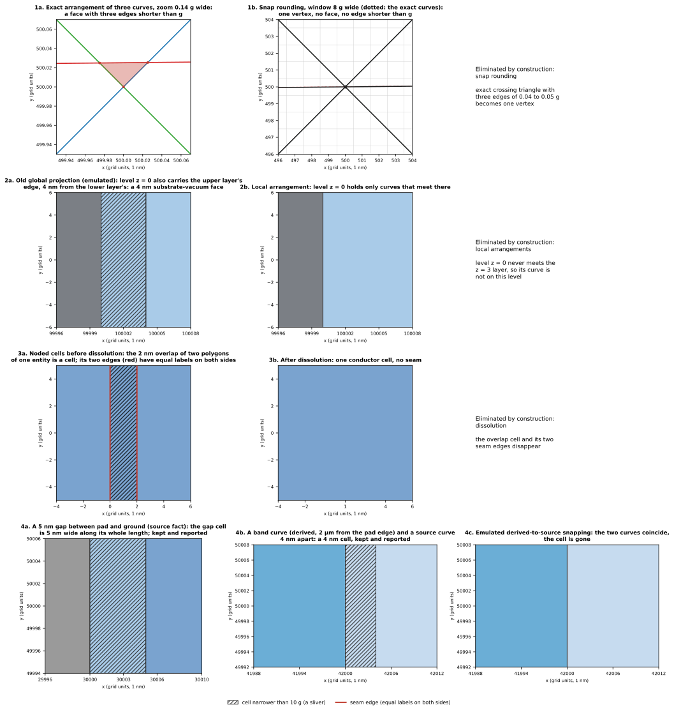

**Sliver** 指的是遠小於模型特徵的 face 或 edge：短於 grid $g$ 的 edge，或只有幾奈米寬的 face。sliver 迫使 mesher 在毀掉元素品質與產生大量細小元素之間做選擇；以 Boolean 為基礎的 CAD 也會在它們周圍失去 topology。

SGB 把 sliver 的來源分成四種：其中三種是推導方式造成的人為結果，各有一個具體的機制把它們移除；第四種來自來源幾何本身，被視為幾何本來的樣子：SGB 保留它，並在 **sliver report** 中回報（D2：v1 只回報，不設門檻）。本頁依序說明這四種、report 的格式與每個數字的意義，以及 D2 的 policy。

## 執行範例的觀點

執行範例沒有 sliver。prototype 對它五次執行的 sliver report：

::: {.askr-table-compact .askr-table-numeric}
| Case（`outputs/<case>/sliver_report.json`） | 最短 edge（µm） | 最窄 face（µm） | 最小角度 | 最大 snap drift（g） | 最大 arc deviation（g） |
|---|---|---|---|---|---|
| `pad_in_ground_A` | 7.071 | 7.071 | 90° | 0.0 | 0.0 |
| `pad_in_ground_B` | 0.1 | 0.1 | 90° | 0.0 | 0.0 |
| `pad_in_ground_A_bands` | 0.0767 | 0.0767 | 90° | 0.0 | 0.632 |
| `pad_in_ground_B_bands` | 0.0767 | 0.0767 | 90° | 0.0 | 0.632 |
| `airbridge_B` | 0.2 | 0.2 | 90° | 0.0 | 0.0 |
:::

表格的讀法：

- **Route B 的 0.1 µm**（最短 edge、最窄 face）是金屬厚度的一半：$z = 0.1$ 的 port 平面把兩面金屬 wall 各切成兩半。這是模型本身的幾何，是 grid 的 100 倍。
- **Route A 的 7.071 µm** 是 pad 5 µm 圓角的 chord（最短 edge），也是它旁邊 face 的寬度；接著是 10 µm 的 port。
- **band 版本的 0.0767 µm** 是 0.1 µm gap-band 曲線在 pad 兩個 chamfer 角上的短片段（margin 半徑的圓弧）及其旁邊窄 cell 的長度。它們的 lineage 指出 family（`band_gap/ring1/corner2@m100.0`）與 Entity。
- **「最窄 face」是 face 的 local feature size**：兩條不相鄰的邊界 edge 之間的最小距離，在精確的 carrier 上量測（圓弧以解析方式處理，而非用 chord）。因此由圓弧圍成的 face 以其真實寬度回報，大 face 內部的細窄通道與孤立的窄 cell 同樣會被找到。chord 多邊形的比值 $2A/P$ 仍保留在每筆資料的 `width_2a_over_p_um` 中，僅供參考。
- **Snap drift 0.0** 表示每個 edge 端點都精確落在其來源 carrier 上：來源已在 grid 上，所以這些模型中 snap 沒有移動任何東西。drift 只會出現在傾斜曲線的交點（見下）。
- **Arc deviation 0.632 g** 是實現出的 inset 圓弧與其精確圓的距離，低於一個 grid unit 的警告線。
- **沒有小於 90° 的角**：範例只有直角與圓弧幾何。

這些都不是缺陷。接下來的各節展示 report 之所以存在的那些情況。

## 四種來源

四種來源與 SGB 對每一種所做的具體處理如下。

::: {.askr-table-compact}
| # | Sliver 來源 | 成因 | SGB 的做法 | 階段 |
|---|---|---|---|---|
| 1 | **Quantization** | 傾斜曲線的精確交點彼此只相差 grid unit 的一小部分 | 以 grid $g$ 做 snap rounding，使任兩個 vertex 的距離不小於 $g$、沒有 edge 短於 $g$ | S4 |
| 2 | **Phantom** | 在 3D 中從不接觸的 layer 的曲線被投影到同一平面，距離只有幾奈米 | level arrangement 只接收與它相接的 slab 與 sheet 的曲線，不相關 layer 的投影不會進來 | S4（level） |
| 3 | **Seam** | 兩個同材料的 prism 重疊或相鄰；它們在金屬內部的邊界切開 cell | dissolution 移除兩側 label 相同、且不屬於 `required` family 的 edge | S5 |
| 4 | **來源近乎重合** | 兩條真正不同的邊界只差幾奈米 | 保留並回報；選用的 policy 需要 Human 決定 | S9 |
:::

{#fig-gallery fig-alt="以 1 nm grid 為尺度的四排平面圖。第 1 排：三條曲線的精確交點形成一個極小的三角形；snap rounding 把它變成一個 vertex。第 2 排：一個 level 帶有不相關 layer 的 edge 時出現 4 nm 的條帶；只含自己曲線的 level 沒有這條帶。第 3 排：兩個同 Net prism 之間 2 nm 的重疊 cell，帶有紅色 seam edge；dissolution 之後消失。第 4 排：pad 與 ground 之間 5 nm 的 gap，以及 band 曲線與來源曲線之間 4 nm 的 cell，第三張圖中這對曲線被弄成重合。"}





### 1. Quantization sliver

三條曲線幾乎交於一點：$L_1$ 從 $(0,0)$ 到 $(1000,1000)$，$L_2$ 從 $(0,1000)$ 到 $(1000,0)$，$L_3$ 從 $(0,495)$ 到 $(995,505)$（grid unit）。它們的精確 arrangement 有一個三角形，三邊為 0.036、0.035 與 0.050 g（面積 $6.3 \times 10^{-4}$ g²）：三條 edge 短於 grid。snap rounding（7 個 hot pixel、2 輪）把三個交點合併進同一個 hot pixel，所以結果只有一個 vertex、沒有有界的 face，最短 edge 為 495 g（@fig-gallery 的 1a 與 1b）。

這個保證針對的是 vertex 與 edge，而不是 face 的寬度：snap rounding 之後，任兩個 vertex 的距離至少 $g$、每條 edge 至少 $g$ 長，但 face 仍可能只有幾個 grid unit 寬（第 2 到 4 排的條帶寬 2 到 5 g）。相關 check：`no_edge_shorter_than_g`、`vertices_on_grid`、`arrangements_planar`（[驗證](validation.qmd)）。

### 2. Phantom sliver

兩層金屬：M1 位於 $z = 0$ 到 $0.2$ µm，M2 位於 $z = 3$ 到 $3.3$ µm，其右緣比 M1 多 4 nm（$x = 100.004$ 對 $100$ µm）。它們從不接觸，但一起投影時 edge 相距 4 nm。global projection 會把每一層的曲線放到每一個 level。這裡的模擬是加入一個 `required` family，把兩層的邊界帶到全部六個 level；local pipeline 沒有任何特別處理。

::: {.askr-table-compact .askr-table-numeric}
| 量 | Global projection（模擬） | Local arrangement（SGB） |
|---|---|---|
| Level cell | 24 | 10 |
| 模型 face | 34 | 23 |
| 窄於 10 nm 的 face | 12 個，位於全部六個 level | 0 |
| 最窄 face（feature size） | 4 nm（每個 level 在晶片右緣的條帶） | 0.2 µm（金屬 wall） |
:::

（[分層模型](layered-model.qmd)一頁在另一對 layer 上展示了同樣的效果。）只要某個 level 同時接收兩層的曲線，條帶就會出現，包括 $z = \pm 100$ µm 的晶片表面。$z = 0$ 的 local arrangement 只含它上方與下方 slab 的曲線，所以 M2 的 edge 不在那裡。

::: {.callout-note title="模擬的範圍"}
「global」欄是在 prototype 中以 `required` family 重現 global projection。它顯示把不相關的曲線投影到每個 level 會對 cell 結構造成什麼影響，而這正是分層模型所排除的。
:::

### 3. Seam sliver

兩個同 Net 的 prism：$a$（$x$ 從 $-100$ 到 $0.002$ µm）與 $b$（$x$ 從 $0$ 到 $100$ µm）重疊 2 nm。noding 把 slab 切成四個 cell、14 條 edge；2 nm 的重疊是一個 2 g 寬的 cell，它周圍的兩條 edge 兩側 label 相同。dissolution 之後剩兩個 cell（導體與 vacuum）與 12 條 edge，最窄的 cell 是導體本身，寬 33 333 g。同一個機制移除了 [label 頁](labels-and-dissolution.qmd)範例中的 seam。

::: {.callout-warning title="D5 之後，這個例子的結果會改變"}
這個範例呈現 prototype 目前依 Net 合併的行為。D5 已決定表面預設依 Entity 歸屬，不同 Entity 之間的 seam 保留為 required edge：兩個 prism 即使屬於同一個 Net，重疊的 2 nm 也會成為屬於 priority 較高 Entity 的一個 2 nm 的 cell，在 report 中以來源近乎重合回報，不再被 dissolution 移除。dissolution 仍然會移除的 seam，是同一個 Entity 內部（例如由多個 polygon 組成的同一個 Entity）或兩側 label 相同的 seam。
:::

### 4. 來源近乎重合

相距 5 nm 的兩條邊界不是人為結果。一個 pad 位於 ground cutout 之內，cutout 的每一邊都比 pad 寬 5 nm，就是一圈 5 nm 寬的環形 gap（panel 4a）。模型通過驗證（13 個 face）：幾何是合法的，solver 甚至可能需要那個 gap。SGB 保留它並**回報**它。

該 gap 的 report 資料（取自 `slivers-numbers.json`，節錄）：

```json
{ "id": "f:1c52b3bd619c73ae", "kind": "horizontal", "group": "SA::substrate|vacuum",
  "value_um": 0.005, "measure": "local feature size", "bounded": false,
  "width_2a_over_p_um": 0.005, "area_um2": 1.6001, "perimeter_um": 640.04,
  "plane": "level[0]", "location_um": [-50.0025, 0.0, 0.0],
  "sources": ["ground", "pad"] }
```

第二種情形涉及**derived** 曲線。與 inset band 曲線相距 4 nm 的使用者來源曲線，是由 derived 曲線造成的同一種情況。在 panel 4b 中，位於 $x = -47.996$ µm 的矩形 family edge，與位於 $x = -48$ µm 的 band 曲線（pad 左緣的 2 µm band）相距 4 nm：形成一個 4 nm 寬的 cell。report 列出兩個 4 nm 的 face：這個 cell 本身，以及這個 cell 所屬的那個大的 band-3 face 的通道（面積 4756.7 µm²，$2A/P$ = 25 µm，所以光看面積與周長的比值不會標出它）。兩者都指出造成它們的 family；cell 的資料（節錄）：

```json
{ "group": "SHEET::pad::band=3", "value_um": 0.004, "measure": "local feature size",
  "width_2a_over_p_um": 0.004, "area_um2": 0.16,
  "plane": "level[0]", "location_um": [-47.998, 0.0, 0.0],
  "sources": ["band_pad_top", "window"] }
```

決定這對近乎重合曲線的規則，是關於*兩條中哪一條移動*的規則；那是 policy，見下。

## Sliver report

report 是已完成 build 的函式。它讀取 topology 與 arrangement，且**不改變任何東西**：build 的 identity digest 在前後完全相同（已測試）。每次 build 都把它寫成 `sliver_report.json`。

::: {.askr-table-compact}
| 欄位 | 內容 |
|---|---|
| `grid_um`、`top` | grid $g$，以及每個清單的資料筆數（預設 10） |
| `shortest_edges[]` | 依長度排序的 edge：`id`、`kind`（`horizontal`、`vertical`）、`value_um`、`plane`、`location_um`（x、y、z）、`sources` |
| `narrowest_faces[]` | 依 **local feature size** 排序的 face：`id`、`kind`（`horizontal`、`wall`）、`group`、`value_um`、`measure`、`bounded`、`width_2a_over_p_um`、`area_um2`、`perimeter_um`、`plane`、`location_um`、`sources` |
| `smallest_angles[]` | 依角度排序的 vertex 楔角：`value_deg`、`plane`、`vertex`、`location_um`、`edges`（兩個 id）、`sources` |
| `snap_drift` | `bound_grid_units`（$\sqrt{2}/2$）、`max_grid_units`、`edges_over_bound`、`edges_measured`、`worst[]`（edge、plane、value、sources） |
| `arc_edges` | `count`、`max_deviation_grid`、`mean_deviation_grid`、`worst[]` |
| `summary` | 各清單的第一筆：`shortest_edge_um`、`narrowest_face_um`、`smallest_angle_deg`、`max_snap_drift_grid`、`max_arc_deviation_grid` |
:::

每筆資料都帶有以微米表示的 **location**、**plane**（level、slab 或 wall 的 z 範圍）與 **sources**：來源 Entity，以及造成曲線的 family（如上面的例子）。讀者因此可以不打開幾何，就從一個數字走到負責的 prism 或 family。

這些數字如何量測，讓審查不至於把 report 當成它沒有量測的東西：

- **寬度是 local feature size。** 對 horizontal face，是兩條不共用 vertex 的邊界 edge 之間的最小距離，在精確的 carrier 上量測；線段對圓弧、圓弧對圓弧的距離以解析方式計算。若 face 的 edge 彼此全部相鄰（三角形、透鏡形），則取 vertex 到不相鄰 edge 的最小距離。對 wall，則是 $\min(\text{height},\ \text{兩條 vertical edge 之間的距離})$。`bounded: true` 標示以 spatial hash 量測的大 face：此時數值是在 hash cell 大小處的上界，不是精確的最小值。
- **Drift 是對直線 carrier 量測**；圓弧有自己的清單（`arc_edges`）。
- report 只做排序與計數；v1 不套用任何門檻（見下，D2）。

## 針對來源近乎重合的 policy（D2）

預設是**保留並回報**。SGB 提供兩個選用的 policy，其中每一個門檻都是 Human Gate；pipeline 從不自行套用其中任何一個。

::: {.askr-table-compact}
| Policy | 做什麼 | 成本 / 風險 | 狀態 |
|---|---|---|---|
| **保留並回報**（預設） | 模型完全依繪製的樣子建出；sliver 被列出 | mesher 會遇到 sliver | 已實作（`sliver_report`） |
| 對某個 layer 或 family 使用**較粗的 snap grid** | 該 layer 中距離小於較粗 grid 的邊界被合併 | 可能抹掉真實的 gap，包括兩個 Net 之間的 gap | 僅為設計；prototype 每個模型只有一個 grid |
| **Derived-to-source snapping**，$\tau_{\text{derived}}$ | 與來源曲線距離在 $\tau$ 之內的 derived 曲線（inset、refinement）移到來源曲線上；**來源曲線永不移動** | band 邊緣最多移動 $\tau$，所以 band 面積略有改變 | 僅為設計；見下方的模擬 |
:::

兩個計算範例，各自明確是替代的模擬：

- **Derived-to-source snapping 的模擬**（panel 4c）。讓 family edge 與 band 曲線重合（移動的是*來源*，4 nm；policy 本身會移動 derived 曲線，但得到的 topology 相同），4 nm 的 cell 就消失：15 個 level cell 變成 14 個，25 個 face 變成 24 個，沒有任何 face 小於 10 nm，最窄的 face 是 0.1 µm 的 band 0。
- **較粗的 grid，以整個模型的替代來模擬。** 在 10 nm grid（prototype 每個模型唯一的 grid）上重建 4 nm 的環形 gap，會讓 gap 封閉：pad 與 ground 的 sheet 會共用 edge，這是不同 Net 的接觸，build 以下列訊息中止：

  ```text
  different-Net contact between Ground (entities ground) and pad (entities pad) at
  (-50.0000, -30.0000) um on level[0] (grid g = 0.01 um; a gap smaller than the grid
  closes when the sources snap)
  ```

  同一條規則涵蓋 derived-to-source snapping：若 snap 封閉了兩個 Net 之間的來源 gap，必須失敗，並指出兩個 Entity 與位置。同 Net 的接觸則屬正常。因此 policy 永遠不會在無聲無息中讓兩個 Net 短路。

::: {.callout-note title="v1 的決定：只回報，不設門檻"}
Human 已決定（D2）：v1 不設任何 sliver 門檻，上表兩個選用 policy 都不啟用。來源近乎重合被視為幾何本來就長這樣，SGB 照樣建出並回報。只有在真實 layout 或極端案例中出現由窄 face 造成的畸形 mesh 元素時，才重新評估是否需要門檻。
:::

::: {.callout-warning title="陷阱：policy 會改變幾何"}
兩個選用 policy 都會把幾何改動至多它們的門檻，所以日後若要啟用，數值必須由 Human 指定並寫進 handoff，report 也要記錄每一次移動（位置、距離、carrier、Entity）。
:::

## 小結

- snap rounding 移除因量化而短於 $g$ 的 edge；local arrangement 移除不相關 layer 的投影；dissolution 移除兩側 label 相同的 seam。這三項各自只涵蓋上面具體說明的情形。
- 窄的 face 仍然可能存在：來源本身相距幾奈米的邊界是來源事實，會被保留，並連同位置、寬度、carrier 與 Entity 一起回報。
- report 只在精確的 carrier 上量測。v1 不設門檻、不移動任何曲線（D2）。
- 下一步：驗證器保證什麼、如何失敗，見[結構 invariant 與失敗行為](validation.qmd)。

## 補充：重現資料

範例由 `zh-TW/docs/design/sgb/_figures/slivers.py` 以 prototype 的 `build()` 及其 sliver report 建構四個小模型；數字在 `figures/slivers-numbers.json`。report 格式與執行範例的數值取自 prototype 的 `outputs/*/sliver_report.json`。Brief 對應第 10 節與 open decision D2；prototype 模組為 `sliver`、`feature_size`、`contacts`、`snap_rounding`、`layers`、`dissolve`。Snap rounding 的文獻：J. D. Hobby（1999），*Practical segment intersection with finite precision output*；L. J. Guibas 與 D. H. Marimont（1998），*Rounding arrangements dynamically*；D. Halperin 與 E. Packer（2002），*Iterated snap rounding*（見[建立 arrangement](arrangement.qmd)）。名詞見[詞彙表](index.qmd#glossary)。
