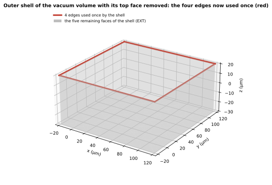

SGB 推導出的模型要交給 mesher 與 solver，所以在寫出之前必須能回答：這個模型的 topology 是否自洽？本頁列出每一條結構 invariant、它在何處執行、失敗代表什麼，並說明支配全部規則的原則：**invariant 一旦失敗，build 就中止；不修補，也不產生 fallback geometry。** 這些是*結構* invariant，關於已規劃 topology 的陳述，不是真就是假；它們不是 research Gate，後者是 Human 的決定（[Open decision](decisions.qmd)）。兩層驗證與下列 invariant 在 production（`scgsim.geometry.sgb`）都已實作：`validate_model` 在每次 build 都執行，一次 build 的報告記錄 31 項 check，其中 4 項是不使 build 失敗的警告。

## 兩層驗證

驗證分兩層。每一層回答不同的問題，也不取代另一層。

::: {.askr-table-compact}
| 層 | 何時執行 | 做什麼 | 失敗時 |
|---|---|---|---|
| **1. 開發測試** | 在安裝了 `occt` dependency group 的環境（目前 CI 不安裝，`occt` 測試在 CI 中略過），涵蓋範例、極端案例 fixture 與隨機 layout | 對寫出的 BREP/XAO 執行 OCCT 自己的檢查：`BRepCheck_Analyzer`、`BOPAlgo_ArgumentAnalyzer`（透過 OCP），以及 Gmsh 載入檢查 `verify_loaded`（數量、vertex 位置、邊界、面積、volume、group） | 測試失敗；是 SGB 或 writer 的缺陷 |
| **2. 每一次 production build** | 每一次 build，寫出之前 | 對 SGB 自己的結構 invariant（本頁其餘部分）fail closed | build 中止，不回傳模型 |
:::

mesher 不再重新檢查寫出的檔案：第 1 層確認 writer 寫出的檔案與規劃一致，第 2 層確認每一個規劃本身成立，所以 mesher 直接信任同一次 build 寫出的 XAO 與 sidecar。

::: {.callout-important title="XAO 與 sidecar 必須來自同一次 build"}

mesher 不比對它收到的兩個檔案。把一次 build 的 XAO 配上另一次 build 的 sidecar，tag 會對到錯誤的 planned id，mesh 仍然會產生，也不會報錯。成對傳遞 `SgbArtifacts` 的 `xao` 與 `sidecar`，就不會發生這種情況。
:::

幾點說明：

- **第 1 層的 OCCT 檢查**（`scgsim.geometry.sgb.checks.verification.occt` 的 `check_file`）依序做四件事：(1) `BRepCheck_Analyzer`（開啟 geometry control）：問每個唯一的 vertex、edge、wire、face、shell 與 solid 是否 `IsValid`，並報告各自的狀態清單與在各 context 中的狀態（edge 在 face 中、face 在 shell 中等）；(2) `BOPAlgo_ArgumentAnalyzer`（Boolean 運算的前置檢查），開啟型別、self-interference、過小 edge、無法重建的 face、tangent face、未合併的 vertex 與 edge（conformity 缺陷）、C0 連續性與 pcurve 對 3-D 曲線等九個模式；(3) 輕量的 `ShapeAnalysis` 檢查：每個 shell 的自由 edge 與不良（non-manifold 或定向不一致）edge、短於 tolerance 十倍的 edge；(4) 與規劃交叉比對：每個 solid 的體積與每個 face 的面積對比規劃值。free 的 port sheet 不進 `BOPAlgo_ArgumentAnalyzer` 的 solid 分析（報告記為 excluded free face），由 `BRepCheck_Analyzer` 與面積比對涵蓋。
- **範例的結果（production）。** 六個真實輸入的模型（`pad_in_ground` 的 Route A、B、C 與各自含 band 的版本）加上兩個 stage 層的 scene（Route B 的 `airbridge`，以及有圓弧與圓柱 wall 的 `pad_in_ground`），各對寫出的 BREP 與 XAO 做一次，共 16 份報告（`figures/validation-numbers.json` 的 `occt_examples`），全部通過：`BRepCheck_Analyzer` 判定有效且沒有 faulty 的 sub-shape；`BOPAlgo_ArgumentAnalyzer`（含 self-interference）沒有 fault 或結果；`ShapeAnalysis` 沒有帶自由 edge 或不良 edge 的 shell；與規劃交叉比對，face 面積的最大相對誤差為 $1.3 \times 10^{-12}$（出現在有圓柱 wall 的 stage 層 scene；六個真實輸入的模型最大為 $2.9 \times 10^{-14}$），solid 體積的最大相對誤差為 $2.6 \times 10^{-16}$。單次執行的耗時，`BRepCheck_Analyzer` 2.5 到 15.8 ms，`BOPAlgo_ArgumentAnalyzer` 6.3 到 46.5 ms（這台機器；隨機器而異）。測試對 17 個具名的模型（`tests/sgb_emit_cases.py` 的 `CASES`）檢查同樣的項目。五個刻意製造的缺陷作為負對照（`tests/sgb_occt_mutations.py`、`tests/test_sgb_occt.py`：反轉的內 wire、shell 內翻轉的共用 face、vertex 移離曲線 $10^{-4}$ µm、缺一個 face 的開放 shell、有缺口的 wire），每一個都被 `BRepCheck_Analyzer` 抓到；其餘檢查各自能抓到哪幾種，測試記錄為下限（例如 vertex 偏離 $10^{-4}$ µm 只有 `BOPAlgo_ArgumentAnalyzer` 同時看得到，因為面積與體積的變化小於 $10^{-7}$，規劃比對看不到）。
- **極端案例 catalogue 與隨機 layout。** 見下一節。
- **Runtime validator 的 scaling（production 量測）。** 對 Route B 隨機 layout（seed 2）N = 1000、5000、20000 個 feature（F = 14 215、71 969、285 871 個 face），31 項結構 check 各自的成本對 face 數的 log-log 局部斜率在 0.97 到 1.31 之間（`cylinders` 在 N = 1000 到 5000 之間為 1.6，但它在 N = 20000 時只花 0.03 s），所有 check 成本合計的斜率約為 1.15（1.16 與 1.14），所以每一項都近似線性。N = 20000 時所有 check 的成本合計 10.6 s（驗證階段的 wall time 為 5.7 s）；最貴的是 planarity（4.6 s）與 shells（3.9 s），接著是 groups（0.67 s）與 edges_in_faces（0.65 s）。測試用的 `verify_loaded` 在 N = 20000 時為 15.3 s，Gmsh 載入為 49.7 s，推導與驗證合計為 61.6 s（`figures/why-validator-scaling.json`、`figures/why-scaling-numbers.json`；單次執行，同一台機器上不同次執行的時間可以差到 10% 以上）。**這些量測都是只有直線的 polygon layout，沒有圓弧也沒有 band，所以圓弧與 band 在大規模下的成本沒有量測，不外推。**
- **OCP 是 optional dependency。** 它是 `cadquery-ocp-novtk==7.8.1.1.post1` 對 OCCT 的 binding（OCCT 7.8.1，與 Gmsh 使用的相同），放在 `occt` dependency group（`uv sync --group occt`）；使用 OCCT 的測試標為 `occt`，沒有安裝時略過。終端使用者（例如經由 OrcaPen SC PDK）不會安裝 OCP。`export_aedt_step` 與 `verification.occt` 的檢查需要 OCP；目前 CI 還沒有安裝這個 group，所以第 1 層的測試只在安裝了它的環境執行。
- **第 1 層的 Gmsh 載入檢查** 是 `verify_loaded`：給定 sidecar 與剛開啟 XAO 的 Gmsh 模型，逐項比對由 sidecar 的表算出的預期值（`views.expected` 與每個 group 的成員：各維度的數量、每個 vertex 的位置、每個 edge、face、solid 的邊界、每個 face 的面積與每個 solid 的體積、physical group 的名稱、維度、tag 與成員），而不是檢視模型本身。測試與極端案例 catalogue 對每個寫出的模型執行它；懷疑檔案被替換或損壞時，也可以用 `verify_xao` 手動診斷。
- **驗證在 production build 中不能被停用。** build 函式沒有任何關閉驗證的參數（測試斷言這一點）；原型保留的 `run_validation` 與 `check_planarity` 開關僅供測試使用。

本頁其餘部分是第 2 層的第一半：SGB 自己的結構 invariant。

## 極端案例 catalogue 的結果 {#catalogue}

production 的 catalogue（`tests/sgb_extreme_cases.py` 的 fixture，`tests/sgb_catalogue_report.py` 產生報告）有 23 個 fixture，每個 fixture 宣告自己適用的 route（多數是 A、B、C，少數只有 B 與 C），共 63 列：Route A 17 列，Route B 與 C 各 23 列。fixture 涵蓋近切圓弧與直線、淺角相交的兩條圓弧、1 到 3 個 $g$ 長的 edge、共線重疊、窄縫、band 消失與 neck 被 inset 切開、浮空導體、巢狀 hole、堆疊 slab 在角落或 wall 邊緣相碰、port edge 落在金屬側壁上、cut family 的曲線穿過 band 邊界，以及相距 0.4 g 與 2 g 的近乎重合邊緣等，也包含圓弧上有外來 vertex 的案例。

::: {.askr-table-compact .askr-table-numeric}
| Route | 列數 | 建出並通過全部檢查 | 預期的拒絕 |
|---|---|---|---|
| A | 17 | 16 | 1 個 `ContactError` |
| B | 23 | 19 | 3 個 `NonManifoldError`、1 個 `ContactError` |
| C | 23 | 19 | 3 個 `NonManifoldError`、1 個 `ContactError` |
| 合計 | 63 | 54 | 9 |
:::

- **通過的 54 列**都做了：build 與結構檢查、寫出 BREP 與 XAO、Gmsh 載入與 `verify_loaded`、一次粗略的 3D mesh，以及 `BRepCheck_Analyzer`、`BOPAlgo_ArgumentAnalyzer`（含 self-interference）與 `ShapeAnalysis`。
- **9 列是預期的拒絕。** 6 列 `NonManifoldError`（Route B 與 C 的 `exactly_tangent_arc_line`、`kissing_corners_same_net`、`hole_touches_outer`：同一個 Net 的 volume 只在一點接觸自己，Route A 的 sheet 則合法）與 3 列 `ContactError`（`kissing_corners_different_nets`，三種 route）。這些都在 build 的最前面拋出，不會拖到寫出之後。原型時期 direct writer 對 5-edge 圓柱 wall 的兩個拒絕已經消失：`arc_with_foreign_vertex` 與 `arc_with_foreign_vertex_from_post` 的 wall 現在被切成兩個圓柱（[曲面 wall](assembly.qmd#curved-walls)），並通過全部檢查。
- **每列的 mesh 品質與 drift 都有記錄**，作為 D2 與 D7 重新評估的依據（不是門檻）。粗略 mesh 用 4 µm 的 mesh size（fixture 是 40 × 40 × 20 µm 的 box）；Gmsh 的 `minSICN`（1 為正四面體，≤ 0 為翻轉或扁平）與 `gamma`（內切球與外接球半徑比，正四面體為 1）取每列的最小值與第 1 百分位。結果：`minSICN` 最小值落在 0.0007 到 0.312，`gamma` 最小值落在 $7 \times 10^{-6}$ 到 0.306，沒有任何一列出現 ≤ 0 的元素；最大 snap drift 為 0 g（fixture 的輸入本來就在 grid 上），最大 arc 偏離為 0.760 g。最低的 `minSICN` 出現在 edge 只有 1 到 3 個 $g$ 長的 `edges_1_to_3_g`（0.0007 到 0.0009），其次是相距 2 g 的 `near_coincident_layers_2g`（0.001）。
- **執行範例的 mesh 品質**用 60 µm 的 mesh size，對 0.1 µm 的 slab 與 0.077 µm 的 band 而言非常粗：七個範例（port 在 support plane）的 `minSICN` 最小值介於 0（`pad_in_ground_C_bands`，一個 `minSICN` 與 `gamma` 都約為 0 的扁平元素）與 0.119（`pad_in_ground_A`）之間，`pad_in_ground_B_bands` 是 $5 \times 10^{-6}$。這是 meshing 的人為結果，不是幾何缺陷。stage 層的 `pad_in_ground_B_bands`（Route B 的 port 在金屬中間平面）同樣在 60 µm 的 mesh 有一個 `minSICN` 與 `gamma` 都為 0 的扁平元素，它的成因可以指認：0.1 µm 的 band 條帶被約 60 µm 的元素 mesh，加上 layout 的對稱，使四條平行的 band 邊界 edge 各在 x = 0 有一個 node，3D Delaunay 把這四個共線的 node 連成體積為零的四面體。幾何通過 OCCT 檢查（含 self-interference），Gmsh API 的 oracle 對同一個 topology 重現同樣的四面體；改用 HXT 並把最大尺寸設為 bounding box 對角線的 1/20、不設 size field（[測試用的 mesh 配方](emission.qmd#mesh-recipe)），三個含 band 的執行範例的 `minSICN` 為 0.0059（Route A）、0.0051（Route B）與 0.0051（Route C）；stage 層 case 會讓 HXT 中止，改用預設的 3D 演算法後為 0.0007，沒有扁平元素。band 的 mesh 尺寸是 Palace adopter 的責任（見[使用契約](consumer-contract.qmd#sidecar)）。D2 不變：不設門檻。
- **測試另外涵蓋**隨機 layout：$N = 100$（Route A、B、C）做完整的 OCCT 檢查（含 self-interference），$N = 1000$（Route B）做便宜的檢查（self-interference 關閉；標為 `slow`）。
- **這些 fixture 都很小**（不到 100 個 face）。檢查成本、mesh 品質與 drift 的數字不代表大型 layout；OCCT 檢查在大模型上的成本沒有量測。

## 執行範例的觀點

執行範例（真實輸入，Route B）的有效 build 記錄 31 個 check，全部通過，其中四個是不會使 build 失敗的*警告*（arc deviation、wall 平面性，以及兩個關於薄於 $g$ 的 slab 與垂直 edge 的報告）。下面的 shell 取自 vacuum volume：`VACUUM_REGION` 把晶片包在裡面，所以它有兩個 shell（外側的盒子與包住晶片的空腔，見[從 arrangement 到實體](assembly.qmd#shell-與內部-void)），這裡取外側的盒子：一個由 6 個 face 組成的封閉曲面。要看這些 check 在保護什麼，移除一個 face（晶片頂面，`EXT::VACUUM_REGION__top`），再向驗證器問一次。

{#fig-shell fig-alt="缺少頂面的方盒的三維視圖：紅色矩形勾勒出 z = 20.2 µm 處開口的頂部，其餘五個面為淡灰色。"}



驗證器完整的回答在 `figures/validation-tampered-shell-report.json`。失敗的部分：

```json
{ "name": "shells_closed_and_oriented", "passed": false, "warning": false,
  "detail": "vol:7346ec1a4ff1ccf9/0: edge e:662347190b40543e used 1 times; ... (4 edges)" },
{ "name": "shell_euler_characteristic", "passed": false, "warning": false,
  "detail": "vol:7346ec1a4ff1ccf9/0: chi=1" }
```

以及 build 拋出的例外（`ValidationError`，訊息節錄）：

```text
2 invariant(s) failed: shells_closed_and_oriented: vol:7346ec1a4ff1ccf9/0: edge ... used 1 times; ...;
shell_euler_characteristic: vol:7346ec1a4ff1ccf9/0: chi=1
```

31 個 check 中仍有 29 個通過（含四個警告）。兩個失敗從兩個方向說同一件事：四條 edge 只被使用一次（shell 上破洞的開口邊界），而曲面的 Euler characteristic 是 1，封閉曲面需要偶數。報告指出 volume、shell 的索引與 edge id，edge id 又透過 lineage 通往來源 prism（[Identity](identity.qmd)）。production 的 `tests/test_sgb_validation.py` 也以同樣的方式竄改模型（刪掉一個 wall face，期望 `every_edge_shared_by_two_faces` 或 `shells_closed_and_oriented` 失敗）。

## 各類 check 能證明什麼

不是每個 check 的結論力度都一樣。讀報告時要分清楚：

::: {.askr-table-compact}
| 類別 | 例子 | 失敗時 | 支持的結論 | 不支持的結論 |
|---|---|---|---|---|
| **硬性 invariant** | `arrangements_planar`、`shells_closed_and_oriented`、`groups_partition_each_dimension` | build 中止（`ValidationError`） | 這個模型的 topology 在該陳述上自洽 | 來源幾何在物理上正確，或 solver 結果準確 |
| **非致命警告** | `arc_deviation_within_snap_bound`、`walls_planar` | 記錄在報告中，build 繼續 | 有一個值得檢視的現象（圓弧偏離超過一個 grid unit；直線 wall 不平） | 模型有誤；警告不是失敗 |
| **抽樣 check** | `arc_edges_do_not_cross`（沿圓弧每隔數個 grid unit 取樣，以浮點判斷） | 與硬性 invariant 相同 | 失敗是真的相交；通過表示在取樣點上沒有相交 | 圓弧在取樣點之間也不相交；它是浮點的安全網，從不決定 topology |
| **OCCT 檢查**（第 1 層） | `BRepCheck_Analyzer`、`BOPAlgo_ArgumentAnalyzer`、與規劃的體積與面積比對 | 開發測試失敗（build 本身不執行這項檢查） | 另一套獨立的 kernel 也認為寫出的 shape 有效，且與規劃一致 | mesh 品質、物理正確性、solver 結果；通過也不代表 SGB 自己的 invariant 可以省略 |
:::

### 保證的三種依據

SGB 各頁使用的「保證」並不都是同一種強度。本頁與其他頁的 callout 以括號標明它的依據：

::: {.askr-table-compact}
| 依據 | 意思 | 例子 |
|---|---|---|
| **建構** | 由演算法的結構決定：只要實作符合設計，就不可能違反 | snap rounding 後任兩個 vertex 距離不小於 $g$；face 列出原子而不擁有副本 |
| **測試** | 有自動化測試在特定的輸入上斷言，通過表示在這些輸入上成立 | `no_entity_is_in_two_physical_groups…`；wall coalescing 的 port 測試 |
| **量測** | 對特定輸入量到的數值，不是通則 | 0.632 g 的 arc deviation；N = 20000 的 build 時間 |
:::

## 規則：fail closed

::: {.callout-important title="設計決策：沒有 fallback geometry"}
任何 invariant 失敗，都會在 build 回傳之前拋出 `ValidationError`。不會以不同的 tolerance 重試，不會做修補，也不會用 Boolean fragment 去「修好」模型，寫出的檔案也不依賴 Gmsh 的 healing：需要修補，就是規劃的缺陷。build 要麼回傳一個通過所有 check 的模型，要麼什麼都不回傳。
:::

有幾種中止，全部都是 fail closed，全部都是同一個 `SgbError` 的子類別：

::: {.askr-table-compact}
| 中止 | 由誰拋出 | 範例（計算結果） |
|---|---|---|
| 來源無法詮釋 | route check、labelling 規則；priority 缺少或相同時 `OverlapError` 會指出該由 layer stack、元件標註或 `GeometryPlan` 的哪一個來源補上 | `Route A needs film conductors as sheets, but these films are still finite after the physical interpretation: …; select a profile that collapses them to sheets (for example thin_film) or choose Route B or C`；`different-Net conductors overlap near (42.5000, 46.5000) um: other_net, pad on layer metal. Fix the layout or the Net declaration: draw the conductors of different Nets apart, or declare them one Net.` |
| Non-manifold pinch | contact 階段的專用檢查，在 arrangement 之後、assembly 之前 | `NonManifoldError`：`non-manifold pinch: VACUUM_REGION (pinched between conductors pad on layer metal, pinch of Net P) touches itself along the vertical edge at (60.0000, 60.0000) um, z 0.0..0.2 um (slab[0,1/5]) …`（一小塊同 Net 的有限厚度金屬只在轉角碰到 pad，兩側的 vacuum 只在那條 vertical edge 相接）；同 Net 的有限厚度金屬只在 vertex 或 vertical edge 相接，或 hole 在 Route B 碰到自己的外邊界；Route A 的 sheet 可以在轉角相接 |
| 不同 Net 接觸 | contact check，在 arrangement 之後、assembly 之前 | `ContactError`：指出兩個 Net、各自的 Entity、位置與 plane；包含只因 snap 或較粗 grid 而封閉的 gap |
| 推導出的結構不一致 | assembly：slab-edge chain 無法追溯、level cell 對其 slab cell 看法不一、wall 連到不同 volume 的 cell | 指出 edge 或 wall id 的 `SgbError` |
| Invariant 失敗 | 驗證器，S9 階段 | 列出每一個失敗 check 的 `ValidationError` |
:::

警告（arc deviation 超過一個 grid unit、非平面的直線 wall）記錄在報告中，不使 build 中止；它們就是標為 `"warning": true` 的兩筆。

## Invariant

驗證器（`validate`）是 S9 階段。它從完成的 record 重新推導每一條陳述，而不是信任本來應該保證它的 assembly 步驟。這些 check 在每次 build 中，於 assembly 之後、emission 之前執行一次：planarity 測試使用 noding kernel，shell 測試逐 volume 執行，其餘是對 record 的掃描。

### Arrangement

::: {.askr-table-compact}
| Check | 陳述 | 失敗代表 |
|---|---|---|
| `vertices_on_grid` | 每個 arrangement 的每個 vertex 都是整數 grid 點 | 某個座標離開了整數 kernel；之後的每個 identity 與每個精確測試都失效 |
| `no_edge_shorter_than_g` | 沒有 horizontal edge 短於 $g$ | snap rounding 沒有完成它的工作（sliver 來源 1，見 [Sliver](slivers.qmd)） |
| `slabs_thinner_than_g_are_kept`（警告） | 薄於 $g$ 的 slab 保留，並列出 | 不是失敗：Z level 是宣告的精確值，不受 XY grid 影響，薄於 $g$ 的 slab（例如 1 nm grid 上 0.5 nm 的薄膜）會被保留並在 report 中回報（與 D2 一致：沒有 Z 門檻）。原型的 `no_vertical_edge_shorter_than_g` 會中止 build，production 已移除這個 abort |
| `no_different_net_contact`、`no_non_manifold_pinch` | 不同 Net 的導體不接觸；同一個 Net 的有限厚度金屬不只在 vertical edge 或 vertex 相接 | 這兩項在 labelling 之後、assembly 之前就拋出 `ContactError`、`NonManifoldError`；報告把它們記為「已在 labelling 階段檢查」 |
| `arrangements_planar` | 任兩條 edge 不相交，沒有 vertex 位於 edge 內部 | noding 錯誤；cell 會重疊 |
| `arc_edges_do_not_cross` | 實現出的 arc edge 不與其他 edge 相交（抽樣） | 把 witness chord 合併回圓弧時破壞了 planarity；這個 check 是浮點的安全網，從不決定 topology |
| `area_conservation_per_arrangement` | 對每個 $S_i$ 與 $A_i$：raw 面積 = dissolve 後面積 = 所圍面積 | dissolution 或 face 擷取遺失或產生了面積 |
| `prism_area_conserved_over_cells` | 每個 prism 的 footprint 面積在其各 cell 上於 snap 界限內守恆 | prism 被切開、snap 或 label 後，面積改變量超出捨入所能允許的範圍 |
| `band_area_monotone` | 每個 inset family 的 band 劃分其 support region，且 $\text{area}(R_m)$ 不隨 $m$ 增加 | band 不再劃分 support region，或選取的累積面積隨 margin 增加 |
| `arc_deviation_within_snap_bound`（警告） | 實現出的圓弧與其精確 carrier 相距在一個 grid unit 以內 | 圓弧被移動的距離超出 snap 所能解釋；查看報告的 `arc_edges` 清單 |
:::

### Shell、face 與 volume

::: {.askr-table-compact}
| Check | 陳述 | 失敗代表 |
|---|---|---|
| `curved_walls_are_single_cylinders` | 每面曲面 wall 由同一個圓上的一條下 arc 與一條上 arc 圍成 | wall 的上下 arc 不在同一個圓柱上；writer 會寫出錯誤的曲面 |
| `vertical_edges_shorter_than_g_are_kept`（警告） | 比 $g$ 短的垂直 edge 保留，並列出 | 與 `slabs_thinner_than_g_are_kept` 同一來源（薄 slab），只報告 |
| `shells_closed_and_oriented` | 在每個 shell 內，每條 edge 被以相反方向使用兩次 | shell 有洞、face 重複，或某個 face 的定向不一致；同 Net 金屬只在轉角相接（non-manifold pinch）時，一條 edge 在同一 shell 中會被使用四次；但這種情形已被更早的 `NonManifoldError` 攔下，這個 check 是第二道防線 |
| `shell_euler_characteristic` | 每個 shell 的 $\chi = 2 - 2g$（偶數；outer shell 至多為 2） | shell 不是預期種類的封閉曲面 |
| `every_volume_has_outer_shell` | 每個 volume 有一個 signed volume 為正的 outer shell | volume 只有 void，或它的 signed volume 錯誤 |
| `each_face_used_by_at_most_two_volumes` | 沒有 face 的相鄰 volume 超過兩個 | face 被分配給第三個 volume |
| `interior_faces_have_two_sides` | 兩側都有 domain 的 face，兩側也都有 volume | 介面 face 指向不屬於任何 volume 的 cell |
| `every_edge_shared_by_two_faces` | 每條 edge 至少在兩個 face 中，embedded face 的自由 edge 除外 | dangling edge：缺少 face，或某條 edge 從未被使用 |
| `walls_planar`（警告） | 每面直線 wall 都是平面 | 直線 carrier 上的 wall 不是平的；以 filled surface 輸出 |
:::

### Physical group

::: {.askr-table-compact}
| Check | 陳述 | 失敗代表 |
|---|---|---|
| `physical_groups_non_empty` | 每個 group 至少有一個成員 | 一個後面什麼也沒有的語意名稱 |
| `groups_partition_each_dimension` | 沒有 face、也沒有 volume 位於兩個 group | mesh 元素重複，且 solver 重複計算同一個表面 |
| `every_emitted_face_in_one_group` | 每個輸出的 face 都在一個 group 中 | solver 無法命名的表面 |
| `every_emitted_face_has_a_name` | 每個輸出的 face 都有名稱 | 沒有任何 primary group 名稱可用的 face |
| `every_emitted_volume_in_one_group` | 每個輸出的 volume 都在一個 group 中 | 沒有 material 的 volume |
| `unions_reference_primary_groups` | union 的每個成員都是存在的 primary group | solver 會讀到的清單中有打錯或過期的名稱 |
:::

### Atomic id

id 是 64 bit 的內容雜湊，碰撞機率極低，但以 id 為 key 的容器會**無聲地**合併兩個撞名的 entity，之後每個階段都會與遺失的結果一致。所以 production 檢查 id 的唯一性：

::: {.askr-table-compact}
| Check | 陳述 | 失敗代表 |
|---|---|---|
| `vertex_ids_unique`、`edge_ids_unique`、`face_ids_unique` | 每個 arrangement 的 vertex、edge、face（或 slab cell）id 各自只對應一個 entity | 兩個不同的 entity 撞名 |
| `topology_keyed_by_entity_id` | topology 的各個表都以 record 自己帶的 id 為 key | 某個 record 被存在另一個 entity 的 id 之下 |
| `every_cell_in_exactly_one_volume` | 每個有 label 的 slab cell 恰好屬於一個 volume | 有 cell 不在任何 volume，或被兩個 volume 同時使用（某個 volume id 吞掉另一個） |
:::

另外兩處在建構時就拒絕：assembly 把 record 存到某個 id 之下時，若那裡已有不同的 record 就失敗（同一個 record 重複登記，例如兩條 edge 共用的 vertex，則可以）；emission 在編號時若同一個 planned id 被編兩次就失敗（`check_one_tag_per_id`）。

### 在 `validate` 之外檢查

下列 invariant（brief 第 11 與 14 節）不在 `validate_model` 本身，而是在 pipeline 的其他位置（其中不同 Net 接觸與 non-manifold pinch 也會在報告中留下一筆記錄）：

- **不同 Net 接觸**：pipeline 的 `contact_check` 階段（`arrangement/derivation/contacts.py`），在 arrangement 完成之後、assembly 之前，從每個 arrangement 的 vertex 與 face 檢查，涵蓋任何 route、任何平面，也涵蓋只由 grid 造成的接觸（`ContactError`）。
- **每個 native entity 恰有一個 planned id。** 寫出的檔案以 `TopExp::MapShapes` 的順序編號，emission 拒絕任何一個 planned id 被編兩次，`verify_loaded` 與 OCCT 檢查再逐維度比對載入的 entity 與 planned id，不同就失敗（[Emission](emission.qmd)）。
- **Mesh conformity**（沒有重複節點、每個共用的內部 face 都被共用）：測試與 catalogue 在粗 mesh 上檢查；`verify_loaded` 以預期的數量、邊界、面積與體積間接保護它。

## 每一種缺陷由什麼抓到

為了展示這些 check 彼此獨立，script 對執行範例的全新 build，一次套用一種故意的缺陷，再重新執行驗證器。計算結果：

::: {.askr-table-compact}
| 缺陷 | 失敗的 check |
|---|---|
| 從 vacuum 外側 shell 移除頂面 | `shells_closed_and_oriented`、`shell_euler_characteristic` |
| 翻轉一個 shell face 的定向 | `shells_closed_and_oriented` |
| 把一個 face 放進兩個 physical group | `groups_partition_each_dimension` |
| 清空一個 physical group | `physical_groups_non_empty`、`every_emitted_face_in_one_group` |
| 把一個 face 從其 physical group 移除 | `every_emitted_face_in_one_group` |
| 在 union 中指名不存在的 group | `unions_reference_primary_groups` |
| 移除介面 face 一側的 volume | `interior_faces_have_two_sides` |
| 改掉某個 level arrangement 記錄的面積 | `area_conservation_per_arrangement` |
| 移除最深 inset band 的一個 cell（有 band 的模型） | `band_area_monotone` |
| 把曲面 wall 的上 arc 換到別的圓（stage 層的 scene，需要圓弧） | `curved_walls_are_single_cylinders` |
:::

這十種缺陷由本頁的 script 對 production 套件套用：前九種各對真實輸入（Route B；band 的那種對加了 band 請求的版本）的全新 build 竄改 record，最後一種需要圓弧，用 stage 層 scene `pad_in_ground("B")`（`tests/sgb_scenes.py`），再以 `validate_model` 重新驗證。production 的 `tests/test_sgb_validation.py` 各自以單元測試竄改模型並斷言對應的 check 失敗（刪掉一個 face、翻轉 loop、face 進兩個 group、清空 group 或移除成員、union 指向未知 group、interface face 少一側、面積不守恆、band 的劃分或面積單調性、把曲面 wall 的上 arc 換到別的圓）。每一種缺陷都被指名它的 check 抓到，沒有被不相關的 check 抓到；若兩條陳述都描述同一種缺陷（少了一個 face 既留下未封閉的 edge，也讓 Euler characteristic 錯誤；清空一個 group 既使它為空，也讓它原本的 face 沒有 group），則被抓到兩次。驗證器是針對規劃缺陷的安全網，不是關於來源的證明。

## 遇到失敗怎麼辦

1. **讀 check 的名稱。** 它告訴你哪一條陳述是假的（上列各表）。
2. **跟著 id 走。** 每則 detail 指出 volume、shell、edge 或 face。它們的 lineage 對應到來源 Entity，對 derived 曲線則對應到切出它們的 family（[Identity](identity.qmd)）。
3. **修正原因**，而不是輸出。無法詮釋的來源（Net 重疊或接觸、non-manifold pinch）屬於模型作者；對有效來源出現結構性失敗，則是 SGB 的缺陷，應附上失敗報告回報。
4. **不要繞過 check。** pipeline 有給測試與 scaling 實驗用的開關；它不是操作模式。

## Check 在 pipeline 中的位置

::: {.askr-mermaid-view view-label="檢視圖表"}
```{mermaid}
flowchart LR
  S1["route check<br/>RouteError"] --> S2["level 與 slab"]
  S2 --> S4["arrangement<br/>snap rounding"]
  S4 --> S5["labelling<br/>OverlapError"]
  S5 --> SC["contact 階段<br/>ContactError, NonManifoldError"]
  SC --> S6["assembly<br/>SgbError：chain"]
  S6 --> S9["S9 驗證<br/>ValidationError"]
  S9 --> S10["emission<br/>每個 native entity 一個 planned id"]
  S9 -. "任何失敗：中止，不回傳" .-> X(("中止"))
  S1 -.-> X
  S5 -.-> X
  SC -.-> X
  S6 -.-> X
  S10 -.-> X
```
:::

## 小結

- 驗證有兩層：開發測試中的 OCCT 檢查與 Gmsh 載入檢查，以及每一次 production build 的 SGB 結構 invariant。mesher 信任同一次 build 寫出的檔案，不再檢查。七個執行範例與 catalogue 中 54 個可建出的列都通過全部檢查，另外 9 列是預期中的拒絕。
- 結構 invariant 在一次 build 中共記錄 31 個 check，涵蓋 arrangement、contact、shell 與 face、physical group；其中四個是警告，一個是抽樣。
- 每個 check 都從完成的 record 重新計算它的陳述，所以 assembly 的缺陷無法躲在自己的簿記後面。
- 任何硬性失敗都會拋出例外；不修補，也不回傳模型。不同 Net 的接觸在更早的階段就會中止。
- 下一步：驗證過的規劃如何送到 Gmsh，見 [Emission](emission.qmd)。

## 補充：重現資料

圖與被竄改 shell 的範例由 `zh-TW/docs/design/sgb/_figures/validation.py` 以 production 套件 `scgsim.geometry.sgb` 產生（`SGB_CORE` 指向 `claude/sgb-core` 的 checkout，用它的 Python 環境執行）；數字在 `figures/validation-numbers.json`，被竄改模型的完整報告在 `figures/validation-tampered-shell-report.json`（不含各 check 的耗時，它們不屬於任何輸出檔）。執行範例是 `tests/sgb_inputs.py` 的真實輸入 `gds_pad_in_ground`（Route B）。production 的數字：invariant 清單是 `ConformalModel.report`（`validation_report` 檔案）的 31 個 check；OCCT 的數字由 script 對六個真實輸入的模型與兩個 stage 層的 scene 以 `check_file` 取得（單次執行，耗時隨機器而異，需要 OCP）；catalogue 由 `python tests/sgb_catalogue_report.py --timings --out <資料夾>` 在 `scgsim` 套件根目錄產生（寫出 `catalogue.json`）。validator 與 `verify_loaded` 的 scaling 是 production 量測，數字在 `figures/why-validator-scaling.json` 與 `figures/why-scaling-numbers.json`（由 `_figures/why_scaling.py` 產生）。Brief 對應第 11 節與第 14 節；production 模組為 `checks/validation`、`arrangement/derivation/contacts`、`checks/verification/loaded`、`checks/verification/occt`；測試為 `tests/test_sgb_validation.py`、`tests/test_sgb_extreme_cases.py`、`tests/test_sgb_occt.py`。名詞見[詞彙表](index.qmd#glossary)。
