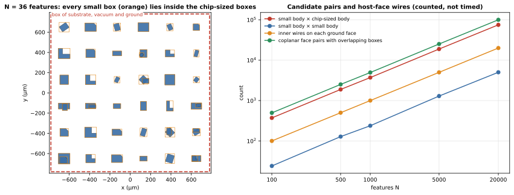
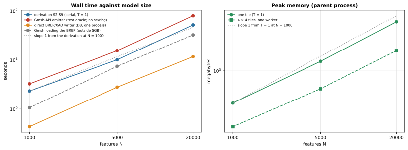
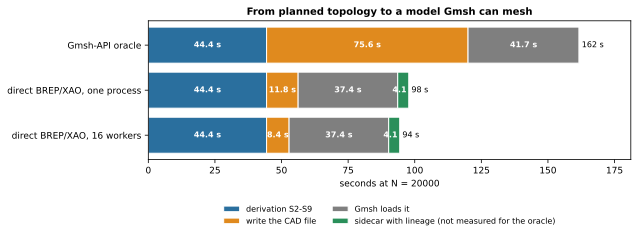

本頁說明 SGB 為什麼在呼叫 CAD kernel **之前**先推導晶片的 topology，而不是為每個 prism 建一個 solid、再請 kernel 一次對全部 solid 做 fragment。讀完之後，你會知道反對全域 fragment 的成本論證、它會遺失哪些 identity，以及規劃後的 pipeline 實際花費多少（來自量測）。

本頁有兩種陳述，標題會把它們分開。

- **論證。** 為什麼 solids-first 的流程預期會很慢並且遺失 identity。它依據 OpenCASCADE（OCCT）Boolean 與 General Fuse 演算法的文件所記載的行為，以及對模型結構的計數。**我們沒有對全域 fragment 做 benchmark**，所以這裡沒有它的任何計時，論證中的不等式也都不是量測值。
- **量測。** 規劃後的 pipeline 實際花費多少，來自原型的 scaling 執行：時間、記憶體，以及 identity 性質，範圍到 $N = 20000$ 個特徵。

## 執行範例的觀點

pad-in-ground 晶片（[總覽](index.qmd#fig-input)）有五個 prism：substrate、vacuum 本體、帶 cutout 的 ground plane、pad，以及 port sheet。若建成 solid，substrate 與 vacuum 本體有整顆晶片那麼大，ground plane 也有整顆晶片那麼大，而且帶孔；pad 很小。在 Route B 的形式中，vacuum 本體涵蓋 $z = 0$ 到 $100$ µm，金屬就在這個範圍內，所以這些 solid 彼此重疊，kernel 必須把金屬從 vacuum 中切掉，而不只是融合相接的 face。

五個本體的情況下，任何做法都瞬間完成。問題是：同一個圖樣在一顆晶片上重複 $N$ 次時會怎樣，這才是真實元件 layout 的樣子。原型的隨機 layout 產生器正是這樣建構的：$N$ 個小特徵（矩形、L 形、倒角形與旋轉形），各自位於同一片 ground plane 的 cutout 中，下面是一個 substrate，上面是一個 vacuum 本體。以下依產生器的 prism 計數：

{#fig-structure fig-alt="左圖：格點上 36 個藍色特徵的俯視圖，每個都在一個橘色 bounding box 內，全部落在一個紅色虛線的晶片大小 box 內。右圖：特徵數 N 從 100 到 20000 的對數-對數圖，有四條直線。三條與 N 成正比：小本體與晶片大小本體的 pair 數、每個 ground face 上的內部 wire 數，以及 coplanar face pair 數。第四條是小本體與小本體的 pair，位置較低。"}



看 @fig-structure 時請注意：橘色的 box 從不超出紅色的 box。**小本體的 box 沒有任何性質能把它與晶片大小的本體分開。** 在 $N = 20000$ 時，有 24 990 個小本體、74 970 組「小本體與晶片大小本體」的 box pair（每個小本體三組），而「兩個小本體」的 pair 只有 4 990 組。ground plane 的頂面與底面各帶有 20 000 個內部 wire。數字在 `figures/why-structure-numbers.json`，由 `_figures/why_structure.py` 計算。

## 一般論證

### 「solids first」是什麼意思

solids-first 流程為每個 prism（或每個材料區域）建一個 CAD solid，然後對全部 solid 執行一次 **General Fuse**（`fragment` 運算）。kernel 會對每一對本體做交集、切割每個 face、合併重合（*same-domain*）的 face，並傳回各個 fragment。之後必須有人判斷哪個 fragment 是哪個表面：哪一個是 pad 的 metal-vacuum 表面，哪一個屬於 port。

SGB 做的剛好相反。它在平面上逐 level 決定這一切，kernel 只負責寫出結果。

### 成本從哪裡來

OCCT 的文件把 General Fuse 演算法描述為：依維度遞增對子形狀（sub-shape）進行一連串的 interference 檢查（vertex-vertex、vertex-edge、edge-edge、vertex-face、edge-face、face-face）、一個切割 face 的部分、same-domain 偵測，以及選用的 history。下面五點是晶片尺度的模型會對這個結構造成壓力的地方。它們是依據文件所述結構的論證，不是量測。

::: {.askr-table-compact}
| # | 文件記載的行為 | 為什麼晶片會碰上它 | 規劃後的 pipeline |
|---|---|---|---|
| 1 | 候選的 sub-shape pair 來自 bounding box（章節「Initialization」），所以篩選的效果取決於 box 有多小。 | 三個本體（substrate、vacuum、ground）的 box 就是整顆晶片。每個小本體都與這三者重疊：每個本體有三組無法剔除的 pair（[@fig-structure]）。 | 一個 level 的 2D arrangement 只接收在該處相遇的曲線；以空間 hash 依位置剔除。 |
| 2 | face 會被建立在其上的 section edge 切割（章節「Build Images for Faces」）。 | ground plane 是單一個 face，兩側各有 $N$ 個內部 wire；每次與它發生 interference，面對的都是邊界有 $N$ 個 loop 的 face。 | 帶孔洞的 cell 是 arrangement 的一個 face，由它的 half-edge 一次建成。 |
| 3 | 重合的 face 會被偵測出來，並共用一個 image（「same domain」；edge 對應章節「Common Blocks」）。 | 每個金屬本體的底面都與 substrate 頂面、vacuum 底面及 ground 底面 coplanar。每個小本體有四組 coplanar 且 box 重疊的 face pair。 | coplanar 的鄰居就是同一個 level arrangement 的 cell；label 相同的 cell 以 dissolution 合併。 |
| 4 | face-face interference 是一般的曲面-曲面求交（章節「Computation Order」）。 | 每個曲面都是平面、垂直 wall 或圓柱 wall。問題是二維的（XY 平面上的曲線）加上 Z；用 3D 求交器來解，動用的機制超過所需。 | 以 exact 整數運算做 planar noding；Z 只透過 level 進入。 |
| 5 | 結果是一組帶有 *history*（`Modified`、`Generated`、`IsDeleted`；章節「General description of the Building Part」）的 fragment。 | 多個輸入可能對應到同一個 image（same-domain），一個輸入也可能對應到多個 fragment。identity 必須沿著 history 或靠幾何來還原。 | 每個輸出實體被建立時，它的來源與 id 就已知；沒有任何東西需要還原。 |
:::

合起來，論證如下。無法剔除的 pair 數量約為 $B \cdot N$（$B$ 為晶片大小本體的個數）。每一組 pair 的成本並不受小本體大小所限，因為對手是一個邊界上有 $N$ 個 wire 的 face。我們不知道前面的常數是多少，所以本頁不做任何計時主張。論證確實顯示的是：模型沒有任何部分對 kernel 而言是局部的；bounding box 篩選這個常用的防線，無法消除佔主導地位的交互作用。

::: {.askr-mermaid-view view-label="檢視圖表"}
```{mermaid}
flowchart TB
  subgraph F["Solids first (the alternative this page argues against)"]
    direction TB
    F1["One solid per prism<br/>N small + B chip-sized"] --> F2["Box prefilter:<br/>B x N pairs not pruned"]
    F2 --> F3["3D face-face<br/>intersection of planes<br/>and cylinders"]
    F3 --> F4["Split host faces<br/>with N inner wires"]
    F4 --> F5["Same-domain merge<br/>of coplanar faces"]
    F5 --> F6["Walk the history to<br/>recover which fragment<br/>came from which input"]
    F6 --> F7["Name by history<br/>or by geometry"]
  end
  subgraph P["Planned (SGB)"]
    direction TB
    P1["Prisms<br/>levels, slabs"] --> P2["Local 2D arrangement<br/>per level and slab"]
    P2 --> P3["Label cells,<br/>dissolve seams"]
    P3 --> P4["Assemble shared<br/>vertices, edges, faces"]
    P4 --> P5["Emit directly,<br/>ids already known"]
  end
```
:::

這張圖是**概念性**的。左側是上面的論證；右側是下面量測的 pipeline。

### 會遺失哪些 identity

fragment 傳回的是幾何。SGB 需要的不只是幾何：對每個表面，還需要 Net、材料配對、inset band 與來源曲線。在 solids-first 流程中，這些事實必須事後還原，而做法只有兩種。

- **靠 history。** 從每個輸入的 sub-shape 沿著 `Modified` 與 `Generated` 追蹤。當兩個輸入對應到同一個 same-domain image 時，答案是模糊的（多個輸入共用一個輸出 face），合併之後還得重新決定 face 的擁有者。
- **靠幾何。** 以座標或面積把 fragment 對應到來源。這正是設計所禁止的：比對容許值是由一個沒有人能審查的數字所做的決定，而且當兩條邊界只相差幾奈米時就會失效。

規劃後的 pipeline 則改成向前傳遞 identity。

::: {.askr-mermaid-view view-label="檢視圖表"}
```{mermaid}
flowchart TB
  subgraph B["Back-tracking (solids first)"]
    direction TB
    b1["Source entity"] --> b2["Solid"] --> b3["Fragment"] --> b4["History or<br/>geometry match"] --> b5["Semantic name"]
  end
  subgraph W["Forward propagation (planned)"]
    direction TB
    w1["Source entity<br/>and curve"] --> w2["Carrier<br/>(lineage recorded)"] --> w3["Atomic edge<br/>(content-hashed id)"] --> w4["Face, volume<br/>(id, label, name)"] --> w5["Written entity<br/>bound to its id by<br/>construction order"]
  end
```
:::

從 solver 實體回到來源的對應，就是把這條鏈反向讀一遍，完全不需要搜尋（見 [Identity](identity.qmd)）。

## 規劃能換來什麼：實測

原型的 scaling 執行建立 Route B 的隨機 layout，特徵數為 $N = 1000, 5000, 20000$，每個都有四個 level，且 ground plane 上每個特徵各有一個孔。模型的 face 數從 12 761 成長到 255 052。以下所有數字都是**計算所得**：來自 `experiments/sgb-redesign/prototype/examples/scaling.py`（`outputs/scaling.json`）以及 `outputs/e3_brep/timing.json` 中 direct writer 的執行；`_figures/why_scaling.py` 負責繪圖。

{#fig-scaling fig-alt="N = 1000、5000、20000 的兩張對數-對數圖。左：四條上升的線，分別是推導、Gmsh API 的 test oracle、direct BREP writer，以及 Gmsh 載入 BREP，並有一條斜率為 1 的虛線參考線。每一條都比參考線稍陡。右：父行程的 peak memory，分別為單一 tile 與 4 × 4 tile，幾乎與斜率為 1 的參考線平行。"}



看 @fig-scaling 時請注意：每一條曲線都靠近斜率為 1 的虛線。$N = 1000$ 到 $5000$ 之間，推導的局部斜率是 1.17；$5000$ 到 $20000$ 之間是 1.14；模型的 face 數斜率為 1.00，peak memory 為 0.89 與 0.98。在這個範圍內，規劃後的 pipeline 對模型大小是**近乎線性**的，時間上只有一點點超線性的額外成長。

::: {.askr-table-compact .askr-table-numeric}
| N | Face 數 | 推導 S2-S9（s） | Gmsh-API oracle 的 emission（s） | direct BREP write，單一行程（s） | direct write，16 個 worker（s） | Gmsh 載入 BREP（s） | Peak RSS，單一 tile（MB） | Peak RSS，4 × 4 tile（MB） |
|---|---|---|---|---|---|---|---|---|
| 1 000 | 12 761 | 1.42 | 2.30 | 0.44 | 0.29 | 1.07 | 324 | 144 |
| 5 000 | 63 664 | 9.34 | 14.57 | 2.80 | 1.94 | 7.47 | 1 358 | 521 |
| 20 000 | 255 052 | 45.17 | 74.22 | 11.76 | 8.66 | 32.59 | 5 272 | 1 929 |
:::

推導、oracle 與記憶體這幾欄來自 `outputs/scaling.json`；direct write 與載入這幾欄來自 `outputs/e3_brep/timing.json` 中另外的執行，所以同一個推導在一次執行中量到 45.2 s，在另一次是 44.4 s。oracle 的時間是**不做** sewing 的 emission，因為這個規模下做 sewing 負擔不起（見下一小節）。Peak memory 指的是父行程的；使用 tile 時，父行程不保留各 tile 的結果。

### Emission 是尾巴

推導完成之後，必須寫出 CAD 檔案，再由 Gmsh 載入。Emission 是循序的，在 $N = 20000$ 時與推導一樣長。逐一呼叫來建立幾何的 Gmsh API，只保留作為**測試用 oracle**；下面的比較就是決策 D8 的證據，D8 讓 direct writer 成為 emission 的路徑。

{#fig-tail fig-alt="三條水平堆疊長條。第一條 Gmsh-API oracle：推導 44.4 秒、寫出 75.6 秒、載入 41.7 秒，合計 162 秒。第二條 direct BREP/XAO（單一行程）：44.4、11.8、37.4 與 4.1 秒（含 sidecar 一段），合計 98 秒。第三條使用 16 個 worker：44.4、8.4、37.4 與 4.1 秒，合計 94 秒。"}



看 @fig-tail 時請注意：

- **透過 Gmsh API**，寫出需要 75.6 s，比推導（44.4 s）還長。原型在 $N = 20000$ 的 profile 把 21.2 s 歸因於 `synchronize`，12.8 s 歸因於建立 plane surface，13.5 s 歸因於寫出 XAO；它們都是循序的，並隨 face 數成長（原型 README，「Emission profile」）。它的 sidecar 時間沒有另外量測。
- **使用 direct BREP/XAO 序列化**，寫出時間降到單一行程 11.8 s、16 個 worker 8.4 s，因為規劃好的階層是以文字寫出，沒有任何東西透過 API 建立。附有 lineage 與 membership 的 sidecar 在 $N = 20000$ 時額外多 4.1 s 與 94 MB（不含 lineage 為 0.65 s；`outputs/e3_brep/sidecar_timing.json`）。
- **載入不屬於 SGB。** Gmsh 解析 255 048 個 face 在 $N = 20000$ 時要 37.4 s，這是 Gmsh 讀取任何格式的下限，而且它和其他一切一樣，隨 face 數成長。

讀這張圖的結論：規劃去除了全域 fragment，並讓推導近乎線性；但在大 $N$ 時，端到端的時間仍由數個循序步驟決定，其中一個還在 SGB 之外：寫出、sidecar 與 Gmsh 載入合計 53 s（單一行程）或 50 s（16 個 worker），相對於 44 s 的推導。平行化無法解決它們（見 [Parallel derivation](parallelism.qmd)）。在原型中，推導本身的加速也最多只有 $N = 5000$ 時的 $1.22\times$ 與 $N = 20000$ 時的 $1.18\times$，這是 CPython 的限制，不是演算法的限制（見[未決的決策](decisions.qmd#d9)）。

### 為什麼不透過 Gmsh API 建立 solid

速度不是 oracle 不作為 emission 路徑的唯一原因。Gmsh API 中的 solid 是由 surface loop 建成的，而 API 無法指定 solid 的**方向**（face 的哪一側是內部）：

- 即使使用 `addSurfaceLoop(sewing=True)`（它能讓 shell 內部互相一致），絕對的方向仍然無法控制。在 $N = 1000$ 個特徵的隨機 layout 中，vacuum 這個 solid 變成內外顛倒，質量為負，而 mesh 仍然可以進行。
- 因此 oracle 對每個 solid 最多嘗試 12 種確定性的 face 順序，並把修不好的記錄下來（oracle sidecar 中的 `inside_out_solids`）。六個固定的測試模型從不需要這個後備方案；隨機 layout 則需要。
- Sewing 不能擴展：一個約 60 000 個 face 的 shell，花了 180 s 與 28 GB。上面 oracle 的時間因此略過 sewing，而此時 solid 的方向也就沒有被檢查。

direct writer 逐 face 明確寫出每一個方向，所以事後沒有任何東西需要修復。資料來源：原型 README 的 phase 3，以及設計簡報中 D8 的證據。

### Identity 性質

Identity 是結果的性質，不是排程的性質。scaling 執行以九種排程建立每個模型：一個 tile 配一個 worker，以及 $4 \times 4$ 與 $8 \times 8$ 個 tile，各搭配 1、8、16、32 個 worker。接著把結果中每個 vertex、edge、face、volume、slab cell、level cell 與 physical group 成員的 id，雜湊成一個 digest。

::: {.askr-table-compact}
| N | 建立的排程數 | 不同的 id digest 數 | Digest | 驗證通過 |
|---|---|---|---|---|
| 1 000 | 9 | **1** | `build:394277f44754d5a5` | 9 個全部 |
| 5 000 | 9 | **1** | `build:4550335d7ad39cd3` | 9 個全部 |
| 20 000 | 9 | **1** | `build:a1305dc586c23466` | 9 個全部 |
:::

::: {.callout-note title="保證：相同輸入得到相同 id"}
在原型的各次執行中，每個實體的 id 在所試過的每一種 tile 配置與 worker 數下都相同。這是依構造而成立的：id 是內容的雜湊（level、格點座標、carrier、label）；edge 的 id 是 H(plane key、排序後的端點 vertex id、排序後的 carrier id 集合)；tile 的切線落在 pixel 欄列之間，所以沒有任何 tile 會產生幾何（見 [Parallel derivation](parallelism.qmd)、[Identity](identity.qmd)）。
:::

solids-first 的 fragment 無法提供這樣的性質：結果中 face 的順序，以及模糊的 face 被歸給哪個輸入，都取決於 kernel 的走訪順序。

## 邊界情況與限制

- **小型模型。** 對於只有幾個 prism 的模型，例如執行範例，兩種做法幾乎不花時間，差別在 identity，不在速度。成本論證要從數百個特徵起才有意義。
- **密集 layout。** scaling 執行使用的特徵間距為 260 µm，各自位於自己的 cutout。更密的 layout（相鄰特徵重疊更多）不在已量測的範圍內。設計預期同樣的近乎線性形狀，但沒有量測過。
- **論證取決於 OCCT 文件記載的結構。** 如果改用結構不同的 kernel（例如穩健、帶索引的 3D Boolean 引擎），這個論證需要針對它重新進行。Identity 的論證則不取決於 kernel。
- **非 prism 的本體**（斜側壁、Z 方向彎曲的橋）在第一版中不在規劃後 pipeline 的範圍內。它們是擴充點，不會被悄悄近似（見[總覽](index.qmd#glossary)）。
- **Python 的限制。** 推導的計時來自 Python 原型，編譯式 kernel 尚未撰寫（D9）。它們呈現的是成本的形狀，不是編譯式實作可以達到的數字。

## 參考資料

- OpenCASCADE Technology，*Boolean Operations* 使用者指南：章節「Computation Order」、「Initialization」、「Build Images for Faces」、「Common Blocks」、「General description of the Building Part」與「Options」（gluing、parallel mode、oriented bounding box）。
  <https://dev.opencascade.org/doc/overview/html/specification__boolean_operations.html>
- Gmsh reference manual，`gmsh.model.occ` API（`fragment`、`synchronize`、`addPhysicalGroup`）。<https://gmsh.info/doc/texinfo/gmsh.html>
- 本頁使用的原型輸出：`outputs/scaling.json`、`outputs/e3_brep/timing.json`、`outputs/e3_brep/sidecar_timing.json`。
