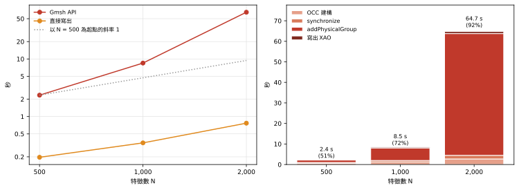
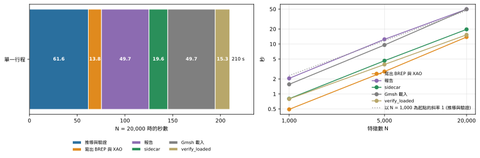

**問題。**direct BREP writer 比透過 Gmsh API 建構同一份幾何快多少？推導完成之後，寫出檔案、報告與 sidecar、在 Gmsh 載入，以及檢查載入後的模型，又各要花多少時間？

**結果。**

- 在 500、1,000 與 2,000 個特徵時，direct writer 需要 0.20 s、0.35 s 與 0.77 s；Gmsh API 需要 2.35 s、8.48 s 與 64.7 s，分別是前者的 12、24 與 84 倍。Gmsh API 在 5,000 個特徵時跑了 10 分鐘仍未完成而被中止，direct writer 只要 2.2 到 2.8 s。
- Gmsh API 建出的 solid 還帶有錯誤的質量正負號（substrate 的質量是負的）。
- 推導之後的其餘路徑，在 20,000 個特徵、單一行程時要 148 s，是推導本身 61.6 s 的兩倍以上；每一步的 scaling 都近乎線性。

## Direct writer 對 Gmsh API

**direct writer** 從推導出的模型規劃 BREP 的 topology，並以文字寫出 BREP 與 XAO 檔案，不透過任何 API 建構。**Gmsh API 建構**是 SGB 測試用來當參考的測試端 builder：它透過 `gmsh.model.occ` 建立每個 entity，執行 synchronize，再以 `addPhysicalGroup` 登錄每個 physical group。兩者處理的是同一批 layout（隨機 layout，Route B，seed 2）。

{#fig-api fig-alt="左：雙對數圖；Gmsh API 的線從 2.35 秒上升到 64.7 秒，比斜率 1 的參考線陡得多，direct writer 的線從 0.20 秒上升到 0.77 秒。右：Gmsh API 時間的堆疊長條；addPhysicalGroup 佔總時間的 51%、72% 與 92%，在最大的長條中占絕大部分。"}

在 @fig-api 中，Gmsh API 的線比參考線陡：它對 N 的局部斜率先是 1.85，再是 2.93，direct writer 的時間則成長得很慢。接手成為主要成本的步驟是 `addPhysicalGroup`，它佔總時間的 51%、72% 與 92%。

::: {.askr-table-compact .askr-table-numeric}

:::

「直接寫出」是以 16 個 worker 規劃並算繪 BREP 與 XAO 的時間；「寫出的 face 數」是寫入 BREP 的 face 數。這些時間來自它們自己的一次執行。下方「推導之後」的表格在 scaling 的那次執行中也量了同一個直接寫出的步驟：1,000 個特徵時，那裡是 0.44 s，這裡是 0.35 s。

### Solid 的質量不對

Gmsh API 的 solid 是由 surface loop 建成的，而 API 不讓呼叫端指定 face 的哪一側是內部。我們重新開啟測試端 builder 建出的 solid，量測它們的質量（有號體積）：

::: {.askr-table-compact .askr-table-numeric}

:::

substrate 的質量是負的，vacuum 為正，兩者都與 direct writer 的 solid 不符。direct writer 的兩個 solid 質量都是正的，其中 substrate 的質量等於晶片面積乘上它的厚度。質量為負的 solid 仍然可以 mesh，所以不檢查就不會發現這個錯誤。direct writer 逐 face 明確寫出每一個方向，載入後的檢查也會把 volume 與規劃比對（見[檢查的成本](validation-cost.qmd)）。

## 推導之後 {#what-follows-the-derivation}

推導完成後，pipeline 會寫出檔案、寫出報告與 sidecar，讓 Gmsh 載入 XAO，再對載入後的模型執行 `verify_loaded`。**sidecar** 是與 BREP、XAO 並存的 JSON 檔，記錄每個 entity 的 lineage 與 group 歸屬。**報告**是與檔案一起寫出的 sliver 報告與 validation 報告。`verify_loaded` 是把載入的 Gmsh 模型與規劃相比對的檢查。

{#fig-tail fig-alt="左：20,000 個特徵時的兩條水平堆疊長條。單一行程：推導 61.6 秒、寫出 13.8、報告 49.7、sidecar 19.6、Gmsh 載入 49.7、verify_loaded 15.3，合計 210 秒。16 個 worker：寫出 9.1 秒，合計 205 秒。右：推導之後五個步驟的雙對數折線，各自靠近斜率 1 的參考線。"}

::: {.askr-table-compact .askr-table-numeric}

:::

在 20,000 個特徵、單一行程時，推導之後的各步驟合計 148 s，推導本身是 61.6 s。從 1,000 到 20,000 個特徵，各步驟的斜率是：寫出 1.08 到 1.15、報告 1.00 到 1.12、sidecar 1.04 到 1.09、Gmsh 載入 1.13 與 1.19、`verify_loaded` 0.99（精確值在圖表旁的 `numbers.json`）。以 16 個 worker 算繪 BREP 與 XAO，把寫出的時間從 13.8 s 縮短為 9.1 s，總時間只差 5 s。

最大的兩個步驟是報告（49.7 s）與 Gmsh 載入（49.7 s）。報告花這麼久，產生的檔案卻很小（12.6 kB 與 4.9 kB）。在 2,000 個特徵時，Gmsh 載入 Gmsh API 寫出的 XAO 要 3.46 s，載入 direct writer 的要 3.06 s，所以寫出者讓載入時間差約 13%，遠小於模型大小造成的差異：

::: {.askr-table-compact .askr-table-numeric}

:::

## 檔案與整條路徑的記憶體

::: {.askr-table-compact .askr-table-numeric}

:::

每個尺寸下，sidecar 都比 BREP 大（20,000 個特徵時是 232 MB 對 190 MB）。「寫出的 face 數」是 BREP 檔中的 face 數。最後一欄是同一個行程建構模型、寫出檔案、在 Gmsh 載入 XAO 並執行 `verify_loaded` 的 peak memory：20,000 個特徵時是 7.6 GB，只建構時是 2.0 GB（見[隨晶片大小的 scaling](scaling.qmd)）。

## 解讀

直接寫出幾何，去除了 Gmsh API 路徑中成長得比線性快的部分。推導之後剩下的是一串近乎線性的步驟，其中最大的兩個，報告與 Gmsh 載入，與推導無關，平行推導也無法縮短它們；對整條路徑的影響見[平行推導](parallelism.qmd#end-to-end)。
