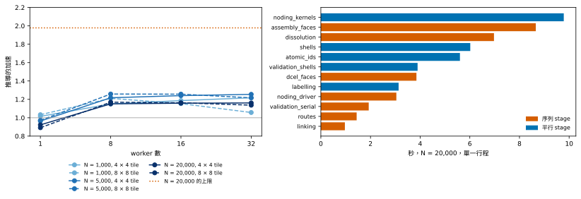

**問題。**推導可以切成 tile，由多個 worker 執行。這樣做能得到什麼、受什麼限制、有必要嗎？

**結果。**推導的最佳加速在 1,000 個特徵時是 1.22 倍，5,000 個特徵時是 1.26 倍，20,000 個特徵時是 1.17 倍。在 20,000 個特徵時，從推導到載入並檢查完畢的整條路徑，同一種排程只省了 209.8 s 中的 8.9 s，也就是 1.04 倍。推導時間約有一半在序列 stage，所以依目前的分解，推導本身最多只能到 1.98 倍。tile 沒有降低 parent process 的記憶體。九種排程在每個尺寸下都得到相同的 identity digest，也都通過驗證。

**結論。**序列推導已經足夠。20,000 個特徵時它只要 61.6 s，而且近乎線性地 scaling（見[隨晶片大小的 scaling](scaling.qmd)）；路徑其餘的時間大多不是推導（見 [Direct writer 與 Gmsh 載入](emission-and-load.qmd)）；平行化對這兩者都沒有影響。平行加速不是這個設計的目標。

## 排程

**tile** 是模型 pixel grid 上的一塊矩形；模型被切成 T × T 個 tile，每個 tile 各自推導成一個 job。**worker** 是執行 job 的 process。推導在九種排程下量測：一個 tile，以及 4 × 4 或 8 × 8 個 tile，各搭配 1、8、16 與 32 個 worker，機器有 64 個硬體執行緒。一個 tile 的執行是基準；**加速**是基準的推導時間除以該排程的時間。推導的 21 個 stage 中有六個平行執行，其餘一律序列執行。

::: {.askr-table-compact .askr-table-numeric}

:::

每格是推導與驗證的時間，括號內是加速。

## 加速

{#fig-parallel fig-alt="左：三種尺寸、兩種 tile 數的加速對 1、8、16、32 個 worker 的折線，全都在 0.9 到 1.3 之間，8 個 worker 之後趨於平坦，遠低於約 1.98 的點線。右：stage 時間的水平長條；noding_kernels 約 9.8 秒、assembly_faces 8.7、dissolution 7.0、shells 6.0、atomic_ids 5.6，其餘更短。"}

在 @fig-parallel 中，加速在 8 個 worker 時達到水準，再增加 worker 也沒有上升。20,000 個特徵、4 × 4 tile 時，8 個 worker 的 build 是 53.6 s，16 個是 53.2 s，32 個是 53.1 s。只有一個 worker 時，tile 反而讓 build 比基準慢：20,000 個特徵時是 0.89 到 0.92 倍。

## 序列比例

推導在單一行程中執行時，序列 stage 約佔所有 stage 時間的一半。依 Amdahl 定律，即使 worker 數不受限制，整個推導的加速也不會超過「總時間除以序列時間」。

::: {.askr-table-compact .askr-table-numeric}

:::

20,000 個特徵時，上限是 1.98 倍，實測最佳加速是 1.17 倍。有 worker 時，序列 stage 會略為變長（單一行程 29.7 s，有 worker 時 32.0 到 32.7 s）。

20,000 個特徵時最花時間的 stage，單一行程，以及 4 × 4 tile、16 個 worker 的對照：

::: {.askr-table-compact .askr-table-numeric}

:::

最長的四個序列 stage 合計 22.5 s，佔所有 stage 時間的 38%，而且它們都沒有因 worker 而變快。平行 stage 的收益不均：最長的 `noding_kernels` 是 1.61 倍，`shells` 是 1.17 倍，`atomic_ids` 是 3.31 倍。這些量測指出哪些 stage 沒有變快，但沒有說明原因。

## 記憶體 {#memory}

::: {.askr-table-compact .askr-table-numeric}

:::

表中是 parent process 的 peak memory（MB）。20,000 個特徵時，tile 搭配單一 worker 與基準相當（1,975 到 1,979 MB 對 2,000 MB），tile 搭配多個 worker 則高出 10% 到 12%（2,207 到 2,233 MB）。同一尺寸下，worker 自己的 peak 是 2,001 到 2,030 MB。worker 的 peak 包含與 parent 共用的記憶體，所以不能相加成整台機器的用量。

## 端到端 {#end-to-end}

20,000 個特徵時，單一行程從推導出的模型到載入並檢查完畢的模型，整條路徑要 209.8 s：推導 61.6 s，其後的所有步驟 148.1 s。最佳的推導排程（8 × 8 tile、8 個 worker，52.7 s）使路徑變成 200.8 s，只快 1.04 倍。如果推導達到序列 stage 決定的上限，路徑是 179 s，快 1.17 倍。推導之後的步驟（寫出、報告、sidecar、Gmsh 載入與載入後的檢查）不屬於推導，所以推導的 tile 與 worker 改變不了它們；writer 另有自己的 worker 設定，在這個尺寸省下 4.7 s。這些步驟列在 [Direct writer 與 Gmsh 載入](emission-and-load.qmd#what-follows-the-derivation)。

## 解讀

平行推導對推導最多帶來 1.26 倍，對整條路徑只有 1.04 倍。推導有一半是序列的，而且在 20,000 個特徵時，推導只占 209.8 s 路徑中的 61.6 s。序列推導已經近乎線性地 scaling，在這個尺寸只要一分鐘左右，所以設計不依賴平行加速，這份研究也不追求它。worker 超過 8 個之後 build 沒有再變短；量測沒有說明原因，所以也無法說其他的 tile 排法或不同的分解是否會做得更好。
