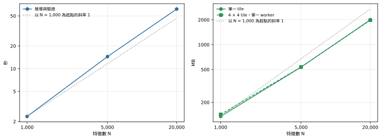

**問題。**晶片上的特徵變多時，建構要多花多少時間、多少記憶體？

**結果。**時間近乎線性成長：特徵數從 1,000 增加到 20,000，推導與驗證分別花 2.33 s、14.5 s 與 61.6 s，相鄰尺寸之間的局部斜率先是 1.13，再是 1.05。模型大小（face 數）的斜率是 1.01 與 0.99，peak memory 的斜率是 0.85 與 0.95。所有數字都針對[總覽](index.qmd#what-was-measured)與[重現方式](reproduction.qmd#layouts)所述、只含多邊形的隨機 layout。

## 名詞

- **特徵（feature）**：放在晶片上、位於自己 ground plane cutout 內的一個小形狀（矩形、L 形、倒角形或旋轉形）。**N** 是特徵數。約四分之一的特徵另帶一個同一 Net、彼此重疊的形狀。
- **推導與驗證**：建構步驟 `build_model_from_catalogue`。它先從 prism 推導 conformal topology（相鄰材料共用的 vertex、edge、face 與 volume），再執行結構檢查；production 中這些檢查不能關閉。檢查本身的成本見[檢查的成本](validation-cost.qmd)。
- **Face**：推導出的模型的一個邊界曲面。face 數就是模型的大小。
- **局部斜率**：兩個相鄰量測點在雙對數座標上連線的斜率，即 `ln(y2 / y1) / ln(N2 / N1)`。斜率 1 代表時間與 N 成正比，斜率 2 代表時間與 N 的平方成正比。

## 時間與記憶體對 N

{#fig-scaling fig-alt="N = 1,000、5,000、20,000 的兩張雙對數圖。左：推導與驗證時間從 2.3 秒上升到 61.6 秒，略比斜率 1 的虛線參考線陡。右：單一 tile 與 4 × 4 tile 的 peak memory 從 135 MB 上升到 2,000 MB，略比參考線平緩。"}

在 @fig-scaling 中，時間曲線略高於斜率 1 的虛線，記憶體曲線略低於它。

::: {.askr-table-compact .askr-table-numeric}

:::

*Peak RSS* 是建構完成時，建構行程的最大常駐記憶體。「每個 face」是時間除以 face 數；特徵數增加 20 倍時，它從 164 µs 升到 216 µs。

::: {.askr-table-compact .askr-table-numeric}

:::

## 解讀

在量測範圍內，建構時間與模型大小近乎線性。從 1,000 到 5,000、再從 5,000 到 20,000 個特徵，每一步時間的倍數都略大於尺寸的倍數，所以整個範圍內每個 face 的成本上升約三分之一。量測沒有超過 20,000 個特徵，因此趨勢不外推到更大的尺寸。

記憶體的成長比模型略慢。把推導切成 4 × 4 個 tile，並沒有改變 parent process 的 peak memory（見[平行推導](parallelism.qmd#memory)）。

推導之後發生什麼事、要花多少時間，見 [Direct writer 與 Gmsh 載入](emission-and-load.qmd)。
