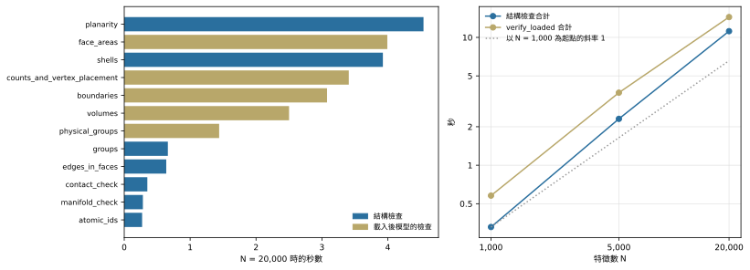

**問題。**建構會檢查自己的輸出。這些檢查要花多少時間？成本成長得比模型快嗎？

**結果。**

- 結構檢查在 1,000、5,000 與 20,000 個特徵時分別花 0.33 s、2.31 s 與 11.2 s，是同一次執行中建構時間的 16% 到 19%。它們的總時間對 face 數的 scaling 斜率先是 1.20，再是 1.14。
- 載入後的 Gmsh 模型檢查 `verify_loaded` 分別花 0.58 s、3.70 s 與 14.4 s。
- 個別檢查的斜率在 0.89 到 1.35 之間；在最大尺寸時超過 0.1 s 的檢查，斜率在 1.00 到 1.35 之間。
- OCCT 檢查只在小型測試模型上執行，花 6.2 到 259.2 ms。它們沒有在 1,000 個特徵以上的模型上量測，所以 scaling 未知。

## 三組檢查

- **結構檢查**在建構期間、寫出任何東西之前，對推導出的模型執行：planarity、每個 shell 的 face、group 歸屬、identifier 的唯一性、面積守恆等（下方表格列出全部）。production 中它們不能關閉。
- **載入後的模型檢查**（`verify_loaded`）在 Gmsh 開啟 XAO 檔之後執行，把 Gmsh 模型與規劃相比對：元素數、vertex 位置、邊界、physical group、volume 與 face 面積。
- **OCCT 檢查**是 OpenCASCADE 的分析器（`BRepCheck_Analyzer`、`BOPAlgo_ArgumentAnalyzer`、`ShapeAnalysis`），對寫出的 BREP 與 XAO 檔案執行，並把面積與 volume 和規劃相比對。

## 結構檢查與載入後的模型檢查

三個尺寸各用一次執行量得：建構模型、寫出檔案、在 Gmsh 開啟 XAO，再執行 `verify_loaded`。

::: {.askr-table-compact .askr-table-numeric}

:::

{#fig-validation fig-alt="左：20,000 個特徵時十二項檢查的水平長條。planarity 最長，約 4.5 秒，其次是 face_areas、shells、counts_and_vertex_placement 與 boundaries，各約 3 到 4 秒；其餘都在 1.5 秒以下。右：雙對數折線，結構檢查總時間從 0.33 秒上升到 11.2 秒，載入後模型檢查總時間從 0.58 秒上升到 14.4 秒，兩者都靠近斜率 1 的參考線。"}

在 @fig-validation 中，最花時間的五項檢查（`planarity`、`face_areas`、`shells`、`counts_and_vertex_placement` 與 `boundaries`）在 20,000 個特徵時各花 3.1 到 4.5 s，其中三項在載入後的模型上執行。全部十九項檢查如下，斜率欄是最小與最大尺寸之間，對 face 數 F 的斜率：

::: {.askr-table-compact .askr-table-numeric}

:::

多數檢查對每個 vertex、edge 或 face 各走訪一次，斜率都接近 1。斜率最高的是 `counts_and_vertex_placement`（1.35）、`groups`（1.25）與 `shells`（1.24）；最低的是 `arcs`（0.89），它檢查 arc edge，而這些 layout 沒有 arc edge 可檢查。scaling 執行中另有一組十二項結構檢查的計時，與這裡相符：5,000 與 20,000 個特徵時差在 1.3% 以內，1,000 個特徵時差 8%。

## OCCT 檢查

OCCT 檢查在 SGB 測試套件的測試模型上執行，這些模型都很小：測試 catalogue 的 23 個 fixture（63 種組合，其中 54 種建得出來），以及 SGB 設計的七個範例模型（Route A、B、C 下的 pad-in-ground，各有與沒有 band，加上一個 airbridge）；範例模型以 BREP 與 XAO 兩種格式檢查。

::: {.askr-table-compact .askr-table-numeric}

:::

每個範圍是該組報告中最短到最長的時間。範例模型的 14 份報告全部通過，face 面積對規劃的最大相對誤差是 1.3e-12。這些模型都很小（Route B 的 pad-in-ground 有 35 個 face，本研究最小的 layout 有 14,215 個），所以此表只說明成本的量級（數毫秒到四分之一秒），沒有說明它如何成長。

## 解讀

這些檢查沒有改變 scaling 的形狀：結構檢查的總時間斜率約 1.15，與它所屬的推導相近（見[隨晶片大小的 scaling](scaling.qmd)），並且維持在建構時間的約五分之一。載入後的模型檢查比結構檢查略貴，屬於推導之後那一段（見 [Direct writer 與 Gmsh 載入](emission-and-load.qmd#what-follows-the-derivation)）。OCCT 檢查在晶片尺度上的成本，是尚待量測的項目。
